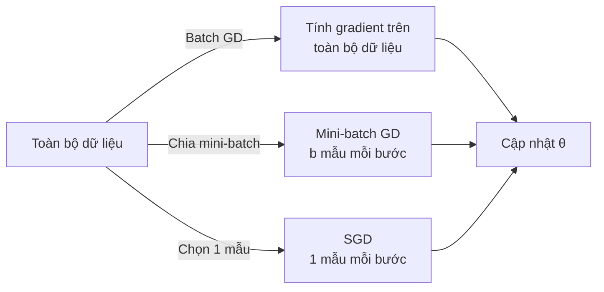

# 4. Hồi quy phi tuyến tính & Gradient Descent

[⬅ Trước: Hồi quy tuyến tính đa biến](03_hoi_quy_tuyen_tinh_da_bien.md) · [Mục lục](README.md) · [Tiếp: Đánh giá mô hình ➡](05_danh_gia_mo_hinh_du_bao.md)

---

## 4.1. Hồi quy phi tuyến tính là gì?

Mối quan hệ giữa biến phụ thuộc và các biến độc lập là **phi tuyến tính**. Sự thay đổi của $Y$ phụ thuộc vào sự thay đổi của các **tham số**, không nhất thiết chỉ phụ thuộc tuyến tính vào $X$:

$$Y = f(X, \beta) + \varepsilon \qquad (21)$$

- $f(X, \beta)$: hàm phi tuyến
- $X$: vector các biến độc lập
- $\beta$: vector tham số mà mô hình ước tính; xác định hình dạng và đặc điểm của $f$
- $\varepsilon$: sai số

**Hai loại chính trong học máy:**

| Loại | Đặc điểm | Ví dụ |
|------|----------|-------|
| **Tham số** (*Parametric*) | Giả định mối quan hệ có thể mô hình bằng một hàm toán học cụ thể | Polynomial, Logistic, Exponential, Power, Logarithmic |
| **Phi tham số** (*Non-parametric*) | Không giả định dạng hàm cụ thể; dùng giải thuật để học từ dữ liệu | Kernel smoothing, Local polynomial, Nearest neighbor |

---

## 4.2. Các loại hồi quy phi tuyến tính phổ biến

### 4.2.1. Hồi quy Đa thức (Polynomial Regression)

$$Y = \beta_0 + \beta_1 X + \beta_2 X^2 + \dots + \beta_n X^n \qquad (22)$$

- Dùng hàm đa thức bậc $n$ để mô hình hoá quan hệ phức tạp giữa các biến.
- Tăng dần bậc $n$ để tạo đường cong khớp với dữ liệu.
- **Ví dụ:** dự đoán chiều cao của cây theo độ tuổi. Mối quan hệ có thể có dạng parabol (bậc 2).

> 💡 Dù $X^2, X^3, \dots$ là phi tuyến theo $X$, mô hình vẫn **tuyến tính theo tham số** $\beta$. Vì vậy có thể giải bằng OLS như hồi quy tuyến tính (bằng cách đặt $X_2 = X^2, X_3 = X^3, \dots$).

### 4.2.2. Hồi quy Mũ (Exponential Regression)

$$Y = \alpha\, e^{\beta x} + \varepsilon \qquad (23)$$

- Mô hình hoá các mối quan hệ có **tăng trưởng hoặc suy giảm nhanh theo cấp số nhân**.
- **Ví dụ:** sự tăng trưởng dân số, sự phân rã phóng xạ, lây lan dịch bệnh.
- Tuyến tính hoá bằng cách lấy logarit: $\ln Y = \ln\alpha + \beta x$.

### 4.2.3. Hồi quy Logarit (Logarithmic Regression)

$$Y = \alpha + \beta\,\log(x) \qquad (24)$$

- Dùng khi mối quan hệ có dạng **thay đổi chậm dần theo thời gian**: tăng nhanh ban đầu rồi bão hoà.
- **Ví dụ:** mối quan hệ giữa chi tiêu quảng cáo và doanh thu. Ban đầu tăng chi tiêu quảng cáo làm doanh thu tăng mạnh, nhưng sau một điểm nào đó mức tăng trưởng giảm dần.

### 4.2.4. Hồi quy Lũy thừa (Power Regression)

$$Y = \alpha\, x^\beta + \varepsilon \qquad (25)$$

- Dùng khi biến phụ thuộc tăng/giảm theo **một lũy thừa cụ thể** của $x$, không theo cấp số nhân.
- **Ví dụ:** mối quan hệ giữa diện tích và dân số; tốc độ dòng chảy và diện tích đáy sông.
- Tuyến tính hoá bằng cách lấy logarit: $\ln Y = \ln\alpha + \beta\ln x$.

### Tóm tắt và so sánh

| Mô hình | Công thức | Hình dạng đường cong | Tuyến tính hoá |
|---------|-----------|----------------------|----------------|
| Đa thức | $\beta_0 + \beta_1 x + \dots + \beta_n x^n$ | Đa dạng (parabola, ...) | Không cần (OLS trực tiếp) |
| Mũ | $\alpha e^{\beta x}$ | Tăng/giảm theo cấp số nhân | $\ln Y = \ln\alpha + \beta x$ |
| Logarit | $\alpha + \beta\log x$ | Tăng nhanh rồi chậm dần | Đặt $z = \log x$ |
| Lũy thừa | $\alpha x^\beta$ | Tăng/giảm dạng lũy thừa | $\ln Y = \ln\alpha + \beta\ln x$ |

---

## 4.3. Tối ưu hoá mô hình bằng Gradient Descent (GD)

### Tại sao cần Gradient Descent?
- Khi không có công thức phân tích trực tiếp (hồi quy phi tuyến phức tạp, mạng nơ-ron).
- Khi dữ liệu quá lớn để giải hệ phương trình chuẩn.
- Phổ biến trong các thư viện học máy: **scikit-learn, TensorFlow, Keras, PyTorch, ...**

### Hàm chi phí MSE

$$MSE = J(\theta) = \frac{1}{n}\sum_{i=1}^{n}\left(Y_i - \hat{Y}_i\right)^2 \qquad (26)$$

- $\hat{Y}$: giá trị dự đoán; $Y$: giá trị thực tế; $n$: số mẫu.
- **Mục tiêu:** tối thiểu hoá $J(\theta)$ bằng cách thay đổi bộ tham số $\theta = (\theta_0, \theta_1, \dots)$.

### Gradient

- **Gradient** là đạo hàm của hàm chi phí theo từng tham số. Nó cho biết "hướng" mà hàm chi phí thay đổi nhanh nhất tại một điểm.
- Nếu hàm chi phí có nhiều tham số, gradient là **vector** chứa đạo hàm theo tất cả các tham số.

### Công thức cập nhật tham số

$$\theta_j = \theta_j - \eta\,\frac{\partial J(\theta)}{\partial \theta_j} \qquad (27)$$

- $\theta_j$: tham số thứ $j$ của mô hình
- $\eta$: **tốc độ học** (*learning rate*), hệ số điều chỉnh độ lớn mỗi bước nhảy
- $\dfrac{\partial J(\theta)}{\partial \theta_j}$: đạo hàm của hàm chi phí theo $\theta_j$

GD di chuyển **ngược hướng gradient** vì muốn đi về phía giảm hàm chi phí.

### Thuật toán Gradient Descent

| Bước | Nội dung |
|------|----------|
| **1** | **Khởi tạo tham số:** ngẫu nhiên cho $\theta_j$ |
| **2** | **Tính hàm chi phí:** tính MSE với tham số hiện tại |
| **3** | **Tính gradient:** đạo hàm của hàm chi phí theo từng tham số |
| **4** | **Cập nhật tham số:** $\theta_j = \theta_j - \eta\,\dfrac{\partial J}{\partial \theta_j}$ |
| **5** | **Kiểm tra hội tụ:** dừng nếu hàm chi phí thay đổi dưới ngưỡng, hoặc vượt số vòng lặp tối đa; ngược lại quay lại bước 2 |

---

## 4.4. Learning rate $\eta$

Learning rate ảnh hưởng quan trọng đến hiệu quả và sự hội tụ của thuật toán:

| Tình huống | Hệ quả |
|------------|--------|
| $\eta$ **quá lớn** | Bước nhảy lớn, hội tụ nhanh, nhưng có thể vượt qua điểm tối ưu hoặc dao động không hội tụ |
| $\eta$ **quá nhỏ** | Bước nhảy nhỏ, chắc chắn hướng đúng, nhưng học rất chậm |
| $\eta$ **phù hợp** | Hội tụ ổn định về điểm tối ưu |

> 💡 Thường chọn $\eta$ theo kinh nghiệm, bắt đầu với $0.001$, $0.01$, $0.1$ rồi điều chỉnh. Có thể dùng **learning rate scheduler** để giảm dần $\eta$ theo thời gian.

---

## 4.5. Ba chế độ Gradient Descent

| | Stochastic GD (SGD) | Batch GD | Mini-batch GD |
|---|---|---|---|
| **Dữ liệu mỗi bước** | 1 mẫu ngẫu nhiên | Toàn bộ tập train | Một mini-batch ($b$ mẫu) |
| **Tốc độ cập nhật** | Nhanh | Chậm (nếu dữ liệu lớn) | Trung bình |
| **Độ chính xác gradient** | Nhiễu, không ổn định | Chính xác | Cân bằng |
| **Local minimum** | Dễ vượt qua (nhờ nhiễu) | Có thể bị kẹt | Hạn chế được |
| **Phù hợp** | Dữ liệu rất lớn | Dữ liệu nhỏ | Hầu hết trường hợp (thực tế) |



> 💡 **Thực tế**, hầu hết các thư viện deep learning (PyTorch, TensorFlow) mặc định dùng **Mini-batch GD** với batch size = 32 hoặc 64.

---

## 💻 Minh họa Python

```python
import numpy as np
import matplotlib.pyplot as plt
from sklearn.preprocessing import PolynomialFeatures
from sklearn.linear_model import LinearRegression
from sklearn.pipeline import make_pipeline

# ---- 1. Hồi quy đa thức ----
np.random.seed(42)
x = np.linspace(0, 10, 50)
y = 2 + 0.5*x**2 - 0.1*x**3 + np.random.randn(50)*3

for degree in [1, 2, 3]:
    model = make_pipeline(PolynomialFeatures(degree), LinearRegression())
    model.fit(x.reshape(-1, 1), y)
    print(f"Bậc {degree}: R² = {model.score(x.reshape(-1,1), y):.4f}")

# ---- 2. Gradient Descent thủ công (đơn biến) ----
x_data = np.array([2., 3., 4., 5., 6.])
y_data = np.array([3., 6., 10., 12., 14.])
n = len(x_data)

theta0, theta1 = 0.0, 0.0   # khởi tạo
eta = 0.01                   # learning rate
epochs = 2000
losses = []

for _ in range(epochs):
    y_hat = theta0 + theta1 * x_data
    loss = np.mean((y_data - y_hat) ** 2)
    losses.append(loss)
    grad0 = -2/n * np.sum(y_data - y_hat)
    grad1 = -2/n * np.sum((y_data - y_hat) * x_data)
    theta0 -= eta * grad0
    theta1 -= eta * grad1

print(f"theta0={theta0:.4f}, theta1={theta1:.4f}, final MSE={losses[-1]:.4f}")

# Mini-batch GD
def mini_batch_gd(X, y, batch_size=2, lr=0.01, epochs=500):
    n, m = X.shape
    theta = np.zeros(m)
    for _ in range(epochs):
        idx = np.random.permutation(n)
        for start in range(0, n, batch_size):
            Xb = X[idx[start:start+batch_size]]
            yb = y[idx[start:start+batch_size]]
            grad = -2 * Xb.T @ (yb - Xb @ theta) / len(yb)
            theta -= lr * grad
    return theta

X_mb = np.column_stack([np.ones(5), x_data])
print("Mini-batch GD:", mini_batch_gd(X_mb, y_data).round(4))
```

---

[⬅ Trước: Hồi quy tuyến tính đa biến](03_hoi_quy_tuyen_tinh_da_bien.md) · [Mục lục](README.md) · [Tiếp: Đánh giá mô hình ➡](05_danh_gia_mo_hinh_du_bao.md)
