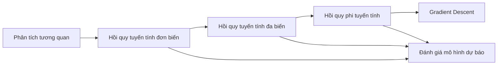

# Chương 3: Phân tích hồi quy

> Tài liệu tóm tắt từ bài giảng **Phân tích dữ liệu kinh doanh – IS403**
> ThS. Dương Phi Long – Khoa Hệ thống Thông tin, Trường ĐH Công nghệ Thông tin (UIT)

## Nội dung chuyên đề

| # | Chuyên đề | Nội dung chính |
|---|-----------|----------------|
| 1 | [Giới thiệu về hồi quy](01_gioi_thieu_hoi_quy.md) | Phân tích tương quan (Chi-square, Pearson), mô hình hồi quy, phân loại hồi quy |
| 2 | [Hồi quy tuyến tính đơn biến](02_hoi_quy_tuyen_tinh_don_bien.md) | SSE, phương pháp bình phương tối thiểu, 3 cách tính $\beta_0, \beta_1$ |
| 3 | [Hồi quy tuyến tính đa biến](03_hoi_quy_tuyen_tinh_da_bien.md) | Hệ phương trình chuẩn, công thức ma trận $(X^TX)^{-1}X^TY$, VD3 |
| 4 | [Hồi quy phi tuyến tính & Gradient Descent](04_hoi_quy_phi_tuyen_gradient_descent.md) | Polynomial, Exponential, Logarithmic, Power; GD, learning rate, SGD / Batch / Mini-batch |
| 5 | [Đánh giá mô hình dự báo](05_danh_gia_mo_hinh_du_bao.md) | SAE, MAE, MAPE, SSE, MSE, RMSE, MSLE, RMSLE, RRSE, RAE, $R^2$, Adjusted $R^2$ + bài tập tổng hợp |

## Lộ trình học gợi ý

## Tổng kết chương

1. **Giới thiệu về hồi quy**: phân tích tương quan, hồi quy và mô hình hồi quy, phân loại hồi quy.
2. **Hồi quy tuyến tính đơn biến** và **Hồi quy tuyến tính đa biến**.
3. **Hồi quy phi tuyến tính**: các loại hồi quy phi tuyến, tối ưu hóa mô hình bằng Gradient Descent.
4. **Đánh giá mô hình dự báo**: các tiêu chí dựa trên sai số tuyệt đối, bình phương sai số và R-squared.

## Tài liệu tham khảo

1. Nguyễn Đình Thuân, *Giáo trình Phân tích dữ liệu kinh doanh*, NXB ĐHQG-HCM, 2024.
2. James R. Evans, *Business Analytics: Methods, Models, and Decisions*, 3rd Edition, Prentice Hall, 2019.
3. Aileen Nielsen, *Practical Time Series Analysis: Prediction with Statistics and Machine Learning*, O'Reilly Media, 2020.
4. Peter Bruce, Andrew Bruce, Peter Gedeck, *Practical Statistics for Data Scientists: 50+ Essential Concepts Using R and Python*, O'Reilly Media, 2020.

Dữ liệu thực hành: [Kaggle](https://www.kaggle.com/) · [UCI Repository](http://archive.ics.uci.edu/)
