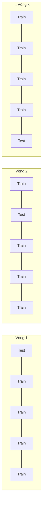

# 4. Đánh giá mô hình dự đoán

[⬅ Trước: Hồi quy Logistic đa lớp](03_hoi_quy_logistic_da_lop.md) · [Mục lục](README.md)

---

## 4.1. Nguyên tắc đánh giá mô hình

- Đánh giá trên **tập validation/test** đã gắn nhãn, **không dùng tập train**.
- Sử dụng các **độ đo đánh giá** (evaluation metrics).
- Sử dụng các **phương pháp ước tính độ chính xác**:
  - Cross-validation
  - Bootstrap
  - Comparing classifiers
  - Confidence intervals
  - Cost-benefit analysis và ROC Curves

### Training – Validation – Testing set
| Tập | Vai trò |
|-----|---------|
| **Training set** | Tập con dữ liệu dùng để **huấn luyện** mô hình |
| **Validation set** | Tập trung gian trong quá trình phát triển mô hình, dùng để **tinh chỉnh siêu tham số** (hyper-parameter) |
| **Testing set** | Tập dùng để **đánh giá hiệu năng** của mô hình đã huấn luyện trên dữ liệu chưa từng thấy, mô phỏng dữ liệu thực tế |

---

## 4.2. Classifier Evaluation Metrics

Các độ đo này tập trung vào **khả năng dự đoán** của mô hình, không phải tốc độ phân lớp, tốc độ xây dựng mô hình hay khả năng mở rộng.

### 4.2.1. Confusion Matrix (Ma trận nhầm lẫn)
Với $m$ lớp, $CM_{i,j}$ là số bộ thuộc **lớp thực tế $i$** được dự đoán là **lớp $j$**.

| Thực tế \ Dự đoán | $C_1$ (Positive) | $\neg C_1$ (Negative) | Tổng |
|---|---|---|---|
| $C_1$ | **TP** (True Positive) | **FN** (False Negative) | P |
| $\neg C_1$ | **FP** (False Positive) | **TN** (True Negative) | N |
| **Tổng** | P' | N' | All |

> 🧩 **Mẹo đọc tên "3 giây không bao giờ nhầm":**
> Tách tên gọi thành 2 từ và đọc từ **phải qua trái**:
> 1. **Từ thứ 2 (`Positive` / `Negative`)**: Mô hình **đoán** là gì? (`Positive` = Có / Dương tính; `Negative` = Không / Âm tính).
> 2. **Từ thứ 1 (`True` / `False`)**: Lời đoán đó **đúng hay sai** so với thực tế?
>
> - **TP (True Positive)**: Đoán là *Positive*, và thực tế đoán **ĐÚNG** → Thật sự là Positive.
> - **TN (True Negative)**: Đoán là *Negative*, và thực tế đoán **ĐÚNG** → Thật sự là Negative.
> - **FP (False Positive)**: Đoán là *Positive*, nhưng đoán **SAI** → Thực tế là Negative (báo có nhưng không có).
> - **FN (False Negative)**: Đoán là *Negative*, nhưng đoán **SAI** → Thực tế là Positive (báo không nhưng có thật).

#### 🎭 Ẩn dụ đời thường để "nhìn một lần là nhớ"

Để không bao giờ bị rối giữa 4 khái niệm này, hãy nhớ 2 câu chuyện kinh điển sau:

##### 1. Câu chuyện "Chiếc chuông báo cháy tòa nhà" 🚨
*Mô hình là chiếc chuông báo cháy. Positive = Chuông reo (Báo cháy); Negative = Chuông im lặng (Bình thường).*

* **TP (Bắt đúng giặc):** Tòa nhà có cháy thật → Chuông reo ing ỏi → Cả tòa nhà sơ tán kịp thời.
* **TN (Bình yên):** Không có cháy → Chuông im ắng → Mọi người ngủ ngon giấc.
* **FP (Báo động giả – False Alarm):** Không hề có cháy (chỉ là khói nấu ăn hoặc ai thắp nhang) → Chuông rú ầm ĩ → Cả tòa nhà hoảng loạn chạy xuống sân lúc nửa đêm. *Hậu quả: Phiền toái, tốn công sức, mất niềm tin vào chuông.*
* **FN (Bỏ sót thảm họa):** Tòa nhà **đang bốc cháy dữ dội** → Chuông **im re** → Mọi người không hề hay biết để thoát thân. *Hậu quả: Thảm họa chết người!*

##### 2. Câu chuyện "Bác sĩ chẩn đoán bệnh / mang thai" 👨‍⚕️
*Positive = Có bệnh (hoặc Mang thai); Negative = Bình thường (Không bệnh).*

* **TP**: Bạn thật sự có bệnh → Bác sĩ phát hiện ra bệnh → Kịp thời chữa trị.
* **TN**: Bạn hoàn toàn khỏe mạnh → Bác sĩ kết luận bình thường → Vui vẻ về nhà.
* **FP (Sai lầm loại I – Type I Error):** Bác sĩ nhìn vào một... người đàn ông và phán: *"Chúc mừng, anh đã có thai!"* → Báo động nhầm. Bạn đi xét nghiệm lại tốn tiền, nhưng sức khỏe không sao.
* **FN (Sai lầm loại II – Type II Error):** Bệnh nhân đang có khối u nguy hiểm → Bác sĩ phán: *"Anh khỏe re, về ăn ngủ bình thường đi!"* → Bỏ sót bệnh, bệnh nhân mất đi giai đoạn vàng điều trị.

> 💡 **Bài học rút ra (Cầu nối sang Precision & Recall):**
> - Trong bài toán an toàn / y tế: **FN nguy hiểm hơn FP rất nhiều** (thà đi sơ tán nhầm vì FP, còn hơn thiệt mạng vì FN). Khi muốn **triệt tiêu FN (không bỏ sót)** → Cần tối ưu **Recall** (Sensitivity).
> - Trong bài toán lọc email spam / phê duyệt vay: **FP khó chịu hơn** (không ai muốn thư đối tác quan trọng bị ném vào hòm rác). Khi muốn **triệt tiêu FP (đoán cái nào chắc cái đó)** → Cần tối ưu **Precision**.

### 4.2.2. Accuracy, Error Rate, Sensitivity, Specificity

| Độ đo | Công thức | Ý nghĩa |
|-------|-----------|---------|
| **Accuracy** | $\dfrac{TP + TN}{All}$ | Tỷ lệ bộ được phân lớp đúng |
| **Error rate** | $1 - Accuracy = \dfrac{FP + FN}{All}$ | Tỷ lệ phân lớp sai |
| **Sensitivity** (True Positive Rate) | $\dfrac{TP}{P}$ | Tỷ lệ phân lớp **positive** đúng (= Recall) |
| **Specificity** (True Negative Rate) | $\dfrac{TN}{N}$ | Tỷ lệ phân lớp **negative** đúng |

> 🎭 **Ẩn dụ đời thường:**
> - **Accuracy (Bài thi trắc nghiệm 100 câu):** Bạn làm đúng bao nhiêu câu trên tổng số câu hỏi. Đơn giản và trực quan nhất.
> - **Error rate (Tỷ lệ hỏng việc):** Cứ 100 lần giao việc thì làm hỏng bao nhiêu lần (hoặc đoán nhầm, hoặc bỏ sót).
> - **Sensitivity (Chiếc lưới bắt cá):** Trong hồ có tất cả 10 con cá ($P = 10$). Mẻ lưới của bạn vớt lên được 8 con ($TP = 8$), để lọt 2 con ($FN = 2$). Sensitivity = 80%. Nó trả lời câu hỏi: *"Có bao nhiêu đối tượng ngoài kia, bạn tóm được bao nhiêu phần trăm? Có để lọt con cá nào không?"*
> - **Specificity (Sự tỉnh táo khi kiểm tra người tốt):** Có 100 người lương thiện không dùng ma túy ($N = 100$). Máy test xác nhận đúng 98 người âm tính ($TN = 98$), nghi oan 2 người ($FP = 2$). Specificity = 98%. Nó trả lời: *"Gặp người vô tội, hệ thống có đủ tỉnh táo để nhận ra họ trong sạch không, hay suốt ngày nghi oan?"*

> ⚠️ **"Cú lừa" của Accuracy (Mất cân bằng lớp):**
> Hãy tưởng tượng một căn bệnh hiểm nghèo cực hiếm: trong 1.000 người chỉ có đúng 1 người mắc bệnh (tỷ lệ 0.1%).
> Một "bác sĩ lười biếng" không cần khám xét gì, cứ gặp ai cũng phán thẳng thừng: *"Anh không có bệnh!"*.
> - Bác sĩ đoán đúng 999 người khỏe mạnh ($TN = 999$), đoán sai đúng 1 người có bệnh ($FN = 1$).
> - **Accuracy của bác sĩ lười:** $\dfrac{999}{1000} = \mathbf{99.9\%}$!
> 
> Nhìn con số 99.9% ngỡ như bác sĩ thiên tài, nhưng thực chất ông ta **hoàn toàn vô dụng** vì bệnh nhân duy nhất cần cứu thì lại bị bỏ qua (Sensitivity = 0%). Đó là lý do khi dữ liệu mất cân bằng, ta bắt buộc phải dùng thêm **Precision, Recall và F1-score**.

---

### 4.2.3. Precision, Recall và F-measures (Binary Classification)

| Độ đo | Công thức | Ý nghĩa |
|-------|-----------|---------|
| **Precision** | $\dfrac{TP}{TP + FP}$ | Trong các bộ được gán positive, bao nhiêu **thực sự** là positive |
| **Recall** | $\dfrac{TP}{TP + FN}$ | Trong các bộ positive thực sự, bao nhiêu được gán positive (= Sensitivity) |
| **F1-score** | $\dfrac{2 \times Precision \times Recall}{Precision + Recall}$ | Trung bình điều hòa của Precision và Recall |
| **$F_\beta$** | $\dfrac{(1 + \beta^2) \times Precision \times Recall}{\beta^2 \times Precision + Recall}$ | Trung bình có trọng số giữa Precision và Recall |

> 🎭 **Ẩn dụ phân biệt Precision vs Recall (Cực kỳ quan trọng!):**
> 
> * **Precision (Phát ngôn của xạ thủ):** Bạn giương súng bắn 5 phát (bạn hô: *"Chỗ kia có giặc!"*), trong đó 4 phát trúng giặc thật ($TP = 4$), 1 phát bắn nhầm dân thường ($FP = 1$). Precision của bạn là $4/5 = 80\%$.
>   - 👉 Trả lời câu hỏi: *"Mỗi khi bạn mở miệng tuyên bố 'CÓ', lời nói của bạn đáng tin bao nhiêu phần trăm?"*
> 
> * **Recall (Lực lượng lùng sục):** Trong khu rừng thực tế có 10 tên giặc đang ẩn nấp ($P = TP + FN = 10$). Sau cuộc càn quét, bạn tóm được 8 tên ($TP = 8$), 2 tên trốn thoát ($FN = 2$). Recall của bạn là $8/10 = 80\%$.
>   - 👉 Trả lời câu hỏi: *"Thực tế ngoài kia có bao nhiêu đối tượng, bạn gom về được bao nhiêu phần trăm?"*
>
> ⚖️ **Sự đánh đổi muôn thuở (Trade-off):**
> - Muốn **Recall = 100%** cực kỳ dễ: Bắt giam... toàn bộ dân làng! Chắc chắn không tên giặc nào thoát, nhưng Precision sẽ tụt dốc thê thảm vì bắt oan vô số người vô tội.
> - Muốn **Precision = 100%** cũng rất dễ: Chỉ bắn đúng 1 phát duy nhất khi giặc đứng ngay trước mũi súng. Lời nói chắc như đinh đóng cột (Precision = 100%), nhưng 9 tên giặc còn lại trong rừng sẽ trốn thoát sạch (Recall cực thấp).

> 🎭 **Ẩn dụ về F1-score (Nguyên lý chiếc thùng gỗ):**
> Tại sao lại dùng **trung bình điều hòa** (Harmonic Mean) thay vì trung bình cộng thông thường?
> - Giả sử một mô hình "bắt bừa" gom sạch mọi người vào tù: đạt **Recall = 100% (1.0)**, nhưng **Precision chỉ 1% (0.01)**.
>   - Nếu tính *Trung bình cộng*: $\dfrac{1.0 + 0.01}{2} = \mathbf{50.5\%}$ (con số này lừa dối, tạo cảm giác mô hình "dùng tạm được").
>   - Nhưng tính *F1-score (Trung bình điều hòa)*: $2 \times \dfrac{1.0 \times 0.01}{1.0 + 0.01} \approx \mathbf{1.98\%}$!
> - **Ẩn dụ chiếc thùng gỗ:** Lượng nước mà thùng chứa được quyết định bởi **thanh gỗ ngắn nhất**. F1-score hoạt động y như vậy: nó trừng phạt rất nặng nếu một trong hai chỉ số (Precision hoặc Recall) bị quá tệ. Muốn F1 cao, mô hình phải "công thủ toàn diện".

> 🎭 **Ẩn dụ về $F_\beta$ (Chiếc bập bênh dịch chuyển trọng tâm):**
> - $\beta = 1$: Chiếc bập bênh nằm ngang cân bằng ($F_1$).
> - **$\beta > 1$ (ví dụ $F_2$ – Nghiêng về Recall):** Ẩn dụ *"Rà phá bom mìn"* hoặc *"Tầm soát ung thư"*. Thà bấm chuông báo động nhầm 100 lần (chấp nhận Precision thấp) còn hơn để sót 1 quả mìn chưa nổ (Recall bắt buộc phải chạm nóc).
> - **$\beta < 1$ (ví dụ $F_{0.5}$ – Nghiêng về Precision):** Ẩn dụ *"Robot tự động bấm lệnh mua chứng khoán"* hoặc *"Gửi mail chào hàng cho khách VIP"*. Thà bỏ lỡ 10 cơ hội kiếm tiền (chấp nhận Recall thấp) còn hơn ấn nhầm nút mua một cổ phiếu rác phá sản (Precision phải chắc chắn tuyệt đối).

---

### 4.2.4. Multi-class Classification

Với mỗi lớp $C_i$ ta tính $Precision_{C_i}$, $Recall_{C_i}$, $F1_{C_i}$ theo kiểu "lớp $C_i$ vs phần còn lại", sau đó gộp lại.

**Macro average**: trung bình cộng trên tất cả các lớp

$$MacroPrecision = \frac{1}{n}\sum_{i=1}^{n} Precision_{C_i}, \quad MacroRecall = \frac{1}{n}\sum_{i=1}^{n} Recall_{C_i}, \quad MacroF1 = \frac{1}{n}\sum_{i=1}^{n} F1_{C_i}$$

**Weighted average**: trung bình có trọng số theo số mẫu $Sample_{C_i}$ của mỗi lớp

$$WeightedPrecision = \frac{\sum_{i=1}^{n} Precision_{C_i} \times Sample_{C_i}}{\sum_{i=1}^{n} Sample_{C_i}}$$

$$WeightedRecall = \frac{\sum_{i=1}^{n} Recall_{C_i} \times Sample_{C_i}}{\sum_{i=1}^{n} Sample_{C_i}}, \quad WeightedF1 = \frac{\sum_{i=1}^{n} F1_{C_i} \times Sample_{C_i}}{\sum_{i=1}^{n} Sample_{C_i}}$$

> 🎭 **Ẩn dụ Macro vs Weighted Average:**
> - **Macro Average (Chủ nghĩa bình đẳng / Điểm thi không nhân hệ số):** Coi mọi lớp đều quan trọng như nhau. Ví dụ: Dù lớp A có 10.000 khách hàng, lớp B chỉ có 10 khách hàng, tiếng nói của lớp B vẫn chiếm 50% trọng số.
>   - 👉 Rất hữu ích khi bạn muốn xem mô hình có đối xử tệ với các **nhóm thiểu số (minority class)** hay không.
> - **Weighted Average (Tính điểm theo số tín chỉ):** Môn 4 tín chỉ (lớp nhiều mẫu) sẽ gánh điểm nhiều hơn môn 1 tín chỉ (lớp ít mẫu).
>   - 👉 Phản ánh trung thực hiệu năng thực tế trên toàn bộ tập dữ liệu (nhưng cẩn thận: lớp chiếm đa số có thể che lấp sự yếu kém của mô hình ở các lớp ít mẫu).

---

## 📝 VD12: Bài toán nhị phân `buy_computer`

Cho ma trận nhầm lẫn sau. Tính Accuracy, Error rate, Sensitivity, Specificity, Precision, Recall và F1-score.

| Thực tế \ Dự đoán | yes | no | Tổng |
|---|---|---|---|
| **yes** | 6954 (TP) | 46 (FN) | 7000 |
| **no** | 412 (FP) | 2588 (TN) | 3000 |
| **Tổng** | 7366 | 2634 | 10000 |

**Lời giải:**

| Độ đo | Tính toán | Kết quả |
|-------|-----------|---------|
| Accuracy | $\dfrac{6954 + 2588}{10000}$ | **95.42%** |
| Error rate | $1 - 0.9542$ | **4.58%** |
| Sensitivity | $\dfrac{6954}{7000}$ | **99.34%** |
| Specificity | $\dfrac{2588}{3000}$ | **86.27%** |
| Precision | $\dfrac{6954}{6954 + 412}$ | **94.41%** |
| Recall | $\dfrac{6954}{6954 + 46}$ | **99.34%** |
| F1-score | $\dfrac{2 \times 0.9441 \times 0.9934}{0.9441 + 0.9934}$ | **96.81%** |

---

## 📝 Bài tập: Phân loại công ty theo mức tăng trưởng

Một bộ phân loại xếp các công ty vào 3 lớp **Tăng trưởng thấp / Tăng trưởng TB / Tăng trưởng cao**, dựa trên các đặc trưng như doanh thu, lợi nhuận và mức tăng trưởng trong một khoảng thời gian. Ma trận nhầm lẫn:

| Thực tế \ Dự đoán | Thấp | TB | Cao | Tổng (support) |
|---|---|---|---|---|
| **Thấp** | **7** | 1 | 2 | 10 |
| **TB** | 1 | **9** | 2 | 12 |
| **Cao** | 1 | 2 | **7** | 10 |
| **Tổng dự đoán** | 9 | 12 | 11 | **32** |

👉 Tính **Accuracy, Weighted Precision, Weighted Recall và Weighted F1-score**.

<details>
<summary><b>Xem lời giải</b></summary>

**Accuracy**

$$Accuracy = \frac{7 + 9 + 7}{32} = \frac{23}{32} = \mathbf{71.88\%}$$

**Chỉ số theo từng lớp**

| Lớp | Precision (theo cột) | Recall (theo hàng) | F1 | Support |
|-----|----------------------|--------------------|----|---------|
| Thấp | 7/9 = 0.7778 | 7/10 = 0.7000 | 0.7368 | 10 |
| TB | 9/12 = 0.7500 | 9/12 = 0.7500 | 0.7500 | 12 |
| Cao | 7/11 = 0.6364 | 7/10 = 0.7000 | 0.6667 | 10 |

**Weighted average**

$$WeightedPrecision = \frac{0.7778 \times 10 + 0.75 \times 12 + 0.6364 \times 10}{32} = \frac{23.141}{32} \approx \mathbf{0.7232}$$

$$WeightedRecall = \frac{0.7 \times 10 + 0.75 \times 12 + 0.7 \times 10}{32} = \frac{23}{32} \approx \mathbf{0.7188}$$

$$WeightedF1 = \frac{0.7368 \times 10 + 0.75 \times 12 + 0.6667 \times 10}{32} = \frac{23.035}{32} \approx \mathbf{0.7198}$$

> Nhận xét: Weighted Recall luôn bằng Accuracy.

</details>

---

## 4.3. Phương pháp ước tính độ chính xác

### Holdout
- Chia ngẫu nhiên dữ liệu thành **tập train (2/3)** để xây dựng mô hình và **tập test (1/3)** để ước tính độ chính xác.
- Thích hợp cho tập dữ liệu nhỏ.
- Lấy mẫu sao cho mỗi lớp được phân bổ đều trong train và test (stratified).
- **Random subsampling**: lặp lại holdout $k$ lần, độ chính xác là trung bình của $k$ lần.

### Cross-validation (k-fold)
- Chia ngẫu nhiên dữ liệu thành $k$ tập con **loại trừ lẫn nhau**, kích thước xấp xỉ bằng nhau.
- Ở mỗi vòng lặp, dùng **1 tập con làm test** và $k - 1$ tập còn lại làm train.
- Thường chọn **$k = 10$**.
- **Leave-one-out**: $k$ bằng số mẫu (dùng cho dữ liệu nhỏ).
- **Stratified cross-validation**: phân bố các lớp trong từng tập con giống như trên toàn bộ dữ liệu.



### Bootstrap
- Hoạt động tốt với bộ dữ liệu nhỏ.
- **Lấy mẫu có hoàn lại**: một bộ đã được chọn vẫn có thể được chọn lại và thêm vào tập huấn luyện.
- Các bộ không được chọn (khoảng 36.8%) dùng làm tập test (out-of-bag).

### Các phương pháp khác
- Comparing classifiers
- Confidence intervals
- Cost-benefit analysis và ROC Curves

---

## 4.4. Các yếu tố ảnh hưởng đến việc lựa chọn mô hình

| Tiêu chí | Mô tả |
|----------|-------|
| **Accuracy** | Độ chính xác của bộ phân lớp khi dự đoán nhãn lớp |
| **Speed** | Thời gian xây dựng (huấn luyện) và thời gian sử dụng (dự đoán) mô hình |
| **Robustness** | Khả năng xử lý dữ liệu nhiễu và giá trị thiếu |
| **Scalability** | Hiệu quả với cơ sở dữ liệu lớn |
| **Interpretability** | Mức độ dễ hiểu và dễ diễn giải mô hình |
| **Khác** | Chất lượng của các luật, ví dụ kích thước cây quyết định hoặc độ chặt chẽ của luật phân lớp |

---

## 💻 Minh họa Python

```python
import numpy as np
from sklearn.metrics import accuracy_score, classification_report, confusion_matrix

# Tái tạo dữ liệu từ ma trận nhầm lẫn của bài tập
labels = ["Thấp", "TB", "Cao"]
cm = np.array([[7, 1, 2],
               [1, 9, 2],
               [1, 2, 7]])
y_true, y_pred = [], []
for i in range(3):
    for j in range(3):
        y_true += [i] * cm[i, j]
        y_pred += [j] * cm[i, j]

print(confusion_matrix(y_true, y_pred))
print("Accuracy:", accuracy_score(y_true, y_pred))
print(classification_report(y_true, y_pred, target_names=labels, digits=4))
# Dòng "weighted avg": precision ≈ 0.7232, recall ≈ 0.7188, f1 ≈ 0.7198
```

```python
# k-fold cross-validation cho hồi quy logistic
from sklearn.datasets import load_breast_cancer
from sklearn.linear_model import LogisticRegression
from sklearn.model_selection import StratifiedKFold, cross_val_score
from sklearn.pipeline import make_pipeline
from sklearn.preprocessing import StandardScaler

X, y = load_breast_cancer(return_X_y=True)
model = make_pipeline(StandardScaler(), LogisticRegression(max_iter=1000))
cv = StratifiedKFold(n_splits=10, shuffle=True, random_state=42)
scores = cross_val_score(model, X, y, cv=cv, scoring="f1")
print(f"F1 10-fold: {scores.mean():.4f} ± {scores.std():.4f}")
```

---

[⬅ Trước: Hồi quy Logistic đa lớp](03_hoi_quy_logistic_da_lop.md) · [Mục lục](README.md)
