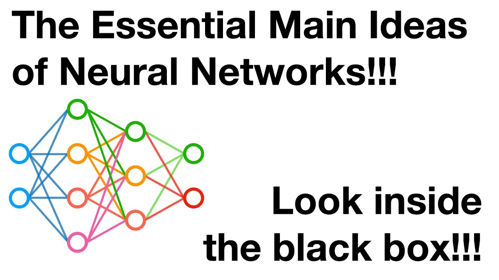
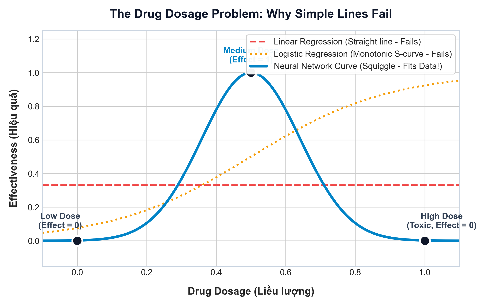
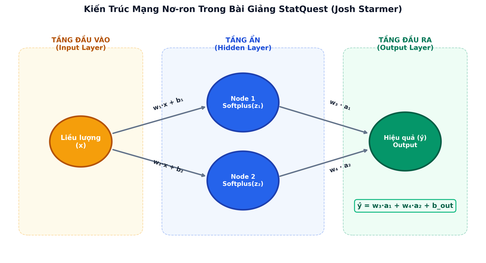
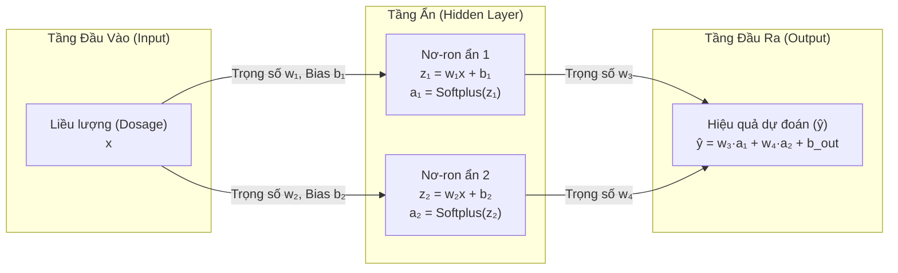
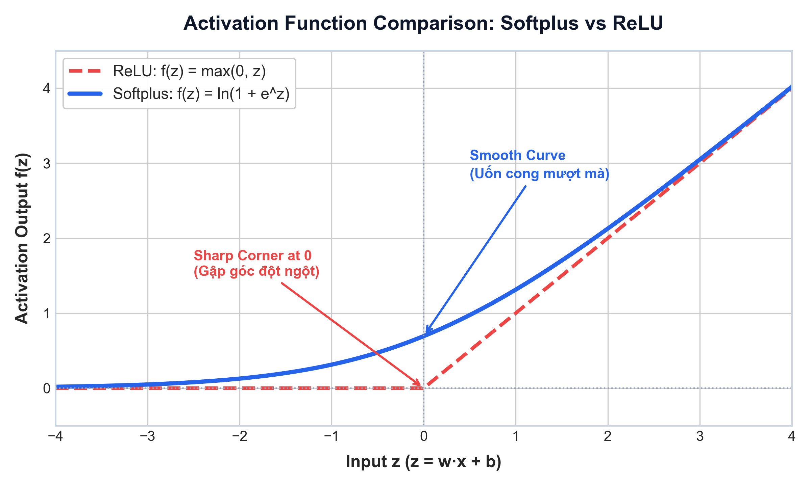
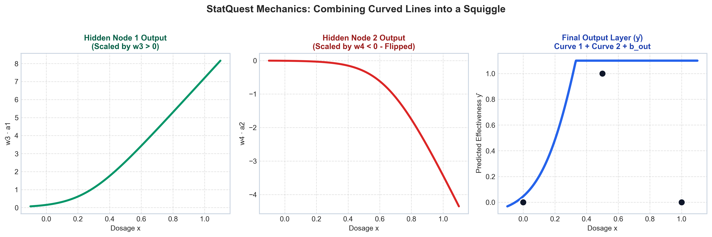

# Mạng Nơ-ron Nhân tạo (Neural Networks) - Phần 1: Bên trong "Hộp đen" (Inside the Black Box)

> 📺 **Nguồn bài giảng gốc:** [StatQuest with Josh Starmer - Neural Networks Part 1: Inside the Black Box](https://www.youtube.com/watch?v=CqOfi41LfDw&list=PLblh5JKOoLUIxGDQs4LFFD--41Vzf-ME1&index=2)  
> 🏷️ **Chủ đề:** Các khái niệm cốt lõi của Mạng Nơ-ron (The Essential Main Ideas of Neural Networks)  
> 🔗 **Mục lục:** [⬅ Quay lại Danh mục Neural Network](README.md)



---

## 1. Giới thiệu: Xóa bỏ định kiến về "Hộp đen" (Black Box)

Mạng nơ-ron nhân tạo (Artificial Neural Networks - ANN) thường bị xem là một **"hộp đen bí ẩn"** (Black Box) khó hiểu, nơi dữ liệu đi vào một đầu và kết quả kỳ diệu xuất hiện ở đầu kia. 

Tuy nhiên, như Josh Starmer nhấn mạnh trong StatQuest:
> 💡 **Bản chất của mạng nơ-ron thực ra rất đơn giản:** Chúng chỉ là tập hợp của các phép tính toán số học cơ bản (nhân trọng số, cộng độ lệch, đi qua hàm kích hoạt phi tuyến) được xếp chồng và kết hợp lại với nhau để tạo ra các **đường cong uốn lượn (Squiggles / Curved lines)** khớp với dữ liệu thực tế.

---

## 2. Bài toán đặt ra: Tại sao các mô hình tuyến tính thất bại?

Để hiểu vì sao cần mạng nơ-ron, StatQuest đưa ra một ví dụ trực quan về **Hiệu quả của liều lượng thuốc (Drug Dosage vs. Effectiveness)**:

### 2.1. Tập dữ liệu thực nghiệm

Giả sử ta thử nghiệm một loại thuốc với các mức liều lượng ($X$) và ghi nhận hiệu quả điều trị ($Y$):
- **Liều lượng thấp (Low Dose):** Không có tác dụng chữa bệnh $\rightarrow$ Hiệu quả = **0**.
- **Liều lượng vừa phải (Medium Dose):** Bệnh nhân khỏi bệnh $\rightarrow$ Hiệu quả = **1**.
- **Liều lượng cao (High Dose):** Thuốc gây độc tính cho cơ thể $\rightarrow$ Hiệu quả = **0**.



### 2.2. Sự bất lực của Hồi quy Tuyến tính & Hồi quy Logistic

1. **Hồi quy tuyến tính (Linear Regression):** 
   - Chỉ vẽ được một **đường thẳng** $y = ax + b$ (đường nét đứt màu đỏ trên đồ thị). 
   - Một đường thẳng không thể vừa đi lên ở giữa lại vừa đi xuống ở hai đầu.
2. **Hồi quy Logistic (Logistic Regression):** 
   - Tạo ra đường cong chữ S (Sigmoid curve - đường chấm màu vàng cam).
   - Tuy nhiên, hàm sigmoid có tính chất **đơn điệu** (chỉ tăng dần hoặc chỉ giảm dần), do đó cũng không thể mô tả được mối quan hệ "lên rồi lại xuống" của liều lượng thuốc.

👉 **Nhu cầu cấp thiết:** Ta cần một mô hình có khả năng uốn cong linh hoạt để tạo ra một đường "gợn sóng" (**Squiggle** - đường màu xanh dương) đi qua các điểm dữ liệu. Đó chính là lý do **Mạng nơ-ron nhân tạo** ra đời!

---

## 3. Kiến trúc cơ bản của Mạng Nơ-ron trong bài giảng

Mạng nơ-ron giải quyết bài toán trên gồm 3 tầng:





- **Tầng đầu vào (Input Layer):** Nhận 1 đặc trưng duy nhất là giá trị Liều lượng ($x$).
- **Tầng ẩn (Hidden Layer):** Gồm 2 nơ-ron (nodes). Mỗi nơ-ron thực hiện phép biến đổi tuyến tính kết hợp với một hàm kích hoạt (Activation Function).
- **Tầng đầu ra (Output Layer):** Tổng hợp kết quả từ các nơ-ron ẩn, nhân với trọng số đầu ra và cộng bias để xuất ra giá trị dự đoán Hiệu quả ($\hat{y}$).

---

## 4. Cơ chế hoạt động chi tiết bên trong từng Nơ-ron

Một nơ-ron trong mạng thực hiện 2 bước tính toán tuần tự:

### 4.1. Bước 1: Biến đổi tuyến tính (Scaling & Shifting)
Đầu vào $x$ được nhân với **Trọng số ($w$ - Weight)** và cộng thêm **Độ lệch ($b$ - Bias)**:
$$z = w \cdot x + b$$

- **Trọng số ($w$):** Điều khiển **độ dốc (slope)** của đường thẳng (xoay đường thẳng).
- **Độ lệch ($b$):** Điều khiển việc **tịnh tiến (shift)** đường thẳng sang trái/phải hoặc lên/xuống.

### 4.2. Bước 2: Bẻ cong đường thẳng bằng Hàm Kích hoạt (Activation Function)
Nếu chỉ dừng lại ở phép tính $w \cdot x + b$, mạng nơ-ron dù sâu bao nhiêu lớp cũng chỉ là một tổ hợp các phép tính tuyến tính (vẫn là đường thẳng).  
Để uốn cong đường thẳng, ta đưa giá trị $z$ qua một **Hàm kích hoạt phi tuyến**.

Trong video, Josh Starmer sử dụng hàm **Softplus**:
$$\text{Softplus}(z) = \ln(1 + e^z)$$



> 🔍 **So sánh Softplus và ReLU:**
> - **ReLU (Rectified Linear Unit):** $f(z) = \max(0, z)$ — bẻ gập đường thẳng đột ngột tại điểm $0$ tạo thành góc nhọn (đường nét đứt đỏ).
> - **Softplus:** Là phiên bản làm mịn (smooth approximation) của ReLU. Thay vì gập góc nhọn, Softplus uốn cong mượt mà quanh điểm 0 (đường liền màu xanh) và luôn có đạo hàm liên tục, tránh hiện tượng "chết nơ-ron" (dying ReLU).

---

## 5. Phép màu của Mạng Nơ-ron: Ghép các đường uốn cong thành "Squiggle"

Làm thế nào để 2 nơ-ron ẩn kết hợp lại tạo thành một đồ thị có đỉnh nhô lên ở giữa và thấp ở hai đầu?

1. **Nơ-ron ẩn số 1:**
   - Tính $z_1 = w_1 \cdot x + b_1$ và đưa qua Softplus: $a_1 = \text{Softplus}(z_1)$.
   - Đồ thị $a_1$ uốn cong đi lên khi liều lượng tăng qua mức liều thấp.
2. **Nơ-ron ẩn số 2:**
   - Tính $z_2 = w_2 \cdot x + b_2$ và đưa qua Softplus: $a_2 = \text{Softplus}(z_2)$.
   - Đồ thị $a_2$ uốn cong đi lên ở ngưỡng liều lượng cao hơn.
3. **Kết hợp tại Tầng Đầu ra (Output Layer):**
   - Tầng đầu ra gán cho $a_1$ một **trọng số dương** ($w_3 > 0$) $\rightarrow$ giữ nguyên chiều cong đi lên.
   - Tầng đầu ra gán cho $a_2$ một **trọng số âm** ($w_4 < 0$) $\rightarrow$ lật ngược đường cong thành chúc xuống dưới.
   - Cộng hai đường cong lại cùng với một độ lệch $b_{out}$:
     $$\hat{y} = w_3 \cdot a_1 + w_4 \cdot a_2 + b_{out}$$



🎉 **Kết quả:** Sự kết hợp của hai đường cong (một đi lên và một đi xuống bị trừ bớt) đã tạo thành một **đường vồng hình chuông mượt mà** khớp hoàn hảo với 3 điểm dữ liệu:
- Liều thấp $\rightarrow$ $\hat{y} \approx 0$
- Liều vừa $\rightarrow$ $\hat{y} \approx 1$
- Liều cao $\rightarrow$ $\hat{y} \approx 0$

---

## 6. Ví dụ thực hành tính toán bằng số cụ thể (Step-by-Step Numerical Walkthrough)

Để thấy rõ cơ chế hoạt động thực tế của **Tầng ẩn (Hidden Layer)** mà không bị bỡ ngỡ bởi các công thức trừu tượng, chúng ta hãy cùng tính toán bằng tay một mô hình với **các con số nguyên/thập phân cực kỳ đơn giản** (có thể tự nhẩm được).

### 6.1. Thiết lập bài toán & Thông số mạng

- **Đầu vào ($x$):** Liều lượng thuốc từ $0$ đến $1$.
- **Mục tiêu ($y$):** Hiệu quả đạt $1$ ở liều vừa ($x = 0.5$), và bằng $0$ ở liều thấp ($x = 0$) hoặc liều cao ($x = 1.0$).
- **Hàm kích hoạt tại tầng ẩn:** Dùng hàm **ReLU** để số tính ra tròn đẹp:
  $$f(z) = \max(0, z) \quad (\text{nếu } z \le 0 \text{ thì bằng } 0\text{; nếu } z > 0 \text{ thì giữ nguyên } z)$$

```
                  ┌── [Nơ-ron ẩn 1]: z₁ = 2x      ──> a₁ = ReLU(z₁) ──┐ (nhân trọng số w₃ = +1)
                  │                                                   ▼
Đầu vào x ────────┤                                                [Đầu ra ŷ] = 1·a₁ - 1·a₂
                  │                                                   ▲
                  └── [Nơ-ron ẩn 2]: z₂ = 4x - 2  ──> a₂ = ReLU(z₂) ──┘ (nhân trọng số w₄ = -1)
```

**Các tham số đã được huấn luyện sẵn của mạng:**
- **Nơ-ron ẩn 1 ($N_1$):** Trọng số $w_1 = 2$, Bias $b_1 = 0 \implies z_1 = 2x$
- **Nơ-ron ẩn 2 ($N_2$):** Trọng số $w_2 = 4$, Bias $b_2 = -2 \implies z_2 = 4x - 2$
- **Tầng đầu ra (Output Layer):** Lấy $N_1$ trừ đi $N_2$ với trọng số $w_3 = 1$, $w_4 = -1$, bias $b_{out} = 0$:
  $$\hat{y} = 1 \cdot a_1 - 1 \cdot a_2$$

---

### 6.2. Tính toán chi tiết cho 3 trường hợp bệnh nhân

#### 🧪 Trường hợp 1: Uống liều thấp ($x = 0.0$)
1. **Tại Nơ-ron ẩn 1 ($N_1$):**
   - $z_1 = 2 \times 0.0 + 0 = 0$
   - $a_1 = \text{ReLU}(0) = \mathbf{0}$
2. **Tại Nơ-ron ẩn 2 ($N_2$):**
   - $z_2 = 4 \times 0.0 - 2 = -2$
   - $a_2 = \text{ReLU}(-2) = \mathbf{0}$ *(Giá trị âm bị ReLU triệt tiêu về 0)*
3. **Tại Tầng đầu ra:**
   - $\hat{y} = 1 \times a_1 - 1 \times a_2 = 1 \times 0 - 1 \times 0 = \mathbf{0}$  
   👉 **Kết quả:** $\hat{y} = 0 \rightarrow$ Thuốc chưa đủ liều, chưa có tác dụng.

---

#### 🧪 Trường hợp 2: Uống liều vừa ($x = 0.5$) — Liều tối ưu
1. **Tại Nơ-ron ẩn 1 ($N_1$):**
   - $z_1 = 2 \times 0.5 + 0 = 1.0$
   - $a_1 = \text{ReLU}(1.0) = \mathbf{1.0}$ *(Nơ-ron 1 được kích hoạt mạnh)*
2. **Tại Nơ-ron ẩn 2 ($N_2$):**
   - $z_2 = 4 \times 0.5 - 2 = 2.0 - 2 = 0$
   - $a_2 = \text{ReLU}(0) = \mathbf{0}$ *(Nơ-ron 2 vẫn đang "ngủ", chưa bị kích hoạt)*
3. **Tại Tầng đầu ra:**
   - $\hat{y} = 1 \times a_1 - 1 \times a_2 = 1 \times 1.0 - 1 \times 0 = \mathbf{1.0}$  
   👉 **Kết quả:** $\hat{y} = 1 \rightarrow$ Bệnh nhân đạt hiệu quả tối đa (khỏi bệnh).

---

#### 🧪 Trường hợp 3: Uống liều cao ($x = 1.0$) — Quá liều gây độc
1. **Tại Nơ-ron ẩn 1 ($N_1$):**
   - $z_1 = 2 \times 1.0 + 0 = 2.0$
   - $a_1 = \text{ReLU}(2.0) = \mathbf{2.0}$ *(Nơ-ron 1 vẫn tiếp tục tăng lên)*
2. **Tại Nơ-ron ẩn 2 ($N_2$):**
   - $z_2 = 4 \times 1.0 - 2 = 2.0$
   - $a_2 = \text{ReLU}(2.0) = \mathbf{2.0}$ *(Lúc này nơ-ron 2 bừng tỉnh vì vượt ngưỡng bias -2, phát tín hiệu mạnh = 2.0)*
3. **Tại Tầng đầu ra:**
   - $\hat{y} = 1 \times a_1 - 1 \times a_2 = 1 \times 2.0 - 1 \times 2.0 = \mathbf{0}$  
   👉 **Kết quả:** $\hat{y} = 0 \rightarrow$ Tín hiệu âm từ Nơ-ron 2 đã **triệt tiêu hoàn toàn** Nơ-ron 1, kéo hiệu quả tụt về 0 (thuốc bị độc, mất tác dụng điều trị).

---

### 6.3. Bảng tổng kết số liệu qua từng tầng

| Mức liều ($x$) | Giá trị vào $N_1$ ($z_1$) | Đầu ra $N_1$ ($a_1$) | Giá trị vào $N_2$ ($z_2$) | Đầu ra $N_2$ ($a_2$) | Dự đoán cuối ($\hat{y} = a_1 - a_2$) | Trạng thái thực tế |
|:---:|:---:|:---:|:---:|:---:|:---:|---|
| **$0.0$** (Thấp) | $0.0$ | $0.0$ | $-2.0$ | $0.0$ | **$0.0$** | Không tác dụng |
| **$0.5$** (Vừa) | $1.0$ | $1.0$ | $0.0$ | $0.0$ | **$1.0$** | **Khỏi bệnh hoàn toàn** |
| **$1.0$** (Cao) | $2.0$ | $2.0$ | $2.0$ | $2.0$ | **$0.0$** | **Quá liều gây độc** |

> 🔑 **Bài học cốt lõi rút ra:**
> - **Nơ-ron 1** đảm nhận vai trò: *"Kéo đường dự đoán đi lên khi bắt đầu tăng liều lượng"*.
> - **Nơ-ron 2** (nhờ có bias âm $b_2 = -2$) đảm nhận vai trò: *"Ngủ yên khi liều còn thấp hoặc vừa, nhưng hễ vượt quá liều an toàn ($x > 0.5$) là kích hoạt để kéo tụt giá trị xuống"*.
> - Chính sự phân vai này của **Tầng ẩn (Hidden Layer)** đã tạo ra khả năng uốn lượn phi tuyến (lên rồi xuống) mà không một mô hình tuyến tính đơn lẻ nào có thể làm được!

---

## 7. Dự đoán trên dữ liệu mới: Lan truyền xuôi (Forward Pass)

Khi mạng đã có đầy đủ các thông số trọng số và bias tối ưu, việc đưa một điểm dữ liệu mới vào để dự đoán được gọi là quá trình **Lan truyền xuôi (Forward Propagation / Forward Pass)**:

1. Đưa giá trị liều lượng $x$ vào tầng đầu vào.
2. Tính toán giá trị tại từng nơ-ron ẩn:
   $$a_1 = \ln\left(1 + e^{w_1 x + b_1}\right)$$
   $$a_2 = \ln\left(1 + e^{w_2 x + b_2}\right)$$
3. Tổng hợp giá trị tại tầng đầu ra:
   $$\hat{y} = w_3 a_1 + w_4 a_2 + b_{out}$$
4. Kết quả $\hat{y}$ chính là mức độ hiệu quả dự báo của liều thuốc đó.

---

## 8. Các trọng số và bias được tìm ra như thế nào? (Preview Phần 2)

Trong video Phần 1, Josh Starmer giả định trước các trọng số và bias đã được tinh chỉnh sẵn để minh họa cơ chế hoạt động. Tuy nhiên trong thực tế:
- Ban đầu, các trọng số ($w$) và bias ($b$) được **khởi tạo ngẫu nhiên**.
- Mô hình sẽ đưa ra những dự đoán ban đầu rất tồi tệ.
- Mạng nơ-ron đo lường sai số bằng **Hàm mất mát (Loss Function / Cost Function)**.
- Sau đó, thuật toán **Lan truyền ngược (Backpropagation)** kết hợp cùng **Gradient Descent** sẽ tính đạo hàm của hàm mất mát theo từng tham số để cập nhật, kéo các đường cong dần khớp vào dữ liệu thật.

*(Nội dung này được trình bày chi tiết trong Phần 2 của chuỗi video).*

---

## 9. Tóm tắt các thuật ngữ cốt lõi (Key Takeaways)

| Thuật ngữ | Tiếng Anh | Ý nghĩa trong Mạng Nơ-ron |
|-----------|-----------|---------------------------|
| **Nơ-ron / Nút** | Node / Neuron | Đơn vị tính toán cơ sở thực hiện phép tính nhân trọng số, cộng bias và áp hàm kích hoạt. |
| **Trọng số** | Weight ($w$) | Quyết định độ dốc và mức độ ảnh hưởng của tín hiệu đầu vào đến nơ-ron kế tiếp. |
| **Độ lệch** | Bias ($b$) | Tịnh tiến đường biểu diễn, quyết định ngưỡng kích hoạt của nơ-ron. |
| **Hàm kích hoạt** | Activation Function | Hàm phi tuyến (ReLU, Softplus, Sigmoid,...) giúp bẻ cong các đường thẳng, tạo khả năng học các mối quan hệ phi tuyến phức tạp. |
| **Đường cong xấp xỉ** | Squiggle | Đường cong phức tạp tạo thành từ việc cộng gộp nhiều đường cong/đoạn gãy đơn giản từ các nơ-ron ẩn. |
| **Lan truyền xuôi** | Forward Pass | Luồng tính toán tuần tự từ đầu vào qua các tầng ẩn đến đầu ra để đưa ra kết quả dự đoán. |

---

## 10. Bài tập suy ngẫm & Ôn tập

1. Nếu một mạng nơ-ron có nhiều tầng ẩn nhưng **không sử dụng bất kỳ hàm kích hoạt phi tuyến nào**, đầu ra của mạng sẽ có dạng gì?  
   *(Gợi ý: Tích của các ma trận tuyến tính vẫn là một phép biến đổi tuyến tính $\rightarrow$ chỉ là một đường thẳng/mặt phẳng).*
2. Nếu bài toán có 5 đỉnh uốn lượn phức tạp thay vì chỉ 1 đỉnh như ví dụ liều lượng thuốc, ta cần thay đổi kiến trúc mạng như thế nào?  
   *(Gợi ý: Cần thêm nhiều nơ-ron ẩn hơn ở hidden layer hoặc xếp chồng thêm nhiều hidden layers để kết hợp nhiều đường cong hơn).*
