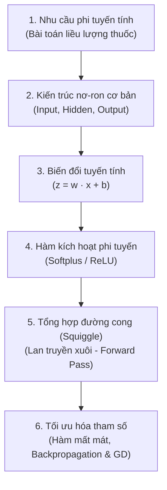

# Chuyên đề: Mạng Nơ-ron Nhân tạo (Neural Networks)

> Nằm trong chuỗi tài liệu **Deep Learning (Học sâu)** thuộc **KnowledgeLibrary**.  
> Tổng hợp & chuyển ngữ có hệ thống từ series bài giảng kinh điển **StatQuest with Josh Starmer**.

---

## 📚 Danh mục bài học

| # | Bài học | Trọng tâm kiến thức | Video gốc |
|---|---------|---------------------|-----------|
| 1 | [Bên trong "Hộp đen" - Khái niệm cốt lõi của Neural Network](01_the_essential_main_ideas_of_neural_networks.md) | Vấn đề phi tuyến tính (Drug Dosage), kiến trúc mạng, trọng số ($w$), bias ($b$), hàm kích hoạt Softplus/ReLU, ghép đường cong (Squiggle), Forward Pass. | [StatQuest Part 1](https://www.youtube.com/watch?v=CqOfi41LfDw) |
| 2 | *Lan truyền ngược & Thuật toán Tối ưu (Backpropagation & Gradient Descent)* | Cách mạng nơ-ron tự học trọng số và bias qua hàm mất mát và đạo hàm riêng (Chain Rule). | StatQuest Part 2 |

---

## 🗺️ Lộ trình tiếp cận kiến thức

