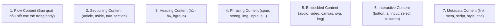

# CHUYÊN ĐỀ 02: HTML5 & CÔNG NGHỆ WEB HIỆN ĐẠI

> **Môn học:** Phát triển ứng dụng Web (IS207)  
> **Tài liệu tham khảo chính:** `Chương 2 Web-HTML5 - SV.pdf` (102 trang)

---

## 1. TỔNG QUAN VỀ HTML5

### 1.1. Lịch sử hình thành & Mục tiêu
- **Bối cảnh:** Năm 2004, nhóm **WHATWG** (Web Hypertext Application Technology Working Group) được thành lập bởi các kỹ sư từ Apple, Mozilla, Opera do không đồng tình với hướng phát triển XHTML 2.0 quá khắt khe của W3C.
- **Thống nhất:** Năm 2007, W3C chấp thuận và áp dụng các đặc tả của WHATWG để phát triển HTML5. Đến năm 2014, HTML5 chính thức được ban hành làm chuẩn chung toàn cầu.
- **Mục tiêu chính:**
  - Hỗ trợ tốt các ứng dụng web đa phương tiện mà **không cần cài thêm plugin thứ ba** (như Adobe Flash, Microsoft Silverlight).
  - Tăng cường ý nghĩa cấu trúc văn bản thông qua hệ thống thẻ ngữ nghĩa (*Semantic Tags*).
  - Cung cấp các API mạnh mẽ phía Client: Lưu trữ dữ liệu (*Web Storage*), Đồ họa 2D (*Canvas & SVG*), Định vị địa lý (*Geolocation*)...
  - Tối giản hóa cú pháp khai báo.

### 1.2. Khai báo DOCTYPE và Meta tối giản
So với HTML4 và XHTML rất cồng kềnh, HTML5 chỉ cần:
```html
<!DOCTYPE html>
<html lang="vi">
  <head>
    <meta charset="UTF-8">
```

---

## 2. MÔ HÌNH NỘI DUNG (CONTENT MODELS) TRONG HTML5

HTML5 phân loại các phần tử thành 7 nhóm mô hình nội dung đan xen lẫn nhau:



---

## 3. CÁC THẺ NGỮ NGHĨA (SEMANTIC ELEMENTS)

Trước HTML5, các nhà phát triển thường dùng hàng loạt thẻ `<div>` vô nghĩa với class hoặc id tự đặt: `<div id="header">`, `<div class="footer">`... HTML5 chuẩn hóa bằng các thẻ mang ý nghĩa ngữ nghĩa rõ ràng:

| Thẻ ngữ nghĩa | Vị trí & Chức năng |
| :--- | :--- |
| `<header>` | Đầu trang hoặc đầu của một bài viết/khối; chứa logo, tiêu đề, thanh điều hướng sơ cấp. |
| `<nav>` | Khu vực điều hướng chính của website (menu liên kết). |
| `<section>` | Phân đoạn tài liệu mang một chủ đề nội dung cụ thể; thường chứa một tiêu đề `<h1>`-`<h6>`. |
| `<article>` | Một khối nội dung độc lập, trọn vẹn, có thể trích xuất và tái xuất bản độc lập (bài báo, post blog, bình luận). |
| `<aside>` | Vùng nội dung phụ trợ, liên quan gián tiếp đến nội dung chính (sidebar, danh mục, banner quảng cáo). |
| `<footer>` | Chân trang hoặc chân của một bài viết; chứa bản quyền tác giả, chính sách bảo mật, liên hệ. |
| `<figure>` | Khối chứa phương tiện minh họa độc lập (ảnh, biểu đồ, code ví dụ). |
| `<figcaption>` | Chú thích đi kèm nằm bên trong thẻ `<figure>`. |
| `<main>` | Vùng chứa nội dung chính duy nhất của toàn bộ tài liệu (không được lặp lại giữa các trang). |
| `<mark>` | Đánh dấu/tô vàng đoạn văn bản nổi bật. |
| `<time>` | Biểu thị mốc thời gian máy đọc được (vd: `<time datetime="2026-10-15">15/10/2026</time>`). |

### Sơ đồ bố cục trang chuẩn HTML5:
```text
+-------------------------------------------------------+
|                       <header>                        |
+-------------------------------------------------------+
|                        <nav>                          |
+------------------------------------+------------------+
|                                    |                  |
|              <main>                |     <aside>      |
|  +------------------------------+  |  (Sidebar / Ads) |
|  |          <article>           |  |                  |
|  |   +-----------------------+  |  |                  |
|  |   |       <section>       |  |  |                  |
|  |   +-----------------------+  |  |                  |
|  +------------------------------+  |                  |
+------------------------------------+------------------+
|                       <footer>                        |
+-------------------------------------------------------+
```

---

## 4. FORM HTML5: INPUT TYPES & VALIDATION MỚI

### 4.1. Các kiểu `type` mới của thẻ `<input>`
- `email`: Tự động kiểm tra đúng định dạng email (phải có ký tự `@` và tên miền hợp lệ).
- `url`: Yêu cầu nhập đúng cú pháp URL tuyệt đối (bắt đầu bằng `http://` hoặc `https://`).
- `number`: Chỉ cho phép nhập số; hỗ trợ nút tăng giảm theo bước nhảy (`min`, `max`, `step`).
- `range`: Thanh trượt chọn giá trị số trong dải xác định.
- `date`, `time`, `datetime-local`, `month`, `week`: Mở hộp thoại chọn lịch ngày/giờ chuyên dụng.
- `color`: Hiển thị bảng chọn màu trực quan (Color Picker, trả về mã HEX).
- `search`: Hộp tìm kiếm có nút xóa nhanh (dấu x) nội dung đã gõ.
- `tel`: Nhập số điện thoại (hỗ trợ hiển thị bàn phím số chuyên dụng trên thiết bị di động).

### 4.2. Các thuộc tính kiểm tra tính hợp lệ (Form Validation Attributes)
HTML5 tích hợp sẵn cơ chế kiểm tra dữ liệu ở phía client mà không cần viết JavaScript:
- `required`: Bắt buộc người dùng phải nhập dữ liệu trước khi gửi form.
- `placeholder`: Chuỗi văn bản gợi ý hiển thị mờ trong ô nhập liệu.
- `autofocus`: Tự động đưa con trỏ chuột vào ô này khi trang vừa tải xong.
- `pattern="regex"`: Bắt buộc giá trị nhập phải khớp với biểu thức chính quy (Regular Expression).
  - *Ví dụ kiểm tra Mã số sinh viên 8 số:* `pattern="[0-9]{8}"`
- `min`, `max`, `step`: Giới hạn khoảng giá trị nhỏ nhất, lớn nhất và bước nhảy của số/ngày.
- `multiple`: Cho phép chọn/nhập nhiều mục (áp dụng cho `type="file"` và `type="email"`).
- `novalidate`: Đặt ở thẻ `<form>` để vô hiệu hóa tính năng kiểm tra tự động của HTML5 khi cần.
- Thuộc tính `form`: Cho phép đặt ô `<input form="idForm">` nằm **bên ngoài** thẻ `<form>` nhưng vẫn gắn liền và gửi dữ liệu theo form đó.

### 4.3. Các thẻ điều khiển mới khác
- `<datalist>`: Cung cấp danh sách gợi ý tự động cho thẻ `<input>` thông qua thuộc tính `list`:
  ```html
  <input list="browsers" name="browser">
  <datalist id="browsers">
    <option value="Chrome">
    <option value="Firefox">
    <option value="Edge">
    <option value="Safari">
  </datalist>
  ```
- `<output>`: Hiển thị kết quả tính toán động của các phép toán trên form.
- `<progress>`: Thanh tiến trình hiển thị mức độ hoàn thành tác vụ (0% - 100%).
- `<meter>`: Thước đo hiển thị giá trị nằm trong một phạm vi xác định (vd: dung lượng ổ đĩa, nhiệt độ).

---

## 5. ĐỒ HỌA WEB: CANVAS 2D VS SVG

### 5.1. Bảng so sánh chi tiết giữa Canvas và SVG (Trọng tâm thi)

| Tiêu chí | HTML5 Canvas (`<canvas>`) | SVG (`<svg>`) |
| :--- | :--- | :--- |
| **Bản chất hình ảnh** | **Raster / Bitmap** (dựa trên từng điểm ảnh pixel). | **Vector** (dựa trên các công thức toán học và XML). |
| **Cơ chế vẽ** | Vẽ động bằng **JavaScript** qua Canvas 2D API. | Viết trực tiếp bằng các thẻ XML lồng nhau hoặc chèn file `.svg`. |
| **Độ phân giải khi zoom** | **Bị mờ, vỡ hạt** khi phóng to hoặc trên màn hình Retina. | **Không bao giờ vỡ nét**, sắc nét tuyệt đối ở mọi kích thước. |
| **Tương tác DOM & Sự kiện** | Toàn bộ canvas là 1 thẻ DOM duy nhất; **không bắt được sự kiện riêng cho từng hình đã vẽ**. | Mỗi hình khối là một Node trong cây DOM; **hỗ trợ đầy đủ CSS và Event Listener** (`click`, `hover`). |
| **Hiệu năng (Performance)** | Rất cao khi có hàng ngàn đối tượng chuyển động liên tục. | Giảm hiệu năng đáng kể nếu số lượng phần tử DOM quá lớn. |
| **Ứng dụng tiêu biểu** | Game 2D, chỉnh sửa hiệu ứng ảnh pixel, biểu đồ thời gian thực. | Logo, icons, bản đồ địa lý, sơ đồ khối, hình vẽ minh họa phẳng. |

### 5.2. Ví dụ vẽ cơ bản trên Canvas 2D
```html
<canvas id="myCanvas" width="300" height="150" style="border:1px solid #000;"></canvas>

<script>
  var canvas = document.getElementById("myCanvas");
  var ctx = canvas.getContext("2d");

  // Vẽ hình chữ nhật màu xanh
  ctx.fillStyle = "#007bff";
  ctx.fillRect(20, 20, 100, 60);

  // Vẽ đường thẳng màu đỏ
  ctx.beginPath();
  ctx.moveTo(150, 20);
  ctx.lineTo(250, 100);
  ctx.strokeStyle = "red";
  ctx.lineWidth = 3;
  ctx.stroke();

  // Vẽ hình tròn
  ctx.beginPath();
  ctx.arc(200, 50, 30, 0, 2 * Math.PI);
  ctx.fillStyle = "gold";
  ctx.fill();
</script>
```

### 5.3. Ví dụ SVG trực tiếp
```html
<svg width="200" height="100">
  <circle cx="50" cy="50" r="40" stroke="green" stroke-width="4" fill="yellow" />
  <rect x="110" y="20" width="80" height="60" style="fill:blue; stroke:pink; stroke-width:3" />
</svg>
```

---

## 6. ĐA PHƯƠNG TIỆN (MULTIMEDIA: AUDIO & VIDEO)

### 6.1. Thẻ `<video>`
Hỗ trợ phát video trực tiếp trên trình duyệt, tương thích với định dạng MP4 (H.264), WebM, Ogg:
```html
<video width="640" height="360" controls poster="poster.jpg">
  <source src="movie.mp4" type="video/mp4">
  <source src="movie.webm" type="video/webm">
  Trình duyệt của bạn không hỗ trợ thẻ video HTML5.
</video>
```

### 6.2. Thẻ `<audio>`
```html
<audio controls autoplay muted loop>
  <source src="song.mp3" type="audio/mpeg">
  <source src="song.ogg" type="audio/ogg">
</audio>
```

### 6.3. Các thuộc tính thông dụng
- `controls`: Hiển thị thanh công cụ điều khiển (play, pause, thanh trượt thời gian, âm lượng).
- `autoplay`: Tự động phát video/nhạc ngay khi tải trang. *(Lưu ý: Các trình duyệt hiện đại bắt buộc phải kèm thuộc tính `muted` thì video mới được phép tự động phát)*.
- `loop`: Tự động lặp lại video từ đầu khi phát hết.
- `muted`: Tắt tiếng mặc định khi bắt đầu phát.
- `poster="url"`: Ảnh đại diện hiển thị trong khung phát khi video chưa được bấm Play.

---

## 7. CƠ CHẾ LƯU TRỮ WEB (WEB STORAGE API)

### 7.1. So sánh Web Storage với Cookie
| Tiêu chí | Web Storage (`localStorage` / `sessionStorage`) | Cookie truyền thống |
| :--- | :--- | :--- |
| **Dung lượng lưu trữ** | Lớn (thường từ **5MB - 10MB** mỗi origin). | Rất nhỏ (tối đa **4KB**). |
| **Truyền tải mạng** | Lưu trữ hoàn toàn ở client; **không gửi kèm** lên server. | Tự động đính kèm vào Header của **mọi HTTP Request** $\rightarrow$ tốn băng thông. |
| **Thời hạn tồn tại** | Do lập trình viên quyết định (`session` hoặc vĩnh viễn). | Có hạn sử dụng (Expire Date); tự hết hạn sau thời gian đặt trước. |
| **Bảo mật** | Truy cập an toàn thông qua JavaScript cùng nguồn (Same-Origin). | Có nguy cơ bị tấn công XSS hoặc đánh cắp session. |

### 7.2. So sánh `localStorage` và `sessionStorage`
- **`localStorage`:** Dữ liệu tồn tại **vĩnh viễn**, không có thời hạn hết hạn. Dữ liệu vẫn được giữ nguyên ngay cả khi người dùng đóng tab, đóng trình duyệt hoặc khởi động lại máy tính. Phù hợp lưu theme (Dark/Light), cài đặt giao diện, token đăng nhập dài hạn.
- **`sessionStorage`:** Dữ liệu chỉ tồn tại trong **phạm vi một phiên làm việc (Session) của tab trình duyệt hiện tại**. Khi đóng tab hoặc đóng cửa sổ, toàn bộ dữ liệu sẽ tự động bị xóa sạch. Mở cùng URL ở tab khác sẽ có session độc lập.

### 7.3. Các phương thức thao tác Web Storage API
```javascript
// 1. Lưu trữ dữ liệu
localStorage.setItem("username", "nguyenvana");

// 2. Lấy dữ liệu
let user = localStorage.getItem("username");

// 3. Xóa một mục cụ thể
localStorage.removeItem("username");

// 4. Xóa sạch toàn bộ dữ liệu của domain
localStorage.clear();

// 5. Kiểm tra số lượng mục lưu trữ
console.log(localStorage.length);
```

> **LƯU Ý ĐẶC BIỆT KHI THI:**  
> Web Storage **chỉ lưu trữ dữ liệu dưới dạng chuỗi (String)**. Nếu muốn lưu Object hoặc Array, bắt buộc phải dùng `JSON.stringify()` khi ghi và `JSON.parse()` khi đọc:
> ```javascript
> const student = { id: "24520496", name: "Nguyễn Văn A" };
> // Ghi vào storage:
> localStorage.setItem("user_info", JSON.stringify(student));
> 
> // Đọc từ storage:
> const retrievedStudent = JSON.parse(localStorage.getItem("user_info"));
> console.log(retrievedStudent.name);
> ```
