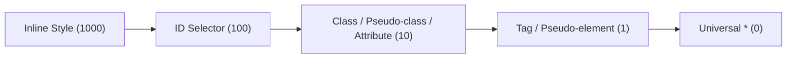

# CHUYÊN ĐỀ 03: CSS CƠ BẢN, BOX MODEL & ĐỊNH VỊ

> **Môn học:** Phát triển ứng dụng Web (IS207)  
> **Tài liệu tham khảo chính:** `Chương 2 CSS - SV.pdf` (58 trang)

---

## 1. GIỚI THIỆU & CÚ PHÁP CSS

### 1.1. CSS là gì?
- **CSS** viết tắt của **Cascading Style Sheets** (Bảng định kiểu xếp tầng).
- Được thiết kế để mô tả cách trình bày giao diện (màu sắc, kích cỡ, font chữ, bố cục khoảng cách) của các phần tử HTML.
- **Lợi ích cốt lõi:**
  - **Tách biệt hoàn toàn** giữa nội dung (HTML) và giao diện hiển thị (CSS).
  - Tái sử dụng code phong cách trên nhiều trang web, tiết kiệm thời gian phát triển và bảo trì.
  - Tối ưu hóa tốc độ tải trang nhờ cơ chế lưu bộ nhớ đệm (Cache) file CSS của trình duyệt.

### 1.2. Cú pháp cơ bản
```css
selector {
  property: value;
  property: value;
}
```
- **Selector (Bộ chọn):** Chỉ định phần tử HTML nào sẽ được áp dụng định dạng.
- **Property (Thuộc tính):** Đặc tính cần thay đổi (vd: `color`, `font-size`, `margin`).
- **Value (Giá trị):** Giá trị gán cho thuộc tính (vd: `red`, `16px`, `10px auto`).
- **Ghi chú trong CSS:** `/* Nội dung ghi chú ở đây */` (không dùng `//` như trong JS/C++).

---

## 2. 3 CÁCH CHÈN CSS & QUY TẮC ĐỘ ƯU TIÊN (SPECIFICITY)

### 2.1. Ba cách chèn CSS vào trang web
1. **Inline Style (Nội dòng):**
   - Viết trực tiếp trong thuộc tính `style` của thẻ HTML:
     ```html
     <p style="color: red; font-size: 18px;">Đoạn văn có màu đỏ</p>
     ```
   - *Ưu/Nhược điểm:* Độ ưu tiên cao nhất, nhưng khó quản lý, vi phạm nguyên tắc tách biệt mã.
2. **Internal / Embedded Style (Nội bộ trang):**
   - Đặt trong cặp thẻ `<style>` bên trong phần `<head>` của trang HTML:
     ```html
     <head>
       <style>
         p { color: blue; }
       </style>
     </head>
     ```
   - *Ưu/Nhược điểm:* Tốt cho việc định dạng riêng một trang đơn lẻ, không tái sử dụng được cho trang khác.
3. **External Style Sheet (Tập tin CSS rời - Khuyến nghị):**
   - Viết toàn bộ CSS vào một file riêng có đuôi mở rộng `.css` và nhúng vào `<head>` bằng thẻ `<link>`:
     ```html
     <link rel="stylesheet" type="text/css" href="css/style.css">
     ```
   - *Ưu/Nhược điểm:* Chuẩn mực cao nhất, dễ quản lý và cho phép cache trên trình duyệt.

### 2.2. Trọng số & Quy tắc độ ưu tiên (Specificity - Trọng tâm thi)

Khi một phần tử được áp dụng nhiều quy tắc CSS xung đột nhau, trình duyệt sẽ tính điểm **Specificity** theo trọng số:

$$\text{Inline (1000)} > \text{ID (100)} > \text{Class / Attribute / Pseudo-class (10)} > \text{Tag / Pseudo-element (1)}$$



#### Bảng tra cứu điểm Specificity:
| Selector | Ví dụ | Trọng số (Inline, ID, Class, Tag) | Tổng điểm |
| :--- | :--- | :---: | :---: |
| `*` | `* { margin: 0; }` | (0, 0, 0, 0) | **0** |
| Thẻ đơn | `p { color: black; }` | (0, 0, 0, 1) | **1** |
| Phân cấp thẻ | `ul li a { color: gray; }` | (0, 0, 0, 3) | **3** |
| Class đơn | `.highlight { color: yellow; }` | (0, 0, 1, 0) | **10** |
| Thẻ kết hợp Class | `p.intro { color: green; }` | (0, 0, 1, 1) | **11** |
| Nhiều Class & Pseudo | `.menu li.active:hover` | (0, 0, 3, 1) | **31** |
| ID Selector | `#header { color: red; }` | (0, 1, 0, 0) | **100** |
| ID kết hợp Class | `#sidebar .widget` | (0, 1, 1, 0) | **110** |
| Inline Style | `<h1 style="color: blue;">` | (1, 0, 0, 0) | **1000** |

#### Quy tắc xử lý xung đột:
1. Quy tắc nào có **tổng điểm Specificity lớn hơn** sẽ giành chiến thắng.
2. Nếu hai quy tắc có **cùng điểm Specificity**, quy tắc nào được định nghĩa **sau cùng** (xuất hiện bên dưới) sẽ ghi đè quy tắc trước.
3. Từ khóa **`!important`**: Có quyền năng tối thượng, ghi đè toàn bộ mọi quy tắc trên (kể cả inline style). Chỉ sử dụng khi thực sự cần thiết để tránh phá vỡ kiến trúc CSS.

---

## 3. BỘ CHỌN (SELECTORS) & BỘ CHỌN GIẢ (PSEUDO)

### 3.1. Các bộ chọn cơ bản
- **Type/Tag selector:** Chọn theo tên thẻ HTML (`h1`, `p`, `div`).
- **Class selector:** Chọn theo thuộc tính class, bắt đầu bằng dấu chấm (`.container`, `.text-danger`).
- **ID selector:** Chọn theo thuộc tính id duy nhất, bắt đầu bằng dấu thăng (`#main-nav`).
- **Universal selector:** Dấu sao `*` chọn toàn bộ phần tử trên trang (thường dùng reset CSS: `* { box-sizing: border-box; }`).
- **Grouping selector:** Gom nhóm nhiều selector có cùng thuộc tính bằng dấu phẩy:
  ```css
  h1, h2, h3 { font-family: Arial, sans-serif; }
  ```

### 3.2. Pseudo-classes (Lớp giả `:`)
Chọn phần tử dựa theo **trạng thái tương tác** hoặc **vị trí cấu trúc**:
- **Trạng thái liên kết thẻ `<a>` (Bắt buộc nhớ quy tắc thứ tự: LVHA):**
  1. `:link`: Liên kết chưa được người dùng truy cập bao giờ.
  2. `:visited`: Liên kết đã được truy cập.
  3. `:hover`: Khi người dùng rê chuột lên liên kết.
  4. `:active`: Khoảnh khắc người dùng đang nhấn giữ chuột trên liên kết.
  *(Nếu viết sai thứ tự này, một số trạng thái sẽ không có tác dụng).*
- **Vị trí và cấu trúc phần tử:**
  - `:first-child`: Phần tử con đầu tiên trong khối cha.
  - `:last-child`: Phần tử con cuối cùng trong khối cha.
  - `:nth-child(n)`: Phần tử con thứ $n$ (hỗ trợ công thức số học: `2n` cho vị trí chẵn, `2n+1` cho vị trí lẻ).
  - `:focus`: Phần tử đang nhận tiêu điểm nhập liệu (dành cho input/button).

### 3.3. Pseudo-elements (Phần tử giả `::`)
Định dạng cho **một thành phần con cụ thể** hoặc chèn nội dung ảo:
- `::first-letter`: Ký tự đầu tiên của đoạn văn (làm chữ Drop-cap sách báo).
- `::first-line`: Dòng chữ đầu tiên của đoạn văn.
- `::before`: Chèn một phần tử ảo ngay **phía trước** nội dung của phần tử.
- `::after`: Chèn một phần tử ảo ngay **phía sau** nội dung của phần tử.
  > **Bắt buộc:** Cả `::before` và `::after` phải có thuộc tính `content: "";` thì mới hiển thị được.
- `::selection`: Đoạn văn bản khi đang được người dùng quét bôi đen chuột.

---

## 4. MÔ HÌNH HỘP (CSS BOX MODEL)

Mọi phần tử HTML trên trang đều được trình duyệt xử lý như một khối hộp chữ nhật gồm **4 lớp từ trong ra ngoài**:

```text
+-------------------------------------------------------+
|                        MARGIN                         |
|   +-----------------------------------------------+   |
|   |                    BORDER                     |   |
|   |   +---------------------------------------+   |   |
|   |   |                PADDING                |   |   |
|   |   |   +-------------------------------+   |   |   |
|   |   |   |            CONTENT            |   |   |   |
|   |   |   |       (width x height)        |   |   |   |
|   |   |   +-------------------------------+   |   |   |
|   |   +---------------------------------------+   |   |
|   +-----------------------------------------------+   |
+-------------------------------------------------------+
```

1. **Content (Nội dung):** Nơi chứa văn bản hoặc hình ảnh thực tế, xác định bởi `width` và `height`.
2. **Padding (Vùng đệm):** Khoảng cách từ nội dung đến đường viền border (trong suốt, lấy màu của background).
3. **Border (Đường viền):** Đường viền bao quanh phần đệm.
4. **Margin (Lề ngoài):** Khoảng cách từ đường viền ra các phần tử lân cận bên ngoài (trong suốt).

### 4.1. Quy tắc viết tắt (Shorthand) cho Margin & Padding
- **4 giá trị (Theo chiều kim đồng hồ):**
  `margin: Top Right Bottom Left;` (vd: `margin: 10px 20px 15px 5px;`)
- **3 giá trị:** `margin: Top Left/Right Bottom;` (vd: `margin: 10px 20px 15px;`)
- **2 giá trị:** `margin: Top/Bottom Left/Right;` (vd: `margin: 15px 30px;`)
- **1 giá trị:** Áp dụng cho cả 4 phía (vd: `padding: 20px;`)

### 4.2. Kỹ thuật căn giữa khối hộp nằm ngang
Để căn giữa một khối hộp mang tính chất `block`:
```css
.box-center {
  width: 600px;        /* 1. BẮT BUỘC phải có chiều rộng cố định */
  margin: 0 auto;      /* 2. Margin trên/dưới tùy ý, trái/phải đặt là auto */
}
```

---

## 5. ĐỊNH VỊ PHẦN TỬ (POSITIONING - TRỌNG TÂM THI CỬ)

Thuộc tính `position` kiểm soát phương thức đặt vị trí của phần tử trong trang:

| Giá trị | Hành vi hiển thị | Vị trí neo tham chiếu | Lưu khoảng trống? |
| :--- | :--- | :--- | :---: |
| **`static`** *(Mặc định)* | Phần tử xuất hiện tuần tự theo luồng tài liệu tự nhiên. Các thuộc tính `top`, `bottom`, `left`, `right`, `z-index` **không có tác dụng**. | Luồng tự nhiên | Có |
| **`relative`** | Dịch chuyển so với **vị trí ban đầu của chính nó**. Khoảng trống ban đầu của nó trong trang **vẫn được giữ nguyên**. | Vị trí gốc ban đầu | **Có** |
| **`absolute`** | Bị **rút hoàn toàn ra khỏi luồng tài liệu** (không chiếm chỗ trống). Định vị theo **phần tử tổ tiên gần nhất có `position` khác `static`**. Nếu không tìm thấy cha nào, nó sẽ neo theo khung nhìn `<html>`. | Phần tử cha gần nhất có `position != static` | **Không** |
| **`fixed`** | Bị rút ra khỏi luồng tài liệu. Neo **cố định tuyệt đối theo màn hình trình duyệt (viewport)**. Khi cuộn trang, phần tử vẫn giữ nguyên vị trí trên màn hình. | Cửa sổ màn hình (Viewport) | **Không** |
| **`sticky`** | Hoạt động như `relative` khi ở vị trí bình thường, và biến thành `fixed` khi người dùng cuộn trang chạm đến ngưỡng quy định (`top: 0;`). | Vị trí cuộn của khung chứa | Có |

### 5.1. Mô hình kinh điển: Cha `relative` - Con `absolute`
Khi muốn đặt một biểu tượng hoặc nhãn con nằm gọn ở góc của thẻ cha:
```css
.card {
  position: relative; /* Thẻ cha làm mốc tọa độ */
  width: 300px;
  height: 200px;
}

.badge-hot {
  position: absolute; /* Thẻ con định vị theo cha */
  top: 10px;
  right: 10px;
}
```

### 5.2. Thứ tự xếp chồng (`z-index`)
- Chỉ có hiệu lực với các phần tử có `position` **khác `static`** (`relative`, `absolute`, `fixed`, `sticky`).
- Nhận giá trị số nguyên: số càng lớn, phần tử càng nằm nổi lên trên bề mặt màn hình.

---

## 6. ĐỊNH KIỂU FONT & TEXT

- `font-family`: Danh sách các font chữ ưu tiên theo thứ tự, kết thúc bằng họ font dự phòng generic (`sans-serif`, `serif`, `monospace`).
- `font-size`: Kích thước chữ (đơn vị: `px`, `rem`, `em`, `%`).
- `font-weight`: Độ đậm của chữ (`normal`, `bold`, hoặc giá trị số `100` đến `900`).
- `text-align`: Căn lề dòng chữ (`left`, `right`, `center`, `justify`).
- `text-decoration`: Đường gạch trang trí (`none` để bỏ gạch chân thẻ `<a>`, `underline`, `line-through`).
- `line-height`: Chiều cao của dòng (giúp tăng khoảng cách dòng chữ dễ đọc).
