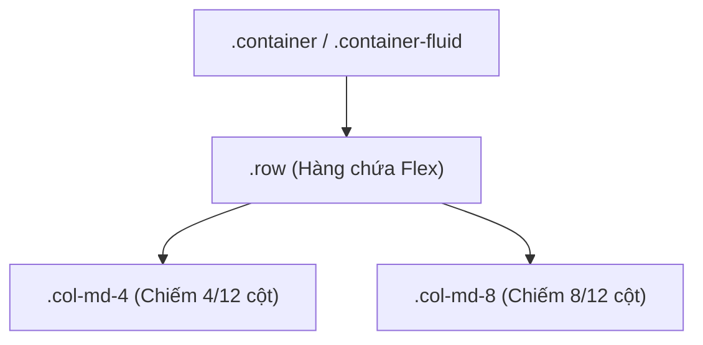

# CHUYÊN ĐỀ 05: BOOTSTRAP FRAMEWORK & THIẾT KẾ RESPONSIVE

> **Môn học:** Phát triển ứng dụng Web (IS207)  
> **Tài liệu tham khảo chính:** `Chương 2 Bootstrap -SV.pdf` (128 trang)

---

## 1. GIỚI THIỆU BOOTSTRAP & THIẾT KẾ RESPONSIVE

### 1.1. Bootstrap là gì?
- **Bootstrap** là framework HTML, CSS và JavaScript mã nguồn mở phổ biến nhất thế giới, cung cấp hệ thống các thành phần giao diện dựng sẵn giúp phát triển website **Responsive** (thích ứng mượt mà trên mọi thiết bị: Mobile, Tablet, Desktop) nhanh chóng và chuẩn mực.
- Thiết kế theo triết lý **Mobile-First** (ưu tiên thiết kế tối ưu cho màn hình nhỏ di động trước, sau đó mở rộng dần ra màn hình lớn).

### 1.2. Thẻ Viewport bắt buộc
Mọi trang web sử dụng Bootstrap đều bắt buộc phải có thẻ meta Viewport đặt trong `<head>`:
```html
<meta name="viewport" content="width=device-width, initial-scale=1">
```
- `width=device-width`: Thiết lập độ rộng của khung nhìn bằng chính độ rộng thực tế của màn hình thiết bị.
- `initial-scale=1`: Thiết lập mức độ thu phóng ban đầu là 100%.

---

## 2. BẢNG SO SÁNH CỐT LÕI: BOOTSTRAP 4 VS BOOTSTRAP 5

Đây là nội dung **cực kỳ hay xuất hiện trong các đề thi lý thuyết và trắc nghiệm**:

| Tiêu chí | Bootstrap 4 | Bootstrap 5 |
| :--- | :--- | :--- |
| **Thư viện phụ thuộc** | Phụ thuộc bắt buộc vào **jQuery** và Popper.js | **Loại bỏ hoàn toàn jQuery**, chuyển sang dùng **Vanilla JavaScript** thuần túy $\rightarrow$ nhẹ và nhanh hơn. |
| **Hệ thống Breakpoints** | Có 5 mức: `xs`, `sm`, `md`, `lg`, `xl` | Bổ sung thêm mức thứ 6: **`xxl`** ($\ge 1400\text{px}$). |
| **Khoảng cách Gutter** | Dùng `.gutter` đơn vị `px` | Dùng hệ thống `.g-*`, `.gx-*`, `.gy-*` (từ 0 đến 5, đơn vị `rem`). |
| **Quy tắc đặt tên căn lề** | Dựa trên `left` / `right` (vd: `ml-*`, `mr-*`, `text-left`, `text-right`, `float-left`) | Đổi sang `start` / `end` (vd: **`ms-*`**, **`me-*`**, **`text-start`**, **`text-end`**, **`float-start`**) để hỗ trợ ngôn ngữ viết từ phải sang trái (RTL). |
| **Thành phần Form** | Dùng `.form-group`, `.form-row` | Bỏ hoàn toàn `.form-group`, thay bằng tiện ích lề **`mb-3`**; thẻ `<select>` dùng riêng class **`.form-select`**. |
| **Biến tùy biến** | Phụ thuộc chính vào preprocessor SASS | Bổ sung hệ thống **CSS Custom Variables** (CSS Variables) ngay trong file CSS compiled và **Utilities API**. |

---

## 3. KHUNG CHỨA (CONTAINERS) & HỆ THỐNG BREAKPOINTS

### 3.1. Các loại Khung chứa (Containers)
Khung chứa là phần tử bao ngoài cơ bản nhất của Bootstrap để căn chỉnh lề, padding cho nội dung:
- `.container`: Khung có độ rộng tối đa (`max-width`) cố định nhảy theo từng breakpoint.
- `.container-fluid`: Khung tràn viền **100% độ rộng** trên tất cả mọi kích cỡ màn hình.
- `.container-{breakpoint}`: Tràn viền 100% cho tới khi màn hình đạt kích thước breakpoint tương ứng thì mới cố định chiều rộng.

### 3.2. Bảng kích thước Breakpoints chuẩn của Bootstrap 5
| Tên Breakpoint | Ký hiệu | Kích thước màn hình | Max-width của `.container` |
| :--- | :---: | :--- | :---: |
| **Extra small** | *(none)* | $< 576\text{px}$ (Điện thoại nhỏ) | 100% (tràn viền) |
| **Small** | `sm` | $\ge 576\text{px}$ (Điện thoại lớn xoay ngang) | $540\text{px}$ |
| **Medium** | `md` | $\ge 768\text{px}$ (Máy tính bảng Tablet) | $720\text{px}$ |
| **Large** | `lg` | $\ge 992\text{px}$ (Laptop / Màn hình nhỏ) | $960\text{px}$ |
| **Extra large** | `xl` | $\ge 1200\text{px}$ (Desktop tiêu chuẩn) | $1140\text{px}$ |
| **Extra extra large** *(B5)* | `xxl` | $\ge 1400\text{px}$ (Màn hình lớn / TV) | $1320\text{px}$ |

---

## 4. HỆ THỐNG LƯỚI (GRID SYSTEM - 12 CỘT)

Hệ thống lưới của Bootstrap xây dựng dựa trên công nghệ **CSS Flexbox**, chia màn hình thành tối đa **12 cột**.



### 4.1. Quy tắc cốt lõi của Grid System
1. **Thứ tự lồng nhau bắt buộc:** `.container` $\rightarrow$ `.row` $\rightarrow$ `.col-*`.
2. `.col-*` phải là con trực tiếp của `.row`.
3. Tổng số cột trên một hàng phải **bằng 12**. Nếu vượt quá 12 cột, các cột thừa sẽ tự động rớt xuống dòng tiếp theo.
4. **Tự động chia đều:** Dùng class `.col` (không kèm số), Bootstrap sẽ tự động chia đều chiều rộng hàng cho các cột đó.
5. **Dịch chuyển vị trí cột (Offsetting columns):** Sử dụng `.offset-{breakpoint}-{number}` (vd: `.offset-md-3` để đẩy lùi cột sang phải 3 đơn vị).

### 4.2. Ví dụ bố cục Responsive đa thiết bị
Yêu cầu: Hiển thị 1 cột trên Mobile (`< 768px`), 2 cột trên Tablet (`>= 768px`) và 4 cột trên Desktop (`>= 992px`):
```html
<div class="container">
  <div class="row g-3">
    <div class="col-12 col-md-6 col-lg-3">
      <div class="p-3 border bg-light">Khối 1</div>
    </div>
    <div class="col-12 col-md-6 col-lg-3">
      <div class="p-3 border bg-light">Khối 2</div>
    </div>
    <div class="col-12 col-md-6 col-lg-3">
      <div class="p-3 border bg-light">Khối 3</div>
    </div>
    <div class="col-12 col-md-6 col-lg-3">
      <div class="p-3 border bg-light">Khối 4</div>
    </div>
  </div>
</div>
```

---

## 5. CÁC TIỆN ÍCH QUAN TRỌNG (UTILITIES)

### 5.1. Tiện ích Lề (Margin & Padding - Spacing)
Cú pháp: `{property}{sides}-{size}`
- **Thuộc tính (`property`):** `m` (margin), `p` (padding).
- **Vị trí (`sides`):**
  - `t` (top), `b` (bottom).
  - `s` (start / bên trái), `e` (end / bên phải).
  - `x` (ngang: cả trái và phải), `y` (dọc: cả trên và dưới).
  - Để trống: áp dụng cả 4 phía.
- **Kích thước (`size`):**
  - `0`: 0px
  - `1`: $0.25\text{rem}$ ($4\text{px}$)
  - `2`: $0.5\text{rem}$ ($8\text{px}$)
  - `3`: $1\text{rem}$ ($16\text{px}$)
  - `4`: $1.5\text{rem}$ ($24\text{px}$)
  - `5`: $3\text{rem}$ ($48\text{px}$)
  - `auto`: Căn giữa tự động (`mx-auto`).

### 5.2. Màu sắc ngữ cảnh (Contextual Colors)
- **Màu chữ:** `.text-primary`, `.text-secondary`, `.text-success`, `.text-danger`, `.text-warning`, `.text-info`, `.text-dark`, `.text-light`, `.text-muted`, `.text-white`.
- **Màu nền:** `.bg-primary`, `.bg-secondary`, `.bg-success`, `.bg-danger`, `.bg-warning`, `.bg-info`, `.bg-dark`, `.bg-light`.

---

## 6. CÁC THÀNH PHẦN GIAO DIỆN (COMPONENTS) PHỔ BIẾN

### 6.1. Bảng (Tables)
- `.table`: Khung bảng chuẩn.
- `.table-striped`: Kẻ sọc màu xen kẽ các dòng.
- `.table-bordered`: Có đường viền ô kẻ xung quanh.
- `.table-hover`: Đổi màu khi hover chuột lên hàng.
- `.table-responsive`: Tạo thanh cuộn ngang khi bảng tràn màn hình điện thoại.

### 6.2. Nút nhấn (Buttons)
- Nút đặc: `.btn .btn-primary`, `.btn .btn-success`, `.btn .btn-danger`...
- Nút viền ngoài: `.btn .btn-outline-primary`, `.btn .btn-outline-danger`...
- Kích thước: `.btn-lg`, `.btn-sm`.
- Nhóm nút: `.btn-group`.

### 6.3. Thẻ thông tin (Cards)
Cấu trúc chuẩn của Card:
```html
<div class="card" style="width: 18rem;">
  
  <div class="card-body">
    <h5 class="card-title">Tiêu đề bài viết</h5>
    <p class="card-text">Nội dung tóm tắt ngắn của thẻ.</p>
    <a href="#" class="btn btn-primary">Xem chi tiết</a>
  </div>
  <div class="card-footer text-muted">Cập nhật 2 ngày trước</div>
</div>
```

### 6.4. Thanh điều hướng Responsive (Navbar)
```html
<nav class="navbar navbar-expand-lg navbar-dark bg-dark">
  <div class="container-fluid">
    <a class="navbar-brand" href="#">IS207-UIT</a>
    <!-- Nút Hamburger hiển thị trên mobile -->
    <button class="navbar-toggler" type="button" data-bs-toggle="collapse" data-bs-target="#navContent">
      <span class="navbar-toggler-icon"></span>
    </button>

    <!-- Menu liên kết sẽ bị thu gọn lại trên mobile -->
    <div class="collapse navbar-collapse" id="navContent">
      <ul class="navbar-nav me-auto mb-2 mb-lg-0">
        <li class="nav-item"><a class="nav-link active" href="#">Trang chủ</a></li>
        <li class="nav-item"><a class="nav-link" href="#">Bài giảng</a></li>
      </ul>
      <form class="d-flex">
        <input class="form-control me-2" type="search" placeholder="Tìm kiếm...">
        <button class="btn btn-outline-success" type="submit">Tìm</button>
      </form>
    </div>
  </div>
</nav>
```

---

## 7. CÁC THÀNH PHẦN JAVASCRIPT TƯƠNG TÁC (JS COMPONENTS)

### 7.1. Hộp thoại Popup (Modal)
- Kích hoạt qua data attribute: `data-bs-toggle="modal"` và `data-bs-target="#myModal"`.
- Cấu trúc khung:
  ```html
  <div class="modal fade" id="myModal" tabindex="-1">
    <div class="modal-dialog">
      <div class="modal-content">
        <div class="modal-header">
          <h5 class="modal-title">Tiêu đề Modal</h5>
          <button type="button" class="btn-close" data-bs-dismiss="modal"></button>
        </div>
        <div class="modal-body">Nội dung thông báo ở đây...</div>
        <div class="modal-footer">
          <button type="button" class="btn btn-secondary" data-bs-dismiss="modal">Đóng</button>
          <button type="button" class="btn btn-primary">Xác nhận</button>
        </div>
      </div>
    </div>
  </div>
  ```

### 7.2. Trình chiếu ảnh động (Carousel)
- Thẻ cha: `.carousel .slide` kèm thuộc tính `data-bs-ride="carousel"`.
- Bên trong chứa `.carousel-inner` với các `.carousel-item` (phải có 1 mục mang class `.active`).

### 7.3. Lưu ý về Tooltip & Popover
Trong Bootstrap, **Tooltip và Popover không tự động hoạt động** qua HTML data-attributes mà **bắt buộc phải kích hoạt bằng JavaScript**:
```javascript
// Kích hoạt tất cả tooltip trên trang bằng Bootstrap 5
var tooltipTriggerList = [].slice.call(document.querySelectorAll('[data-bs-toggle="tooltip"]'));
var tooltipList = tooltipTriggerList.map(function (tooltipTriggerEl) {
  return new bootstrap.Tooltip(tooltipTriggerEl);
});
```
