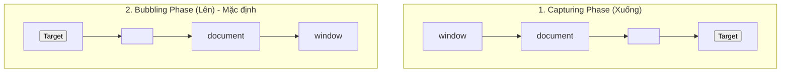

# CHUYÊN ĐỀ 08: JAVASCRIPT DOM & XỬ LÝ SỰ KIỆN (EVENT HANDLING)

> **Môn học:** Phát triển ứng dụng Web (IS207)  
> **Tài liệu tham khảo chính:** `Chương 3 Javascript - SV.pdf` (Slide 103 - 165)

---

## 1. TỔNG QUAN VỀ BOM VÀ DOM

### 1.1. Browser Object Model (BOM)
BOM cung cấp các đối tượng đại diện cho trình duyệt để JavaScript tương tác với môi trường bên ngoài trang web:
- **`window`:** Đối tượng cao nhất đại diện cho cửa sổ trình duyệt (toàn bộ biến và hàm toàn cục đều thuộc về `window`).
  - Hộp thoại: `alert("Thông báo")`, `confirm("Bạn có chắc không?")`, `prompt("Nhập tên:")`.
  - Bộ đếm thời gian (Timers):
    - `let timer = setTimeout(fn, delay)`: Thực thi hàm `fn` một lần sau `delay` mili-giây. Hủy bằng `clearTimeout(timer)`.
    - `let interval = setInterval(fn, delay)`: Lặp lại hàm `fn` định kỳ mỗi `delay` mili-giây. Hủy bằng `clearInterval(interval)`.
  - `window.location`: Quản lý URL hiện tại (`location.href = "url"`, `location.reload()`).
  - `window.history`: Quản lý lịch sử duyệt trang (`history.back()`, `history.forward()`).

### 1.2. Document Object Model (DOM)
DOM là giao diện lập trình ứng dụng (API) biểu diễn tài liệu HTML dưới dạng một **cây cấu trúc phân cấp các nút (DOM Tree)**:

```mermaid
graph TD
    Document["document"] --> HTML["<html>"]
    HTML --> Head["<head>"]
    HTML --> Body["<body>"]
    Head --> Title["<title>"]
    Body --> H1["<h1> Header"]
    Body --> Form["<form id='myForm'>"]
    Form --> Input["<input name='user'>"]
    Form --> Btn["<button> Submit"]
```



---

## 2. TRUY XUẤT CÁC PHẦN TỬ TRÊN CÂY DOM

| Phương thức | Cú pháp | Giá trị trả về |
| :--- | :--- | :--- |
| `getElementById` | `document.getElementById("btnSubmit")` | **1 phần tử duy nhất** có id tương ứng (hoặc `null` nếu không thấy). |
| `getElementsByTagName` | `document.getElementsByTagName("p")` | **HTMLCollection** chứa tất cả thẻ có tên tương ứng. |
| `getElementsByClassName` | `document.getElementsByClassName("item")` | **HTMLCollection** chứa tất cả phần tử có class đó. |
| `querySelector` | `document.querySelector(".menu > li.active")` | **Phần tử đầu tiên** khớp với CSS Selector. |
| `querySelectorAll` | `document.querySelectorAll("input[type='text']")` | **NodeList** chứa toàn bộ các phần tử khớp (có thể dùng `.forEach()`). |

---

## 3. THAO TÁC NỘI DUNG, THUỘC TÍNH & STYLE

### 3.1. Đọc và Ghi nội dung
- **`element.innerHTML`:** Lấy hoặc gán nội dung bao gồm **cả các thẻ HTML bên trong** (trình duyệt sẽ phân tích và render thẻ).
- **`element.textContent`:** Lấy hoặc gán **văn bản thô (Plain Text)**, tự động bỏ qua mọi thẻ HTML. Tuyệt đối an toàn, ngăn chặn tấn công XSS.
- **`inputElement.value`:** Đọc hoặc gán giá trị của các ô điều khiển Form (`<input>`, `<select>`, `<textarea>`).

### 3.2. Thao tác Thuộc tính (Attributes)
```javascript
let link = document.querySelector("a");
// Lấy giá trị thuộc tính:
let url = link.getAttribute("href");
// Thiết lập thuộc tính mới:
link.setAttribute("target", "_blank");
// Xóa thuộc tính:
link.removeAttribute("title");
```

### 3.3. Thay đổi Style và CSS Classes
- **Thuộc tính `.style` (Inline CSS):**
  Tên các thuộc tính CSS có dấu gạch ngang được chuyển thành chuẩn **camelCase**:
  ```javascript
  let box = document.getElementById("box");
  box.style.color = "blue";
  box.style.backgroundColor = "#f0f0f0"; // background-color -> backgroundColor
  box.style.fontSize = "20px";           // font-size -> fontSize
  ```
- **Quản lý danh sách Class qua `.classList` (Khuyến nghị):**
  - `box.classList.add("highlight");` $\rightarrow$ Thêm class
  - `box.classList.remove("hide");` $\rightarrow$ Xóa class
  - `box.classList.toggle("active");` $\rightarrow$ Bật/tắt class (nếu có thì xóa, chưa có thì thêm)
  - `box.classList.contains("active");` $\rightarrow$ Kiểm tra class tồn tại (`true`/`false`)

---

## 4. TẠO VÀ THAO TÁC DOM ĐỘNG (DYNAMIC DOM & DYNAMIC TABLE)

### 4.1. Các phương thức thêm / xóa Node cơ bản
- Tạo phần tử: `let newDiv = document.createElement("div");`
- Thêm vào cuối khối cha: `parent.appendChild(newDiv);`
- Thêm vào trước một nút con: `parent.insertBefore(newDiv, referenceNode);`
- Xóa nút: `parent.removeChild(childNode);` hoặc `childNode.remove();`

### 4.2. Thao tác Bảng động (Dynamic Table - Trọng tâm bài thi thực hành)
Để tương tác linh hoạt với thẻ `<table>`, JavaScript cung cấp các phương thức chuyên dụng:
- `table.insertRow(index)`: Thêm một hàng mới `<tr>` vào bảng (nếu `index = -1` hoặc để trống sẽ chèn vào cuối bảng).
- `row.insertCell(index)`: Thêm một ô dữ liệu `<td>` vào hàng vừa tạo.
- `table.deleteRow(index)`: Xóa hàng ở vị trí chỉ số `index`.

```javascript
function addTableRow(tableId, id, name, score) {
  let table = document.getElementById(tableId);
  // Tạo hàng mới ở cuối bảng
  let row = table.insertRow(-1);

  // Tạo các ô dữ liệu
  let cell1 = row.insertCell(0);
  let cell2 = row.insertCell(1);
  let cell3 = row.insertCell(2);
  let cell4 = row.insertCell(3);

  cell1.textContent = id;
  cell2.textContent = name;
  cell3.textContent = score;
  cell4.innerHTML = `<button onclick="deleteRow(this)">Xóa</button>`;
}

function deleteRow(btn) {
  // btn.parentElement là <td>, parentElement.parentElement là <tr>
  let row = btn.parentElement.parentElement;
  row.remove(); // hoặc table.deleteRow(row.rowIndex);
}
```

---

## 5. XỬ LÝ SỰ KIỆN (EVENT HANDLING)

### 5.1. Ba cách đăng ký lắng nghe sự kiện
1. **Cách 1: Gán inline trong thuộc tính HTML (Lỗi thời, không khuyến khích):**
   ```html
   <button onclick="showMessage('Xin chào')">Click me</button>
   ```
2. **Cách 2: Gán qua thuộc tính sự kiện của phần tử DOM:**
   ```javascript
   let btn = document.getElementById("btn");
   btn.onclick = function() {
     console.log("Đã click nút");
   };
   ```
3. **Cách 3: Sử dụng `addEventListener()` (Chuẩn mực hiện đại):**
   ```javascript
   let btn = document.getElementById("btn");
   btn.addEventListener("click", function(event) {
     console.log("Xử lý click 1");
   });
   // Cho phép gắn nhiều hàm xử lý độc lập cho cùng 1 sự kiện mà không bị ghi đè:
   btn.addEventListener("click", anotherFunction);
   ```

### 5.2. Đối tượng Sự kiện (Event Object)
Khi một sự kiện xảy ra, hàm xử lý sẽ tự động nhận đối tượng `event` làm tham số đầu vào:
- `event.target`: Phần tử HTML thực tế phát sinh ra sự kiện.
- `event.type`: Tên loại sự kiện (vd: `"click"`, `"keyup"`).
- **`event.preventDefault()` (Cực kỳ quan trọng):** Ngăn chặn hành vi mặc định của trình duyệt (ví dụ: ngăn form tự động reload trang khi submit, ngăn thẻ `<a>` nhảy trang).
  ```javascript
  document.getElementById("loginForm").addEventListener("submit", function(e) {
    e.preventDefault(); // Giữ nguyên trang để xử lý AJAX hoặc kiểm tra dữ liệu
  });
  ```
- **`event.stopPropagation()`:** Ngăn chặn sự kiện tiếp tục lan truyền (nổi bọt) lên các phần tử cha.

### 5.3. Cơ chế Lan truyền Sự kiện: Bubbling vs Capturing
- **Event Bubbling (Sự kiện nổi bọt - Mặc định):** Sự kiện được kích hoạt tại phần tử con trong cùng, sau đó **nổi bọt ngược dần lên các phần tử cha bao ngoài** cho đến thẻ `window`.
- **Event Capturing (Bắt giữ):** Sự kiện di chuyển từ ngoài `window` đi sâu dần xuống phần tử đích (kích hoạt bằng cách truyền tham số thứ 3 `true` vào `addEventListener(..., true)`).



---

## 6. BÀI TẬP ỨNG DỤNG MẪU: QUẢN LÝ DANH SÁCH SINH VIÊN

```html
<!DOCTYPE html>
<html lang="vi">
<head>
  <meta charset="UTF-8">
  <title>Quản lý sinh viên - Dynamic DOM</title>
  <style>
    table, th, td { border: 1px solid #333; border-collapse: collapse; padding: 8px; }
  </style>
</head>
<body>
  <h2>Thêm Sinh Viên Mới</h2>
  <form id="studentForm">
    <input type="text" id="mssv" placeholder="Mã số sinh viên" required>
    <input type="text" id="fullname" placeholder="Họ và tên" required>
    <input type="number" id="score" placeholder="Điểm TK" step="0.1" min="0" max="10" required>
    <button type="submit">Thêm vào bảng</button>
  </form>

  <h3 style="margin-top: 20px;">Danh Sách Sinh Viên</h3>
  <table id="tblStudents">
    <thead>
      <tr>
        <th>MSSV</th>
        <th>Họ Tên</th>
        <th>Điểm</th>
        <th>Hành động</th>
      </tr>
    </thead>
    <tbody></tbody>
  </table>

  <script>
    const form = document.getElementById("studentForm");
    const tbody = document.querySelector("#tblStudents tbody");

    form.addEventListener("submit", function(e) {
      e.preventDefault(); // Ngăn reload trang

      const mssv = document.getElementById("mssv").value.trim();
      const name = document.getElementById("fullname").value.trim();
      const score = document.getElementById("score").value;

      // Tạo một hàng <tr> mới
      const row = tbody.insertRow();
      row.insertCell(0).textContent = mssv;
      row.insertCell(1).textContent = name;
      row.insertCell(2).textContent = score;

      const actionCell = row.insertCell(3);
      const delBtn = document.createElement("button");
      delBtn.textContent = "Xóa";
      delBtn.style.color = "red";
      delBtn.addEventListener("click", function() {
        row.remove(); // Xóa hàng khi click
      });
      actionCell.appendChild(delBtn);

      form.reset(); // Xóa trắng form sau khi thêm
    });
  </script>
</body>
</html>
```
