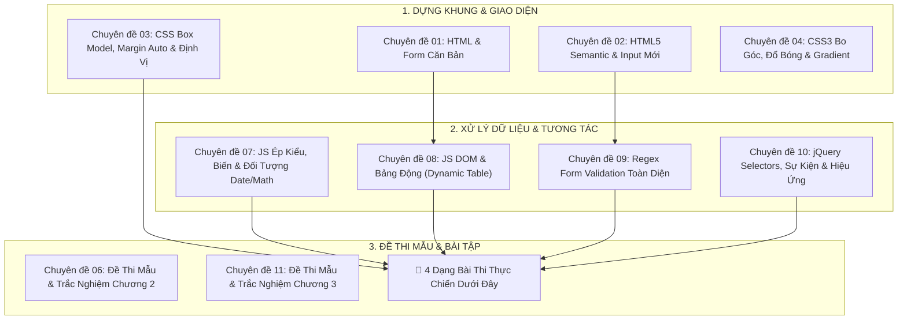

# 🎯 CẨM NANG ÔN THI GIỮA KỲ THỰC CHIẾN (IS207)
### HƯỚNG DẪN VIẾT CODE TRANG WEB KẾT HỢP: HTML + CSS + JAVASCRIPT + JQUERY
> **Môn học:** Phát triển ứng dụng Web (IS207) - Khoa Hệ thống Thông tin (UIT)  
> **Hình thức thi:** Viết code trực tiếp (HTML cấu trúc, CSS định dạng, JavaScript/jQuery xử lý sự kiện, tính toán & DOM).

---

## 🧭 BẢN ĐỒ LIÊN KẾT NHANH ĐẾN CÁC CHUYÊN ĐỀ ÔN TẬP

Để tra cứu lý thuyết chi tiết và cú pháp từng phần, hãy nhấp vào các liên kết chuyên đề dưới đây:



### Bảng Tra Cứu Theo Kỹ Năng Thi:
| Kỹ năng cần thực hiện trong đề thi | File chuyên đề cần xem ngay |
| :--- | :--- |
| **Dựng form, bảng biểu, gộp ô `colspan`/`rowspan`** | 👉 [`01_HTML_Co_Ban.md`](./01_HTML_Co_Ban.md) |
| **Ô nhập ngày giờ, số lượng `min`/`max`, validate HTML5** | 👉 [`02_HTML5_Nang_Cao.md`](./02_HTML5_Nang_Cao.md) |
| **Căn giữa form `margin: auto`, định vị badge, popup** | 👉 [`03_CSS_Co_Ban_Box_Model.md`](./03_CSS_Co_Ban_Box_Model.md) |
| **Nút bấm hover đổi màu, bo góc viền đẹp** | 👉 [`04_CSS3_Nang_Cao_Effects_Animation.md`](./04_CSS3_Nang_Cao_Effects_Animation.md) |
| **Lấy ngày giờ hệ thống tự động (`Date`), làm tròn tiền (`Math`)** | 👉 [`07_JavaScript_Co_Ban_Cu_Phap_Kieu_Du_Lieu.md`](./07_JavaScript_Co_Ban_Cu_Phap_Kieu_Du_Lieu.md) |
| **Thêm hàng `insertRow`, xóa hàng `deleteRow`, bắt sự kiện DOM** | 👉 [`08_JavaScript_DOM_Event_Handling.md`](./08_JavaScript_DOM_Event_Handling.md) |
| **Viết biểu thức Regex kiểm tra Email, SĐT, MSSV UIT** | 👉 [`09_JavaScript_Bat_Dong_Bo_ES6_Regex.md`](./09_JavaScript_Bat_Dong_Bo_ES6_Regex.md) |
| **Dùng jQuery `$(":checked")`, `.val()`, `.append()`, `.on()`** | 👉 [`10_jQuery_Co_Ban_Selector_DOM_Effects.md`](./10_jQuery_Co_Ban_Selector_DOM_Effects.md) |
| **Ôn lại trắc nghiệm và câu hỏi lý thuyết thi cử** | 👉 [`06_Tong_Hop_Cau_Hoi_On_Thi.md`](./06_Tong_Hop_Cau_Hoi_On_Thi.md) & [`11_Tong_Hop_Cau_Hoi_On_Thi_Chuong_3.md`](./11_Tong_Hop_Cau_Hoi_On_Thi_Chuong_3.md) |

---

## 📝 KHUNG SƯỜN CODE CHUẨN KHI BẮT ĐẦU VÀO PHÒNG THI

Khi nhận đề thi, hãy tạo ngay file HTML với cấu trúc chuẩn tích hợp cả 4 thành phần sau để không bị sót:

```html
<!DOCTYPE html>
<html lang="vi">
<head>
  <meta charset="UTF-8">
  <meta name="viewport" content="width=device-width, initial-scale=1.0">
  <title>Bài Thi Giữa Kỳ - Môn Web IS207</title>

  <!-- Nhúng jQuery từ CDN hoặc file cục bộ -->
  <script src="https://code.jquery.com/jquery-3.7.1.min.js"></script>

  <style>
    /* 1. RESET CSS CƠ BẢN */
    * { box-sizing: border-box; margin: 0; padding: 0; }
    body { font-family: Arial, sans-serif; background-color: #f4f6f9; padding: 20px; }

    /* 2. KHUNG CHỨA BÀI THI */
    .container { max-width: 800px; margin: 0 auto; background: #fff; padding: 25px; border-radius: 8px; box-shadow: 0 2px 10px rgba(0,0,0,0.1); }
    h2, h3 { text-align: center; color: #003366; margin-bottom: 20px; }

    /* 3. ĐỊNH DẠNG FORM & BẢNG */
    table { width: 100%; border-collapse: collapse; margin-top: 15px; }
    th, td { border: 1px solid #ccc; padding: 10px; }
    th { background-color: #007bff; color: white; text-align: center; }
    .form-group { margin-bottom: 12px; }
    label { font-weight: bold; display: block; margin-bottom: 5px; }
    input[type="text"], input[type="number"], select { width: 100%; padding: 8px; border: 1px solid #ccc; border-radius: 4px; }
    .btn { background: #28a745; color: white; border: none; padding: 10px 20px; border-radius: 4px; cursor: pointer; font-weight: bold; }
    .btn:hover { background: #218838; }
    .error { color: red; font-size: 13px; margin-top: 4px; }
    .text-right { text-align: right; }
  </style>
</head>
<body>

  <div class="container">
    <!-- NỘI DUNG ĐỀ THI ĐẶT TẠI ĐÂY -->
  </div>

  <script>
    // XỬ LÝ LOGIC JAVASCRIPT & JQUERY TẠI ĐÂY
    $(document).ready(function() {
      console.log("DOM đã sẵn sàng!");
    });
  </script>
</body>
</html>
```

---

## 🏆 4 DẠNG BÀI THI VIẾT CODE HAY GẶP NHẤT TẠI UIT (KÈM CODE MẪU)

---

### DẠNG 1: FORM ĐĂNG KÝ / ĐẶT VÉ CÓ KIỂM TRA HỢP LỆ (FORM VALIDATION VỚI REGEX)
> **Mô tả đề thi:** Tạo form đăng ký/đặt tour. Khi bấm "Xác nhận", kiểm tra nếu bỏ trống hoặc nhập sai định dạng Regex thì báo lỗi đỏ bên dưới ô nhập và không cho submit.

```html
<!-- GIAO DIỆN FORM -->
<h3>ĐĂNG KÝ THÔNG TIN KHÁCH HÀNG</h3>
<form id="regForm">
  <div class="form-group">
    <label>Mã số sinh viên / Khách hàng (8 số, bắt đầu số 2):</label>
    <input type="text" id="txtId" placeholder="VD: 24520496">
    <div id="errId" class="error"></div>
  </div>

  <div class="form-group">
    <label>Họ và tên:</label>
    <input type="text" id="txtName" placeholder="Nguyễn Văn A">
    <div id="errName" class="error"></div>
  </div>

  <div class="form-group">
    <label>Email liên hệ:</label>
    <input type="text" id="txtEmail" placeholder="example@uit.edu.vn">
    <div id="errEmail" class="error"></div>
  </div>

  <div class="form-group">
    <label>Số điện thoại (10 số mạng VN):</label>
    <input type="text" id="txtPhone" placeholder="VD: 0912345678">
    <div id="errPhone" class="error"></div>
  </div>

  <button type="submit" class="btn">Đăng Ký Ngay</button>
</form>

<script>
  $("#regForm").on("submit", function(e) {
    e.preventDefault(); // BẮT BUỘC: Ngăn trang tự động reload
    let isValid = true;

    // Reset thông báo lỗi cũ
    $(".error").text("");

    // 1. Kiểm tra Mã số (8 số, bắt đầu bằng 2)
    let id = $("#txtId").val().trim();
    let regexId = /^2\d{7}$/;
    if (!regexId.test(id)) {
      $("#errId").text("Mã số không hợp lệ! Phải có 8 số và bắt đầu bằng số 2.");
      isValid = false;
    }

    // 2. Kiểm tra Họ tên không được rỗng
    let name = $("#txtName").val().trim();
    if (name === "") {
      $("#errName").text("Vui lòng không để trống họ tên!");
      isValid = false;
    }

    // 3. Kiểm tra Email
    let email = $("#txtEmail").val().trim();
    let regexEmail = /^[^\s@]+@[^\s@]+\.[^\s@]+$/;
    if (!regexEmail.test(email)) {
      $("#errEmail").text("Địa chỉ email không đúng định dạng!");
      isValid = false;
    }

    // 4. Kiểm tra SĐT Việt Nam (10 số, đầu 03, 05, 07, 08, 09)
    let phone = $("#txtPhone").val().trim();
    let regexPhone = /^0[35789]\d{8}$/;
    if (!regexPhone.test(phone)) {
      $("#errPhone").text("Số điện thoại phải có 10 số và hợp lệ tại Việt Nam!");
      isValid = false;
    }

    if (isValid) {
      alert("Đăng ký thành công thông tin: " + name);
      this.reset();
    }
  });
</script>
```

---

### DẠNG 2: THỰC ĐƠN / TÍNH TIỀN MÓN ĂN & DỊCH VỤ (CHECKBOX + RADIO + DROP-DOWN)
> **Mô tả đề thi (Trích Bài TH2 - UIT):** Khách hàng chọn nhiều món ăn (checkbox), thời điểm (Ngày/Đêm - radio). Nếu đặt ban đêm thì phụ thu thêm 10%. Nhấn "Tính tiền" sẽ in bảng chi tiết món ăn và tổng thanh toán bên dưới.

```html
<h3>THỰC ĐƠN ĐẶT MÓN</h3>
<form id="foodForm">
  <div class="form-group">
    <label>Chọn món ăn:</label>
    <label><input type="checkbox" name="food" value="20000" data-name="Bún bò"> Bún bò (20.000đ)</label><br>
    <label><input type="checkbox" name="food" value="18000" data-name="Hủ tiếu"> Hủ tiếu (18.000đ)</label><br>
    <label><input type="checkbox" name="food" value="17000" data-name="Bánh canh"> Bánh canh (17.000đ)</label><br>
    <label><input type="checkbox" name="food" value="15000" data-name="Bánh cuốn"> Bánh cuốn (15.000đ)</label>
  </div>

  <div class="form-group">
    <label>Thời điểm đặt món:</label>
    <label><input type="radio" name="time" value="day" checked> Ban ngày (Giá gốc)</label>
    <label><input type="radio" name="time" value="night"> Ban đêm (Tăng thêm 10%)</label>
  </div>

  <button type="button" id="btnCal" class="btn">Tính Tiền</button>
</form>

<!-- VÙNG HIỂN THỊ KẾT QUẢ IN HÓA ĐƠN -->
<div id="billResult" style="display: none; margin-top: 20px;">
  <h3>HÓA ĐƠN THANH TOÁN</h3>
  <table id="tblBill">
    <thead>
      <tr>
        <th>Món Ăn</th>
        <th class="text-right">Đơn Giá</th>
      </tr>
    </thead>
    <tbody></tbody>
    <tfoot>
      <tr>
        <th>Tổng Thanh Toán:</th>
        <th id="totalMoney" class="text-right" style="color: red; font-size: 18px;"></th>
      </tr>
    </tfoot>
  </table>
</div>

<script>
  $("#btnCal").click(function() {
    let tbody = $("#tblBill tbody");
    tbody.empty(); // Xóa sạch dữ liệu hóa đơn cũ

    let total = 0;
    let selectedFoods = $("input[name='food']:checked");

    if (selectedFoods.length === 0) {
      alert("Vui lòng chọn ít nhất 1 món ăn!");
      $("#billResult").hide();
      return;
    }

    selectedFoods.each(function() {
      let name = $(this).data("name");
      let price = parseFloat($(this).val());
      total += price;

      tbody.append(`
        <tr>
          <td>${name}</td>
          <td class="text-right">${price.toLocaleString('vi-VN')} đ</td>
        </tr>
      `);
    });

    // Kiểm tra thời điểm đêm phụ thu 10%
    let isNight = $("input[name='time']:checked").val() === "night";
    if (isNight) {
      let surcharge = total * 0.1;
      tbody.append(`
        <tr style="color: blue; font-style: italic;">
          <td>Phụ thu ban đêm (+10%)</td>
          <td class="text-right">${surcharge.toLocaleString('vi-VN')} đ</td>
        </tr>
      `);
      total += surcharge;
    }

    $("#totalMoney").text(total.toLocaleString('vi-VN') + " đ");
    $("#billResult").fadeIn(400); // Hiển thị bảng với hiệu ứng mượt
  });
</script>
```

---

### DẠNG 3: BẢNG GIỎ HÀNG ĐỘNG (TỰ TÍNH TIỀN KHI ĐỔI SỐ LƯỢNG & XÓA HÀNG)
> **Mô tả đề thi (Trích Câu 5 - Bài TH2 UIT):** Bảng giỏ hàng có các cột: Tên hàng, Số lượng (dạng number), Đơn giá, Thành tiền và nút Xóa. Khi thay đổi số lượng hoặc xóa dòng, Thành tiền và Tổng tiền toàn bộ giỏ hàng phải tự động cập nhật ngay lập tức.

```html
<h3>GIỎ HÀNG CỦA BẠN</h3>
<table id="cartTable">
  <thead>
    <tr>
      <th>Tên Sản Phẩm</th>
      <th style="width: 120px;">Số Lượng</th>
      <th class="text-right">Đơn Giá</th>
      <th class="text-right">Thành Tiền</th>
      <th style="width: 80px; text-align: center;">Hành Động</th>
    </tr>
  </thead>
  <tbody>
    <tr>
      <td>Áo Thun UIT</td>
      <td><input type="number" class="qty" value="2" min="1" style="width: 80px;"></td>
      <td class="text-right price" data-price="120000">120.000 đ</td>
      <td class="text-right subtotal">240.000 đ</td>
      <td style="text-align: center;"><button class="btn-del" style="background: red; color: white; border: none; padding: 5px 10px; cursor: pointer;">Xóa</button></td>
    </tr>
    <tr>
      <td>Balo Laptop</td>
      <td><input type="number" class="qty" value="1" min="1" style="width: 80px;"></td>
      <td class="text-right price" data-price="350000">350.000 đ</td>
      <td class="text-right subtotal">350.000 đ</td>
      <td style="text-align: center;"><button class="btn-del" style="background: red; color: white; border: none; padding: 5px 10px; cursor: pointer;">Xóa</button></td>
    </tr>
  </tbody>
  <tfoot>
    <tr>
      <th colspan="3" class="text-right">Tổng Tiền Giỏ Hàng:</th>
      <th id="cartTotal" class="text-right" style="color: red; font-size: 18px;">590.000 đ</th>
      <th></th>
    </tr>
  </tfoot>
</table>

<script>
  // Hàm tính toán lại toàn bộ giỏ hàng
  function recalculateCart() {
    let grandTotal = 0;

    $("#cartTable tbody tr").each(function() {
      let qty = parseInt($(this).find(".qty").val()) || 0;
      let price = parseFloat($(this).find(".price").data("price")) || 0;
      let subtotal = qty * price;

      $(this).find(".subtotal").text(subtotal.toLocaleString('vi-VN') + " đ");
      grandTotal += subtotal;
    });

    $("#cartTotal").text(grandTotal.toLocaleString('vi-VN') + " đ");
  }

  // 1. Lắng nghe sự kiện thay đổi số lượng (oninput / onchange)
  $("#cartTable").on("input change", ".qty", function() {
    if ($(this).val() < 1) $(this).val(1); // Không cho số lượng < 1
    recalculateCart();
  });

  // 2. Lắng nghe sự kiện click nút Xóa (Event Delegation)
  $("#cartTable").on("click", ".btn-del", function() {
    $(this).closest("tr").remove(); // Xóa đúng dòng chứa nút bấm
    recalculateCart(); // Cập nhật lại tổng tiền sau khi xóa
  });
</script>
```

---

### DẠNG 4: HIỂN THỊ ĐỒNG HỒ NGÀY GIỜ HỆ THỐNG & QUẢN LÝ THEO BÀN
> **Mô tả đề thi (Trích Câu 3 - Bài TH2 UIT):** Lấy thứ, ngày, tháng, năm và giờ hiện tại của hệ thống hiển thị tự động. Thêm món vào bàn được chọn, tự động cộng dồn số lượng nếu món đã tồn tại.

```javascript
// HÀM LẤY THỜI GIAN HỆ THỐNG CHUẨN ĐỀ THI UIT
function showSystemDateTime() {
  const days = ["Chủ Nhật", "Thứ 2", "Thứ 3", "Thứ 4", "Thứ 5", "Thứ 6", "Thứ 7"];
  const now = new Date();

  const dayName = days[now.getDay()];
  const date = String(now.getDate()).padStart(2, '0');
  const month = String(now.getMonth() + 1).padStart(2, '0'); // Tháng tính từ 0 nên +1
  const year = now.getFullYear();
  const hours = String(now.getHours()).padStart(2, '0');
  const minutes = String(now.getMinutes()).padStart(2, '0');

  const str = `${dayName}, ${date}/${month}/${year}, ${hours}:${minutes}`;
  document.getElementById("clock").textContent = str;
}
showSystemDateTime();
```

---

## ⚠️ CHECKLIST 5 SAI LẦM KHIẾN BỊ 0 ĐIỂM HOẶC VỠ CODE

1. **Quên `event.preventDefault()` khi submit form:**
   - Hậu quả: Khi bấm nút Submit, trình duyệt tự động tải lại trang ngay tức khắc $\rightarrow$ Bảng kết quả vừa tính xong bị biến mất trong tích tắc!
   - Cách sửa: Luôn đặt `e.preventDefault();` ở dòng đầu tiên của hàm xử lý sự kiện submit.
2. **Cộng chuỗi thay vì cộng số (Lỗi ép kiểu):**
   - Hậu quả: Lấy giá trị ô input `let a = $("#txtA").val(); let b = $("#txtB").val();` rồi ghi `a + b` sẽ ra kết quả `"10" + "20" = "1020"` thay vì `30`!
   - Cách sửa: Luôn bọc `parseFloat()` hoặc `parseInt()`: `parseFloat(a) + parseFloat(b)`.
3. **Gọi jQuery khi DOM chưa sẵn sàng:**
   - Hậu quả: Code đặt trong `<head>` gọi `$("#btn")` trả về rỗng vì thẻ HTML bên dưới chưa kịp render.
   - Cách sửa: Luôn bao bọc toàn bộ code trong `$(document).ready(function() { ... });` hoặc đặt thẻ `<script>` ở cuối trước thẻ `</body>`.
4. **Nút "Xóa" tạo động bằng `.append()` không nhận sự kiện click:**
   - Hậu quả: Dùng `$(".btn-del").click(...)` thì các hàng mới thêm vào sau sẽ không bấm nút xóa được!
   - Cách sửa: Dùng cơ chế **Event Delegation**: `$("#myTable").on("click", ".btn-del", function() { ... })`.
5. **Quên đóng thẻ hoặc sai chính tả thuộc tính:**
   - Thẻ `<table>` thiếu thẻ đóng `</table>` hoặc quên thẻ `<tr>` bao quanh `<td>` sẽ làm bảng bị vỡ nát layout.
