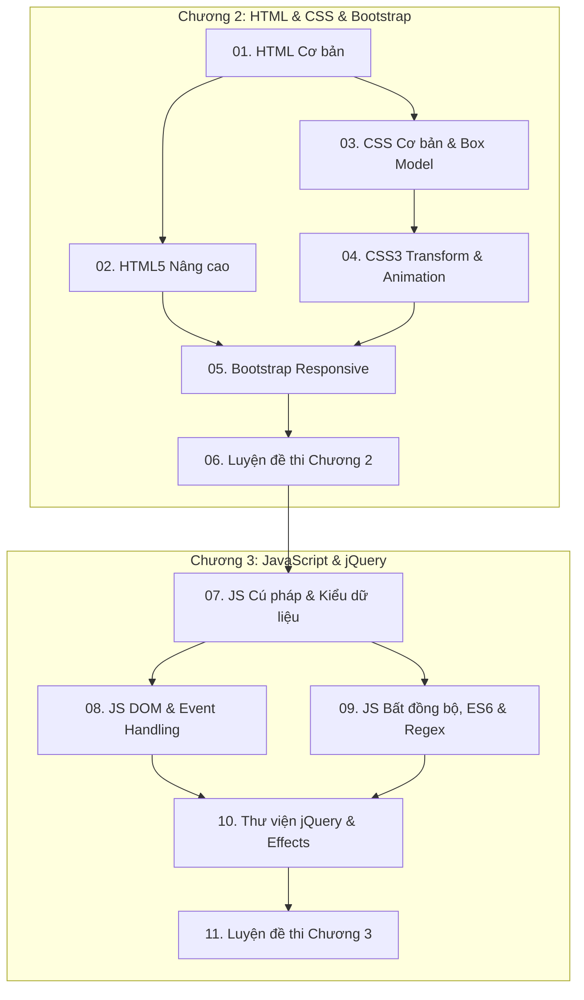

# 📖 TÀI LIỆU ÔN TẬP PHÁT TRIỂN ỨNG DỤNG WEB (IS207)
> **Khoa Hệ thống Thông tin - Trường ĐH Công nghệ Thông tin (UIT)**  
> Bao phủ toàn diện: **Chương 2 (HTML, HTML5, CSS, CSS3, Bootstrap) & Chương 3 (JavaScript, DOM, Async, Regex, jQuery)**

---

## 📌 Danh Sách Các Chuyên Đề Ôn Tập

Hệ thống tài liệu được biên soạn và phân chia thành các chuyên đề chi tiết từ cơ bản đến nâng cao, bám sát toàn bộ slide bài giảng của khoa, kèm bảng so sánh, ví dụ minh họa và đề thi mẫu:

### 🌐 Phần I: Công Nghệ Web Phía Client (Chương 2)

| STT | Tên Chuyên Đề | File Tài Liệu | Nội Dung Trọng Tâm |
| :---: | :--- | :--- | :--- |
| **01** | **HTML & Cấu trúc Web tĩnh** | [`01_HTML_Co_Ban.md`](./01_HTML_Co_Ban.md) | Cấu trúc văn bản, thẻ định dạng, bảng biểu (`colspan`, `rowspan`), form và controls cơ bản, `GET` vs `POST`. |
| **02** | **HTML5 & Công nghệ Web Hiện đại** | [`02_HTML5_Nang_Cao.md`](./02_HTML5_Nang_Cao.md) | Thẻ ngữ nghĩa (*Semantic tags*), Form validation, **Canvas 2D vs SVG**, Audio/Video, **Web Storage** (`localStorage`, `sessionStorage`). |
| **03** | **CSS Cơ bản, Box Model & Định vị** | [`03_CSS_Co_Ban_Box_Model.md`](./03_CSS_Co_Ban_Box_Model.md) | Độ ưu tiên (*Specificity*), Bộ chọn, Pseudo-classes/elements, **CSS Box Model**, Định vị `position` (`relative`, `absolute`, `fixed`). |
| **04** | **CSS3 Nâng cao, Hiệu ứng & Hoạt họa** | [`04_CSS3_Nang_Cao_Effects_Animation.md`](./04_CSS3_Nang_Cao_Effects_Animation.md) | Bo góc, đổ bóng, Gradient, Transform 2D/3D, Transition, Animation `@keyframes`, chuẩn `box-sizing: border-box`. |
| **05** | **Bootstrap & Thiết kế Responsive** | [`05_Bootstrap_Responsive_Design.md`](./05_Bootstrap_Responsive_Design.md) | So sánh **Bootstrap 4 vs 5**, Hệ thống lưới 12 cột (*Grid System*), Containers, Navbar responsive, Card, Modal, Carousel. |
| **06** | **Tổng hợp Câu hỏi & Đề thi Chương 2** | [`06_Tong_Hop_Cau_Hoi_On_Thi.md`](./06_Tong_Hop_Cau_Hoi_On_Thi.md) | Ngân hàng câu hỏi trắc nghiệm có giải thích, bài tập tự luận vẽ bảng gộp ô, chia layout responsive và mẹo tránh bẫy. |

---

### ⚡ Phần II: Lập Trình Phía Client - JavaScript & jQuery (Chương 3)

| STT | Tên Chuyên Đề | File Tài Liệu | Nội Dung Trọng Tâm |
| :---: | :--- | :--- | :--- |
| **07** | **JavaScript Cú pháp, Biến & Kiểu dữ liệu** | [`07_JavaScript_Co_Ban_Cu_Phap_Kieu_Du_Lieu.md`](./07_JavaScript_Co_Ban_Cu_Phap_Kieu_Du_Lieu.md) | So sánh Java vs JS, `var` vs `let` vs `const`, Hoisting, Dynamic Typing, Type Coercion, `null` vs `undefined` vs `NaN`, `??`, `??=`, `eval()`, String/Math/Date/Array. |
| **08** | **JavaScript DOM & Xử lý Sự kiện** | [`08_JavaScript_DOM_Event_Handling.md`](./08_JavaScript_DOM_Event_Handling.md) | BOM & Cây DOM, truy xuất phần tử, `innerHTML` vs `textContent`, **Dynamic Table** (`insertRow`, `deleteRow`), Event Bubbling & Capturing, `preventDefault()`, `stopPropagation()`. |
| **09** | **Bất đồng bộ, ES6+ & Biểu thức chính quy (Regex)** | [`09_JavaScript_Bat_Dong_Bo_ES6_Regex.md`](./09_JavaScript_Bat_Dong_Bo_ES6_Regex.md) | Event Loop, Callback Hell, **Promise**, **`async` / `await`**, Arrow functions, Destructuring, Spread/Rest, **Biểu thức chính quy (Regex)** validate Form. |
| **10** | **jQuery Thao tác DOM & Hiệu ứng (Effects)** | [`10_jQuery_Co_Ban_Selector_DOM_Effects.md`](./10_jQuery_Co_Ban_Selector_DOM_Effects.md) | Triết lý jQuery, `$(document).ready()` vs `window.onload`, Selectors (`:even`, `:odd`, `:eq`), `.val()`, `.append()`, `.remove()` vs `.empty()`, Event Delegation `.on()`, Fading, Sliding, Chaining. |
| **11** | **Tổng hợp Câu hỏi & Đề thi Chương 3** | [`11_Tong_Hop_Cau_Hoi_On_Thi_Chuong_3.md`](./11_Tong_Hop_Cau_Hoi_On_Thi_Chuong_3.md) | Bảng so sánh kinh điển, trắc nghiệm chọn lọc có đáp án, bài tập thực hành code Dynamic Table & Tab menu jQuery, mẹo tránh bẫy thi cử. |

---

## 🗺️ Lộ Trình Học & Ôn Tập Toàn Diện

---

## 💡 Tài Liệu Tóm Tắt Nhanh Tại Thư Mục Gốc
- [`De_Muc_On_Tap_Chuong_2.md`](../De_Muc_On_Tap_Chuong_2.md): Tóm tắt đề mục Chương 2 (HTML/CSS/Bootstrap).
- [`De_Muc_On_Tap_Chuong_3.md`](../De_Muc_On_Tap_Chuong_3.md): Tóm tắt đề mục Chương 3 (JavaScript & jQuery).
