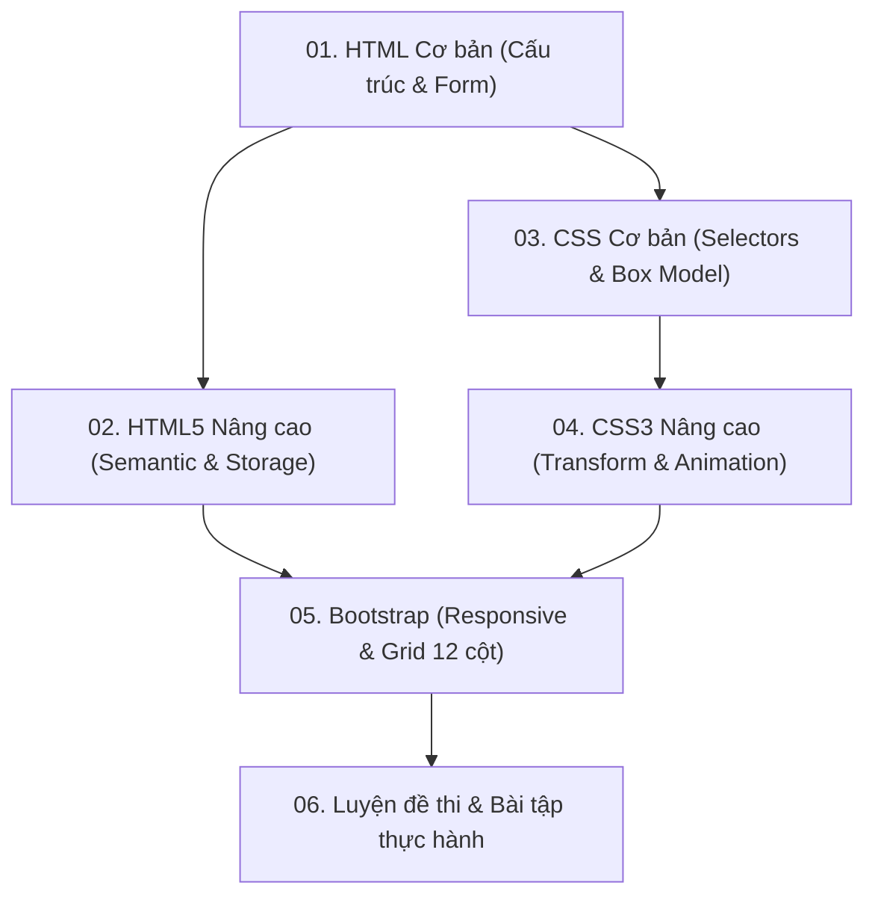

# 📖 TÀI LIỆU ÔN TẬP PHÁT TRIỂN ỨNG DỤNG WEB (IS207)
> **Khoa Hệ thống Thông tin - Trường ĐH Công nghệ Thông tin (UIT)**  
> Trọng tâm: **Công nghệ Web phía Client (HTML, HTML5, CSS, CSS3, Bootstrap Framework)**

---

## 📌 Danh Sách Các Chuyên Đề Ôn Tập

Tài liệu được phân chia theo từng module kiến thức chuẩn chỉ, từ nền tảng đến nâng cao kèm ví dụ minh họa và câu hỏi trắc nghiệm/bài tập thực hành:

| STT | Tên Chuyên Đề | File Tài Liệu | Nội Dung Trọng Tâm |
| :---: | :--- | :--- | :--- |
| **01** | **HTML & Cấu trúc Web tĩnh** | [`01_HTML_Co_Ban.md`](./01_HTML_Co_Ban.md) | Cấu trúc văn bản, thẻ định dạng, bảng biểu (`colspan`, `rowspan`), form và controls cơ bản, GET vs POST. |
| **02** | **HTML5 & Công nghệ Web Hiện đại** | [`02_HTML5_Nang_Cao.md`](./02_HTML5_Nang_Cao.md) | Thẻ ngữ nghĩa (Semantic tags), Form validation, Canvas 2D vs SVG, Audio/Video, Web Storage (`localStorage`, `sessionStorage`). |
| **03** | **CSS Cơ bản, Box Model & Định vị** | [`03_CSS_Co_Ban_Box_Model.md`](./03_CSS_Co_Ban_Box_Model.md) | Độ ưu tiên (Specificity), Bộ chọn, Pseudo-classes/elements, CSS Box Model, Positioning (`relative`, `absolute`, `fixed`). |
| **04** | **CSS3 Nâng cao, Hiệu ứng & Hoạt họa** | [`04_CSS3_Nang_Cao_Effects_Animation.md`](./04_CSS3_Nang_Cao_Effects_Animation.md) | Bo góc, đổ bóng, Gradient, 2D/3D Transform, Transition, Animation `@keyframes`, `box-sizing: border-box`. |
| **05** | **Bootstrap & Thiết kế Responsive** | [`05_Bootstrap_Responsive_Design.md`](./05_Bootstrap_Responsive_Design.md) | So sánh Bootstrap 4 vs 5, Hệ thống lưới 12 cột (Grid System), Containers, Navbar responsive, Card, Modal, Carousel. |
| **06** | **Tổng hợp Câu hỏi & Đề thi Mẫu** | [`06_Tong_Hop_Cau_Hoi_On_Thi.md`](./06_Tong_Hop_Cau_Hoi_On_Thi.md) | Ngân hàng câu hỏi trắc nghiệm có đáp án, bài tập tự luận vẽ bảng, thiết kế layout và mẹo tránh bẫy khi thi. |

---

## 🗺️ Lộ Trình Học & Ôn Tập Khuyến Nghị

---

## 💡 Mẹo Ôn Thi Hiệu Quả
1. **Lý thuyết**: Nắm chắc các bảng so sánh (Canvas vs SVG, `localStorage` vs `sessionStorage`, `GET` vs `POST`, Bootstrap 4 vs 5, `relative` vs `absolute`).
2. **Thực hành vẽ giao diện**: Luyện tập chia bố cục với Bootstrap Grid (`row`, `col-md-*`) và vẽ cấu trúc bảng phức tạp có gộp ô (`rowspan`, `colspan`).
3. **Tra cứu nhanh**: Xem trực tiếp file tóm tắt tổng hợp [`De_Muc_On_Tap_Chuong_2.md`](../De_Muc_On_Tap_Chuong_2.md) ở thư mục gốc.
