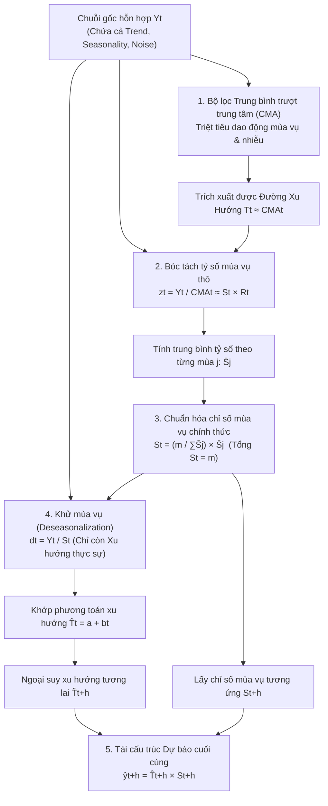

# CHUYÊN ĐỀ 01: NỀN TẢNG CHUỖI THỜI GIAN & PHÂN RÃ CỔ ĐIỂN
## Time Series Foundations, Autocorrelation & Classical Decomposition

---

## 1. BẢN CHẤT VÀ KIẾN TRÚC PHÂN RÃ CHUỖI THỜI GIAN

### 1.1. Chuỗi thời gian là gì?
Chuỗi thời gian (Time Series) là một chuỗi các quan sát $\{y_1, y_2, \dots, y_n\}$ được ghi nhận theo trình tự thời gian với bước nhảy đều đặn (giờ, ngày, tuần, tháng, quý hoặc năm).

### 1.2. Bốn thành phần cấu thành
Một chuỗi dữ liệu thực tế luôn chịu tác động đồng thời của 4 lực đẩy:
1. **Xu hướng dài hạn ($T_t$ - Trend):** Hướng vận động tổng thể của chuỗi qua thời gian dài (tăng trưởng, suy thoái, bão hòa).
2. **Mùa vụ ($S_t$ - Seasonality):** Biến động tuần hoàn lặp đi lặp lại gắn liền với lịch dương (chu kỳ $m$ cố định: $m=4$ theo quý, $m=12$ theo tháng, $m=7$ theo ngày trong tuần, $m=24$ theo giờ trong ngày).
3. **Chu kỳ kinh tế ($C_t$ - Cyclical):** Dao động hình sóng trung-dài hạn gắn liền với chu kỳ kinh tế vĩ mô (khủng hoảng, phục hồi, mở rộng), không có độ dài cố định (thường 2–10 năm). Trong thực hành dự báo ngắn hạn, ta gộp chung thành **Xu hướng - Chu kỳ ($TC_t$)**.
4. **Nhiễu ngẫu nhiên ($R_t$ hoặc $I_t$ - Residual / Irregular):** Các biến động bất thường, đột ngột, không thể dự báo do thiên tai, dịch bệnh, chính sách hay nhiễu đo lường.

### 1.3. Hai dạng mô hình phân rã kinh điển
* **Mô hình cộng (Additive Model):** Áp dụng khi **biên độ dao động mùa vụ không đổi**, bất kể mức độ cao hay thấp của xu hướng:

$$
Y_t = T_t + S_t + R_t
$$

* **Mô hình nhân (Multiplicative Model):** Áp dụng khi **biên độ dao động mùa vụ tỷ lệ thuận với xu hướng** (khi doanh số nền tăng gấp đôi, chênh lệch đỉnh mùa vụ cũng mở rộng gấp đôi):

$$
Y_t = T_t \times S_t \times R_t
$$

---

## 2. SƠ ĐỒ KIẾN TRÚC & LUỒNG FORWARD PASS: PHÂN RÃ CỔ ĐIỂN

Dưới đây là sơ đồ luồng dữ liệu (Forward Pass Pipeline) từ chuỗi gốc đến dự báo tương lai:

---

## 3. TỰ TƯƠNG QUAN MẪU (AUTOCORRELATION FUNCTION - ACF)

### 3.1. Ý nghĩa bản chất
Hệ số tự tương quan mẫu bậc $k$ (ký hiệu $r_k$) đo lường mức độ tương quan tuyến tính giữa giá trị của chuỗi ở thời điểm hôm nay $y_t$ và giá trị của chính chuỗi đó ở $k$ bước trong quá khứ $y_{t-k}$.

### 3.2. Cấu trúc toán học của công thức $r_k$

$$
r_k = \frac{\sum_{t=k+1}^{n} (y_t - \bar{y})(y_{t-k} - \bar{y})}{\sum_{t=1}^{n} (y_t - \bar{y})^2}
$$

* **Tử số (Sample Autocovariance):** Là tổng tích các độ lệch đồng hướng giữa $y_t$ và $y_{t-k}$ so với giá trị trung bình mẫu $\bar{y}$:
  * Nếu hôm nay cao hơn trung bình ($(y_t - \bar{y}) > 0$) và $k$ ngày trước cũng cao hơn trung bình ($(y_{t-k} - \bar{y}) > 0$), tích số mang dấu dương $\implies$ chuỗi có quán tính cùng chiều.
  * Nếu ngược dấu, tích số mang dấu âm $\implies$ chuỗi có xu hướng đảo chiều sau $k$ bước.
* **Mẫu số (Sample Variance):** Là tổng bình phương độ lệch của toàn bộ chuỗi $\sum_{t=1}^n (y_t - \bar{y})^2$. Đóng vai trò chuẩn hóa đưa $r_k$ về khoảng $[-1, 1]$.
* $r_0 = 1$ luôn đúng (chuỗi tương quan tuyệt đối với chính nó tại độ trễ 0).

---

## 4. QUY TRÌNH PHÂN RÃ MÔ HÌNH NHÂN TỪNG BƯỚC

### Bước 1: Tính Trung bình trượt trung tâm (Centered Moving Average - CMA)
* Với chu kỳ mùa vụ chẵn $m=4$ (quý), một trung bình trượt 4 điểm sẽ rơi vào giữa hai quý (không khớp với mốc thời gian thực).
* Để khắc phục, ta lấy trung bình của 2 giá trị MA 4 điểm liên tiếp (gọi là $2 \times 4 \text{ MA}$ hay CMA).
* **Bản chất trọng số:**

$$
\text{CMA}_t = \frac{\frac{y_{t-2} + y_{t-1} + y_t + y_{t+1}}{4} + \frac{y_{t-1} + y_t + y_{t+1} + y_{t+2}}{4}}{2} = \frac{0.5 y_{t-2} + y_{t-1} + y_t + y_{t+1} + 0.5 y_{t+2}}{4}
$$

> [!NOTE]
> Hai đầu mút $y_{t-2}$ và $y_{t+2}$ chỉ nhận trọng số $0.5$, còn 3 điểm ở giữa nhận trọng số $1.0$. Phép tính này giúp căn đúng trọng tâm thời gian tại quý $t$.

### Bước 2: Tách tỷ số mùa vụ thô
Lấy chuỗi gốc chia cho đường xu hướng vừa làm mịn:

$$
z_t = \frac{y_t}{\text{CMA}_t} = \frac{T_t \times S_t \times R_t}{T_t} \approx S_t \times R_t
$$

### Bước 3: Chuẩn hóa chỉ số mùa vụ ($S_t$)
1. Tính giá trị trung bình của các tỷ số $z_t$ theo từng mùa $j \in \{1, \dots, m\}$ qua các năm: $\bar{S}_j$.
2. **Quy tắc chuẩn hóa tổng:** Đối với mô hình nhân, tổng các chỉ số mùa vụ trong 1 chu kỳ phải bằng đúng $m$:

$$
c = \frac{m}{\sum_{j=1}^m \bar{S}_j} \implies S_j = c \times \bar{S}_j
$$

*(Ý nghĩa: $S_j = 1.10$ nghĩa là mùa vụ đó doanh số cao hơn mức bình quân 10%; $S_j = 0.85$ nghĩa là thấp hơn mức bình quân 15%)*.

### Bước 4: Khử mùa vụ (Deseasonalization)
Loại bỏ ảnh hưởng mùa vụ để nhìn thấy sức mua nền tảng:

$$
d_t = \frac{y_t}{S_t}
$$

### Bước 5: Dự báo tương lai
Ngoại suy đường xu hướng $\hat{T}_{t+h} = a + b(t+h)$ và tái cấu trúc yếu tố mùa vụ:

$$
\hat{y}_{t+h} = \hat{T}_{t+h} \times S_{t+h}
$$

---

## 5. CÁC THƯỚC ĐO ĐÁNH GIÁ SAI SỐ DỰ BÁO (ERROR METRICS)

Đặt sai số dự báo tại bước $t$ là $e_t = y_t - \hat{y}_t$.

### 5.1. Sai số tuyệt đối trung bình (Mean Absolute Error - MAE)

$$
\text{MAE} = \frac{1}{n} \sum_{t=1}^{n} |y_t - \hat{y}_t|
$$

* **Bản chất:** Đo khoảng cách trung bình giữa thực tế và dự báo theo cùng đơn vị gốc của dữ liệu. Trực quan, dễ giải thích với các bên liên quan.

### 5.2. Sai số bình phương trung bình (Mean Squared Error - MSE)

$$
\text{MSE} = \frac{1}{n} \sum_{t=1}^{n} (y_t - \hat{y}_t)^2
$$

* **Bản chất:** Bình phương các sai số khiến mô hình phạt rất nặng những cú đoán sai lệch lớn.

### 5.3. Căn bậc hai sai số bình phương trung bình (Root Mean Squared Error - RMSE)

$$
\text{RMSE} = \sqrt{\text{MSE}} = \sqrt{\frac{1}{n} \sum_{t=1}^{n} (y_t - \hat{y}_t)^2}
$$

* **Bản chất:** Đưa MSE về cùng đơn vị gốc của dữ liệu. Do tính chất bình phương, $\text{RMSE} \ge \text{MAE}$; chênh lệch giữa RMSE và MAE càng lớn chứng tỏ mô hình có nhiều điểm dự báo sai lệch cục bộ cực đoan.

### 5.4. Phần trăm sai số tuyệt đối trung bình (Mean Absolute Percentage Error - MAPE)

$$
\text{MAPE} = \frac{100\%}{n} \sum_{t=1}^{n} \left| \frac{y_t - \hat{y}_t}{y_t} \right|
$$

* **Bản chất:** Đo tỷ lệ phần trăm sai lệch tương đối so với giá trị thực tế $y_t$ ở mẫu số. Cho phép so sánh độ chính xác giữa các chuỗi dữ liệu có quy mô doanh thu khác nhau hoàn toàn.

---

## 6. VÍ DỤ TÍNH TAY TỪNG BƯỚC ĐỐI CHIẾU

### Bài toán:
Cho dữ liệu bán hàng 5 quý: $y_1 = 40, y_2 = 56, y_3 = 68, y_4 = 92, y_5 = 50$ (triệu VNĐ).
Đường xu hướng: $\hat{T}_t = 36.5 + 8.5t$. Chỉ số mùa vụ Quý 1: $S_1 = 0.6950$, Quý 3: $S_3 = 1.0392$.

### Các bước tính toán cụ thể:
1. **Tính $\text{CMA}_3$:**

$$
\text{CMA}_3 = \frac{0.5(40) + 56 + 68 + 92 + 0.5(50)}{4} = \frac{20 + 56 + 68 + 92 + 25}{4} = \frac{261}{4} = 65.25
$$

2. **Tính tỷ số mùa vụ thô $z_3$:**

$$
z_3 = \frac{68}{65.25} \approx 1.0421
$$

3. **Tính doanh số khử mùa vụ $d_3$:**

$$
d_3 = \frac{y_3}{S_3} = \frac{68}{1.0392} \approx 65.435 \text{ (triệu VNĐ)}
$$

4. **Dự báo cho Quý 1 năm 3 ($t=9$):**
   * Xu hướng: $\hat{T}_9 = 36.5 + 8.5(9) = 36.5 + 76.5 = 113.0$ triệu VNĐ.
   * Dự báo điều chỉnh mùa vụ: $\hat{y}_9 = \hat{T}_9 \times S_1 = 113.0 \times 0.6950 = 78.535$ triệu VNĐ.

---

## 6. BÀI TẬP VẬN DỤNG & THỰC HÀNH TƯƠNG TÁC

Hãy mở tập tin bài tập tương tác kiểm tra kiến trúc và tự tính toán con số tại:
[bai_tap_tinh_toan.html](file:///d:/KnowledgeLibrary/time-series/01_nen_tang_va_phan_ra_chuoi_thoi_gian/bai_tap_tinh_toan.html)
