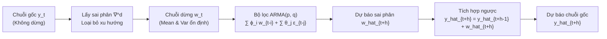

# CHUYÊN ĐỀ 03: MÔ HÌNH THỐNG KÊ CỔ ĐIỂN AR, MA, ARIMA & SARIMA
## Autoregressive, Moving Average & Seasonal Integrated Models

---

## 1. TỔNG QUAN VỀ HỌ MÔ HÌNH BOX-JENKINS

Phương pháp tiếp cận Box-Jenkins (1970) là một trong những nền tảng kinh điển và chặt chẽ nhất của lý thuyết chuỗi thời gian thống kê. Ý tưởng trung tâm là:
* Biến đổi chuỗi thời gian thực tế (thường không dừng, có xu hướng hoặc mùa vụ) về một **chuỗi dừng (Stationary Series)** thông qua kỹ thuật lấy sai phân (Differencing).
* Mô hình hóa cấu trúc tương quan nội tại của chuỗi dừng bằng sự kết hợp giữa **Tự hồi quy (Autoregressive - AR)** và **Trung bình trượt (Moving Average - MA)**.
* Dự báo trên chuỗi dừng, sau đó **tích hợp ngược (Integration/Undifferencing)** để đưa về thang đo gốc của chuỗi ban đầu.

---

## 2. BẢN CHẤT KIẾN TRÚC & LUỒNG FORWARD PASS TRONG ARIMA

Mô hình ARIMA($p, d, q$) hoạt động như một hệ thống xử lý và lọc tín hiệu số (Digital Signal Filter) gồm 3 giai đoạn:

1. **Giai đoạn tiền xử lý (Differencing - $\nabla^d$):**
   * Nếu chuỗi có xu hướng trôi (stochastic trend), nó chứa nghiệm đơn vị (Unit Root). Ta thực hiện sai phân bậc 1: $w_t = y_t - y_{t-1}$.
   * Chuỗi $w_t$ thu được dao động ổn định quanh mức trung bình cố định $\mu$.

2. **Giai đoạn suy luận ARMA (Inference on Stationary Series):**
   * Giá trị $w_t$ được ước lượng bằng $p$ quan sát trễ trong quá khứ (thành phần AR với các hệ số $\phi_1, \dots, \phi_p$) và $q$ cú sốc ngẫu nhiên trong quá khứ (thành phần MA với các hệ số $\theta_1, \dots, \theta_q$).
   * Khi suy luận tiến vào tương lai ($h \ge 1$), kỳ vọng của mọi cú sốc mới chưa xảy ra bằng $0$ ($\mathbb{E}[\epsilon_{t+h}] = 0$). Các cú sốc cũ biến mất sau $q$ bước, khiến dự báo tiệm cận dần về mức trung bình dài hạn $\mu$.

3. **Giai đoạn phục hồi tích hợp (Cumulative Undifferencing):**
   * Để đưa dự báo sai phân $\hat{w}_{t+h}$ về giá trị quan sát gốc $\hat{y}_{t+h}$, ta thực hiện phép tích phân rời rạc (cộng dồn lũy tích):

$$
\hat{y}_{t+1} = y_t + \hat{w}_{t+1}
$$

$$
\hat{y}_{t+2} = \hat{y}_{t+1} + \hat{w}_{t+2} = y_t + \hat{w}_{t+1} + \hat{w}_{t+2}
$$

---

## 3. QUÁ TRÌNH TỰ HỒI QUY (AUTOREGRESSIVE MODEL - AR)

### 3.1. Định nghĩa mô hình AR(p)
Mô hình tự hồi quy bậc $p$, ký hiệu $\text{AR}(p)$, giả định giá trị hiện tại $y_t$ là một tổ hợp tuyến tính của $p$ giá trị trễ quá khứ cộng với số hạng nhiễu trắng:

$$
y_t = c + \phi_1 y_{t-1} + \phi_2 y_{t-2} + \dots + \phi_p y_{t-p} + \epsilon_t
$$

Trong đó:
* $c$ là hệ số chặn (constant / intercept).
* $\phi_1, \dots, \phi_p$ là các tham số tự hồi quy.
* $\epsilon_t \sim \text{WN}(0, \sigma_\epsilon^2)$ là quá trình **nhiễu trắng (White Noise)**: $\mathbb{E}[\epsilon_t] = 0$, $\text{Var}(\epsilon_t) = \sigma_\epsilon^2$, và $\text{Cov}(\epsilon_t, \epsilon_s) = 0$ khi $t \ne s$.

### 3.2. Tính chất của quá trình AR(1)
Xét mô hình $\text{AR}(1)$:

$$
y_t = c + \phi_1 y_{t-1} + \epsilon_t
$$

1. **Điều kiện dừng (Stationarity Condition):**
   Chuỗi dừng khi và chỉ khi:

$$
|\phi_1| < 1
$$

2. **Kỳ vọng trung bình dài hạn ($\mu$):**
   Lấy kỳ vọng toán học hai vế khi chuỗi đã dừng ($\mathbb{E}[y_t] = \mathbb{E}[y_{t-1}] = \mu$):

$$
\mu = c + \phi_1 \mu + \mathbb{E}[\epsilon_t] = c + \phi_1 \mu + 0 \implies \mu(1 - \phi_1) = c
$$

$$
\mu = \frac{c}{1 - \phi_1}
$$

3. **Phương sai toàn cục ($\text{Var}(y_t)$):**
   Lấy phương sai hai vế (vì $\epsilon_t$ độc lập với $y_{t-1}$):

$$
\text{Var}(y_t) = \phi_1^2 \text{Var}(y_{t-1}) + \text{Var}(\epsilon_t) = \phi_1^2 \text{Var}(y_t) + \sigma_\epsilon^2
$$

$$
\text{Var}(y_t)(1 - \phi_1^2) = \sigma_\epsilon^2 \implies \text{Var}(y_t) = \frac{\sigma_\epsilon^2}{1 - \phi_1^2}
$$

---

## 4. QUÁ TRÌNH TRUNG BÌNH TRƯỢT (MOVING AVERAGE - MA) & ARMA

### 4.1. Định nghĩa mô hình MA(q)
Mô hình trung bình trượt bậc $q$, ký hiệu $\text{MA}(q)$, biểu diễn giá trị hiện tại theo các cú sốc ngẫu nhiên quá khứ:

$$
y_t = \mu + \epsilon_t + \theta_1 \epsilon_{t-1} + \theta_2 \epsilon_{t-2} + \dots + \theta_q \epsilon_{t-q}
$$

* **Tính dừng:** Mọi quá trình $\text{MA}(q)$ với số bậc hữu hạn $q$ đều **luôn luôn dừng** với bất kỳ giá trị tham số nào của $\theta$.
* **Tính khả nghịch (Invertibility):** Để mô hình $\text{MA}(q)$ có thể biểu diễn tương đương dưới dạng $\text{AR}(\infty)$, các nghiệm của đa thức đặc trưng phải nằm ngoài đường tròn đơn vị. Với $\text{MA}(1)$, điều kiện là $|\theta_1| < 1$.

### 4.2. Mô hình kết hợp ARMA(p, q)
Kết hợp cả hai thành phần:

$$
y_t = c + \sum_{i=1}^p \phi_i y_{t-i} + \epsilon_t + \sum_{j=1}^q \theta_j \epsilon_{t-j}
$$

### 4.3. Quy tắc kỳ vọng có điều kiện cho dự báo đa bước
Khi đứng tại mốc $t$ để dự báo bước tương lai $t+h$:

$$
\hat{y}_{t+h|t} = \mathbb{E}[y_{t+h} \mid y_1, \dots, y_t]
$$

* **Với các biến quá khứ ($k \le 0$):**
  * $\mathbb{E}[y_{t+k} \mid \dots] = y_{t+k}$ (đã xảy ra, là hằng số đã biết).
  * $\mathbb{E}[\epsilon_{t+k} \mid \dots] = e_{t+k} = y_{t+k} - \hat{y}_{t+k|t+k-1}$ (phần dư thực tế đã quan sát).
* **Với các biến tương lai ($k > 0$):**
  * $\mathbb{E}[y_{t+k} \mid \dots] = \hat{y}_{t+k|t}$ (thay bằng giá trị dự báo đệ quy).
  * $\mathbb{E}[\epsilon_{t+k} \mid \dots] = 0$ (vì tương lai chưa xảy ra, kỳ vọng nhiễu bằng 0).

---

## 5. MÔ HÌNH TÍCH HỢP ARIMA(p, d, q) & SARIMA

### 5.1. Định nghĩa ARIMA(p, d, q)
Khi chuỗi gốc $y_t$ không dừng nhưng sai phân bậc $d$ của nó $w_t = \Delta^d y_t = (1 - B)^d y_t$ là một chuỗi dừng tuân theo $\text{ARMA}(p, q)$, ta gọi đó là mô hình $\text{ARIMA}(p, d, q)$:

$$
(1 - \phi_1 B - \dots - \phi_p B^p)(1 - B)^d y_t = c + (1 + \theta_1 B + \dots + \theta_q B^q)\epsilon_t
$$

### 5.2. Mô hình SARIMA(p, d, q)(P, D, Q)[m]
Mở rộng cho chuỗi có yếu tố mùa vụ chu kỳ $m$ (ví dụ $m=4$ theo quý, $m=12$ theo tháng):
* $D$: Số lần lấy sai phân mùa vụ $\Delta_m y_t = y_t - y_{t-m}$.
* $P$: Bậc tự hồi quy mùa vụ $\Phi(B^m)$.
* $Q$: Bậc trung bình trượt mùa vụ $\Theta(B^m)$.

---

## 6. VÍ DỤ TÍNH TAY CHI TIẾT TỪNG BƯỚC (WORKED NUMERICAL EXAMPLES)

### 6.1. Bài toán 1: Tính toán Kỳ vọng và Phương sai AR(1)
Cho quá trình $\text{AR}(1)$ có phương trình:

$$
y_t = 6.0 + 0.7 y_{t-1} + \epsilon_t
$$

với phương sai của số hạng nhiễu trắng $\sigma_\epsilon^2 = 1.02$.

#### Bước 1: Tính kỳ vọng trung bình dài hạn $\mu$
* Hệ số chặn $c = 6.0$, hệ số tự hồi quy $\phi_1 = 0.7$.
* Vì $|\phi_1| = 0.7 < 1$, chuỗi có tính dừng. Mức cân bằng dài hạn là:

$$
\mu = \frac{c}{1 - \phi_1} = \frac{6.0}{1 - 0.7} = \frac{6.0}{0.3} = 20.0
$$

#### Bước 2: Tính phương sai toàn cục của chuỗi $\text{Var}(y_t)$

$$
\text{Var}(y_t) = \frac{\sigma_\epsilon^2}{1 - \phi_1^2} = \frac{1.02}{1 - (0.7)^2} = \frac{1.02}{1 - 0.49} = \frac{1.02}{0.51} = 2.0
$$

---

### 6.2. Bài toán 2: Dự báo đệ quy đa bước ARMA(1, 1)
Cho mô hình $\text{ARMA}(1, 1)$ có phương trình:

$$
y_t = 8.0 + 0.5 y_{t-1} + 0.3 \epsilon_{t-1} + \epsilon_t
$$

Tại thời điểm hiện tại $t = 50$:
* Giá trị chuỗi: $y_{50} = 22.0$
* Phần dư quan sát được: $\epsilon_{50} = 2.0$

#### Bước 1: Dự báo 1 bước tới ($h=1$, thời điểm $t=51$)
Viết phương trình tại $t=51$:

$$
y_{51} = 8.0 + 0.5 y_{50} + 0.3 \epsilon_{50} + \epsilon_{51}
$$

Lấy kỳ vọng có điều kiện tại $t=50$:
* $\mathbb{E}[y_{50}] = 22.0$
* $\mathbb{E}[\epsilon_{50}] = 2.0$
* $\mathbb{E}[\epsilon_{51}] = 0$ (nhiễu tương lai)

$$
\hat{y}_{51|50} = 8.0 + 0.5(22.0) + 0.3(2.0) + 0 = 8.0 + 11.0 + 0.6 = 19.6
$$

#### Bước 2: Dự báo 2 bước tới ($h=2$, thời điểm $t=52$)
Viết phương trình tại $t=52$:

$$
y_{52} = 8.0 + 0.5 y_{51} + 0.3 \epsilon_{51} + \epsilon_{52}
$$

Lấy kỳ vọng có điều kiện:
* $y_{51}$ chưa xảy ra, thay bằng giá trị dự báo $\hat{y}_{51|50} = 19.6$.
* Cú sốc $\epsilon_{51}$ thuộc tương lai so với mốc $t=50$, do đó $\mathbb{E}[\epsilon_{51}] = 0$.
* Tương tự $\mathbb{E}[\epsilon_{52}] = 0$.

$$
\hat{y}_{52|50} = 8.0 + 0.5(19.6) + 0.3(0) + 0 = 8.0 + 9.8 = 17.8
$$

#### Bước 3: Xác định giá trị hội tụ dài hạn khi $h \to \infty$
Khi dự báo rất xa vào tương lai, ảnh hưởng của điều kiện ban đầu ($y_{50}, \epsilon_{50}$) tiêu biến hoàn toàn, dự báo hội tụ về trung bình dài hạn $\mu$:

$$
\mu = \frac{c}{1 - \phi_1} = \frac{8.0}{1 - 0.5} = \frac{8.0}{0.5} = 16.0
$$

---

### 6.3. Bài toán 3: Phục hồi tích hợp sai phân ARIMA(1, 1, 0)
Xét chuỗi sai phân bậc 1: $w_t = y_t - y_{t-1}$ tuân theo mô hình $\text{AR}(1)$:

$$
w_t = 0.4 w_{t-1} + \epsilon_t
$$

Tại thời điểm $t=20$, dữ liệu gốc có:
* $y_{19} = 100.0$
* $y_{20} = 105.0$

#### Bước 1: Tính giá trị sai phân tại $t=20$ ($w_{20}$)

$$
w_{20} = y_{20} - y_{19} = 105.0 - 100.0 = 5.0
$$

*(Ý nghĩa: Tại bước 20, mức tăng trưởng thực tế là $+5.0$ đơn vị)*.

#### Bước 2: Dự báo sai phân $\hat{w}_{21}$ và phục hồi giá trị gốc $\hat{y}_{21}$
* Dự báo tốc độ tăng trưởng ở bước 21:

$$
\hat{w}_{21} = 0.4 \times w_{20} = 0.4 \times 5.0 = 2.0
$$

* Phục hồi tích hợp đưa về chuỗi gốc:

$$
\hat{y}_{21} = y_{20} + \hat{w}_{21} = 105.0 + 2.0 = 107.0
$$

#### Bước 3: Dự báo sai phân $\hat{w}_{22}$ và phục hồi giá trị gốc $\hat{y}_{22}$
* Dự báo tốc độ tăng trưởng ở bước 22:

$$
\hat{w}_{22} = 0.4 \times \hat{w}_{21} = 0.4 \times 2.0 = 0.8
$$

* Phục hồi tích hợp đưa về chuỗi gốc:

$$
\hat{y}_{22} = \hat{y}_{21} + \hat{w}_{22} = 107.0 + 0.8 = 107.8
$$

---

## 7. BÀI TẬP VẬN DỤNG & THỰC HÀNH TƯƠNG TÁC

Hãy mở tập tin bài tập tương tác kiểm tra kiến trúc và tự tính toán con số tại:
[bai_tap_tinh_toan.html](file:///d:/KnowledgeLibrary/time-series/03_mo_hinh_arima_va_sarima/bai_tap_tinh_toan.html)
