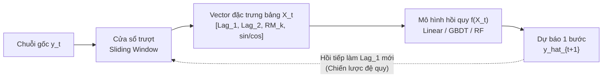

# CHUYÊN ĐỀ 04: HỌC MÁY CHO DỰ BÁO CHUỖI THỜI GIAN
## Tabular Feature Engineering & Supervised Regression for Time Series

---

## 1. NGUYÊN LÝ BIẾN ĐỔI CHUỖI THỜI GIAN SANG DỮ LIỆU BẢNG

Các mô hình học máy có giám sát (Supervised Machine Learning) như Hồi quy tuyến tính (Ridge, Lasso), Random Forest, XGBoost hay LightGBM không thể tiếp nhận trực tiếp chuỗi thời gian đơn biến $\{y_1, y_2, \dots, y_T\}$. Chúng đòi hỏi dữ liệu huấn luyện ở định dạng ma trận bảng:

$$
\mathcal{D} = \{(X_t, y_t)\}_{t=k}^N \quad \text{với } X_t \in \mathbb{R}^d, \, y_t \in \mathbb{R}
$$

Để thực hiện điều này, kỹ thuật **Cửa sổ trượt (Sliding Window Formulation)** được áp dụng nhằm trích xuất các đặc trưng quá khứ làm biến độc lập ($X_t$) và giá trị hiện tại làm nhãn mục tiêu ($y_t$).

---

## 2. BẢN CHẤT KIẾN TRÚC & LUỒNG FORWARD PASS TRONG TABULAR ML

Luồng tính toán xuôi (Forward Loop) trong bài toán dự báo học máy dạng bảng trải qua 3 khâu liên hoàn:

1. **Khâu bóc tách đặc trưng (Feature Engineering Pipeline):**
   * Tại mỗi mốc thời gian $t$, bộ trích xuất lùi về quá khứ để lấy các giá trị trễ ($y_{t-1}, y_{t-2}$), tính các đại lượng thống kê trượt (Rolling Mean, Rolling Std) và mã hóa chu kỳ ngày/tuần bằng hàm lượng giác $(\sin, \cos)$ để đóng gói thành vector đặc trưng $X_t$.

2. **Khâu suy luận tiến (Forward Inference):**
   * Vector $X_t$ được truyền qua hàm quyết định của mô hình đã huấn luyện $\hat{y}_{t+1} = f(X_t)$ để sinh ra giá trị dự báo một bước tiếp theo.

3. **Khâu hồi tiếp đệ quy đa bước (Recursive Forward Feedback):**
   * Khi cần dự báo tiếp bước $t+2$ mà dữ liệu thực tế $y_{t+1}$ chưa xảy ra, ta đưa chính giá trị vừa dự báo $\hat{y}_{t+1}$ quay ngược lại đóng vai trò làm $\text{Lag}_1$, dịch chuyển toàn bộ cửa sổ sang phải 1 vị trí và lặp lại luồng suy luận.

---

## 3. CÁC HỌ ĐẶC TRƯNG THỜI GIAN CỐT LÕI (FEATURE ENGINEERING)

### 3.1. Đặc trưng trễ (Lag Features)
Lấy các giá trị quan sát lùi về quá khứ làm các cột biến độc lập:

$$
\text{Lag}_1 = y_{t-1}, \quad \text{Lag}_2 = y_{t-2}, \quad \dots, \quad \text{Lag}_p = y_{t-p}
$$

*Ý nghĩa:* Giúp mô hình nắm bắt được mối quan hệ tự hồi quy và quán tính biến động của chuỗi.

### 3.2. Đặc trưng thống kê trượt (Rolling Window Statistics)
Được tính toán trên một cửa sổ kích thước $k$ kết thúc tại $t-1$ (tuyệt đối không chứa $y_t$ để tránh rò rỉ thông tin tương lai):

1. **Trung bình trượt (Rolling Mean - $\text{RM}_k$):**

$$
\text{RM}_k = \frac{1}{k} \sum_{i=1}^k y_{t-i} = \frac{y_{t-1} + y_{t-2} + \dots + y_{t-k}}{k}
$$

2. **Độ lệch chuẩn trượt (Rolling Standard Deviation):** Đo lường mức độ biến động (volatility) ngắn hạn.

$$
\text{roll\_std}_{t, k} = \sqrt{\frac{1}{k-1} \sum_{i=1}^k (y_{t-i} - \text{RM}_k)^2}
$$

3. **Cực trị trượt (Rolling Min / Max):** Xác định ngưỡng kháng cự và hỗ trợ ngắn hạn của chuỗi.

### 3.3. Đặc trưng lịch & Mã hóa chu kỳ lượng giác (Cyclical Encoding)
Các biến thời gian như giờ trong ngày ($0 \dots 23$), ngày trong tuần ($1 \dots 7$) hay tháng trong năm ($1 \dots 12$) có tính chất tuần hoàn khép kín:
* Giờ 23:00 và giờ 00:00 cách nhau chỉ 1 tiếng, nhưng nếu để dạng số nguyên thì khoảng cách toán học giữa chúng là $|23 - 0| = 23$ đơn vị. Mô hình sẽ hiểu lầm đây là hai trạng thái đối nghịch cực đoan.
* Để giải quyết điểm gián đoạn này, ta chiếu biến chu kỳ lên **vòng tròn lượng giác đơn vị 2 chiều** qua cặp tọa độ $(\sin, \cos)$ với chu kỳ cơ sở $T$:

$$
x_{\sin} = \sin\left(\frac{2\pi \times t}{T}\right), \qquad x_{\cos} = \cos\left(\frac{2\pi \times t}{T}\right)
$$

* **Chu kỳ giờ trong ngày ($T = 24$, với $\text{hour} \in [0, 23]$):**

$$
\text{hour}_{\sin} = \sin\left(\frac{2\pi \times \text{hour}}{24}\right), \qquad \text{hour}_{\cos} = \cos\left(\frac{2\pi \times \text{hour}}{24}\right)
$$

* **Chu kỳ ngày trong tuần ($T = 7$, với $\text{dow} \in [1, 7]$):**

$$
\text{dow}_{\sin} = \sin\left(\frac{2\pi \times \text{dow}}{7}\right), \qquad \text{dow}_{\cos} = \cos\left(\frac{2\pi \times \text{dow}}{7}\right)
$$

> [!TIP]
> **Bản chất hình học:** Trên mặt phẳng tọa độ $(\cos, \sin)$, điểm đại diện cho 23:00 (góc $345^\circ$) nằm sát ngay bên cạnh điểm đại diện cho 00:00 (góc $0^\circ$). Khoảng cách Euclid giữa chúng thực sự bằng 1 bước thời gian, giúp cây quyết định và mạng nơ-ron học trơn tru.

---

## 4. CHIẾN LƯỢC KIỂM ĐỊNH & DỰ BÁO ĐA BƯỚC

### 4.1. Nguyên tắc phân chia dữ liệu (Cross-Validation)
> [!WARNING]
> **TUYỆT ĐỐI KHÔNG DÙNG K-FOLD RANDOM SHUFFLE**
> Việc xáo trộn ngẫu nhiên các dòng dữ liệu chuỗi thời gian sẽ gây ra hiện tượng **Look-ahead Bias (Rò rỉ tương lai vào quá khứ)**: mô hình dùng thông tin của ngày mai để dự báo ngày hôm qua, dẫn đến điểm kiểm thử cao ảo nhưng thất bại hoàn toàn trên thực tế.

* **Cửa sổ mở rộng (Expanding Window / TimeSeriesSplit):**
  * Fold 1: Train $[1 \dots t_1]$, Test $[t_1+1 \dots t_2]$
  * Fold 2: Train $[1 \dots t_2]$, Test $[t_2+1 \dots t_3]$
* **Cửa sổ trượt cố định (Rolling Window):** Giữ nguyên độ dài tập huấn luyện và dịch chuyển đều theo thời gian.

### 4.2. Các chiến lược dự báo đa bước (Multi-step Forecasting)
Khi cần dự báo một chân trời thời gian $H$ bước ($\hat{y}_{t+1}, \hat{y}_{t+2}, \dots, \hat{y}_{t+H}$):

1. **Chiến lược đệ quy (Recursive Strategy):**
   * Huấn luyện 1 mô hình dự báo 1 bước tới: $\hat{y}_{t+1} = f(y_t, y_{t-1}, \dots)$.
   * Lấy $\hat{y}_{t+1}$ làm $\text{Lag}_1$ giả định để dự báo tiếp $\hat{y}_{t+2}$.
   * *Ưu điểm:* Đơn giản, chi phí tính toán thấp.
   * *Nhược điểm:* **Tích lũy sai số (Error Accumulation)** — sai số ở các bước đầu tiên sẽ bị khuếch đại sang các bước sau.

2. **Chiến lược trực tiếp (Direct Strategy):**
   * Huấn luyện $H$ mô hình riêng biệt: mô hình thứ $h$ chuyên trách dự báo thời điểm $t+h$: $\hat{y}_{t+h} = f_h(y_t, y_{t-1}, \dots)$.
   * *Ưu điểm:* Không bị tích lũy sai số.
   * *Nhược điểm:* Tốn công sức và tài nguyên huấn luyện gấp $H$ lần.

---

## 5. VÍ DỤ TÍNH TAY CHI TIẾT TỪNG BƯỚC (WORKED NUMERICAL EXAMPLES)

### 5.1. Bài toán 1: Bóc tách Đặc trưng Trễ và Trung bình trượt
Cho chuỗi thời gian: $y = [10, 15, 12, 18, 20, 25]$ với chỉ số thời gian $t = 1 \dots 6$:
* $y_1 = 10, y_2 = 15, y_3 = 12, y_4 = 18, y_5 = 20, y_6 = 25$.

#### Bước 1: Bóc tách vector đặc trưng tại $t=4$ ($y_4 = 18$)
Tại mốc $t=4$, các quan sát trong quá khứ là $y_3, y_2, y_1$:
* Đặc trưng trễ bậc 1: $L_1 = y_{t-1} = y_3 = 12$.
* Đặc trưng trễ bậc 2: $L_2 = y_{t-2} = y_2 = 15$.
* Trung bình trượt 3 bước $\text{RM}_3$:

$$
\text{RM}_3 = \frac{y_3 + y_2 + y_1}{3} = \frac{12 + 15 + 10}{3} = \frac{37}{3} \approx 12.333
$$

Vector đặc trưng tại $t=4$ là $X_4 = [12, 15, 12.333]$ với nhãn mục tiêu $y_4 = 18$.

#### Bước 2: Bóc tách vector đặc trưng tại $t=5$ ($y_5 = 20$)
Tại mốc $t=5$:
* Đặc trưng trễ bậc 1: $L_1 = y_{t-1} = y_4 = 18$.
* Trung bình trượt 2 bước $\text{RM}_2$:

$$
\text{RM}_2 = \frac{y_4 + y_3}{2} = \frac{18 + 12}{2} = \frac{30}{2} = 15.0
$$

---

### 5.2. Bài toán 2: Tính toán Tọa độ Mã hóa Lượng giác Cyclical
Áp dụng công thức mã hóa giờ trong ngày với chu kỳ $T = 24$:

$$
\text{hour}_{\sin} = \sin\left(\frac{2\pi \times \text{hour}}{24}\right), \qquad \text{hour}_{\cos} = \cos\left(\frac{2\pi \times \text{hour}}{24}\right)
$$

#### Bước 1: Thời điểm 06:00 sáng ($\text{hour} = 6$)
* Góc pha lượng giác:

$$
\theta = \frac{2\pi \times 6}{24} = \frac{\pi}{2} \text{ rad} = 90^\circ
$$

* Tọa độ lượng giác:

$$
\text{hour}_{\sin} = \sin(90^\circ) = 1.0
$$

$$
\text{hour}_{\cos} = \cos(90^\circ) = 0.0
$$

#### Bước 2: Thời điểm 18:00 chiều ($\text{hour} = 18$)
* Góc pha lượng giác:

$$
\theta = \frac{2\pi \times 18}{24} = \frac{3\pi}{2} \text{ rad} = 270^\circ
$$

* Tọa độ lượng giác:

$$
\text{hour}_{\sin} = \sin(270^\circ) = -1.0
$$

$$
\text{hour}_{\cos} = \cos(270^\circ) = 0.0
$$

---

### 5.3. Bài toán 3: Dự báo Đệ quy Đa bước (Recursive Forecasting)
Giả sử mô hình hồi quy tuyến tính đã huấn luyện có phương trình:

$$
\hat{y}_t = 5.0 + 0.7 L_1 + 0.2 L_2
$$

Tại thời điểm hiện tại $t = 10$, ta có dữ liệu lịch sử:
* $y_9 = 40.0$
* $y_{10} = 45.0$

#### Bước 1: Dự báo 1 bước tới ($t = 11$)
Xác định các đặc trưng trễ tại $t = 11$:
* $L_1 = y_{10} = 45.0$
* $L_2 = y_9 = 40.0$
Áp dụng phương trình mô hình:

$$
\hat{y}_{11} = 5.0 + 0.7(45.0) + 0.2(40.0) = 5.0 + 31.5 + 8.0 = 44.5
$$

#### Bước 2: Dự báo đệ quy bước thứ hai ($t = 12$)
Tại thời điểm $t = 12$, giá trị thực tế $y_{11}$ chưa có trong tự nhiên. Theo chiến lược đệ quy, ta thay thế $y_{11}$ bằng giá trị vừa dự báo $\hat{y}_{11} = 44.5$:
* $L_1 = \hat{y}_{11} = 44.5$
* $L_2 = y_{10} = 45.0$
Áp dụng phương trình mô hình:

$$
\hat{y}_{12} = 5.0 + 0.7(\hat{y}_{11}) + 0.2(y_{10}) = 5.0 + 0.7(44.5) + 0.2(45.0) = 5.0 + 31.15 + 9.0 = 45.15
$$

> [!NOTE]
> **Nhận xét hiện tượng tích lũy sai số:** Nếu giá trị thực tế của $y_{11}$ sau này diễn ra là $48.0$ (sai số dự báo $-3.5$), thì sai số này đã thâm nhập vào biến đầu vào $L_1$ của bước 12 và làm lệch $\hat{y}_{12}$ một lượng $0.7 \times (-3.5) = -2.45$.

---

## 6. BÀI TẬP VẬN DỤNG & THỰC HÀNH TƯƠNG TÁC

Hãy mở tập tin bài tập tương tác kiểm tra kiến trúc và tự tính toán con số tại:
[bai_tap_tinh_toan.html](file:///d:/KnowledgeLibrary/time-series/04_machine_learning_time_series_regression/bai_tap_tinh_toan.html)
