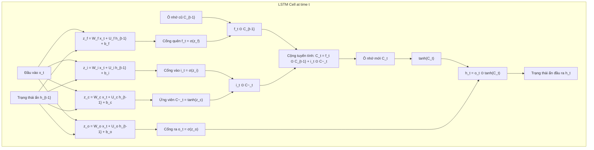

# CHUYÊN ĐỀ 05: HỌC SÂU CHO DỰ BÁO CHUỖI THỜI GIAN
## Deep Learning: Recurrent Neural Networks & LSTM Forward Pass

---

## 1. MẠNG NƠ-RON HỒI QUY CƠ BẢN (VANILLA RNN)

### 1.1. Cấu trúc mạng RNN
Không giống như mạng truyền thẳng (Feedforward Neural Networks), mạng nơ-ron hồi quy có vòng lặp phản hồi cho phép truyền thông tin ngữ cảnh qua từng bước thời gian:

$$
h_t = \tanh(W_{xh} x_t + W_{hh} h_{t-1} + b_h)
$$

$$
\hat{y}_t = W_{hy} h_t + b_y
$$

Trong đó:
* $x_t \in \mathbb{R}^d$: Vector đầu vào tại thời điểm $t$.
* $h_t \in \mathbb{R}^k$: Vector trạng thái ẩn (Hidden state) đóng vai trò bộ nhớ ngắn hạn.
* $W_{xh}, W_{hh}, W_{hy}$: Các ma trận trọng số được chia sẻ chung qua tất cả các bước thời gian (Weight sharing).

### 1.2. Hạn chế: Bài toán Triệt tiêu Đạo hàm (Vanishing Gradient Problem)
Khi huấn luyện bằng giải thuật lan truyền ngược qua thời gian (Backpropagation Through Time - BPTT) trên chuỗi dài $T$ bước:

$$
\frac{\partial \mathcal{L}}{\partial h_1} = \frac{\partial \mathcal{L}}{\partial h_T} \prod_{k=2}^T \frac{\partial h_k}{\partial h_{k-1}}
$$

Tích ma trận Jacobian liên tiếp $\frac{\partial h_k}{\partial h_{k-1}} = \text{diag}(1 - h_k^2) W_{hh}^T$ khiến đạo hàm suy giảm theo hàm mũ về 0 nếu các giá trị riêng nhỏ hơn 1. Hệ quả là mạng **hoàn toàn mất khả năng ghi nhớ các phụ thuộc thời gian dài (Long-term dependencies)**.

---

## 2. BẢN CHẤT KIẾN TRÚC & LUỒNG FORWARD PASS TRONG TẾ BÀO LSTM

Để khắc phục hiện tượng triệt tiêu đạo hàm, Sepp Hochreiter & Jürgen Schmidhuber (1997) đã thiết kế tế bào **LSTM (Long Short-Term Memory)** với cốt lõi là **Đường cao tốc Ô nhớ (Cell State Highway - $C_t$)** chạy xuyên suốt thời gian và được điều tiết bởi 3 cổng logic (Gates):

---

## 3. CHI TIẾT 6 PHƯƠNG TRÌNH FORWARD PASS & VAI TRÒ HÀM KÍCH HOẠT

Quá trình lan truyền xuôi (Forward Pass) của tế bào LSTM tại mỗi bước thời gian $t$ bao gồm 6 phương trình toán học chặt chẽ:

### 3.1. Các phương trình kích hoạt cổng và ô nhớ
1. **Cổng quên (Forget Gate - $f_t$):**
   * Giá trị tuyến tính (Logit): $z_f = W_f x_t + U_f h_{t-1} + b_f$
   * Độ mở cổng:

   $$
   f_t = \sigma(z_f) = \sigma(W_f x_t + U_f h_{t-1} + b_f)
   $$

2. **Cổng vào (Input Gate - $i_t$):**
   * Giá trị tuyến tính (Logit): $z_i = W_i x_t + U_i h_{t-1} + b_i$
   * Độ mở cổng:

   $$
   i_t = \sigma(z_i) = \sigma(W_i x_t + U_i h_{t-1} + b_i)
   $$

3. **Trạng thái ứng viên mới (Candidate Cell State - $\tilde{C}_t$):**
   * Giá trị tuyến tính (Logit): $z_c = W_c x_t + U_c h_{t-1} + b_c$
   * Giá trị ứng viên:

   $$
   \tilde{C}_t = \tanh(z_c) = \tanh(W_c x_t + U_c h_{t-1} + b_c)
   $$

4. **Cập nhật trạng thái ô nhớ (Cell State Update - $C_t$):**

   $$
   C_t = f_t \odot C_{t-1} + i_t \odot \tilde{C}_t
   $$

5. **Cổng ra (Output Gate - $o_t$):**
   * Giá trị tuyến tính (Logit): $z_o = W_o x_t + U_o h_{t-1} + b_o$
   * Độ mở cổng:

   $$
   o_t = \sigma(z_o) = \sigma(W_o x_t + U_o h_{t-1} + b_o)
   $$

6. **Trạng thái ẩn đầu ra (Hidden State - $h_t$):**

   $$
   h_t = o_t \odot \tanh(C_t)
   $$

*(Ký hiệu $\odot$ biểu thị phép nhân từng phần tử - Hadamard Product)*.

---

### 3.2. Vì sao cổng dùng Sigmoid ($\sigma$) nhưng ứng viên và ô nhớ dùng Tanh ($\tanh$)?

| Thành phần | Hàm kích hoạt | Miền giá trị | Bản chất và Ý nghĩa vật lý |
|:---|:---:|:---:|:---|
| **Cổng ($f_t, i_t, o_t$)** | **Sigmoid ($\sigma$)** | $(0, 1)$ | Đóng vai trò là **chiếc van điều tiết tỷ lệ phần trăm**: $0$ tương ứng van đóng hoàn toàn (quên hết / chặn hoàn toàn), $1$ tương ứng van mở cực đại (giữ lại 100% / cho qua toàn bộ). |
| **Ứng viên ($\tilde{C}_t$)** | **Tanh** | $(-1, 1)$ | Đóng vai trò tạo ra **lượng biến thiên thông tin mới**: có tính đối xứng quanh số 0 (Zero-centered), cho phép ô nhớ có thể tăng lên ($> 0$) hoặc giảm xuống ($< 0$). |
| **Trạng thái ẩn ($h_t$)** | **Tanh($C_t$)** | $(-1, 1)$ | Giá trị ô nhớ $C_t$ tích lũy qua thời gian có thể trở nên rất lớn. Phép biến đổi qua $\tanh$ giúp **nén giá trị về khoảng hữu hạn $(-1, 1)$** trước khi xuất ra ngoài, ngăn ngừa bùng nổ số học. |

---

### 3.3. Vì sao đường truyền ô nhớ (Cell State Highway) triệt tiêu bài toán Vanishing Gradient?
Xét phương trình cập nhật ô nhớ:

$$
C_t = f_t \odot C_{t-1} + i_t \odot \tilde{C}_t
$$

Khi lấy đạo hàm riêng theo bước thời gian trước đó:

$$
\frac{\partial C_t}{\partial C_{t-1}} = f_t
$$

> [!IMPORTANT]
> **Điểm đột phá của LSTM:** Đạo hàm $\frac{\partial C_t}{\partial C_{t-1}}$ không còn bị nhân với ma trận trọng số $W$ hay đạo hàm hàm kích hoạt $\tanh' \le 1$ như trong RNN thông thường. Nếu mạng học được việc giữ cổng quên mở hoàn toàn ($f_t \approx 1$), gradient có thể truyền ngược dọc theo đường cao tốc ô nhớ qua hàng trăm bước thời gian **mà không hề bị suy giảm hay suy hao**.

---

## 4. VÍ DỤ TÍNH TAY CHI TIẾT TỪNG BƯỚC (WORKED NUMERICAL EXAMPLES)

Dưới đây là bài toán tính toán Forward Pass hoàn chỉnh cho một tế bào LSTM đơn biến (Scalar LSTM) tại bước thời gian $t$.

### 4.1. Thiết lập bài toán
Xét trạng thái đầu vào tại thời điểm $t$:
* Đầu vào hiện tại: $x_t = 2.0$
* Trạng thái ẩn bước trước: $h_{t-1} = 1.0$
* Trạng thái ô nhớ bước trước: $C_{t-1} = 4.0$
* Trạng thái ứng viên mới đã tính sẵn: $\tilde{C}_t = 0.800$

Hàm Sigmoid: $\sigma(z) = \frac{1}{1 + e^{-z}}$ (lưu ý đặc biệt: khi $z = 0 \implies \sigma(0) = \frac{1}{1 + 1} = 0.5$).

Bộ trọng số đã huấn luyện của các cổng:
* Cổng quên: $W_f = 0.5, U_f = 0.2, b_f = -1.2$
* Cổng vào: $W_i = 0.6, U_i = -0.2, b_i = -1.0$
* Cổng ra: $W_o = 0.3, U_o = 0.4, b_o = -1.0$

---

### 4.2. Tính toán cụ thể từng bước

#### Bước 1: Tính toán Cổng quên ($f_t$)
1. Giá trị tuyến tính đầu vào (Logit $z_f$):

$$
z_f = W_f x_t + U_f h_{t-1} + b_f = 0.5(2.0) + 0.2(1.0) - 1.2 = 1.0 + 0.2 - 1.2 = 0.0
$$

2. Độ mở cổng quên $f_t$:

$$
f_t = \sigma(z_f) = \sigma(0.0) = \frac{1}{1 + e^0} = \frac{1}{2} = 0.5
$$

*(Ý nghĩa: Tế bào quyết định giữ lại đúng 50% nội dung của ô nhớ cũ $C_{t-1}$)*.

---

#### Bước 2: Tính toán Cổng vào ($i_t$)
1. Giá trị tuyến tính đầu vào (Logit $z_i$):

$$
z_i = W_i x_t + U_i h_{t-1} + b_i = 0.6(2.0) - 0.2(1.0) - 1.0 = 1.2 - 0.2 - 1.0 = 0.0
$$

2. Độ mở cổng vào $i_t$:

$$
i_t = \sigma(z_i) = \sigma(0.0) = 0.5
$$

*(Ý nghĩa: Tế bào cho phép 50% thông tin mới $\tilde{C}_t$ được nạp vào ô nhớ)*.

---

#### Bước 3: Cập nhật Trạng thái ô nhớ ($C_t$)
Áp dụng công thức đường cao tốc ô nhớ:

$$
C_t = f_t \times C_{t-1} + i_t \times \tilde{C}_t
$$

1. Lượng thông tin giữ lại từ ô nhớ cũ:

$$
\text{Info}_{\text{old}} = f_t \times C_{t-1} = 0.5 \times 4.0 = 2.0
$$

2. Lượng thông tin mới nạp vào:

$$
\text{Info}_{\text{new}} = i_t \times \tilde{C}_t = 0.5 \times 0.800 = 0.400
$$

3. Tổng trạng thái ô nhớ mới:

$$
C_t = 2.0 + 0.400 = 2.400
$$

---

#### Bước 4: Tính toán Cổng ra ($o_t$)
1. Giá trị tuyến tính đầu vào (Logit $z_o$):

$$
z_o = W_o x_t + U_o h_{t-1} + b_o = 0.3(2.0) + 0.4(1.0) - 1.0 = 0.6 + 0.4 - 1.0 = 0.0
$$

2. Độ mở cổng ra $o_t$:

$$
o_t = \sigma(z_o) = \sigma(0.0) = 0.5
$$

---

#### Bước 5: Tính toán Trạng thái ẩn đầu ra ($h_t$)
1. Nén giá trị ô nhớ $C_t = 2.4$ qua hàm phi tuyến Tanh:

$$
\tanh(C_t) = \tanh(2.4) \approx 0.9837
$$

2. Nhân với độ mở cổng ra $o_t$:

$$
h_t = o_t \times \tanh(C_t) = 0.5 \times 0.9837 = 0.49185 \approx 0.492
$$

> [!NOTE]
> **Kết quả thu được:** Sau bước $t$, tế bào xuất ra trạng thái ẩn $h_t = 0.492$ (được chuyển tiếp sang bước $t+1$ và đưa vào tầng Dense để dự báo giá trị mục tiêu) đồng thời lưu trữ ô nhớ nội bộ $C_t = 2.4$ để bảo toàn bộ nhớ dài hạn.

---

## 5. BÀI TẬP VẬN DỤNG & THỰC HÀNH TƯƠNG TÁC

Hãy mở tập tin bài tập tương tác kiểm tra kiến trúc và tự tính toán con số tại:
[bai_tap_tinh_toan.html](file:///d:/KnowledgeLibrary/time-series/05_deep_learning_rnn_lstm_forecasting/bai_tap_tinh_toan.html)
