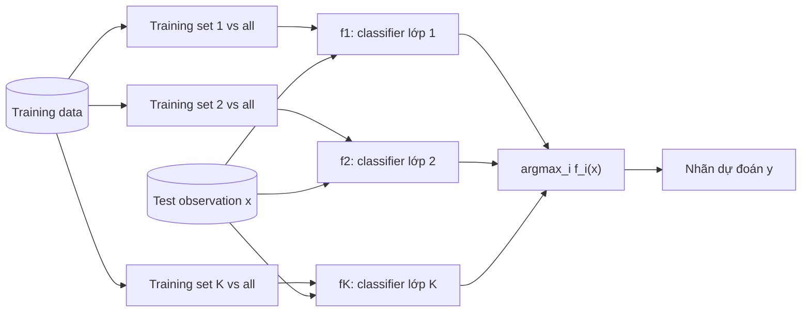
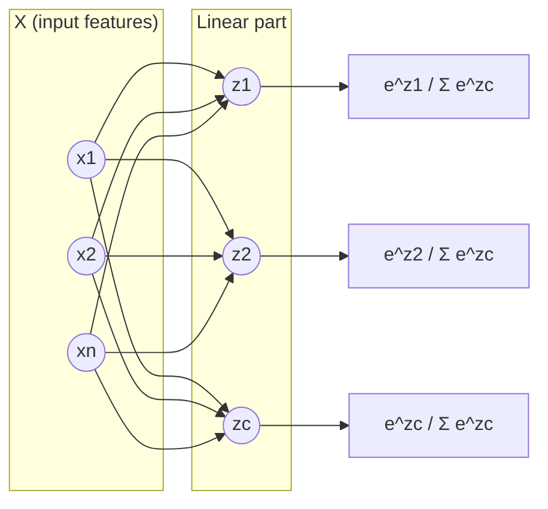

# 3. Hồi quy Logistic đa lớp

[⬅ Trước: Ước lượng MLE](02_uoc_luong_hop_ly_toi_da.md) · [Mục lục](README.md) · [Tiếp: Đánh giá mô hình ➡](04_danh_gia_mo_hinh.md)

---

## 3.1. Hồi quy logistic đa lớp là gì?

**Multiclass Logistic Regression** mở rộng hồi quy logistic nhị phân để phân loại đối tượng vào **nhiều hơn hai lớp**.

Có hai hướng tiếp cận:
1. **One-vs-All (OvA)**, còn gọi là **One-vs-Rest (OvR)**
2. **Softmax Regression**, dùng hàm Softmax

---

## 3.2. Phương pháp One-vs-All (OvA)

### Ý tưởng
- Thay vì huấn luyện một mô hình chung cho tất cả các lớp, ta **huấn luyện một mô hình nhị phân cho mỗi lớp**.
- Mô hình thứ $k$ phân biệt **lớp $k$** với **tất cả các lớp còn lại**.
- Khi dự đoán, ta **chọn lớp có xác suất cao nhất** trong tất cả các mô hình đã huấn luyện.



Với $K$ lớp, nhãn dự đoán là:

$$\hat{y} = \arg\max_{k \in \{1,\dots,K\}} f_k(x), \qquad f_k(x) = \sigma(\beta_k^T x)$$

> ⚠️ Các mô hình được huấn luyện **độc lập** nên tổng $\sum_k f_k(x)$ **có thể lớn hơn 1**. Các giá trị này không tạo thành một phân phối xác suất thực sự.

### Ưu – nhược điểm
| ✅ Ưu điểm | ❌ Nhược điểm |
|-----------|--------------|
| Đơn giản, dễ triển khai | Dễ bị ảnh hưởng bởi **mất cân bằng lớp** (mỗi mô hình là "1 lớp vs nhiều lớp") |
| Dễ mở rộng cho số lớp lớn | Khó khăn khi các lớp có độ tương đồng cao |
| Tận dụng được các thuật toán phân loại nhị phân mạnh | Phải huấn luyện $K$ mô hình nên tăng chi phí tính toán |
| Chia bài toán đa lớp thành các bài toán nhị phân | Không tối ưu đồng thời toàn bộ bài toán đa lớp |
| | Khó ra quyết định khi xác suất của các lớp rất gần nhau |

---

## 3.3. Softmax Regression (Multinomial Logistic Regression)

### Ý tưởng
- Tìm **một hàm quyết định** để phân loại mẫu $X$ vào một trong các lớp.
- Thay vì dùng hàm sigmoid như hồi quy nhị phân, Softmax Regression dùng **hàm softmax** để tính xác suất cho từng lớp.
- Hàm softmax chuyển các giá trị logit thành xác suất sao cho **tổng xác suất của các lớp bằng 1**.

### Công thức
Giả sử có $K$ lớp với vector logit $z = [z_1, z_2, \dots, z_K]$, trong đó $z_k = \beta_k^T x$ là logit của lớp $k$. Xác suất của lớp $k$:

$$p(class = k \mid X; \beta) = \mathrm{softmax}(z_k) = \frac{e^{z_k}}{\sum_{j=1}^{K} e^{z_j}} \tag{25}$$

- $z_k = \beta_k^T x$: logit của lớp thứ $k$
- $e^{z_k}$: hàm mũ của logit, luôn dương
- Tổng xác suất các lớp: $\sum_{k=1}^{K} p(class = k \mid X; \beta) = 1$

### Kiến trúc



**Hàm mất mát** (Categorical Cross-Entropy), mở rộng từ công thức (21):

$$\mathcal{L}(\beta) = -\frac{1}{n}\sum_{i=1}^{n}\sum_{k=1}^{K} \mathbb{1}\{y^{(i)} = k\} \log p(class = k \mid x^{(i)}; \beta)$$

> 💡 Khi $K = 2$, Softmax Regression **tương đương** với hồi quy logistic nhị phân.

### Ví dụ tính softmax
Với logit $z = [2.0,\ 1.0,\ 0.1]$:

| Lớp | $z_k$ | $e^{z_k}$ | $p_k$ |
|-----|-------|-----------|-------|
| 1 | 2.0 | 7.389 | **0.659** |
| 2 | 1.0 | 2.718 | 0.242 |
| 3 | 0.1 | 1.105 | 0.099 |
| **Tổng** | | 11.212 | **1.000** |

Mô hình dự đoán **lớp 1**.

### Ưu – nhược điểm
| ✅ Ưu điểm | ❌ Nhược điểm |
|-----------|--------------|
| Phân loại đa lớp trực tiếp, không cần tách thành các bài toán nhị phân | Gặp vấn đề với mất cân bằng lớp, dễ phân loại sai lớp hiếm |
| Tối ưu đồng thời tất cả các lớp, học được quan hệ giữa các lớp | Chạy chậm khi số lớp và số đặc trưng lớn |
| Cung cấp xác suất cho từng lớp | Không xử lý được quan hệ phi tuyến trong dữ liệu |
| Dễ giải thích vì là mô hình tuyến tính | Không phù hợp khi số lớp quá lớn (tốn tài nguyên) |
| Hiệu quả khi số lớp và số đặc trưng vừa phải | Cần chuẩn hóa đầu vào để đạt hiệu suất tốt |

---

## 3.4. So sánh OvA và Softmax

| Tiêu chí | One-vs-All | Softmax |
|----------|-----------|---------|
| Số mô hình | $K$ mô hình nhị phân | 1 mô hình |
| Hàm kích hoạt | Sigmoid | Softmax |
| Tổng xác suất | Có thể ≠ 1 | Luôn = 1 |
| Tối ưu | Từng lớp riêng rẽ | Đồng thời tất cả các lớp |
| Phù hợp khi | Các lớp không loại trừ lẫn nhau (multi-label) | Các lớp loại trừ lẫn nhau |

---

## 💻 Minh họa Python

```python
import numpy as np
from sklearn.datasets import load_iris
from sklearn.linear_model import LogisticRegression
from sklearn.multiclass import OneVsRestClassifier
from sklearn.model_selection import train_test_split

X, y = load_iris(return_X_y=True)
X_tr, X_te, y_tr, y_te = train_test_split(X, y, test_size=1/3, stratify=y, random_state=42)

ova = OneVsRestClassifier(LogisticRegression(max_iter=1000)).fit(X_tr, y_tr)
softmax = LogisticRegression(max_iter=1000).fit(X_tr, y_tr)  # sklearn >= 1.5: mặc định multinomial

print("OvA     accuracy:", ova.score(X_te, y_te))
print("Softmax accuracy:", softmax.score(X_te, y_te))
print("Tổng xác suất softmax:", softmax.predict_proba(X_te[:3]).sum(axis=1))

def softmax_fn(z):
    e = np.exp(z - np.max(z))      # trừ max để ổn định số học
    return e / e.sum()
print(softmax_fn(np.array([2.0, 1.0, 0.1])).round(3))   # [0.659 0.242 0.099]
```

---

[⬅ Trước: Ước lượng MLE](02_uoc_luong_hop_ly_toi_da.md) · [Mục lục](README.md) · [Tiếp: Đánh giá mô hình ➡](04_danh_gia_mo_hinh.md)
