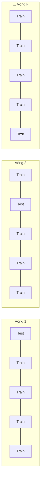

# 4. Đánh giá mô hình dự đoán

[⬅ Trước: Hồi quy Logistic đa lớp](03_hoi_quy_logistic_da_lop.md) · [Mục lục](README.md)

---

## 4.1. Nguyên tắc đánh giá mô hình

- Đánh giá trên **tập validation/test** đã gắn nhãn, **không dùng tập train**.
- Sử dụng các **độ đo đánh giá** (evaluation metrics).
- Sử dụng các **phương pháp ước tính độ chính xác**:
  - Cross-validation
  - Bootstrap
  - Comparing classifiers
  - Confidence intervals
  - Cost-benefit analysis và ROC Curves

### Training – Validation – Testing set
| Tập | Vai trò |
|-----|---------|
| **Training set** | Tập con dữ liệu dùng để **huấn luyện** mô hình |
| **Validation set** | Tập trung gian trong quá trình phát triển mô hình, dùng để **tinh chỉnh siêu tham số** (hyper-parameter) |
| **Testing set** | Tập dùng để **đánh giá hiệu năng** của mô hình đã huấn luyện trên dữ liệu chưa từng thấy, mô phỏng dữ liệu thực tế |

---

## 4.2. Classifier Evaluation Metrics

Các độ đo này tập trung vào **khả năng dự đoán** của mô hình, không phải tốc độ phân lớp, tốc độ xây dựng mô hình hay khả năng mở rộng.

### 4.2.1. Confusion Matrix (Ma trận nhầm lẫn)
Với $m$ lớp, $CM_{i,j}$ là số bộ thuộc **lớp thực tế $i$** được dự đoán là **lớp $j$**.

| Thực tế \ Dự đoán | $C_1$ (Positive) | $\neg C_1$ (Negative) | Tổng |
|---|---|---|---|
| $C_1$ | **TP** (True Positive) | **FN** (False Negative) | P |
| $\neg C_1$ | **FP** (False Positive) | **TN** (True Negative) | N |
| **Tổng** | P' | N' | All |

### 4.2.2. Accuracy, Error Rate, Sensitivity, Specificity

| Độ đo | Công thức | Ý nghĩa |
|-------|-----------|---------|
| **Accuracy** | $\dfrac{TP + TN}{All}$ | Tỷ lệ bộ được phân lớp đúng |
| **Error rate** | $1 - Accuracy = \dfrac{FP + FN}{All}$ | Tỷ lệ phân lớp sai |
| **Sensitivity** (True Positive Rate) | $\dfrac{TP}{P}$ | Tỷ lệ phân lớp **positive** đúng |
| **Specificity** (True Negative Rate) | $\dfrac{TN}{N}$ | Tỷ lệ phân lớp **negative** đúng |

> ⚠️ **Mất cân bằng lớp**: khi một lớp rất hiếm (ví dụ gian lận chiếm 1%), mô hình luôn đoán "không gian lận" vẫn đạt Accuracy 99%. Khi đó cần xem thêm Sensitivity, Specificity, Precision, Recall và F1.

### 4.2.3. Precision, Recall và F-measures (Binary Classification)

| Độ đo | Công thức | Ý nghĩa |
|-------|-----------|---------|
| **Precision** | $\dfrac{TP}{TP + FP}$ | Trong các bộ được gán positive, bao nhiêu **thực sự** là positive |
| **Recall** | $\dfrac{TP}{TP + FN}$ | Trong các bộ positive thực sự, bao nhiêu được gán positive (= Sensitivity) |
| **F1-score** | $\dfrac{2 \times Precision \times Recall}{Precision + Recall}$ | Trung bình điều hòa của Precision và Recall |
| **$F_\beta$** | $\dfrac{(1 + \beta^2) \times Precision \times Recall}{\beta^2 \times Precision + Recall}$ | Trung bình có trọng số giữa Precision và Recall |

- F1 càng cao, bộ phân lớp càng tốt.
- $\beta > 1$: ưu tiên Recall (ví dụ chẩn đoán bệnh). $\beta < 1$: ưu tiên Precision (ví dụ lọc spam).

### 4.2.4. Multi-class Classification

Với mỗi lớp $C_i$ ta tính $Precision_{C_i}$, $Recall_{C_i}$, $F1_{C_i}$ theo kiểu "lớp $C_i$ vs phần còn lại", sau đó gộp lại.

**Macro average**: trung bình cộng trên tất cả các lớp

$$MacroPrecision = \frac{1}{n}\sum_{i=1}^{n} Precision_{C_i}, \quad MacroRecall = \frac{1}{n}\sum_{i=1}^{n} Recall_{C_i}, \quad MacroF1 = \frac{1}{n}\sum_{i=1}^{n} F1_{C_i}$$

**Weighted average**: trung bình có trọng số theo số mẫu $Sample_{C_i}$ của mỗi lớp

$$WeightedPrecision = \frac{\sum_{i=1}^{n} Precision_{C_i} \times Sample_{C_i}}{\sum_{i=1}^{n} Sample_{C_i}}$$

$$WeightedRecall = \frac{\sum_{i=1}^{n} Recall_{C_i} \times Sample_{C_i}}{\sum_{i=1}^{n} Sample_{C_i}}, \quad WeightedF1 = \frac{\sum_{i=1}^{n} F1_{C_i} \times Sample_{C_i}}{\sum_{i=1}^{n} Sample_{C_i}}$$

---

## 📝 VD12: Bài toán nhị phân `buy_computer`

Cho ma trận nhầm lẫn sau. Tính Accuracy, Error rate, Sensitivity, Specificity, Precision, Recall và F1-score.

| Thực tế \ Dự đoán | yes | no | Tổng |
|---|---|---|---|
| **yes** | 6954 (TP) | 46 (FN) | 7000 |
| **no** | 412 (FP) | 2588 (TN) | 3000 |
| **Tổng** | 7366 | 2634 | 10000 |

**Lời giải:**

| Độ đo | Tính toán | Kết quả |
|-------|-----------|---------|
| Accuracy | $\dfrac{6954 + 2588}{10000}$ | **95.42%** |
| Error rate | $1 - 0.9542$ | **4.58%** |
| Sensitivity | $\dfrac{6954}{7000}$ | **99.34%** |
| Specificity | $\dfrac{2588}{3000}$ | **86.27%** |
| Precision | $\dfrac{6954}{6954 + 412}$ | **94.41%** |
| Recall | $\dfrac{6954}{6954 + 46}$ | **99.34%** |
| F1-score | $\dfrac{2 \times 0.9441 \times 0.9934}{0.9441 + 0.9934}$ | **96.81%** |

---

## 📝 Bài tập: Phân loại công ty theo mức tăng trưởng

Một bộ phân loại xếp các công ty vào 3 lớp **Tăng trưởng thấp / Tăng trưởng TB / Tăng trưởng cao**, dựa trên các đặc trưng như doanh thu, lợi nhuận và mức tăng trưởng trong một khoảng thời gian. Ma trận nhầm lẫn:

| Thực tế \ Dự đoán | Thấp | TB | Cao | Tổng (support) |
|---|---|---|---|---|
| **Thấp** | **7** | 1 | 2 | 10 |
| **TB** | 1 | **9** | 2 | 12 |
| **Cao** | 1 | 2 | **7** | 10 |
| **Tổng dự đoán** | 9 | 12 | 11 | **32** |

👉 Tính **Accuracy, Weighted Precision, Weighted Recall và Weighted F1-score**.

<details>
<summary><b>Xem lời giải</b></summary>

**Accuracy**

$$Accuracy = \frac{7 + 9 + 7}{32} = \frac{23}{32} = \mathbf{71.88\%}$$

**Chỉ số theo từng lớp**

| Lớp | Precision (theo cột) | Recall (theo hàng) | F1 | Support |
|-----|----------------------|--------------------|----|---------|
| Thấp | 7/9 = 0.7778 | 7/10 = 0.7000 | 0.7368 | 10 |
| TB | 9/12 = 0.7500 | 9/12 = 0.7500 | 0.7500 | 12 |
| Cao | 7/11 = 0.6364 | 7/10 = 0.7000 | 0.6667 | 10 |

**Weighted average**

$$WeightedPrecision = \frac{0.7778 \times 10 + 0.75 \times 12 + 0.6364 \times 10}{32} = \frac{23.141}{32} \approx \mathbf{0.7232}$$

$$WeightedRecall = \frac{0.7 \times 10 + 0.75 \times 12 + 0.7 \times 10}{32} = \frac{23}{32} \approx \mathbf{0.7188}$$

$$WeightedF1 = \frac{0.7368 \times 10 + 0.75 \times 12 + 0.6667 \times 10}{32} = \frac{23.035}{32} \approx \mathbf{0.7198}$$

> Nhận xét: Weighted Recall luôn bằng Accuracy.

</details>

---

## 4.3. Phương pháp ước tính độ chính xác

### Holdout
- Chia ngẫu nhiên dữ liệu thành **tập train (2/3)** để xây dựng mô hình và **tập test (1/3)** để ước tính độ chính xác.
- Thích hợp cho tập dữ liệu nhỏ.
- Lấy mẫu sao cho mỗi lớp được phân bổ đều trong train và test (stratified).
- **Random subsampling**: lặp lại holdout $k$ lần, độ chính xác là trung bình của $k$ lần.

### Cross-validation (k-fold)
- Chia ngẫu nhiên dữ liệu thành $k$ tập con **loại trừ lẫn nhau**, kích thước xấp xỉ bằng nhau.
- Ở mỗi vòng lặp, dùng **1 tập con làm test** và $k - 1$ tập còn lại làm train.
- Thường chọn **$k = 10$**.
- **Leave-one-out**: $k$ bằng số mẫu (dùng cho dữ liệu nhỏ).
- **Stratified cross-validation**: phân bố các lớp trong từng tập con giống như trên toàn bộ dữ liệu.



### Bootstrap
- Hoạt động tốt với bộ dữ liệu nhỏ.
- **Lấy mẫu có hoàn lại**: một bộ đã được chọn vẫn có thể được chọn lại và thêm vào tập huấn luyện.
- Các bộ không được chọn (khoảng 36.8%) dùng làm tập test (out-of-bag).

### Các phương pháp khác
- Comparing classifiers
- Confidence intervals
- Cost-benefit analysis và ROC Curves

---

## 4.4. Các yếu tố ảnh hưởng đến việc lựa chọn mô hình

| Tiêu chí | Mô tả |
|----------|-------|
| **Accuracy** | Độ chính xác của bộ phân lớp khi dự đoán nhãn lớp |
| **Speed** | Thời gian xây dựng (huấn luyện) và thời gian sử dụng (dự đoán) mô hình |
| **Robustness** | Khả năng xử lý dữ liệu nhiễu và giá trị thiếu |
| **Scalability** | Hiệu quả với cơ sở dữ liệu lớn |
| **Interpretability** | Mức độ dễ hiểu và dễ diễn giải mô hình |
| **Khác** | Chất lượng của các luật, ví dụ kích thước cây quyết định hoặc độ chặt chẽ của luật phân lớp |

---

## 💻 Minh họa Python

```python
import numpy as np
from sklearn.metrics import accuracy_score, classification_report, confusion_matrix

# Tái tạo dữ liệu từ ma trận nhầm lẫn của bài tập
labels = ["Thấp", "TB", "Cao"]
cm = np.array([[7, 1, 2],
               [1, 9, 2],
               [1, 2, 7]])
y_true, y_pred = [], []
for i in range(3):
    for j in range(3):
        y_true += [i] * cm[i, j]
        y_pred += [j] * cm[i, j]

print(confusion_matrix(y_true, y_pred))
print("Accuracy:", accuracy_score(y_true, y_pred))
print(classification_report(y_true, y_pred, target_names=labels, digits=4))
# Dòng "weighted avg": precision ≈ 0.7232, recall ≈ 0.7188, f1 ≈ 0.7198
```

```python
# k-fold cross-validation cho hồi quy logistic
from sklearn.datasets import load_breast_cancer
from sklearn.linear_model import LogisticRegression
from sklearn.model_selection import StratifiedKFold, cross_val_score
from sklearn.pipeline import make_pipeline
from sklearn.preprocessing import StandardScaler

X, y = load_breast_cancer(return_X_y=True)
model = make_pipeline(StandardScaler(), LogisticRegression(max_iter=1000))
cv = StratifiedKFold(n_splits=10, shuffle=True, random_state=42)
scores = cross_val_score(model, X, y, cv=cv, scoring="f1")
print(f"F1 10-fold: {scores.mean():.4f} ± {scores.std():.4f}")
```

---

[⬅ Trước: Hồi quy Logistic đa lớp](03_hoi_quy_logistic_da_lop.md) · [Mục lục](README.md)
