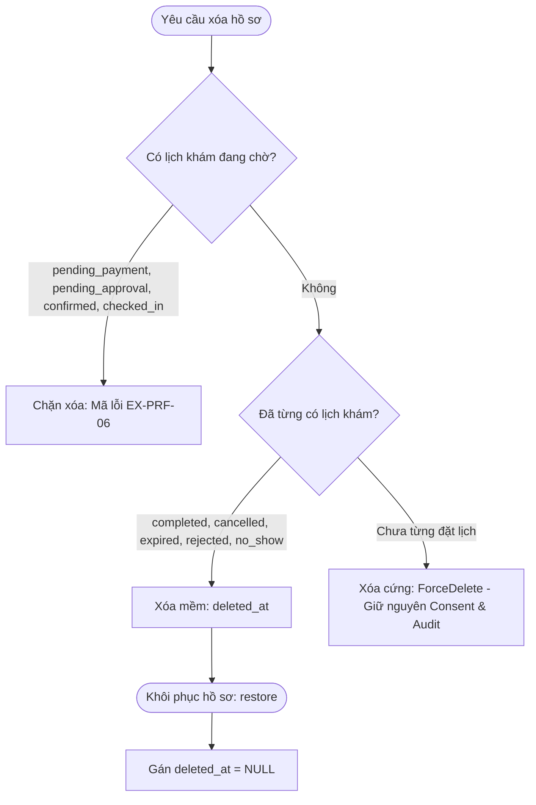

# Phân Hệ 03: Che Mờ Dữ Liệu, Snapshot & Chính Sách Xóa Hồ Sơ (Mã Task: S4-23, S4-24, S4-25)

> **Căn cứ tài liệu:** `Sprint_4_requirement.pdf` (Mục 4.4.d, 4.4.e, 4.4.f) & `03._ERD_v1.1.pdf` (Mục 4.2)  
> **Người thực hiện:** Hiệu  
> **Nhiệm vụ:** Che mờ dữ liệu nhạy cảm (CCCD, BHYT, SĐT), hàm `makePatientSnapshot`, chính sách xóa hồ sơ 3 trường hợp và khôi phục hồ sơ đã xóa mềm.

---

## 1. Che Mờ Dữ Liệu Nhạy Cảm (Sensitive Data Masking — S4-23)

Theo quy định tại mục 4.4.(d) `Sprint_4_requirement.pdf` và trang 5 của `03._ERD_v1.1.pdf`:
> *"API Resource che CCCD, BHYT, SĐT trừ màn sửa của chủ hồ sơ."*

### 1.1. Quy tắc che mờ chi tiết:
* **Số CCCD / Định danh (`identity_card_number`):**
  * Giữ lại 6 số đầu và 2 số cuối; các số ở giữa thay bằng `****` (Ví dụ: `001099123456` $\rightarrow$ `001099****56`).
* **Mã Bảo hiểm y tế (`health_insurance_code`):**
  * Giữ lại 5 ký tự đầu (mã đối tượng/mức hưởng/tỉnh) và 2 ký tự cuối; thay ở giữa bằng `*****` (Ví dụ: `DN4010123456789` $\rightarrow$ `DN401*****89`).
* **Số điện thoại (`phone`, `guardian_phone`):**
  * Giữ lại 3 số đầu và 2 số cuối; thay ở giữa bằng `*****` (Ví dụ: `0912345678` $\rightarrow$ `091*****78`).
* **Ngoại lệ xem rõ:**
  * Khi chủ hồ sơ truy cập màn hình chỉnh sửa hồ sơ của mình (gửi tham số `?mode=edit` hoặc `for_edit=1`), API trả về dữ liệu nguyên bản để người dùng có thể đối soát và chỉnh sửa.

---

## 2. Hàm `makePatientSnapshot(profile)` (S4-24)

Theo mục 4.4.(f) `Sprint_4_requirement.pdf`:
> *"Hàm makePatientSnapshot(profile) trả JSON đã che cho Hoài Bảo và Tuấn Anh."*

* **Mục đích:** Khi Hoài Bảo (luồng bác sĩ) hoặc Tuấn Anh (luồng bệnh viện) tạo lịch khám (`bookings`), hàm này được gọi để trích xuất toàn bộ dữ liệu người bệnh tại thời điểm khám đã được che mờ (masked) để lưu vào cột JSON `bookings.patient_snapshot`.
* **Đặc tính:** Snapshot là bất biến (immutable), không bị ảnh hưởng nếu hồ sơ gốc sau này bị thay đổi hay xóa.
* **Định dạng dữ liệu trả về:**
  ```json
  {
    "profile_id": 15,
    "full_name": "Nguyễn Văn Bé",
    "dob": "2018-05-12",
    "gender": "male",
    "relationship": "Con",
    "phone": "091*****78",
    "identity_card_number": "001099****56",
    "health_insurance_code": "DN401*****89",
    "guardian_name": "Nguyễn Văn Cha",
    "guardian_phone": "090*****67",
    "guardian_relationship": "Bố",
    "captured_at": "2026-11-06T15:00:00+07:00"
  }
  ```

---

## 3. Chính Sách Xóa Hồ Sơ & Khôi Phục (S4-25)

Xử lý khi người dùng gửi yêu cầu xóa hồ sơ theo đúng **3 trường hợp**:



### 3.1. Ba trường hợp xử lý chi tiết

| Trường hợp | Điều kiện kiểm tra lịch khám | Hành động của hệ thống | Kết quả / Mã phản hồi |
|---|---|---|---|
| **1. Có lịch chờ** | Tồn tại lịch ở trạng thái: `pending_payment`, `pending_approval`, `confirmed`, `checked_in`. | **Chặn xóa ngay lập tức.** | HTTP 400 kèm mã lỗi nghiệp vụ **`EX-PRF-06`**. |
| **2. Đã có lịch sử cũ** | Không có lịch chờ, nhưng từng phát sinh lịch khám trong quá khứ (`completed`, `cancelled`, `expired`...). | **Xóa mềm (Soft Delete).** Gán timestamp `deleted_at`. Bản ghi được lưu trữ, ẩn khỏi danh sách của user. | `$profile->delete();` |
| **3. Chưa từng đặt lịch** | Tổng số lịch khám gắn với hồ sơ = 0. | **Xóa cứng (Hard Delete).** Xóa vĩnh viễn khỏi bảng `patient_profiles`. Bản ghi `patient_consents` và `audit_logs` **vẫn được bảo lưu**. | `$profile->forceDelete();` |

### 3.2. Khôi phục hồ sơ đã xóa mềm (Restore)
* Khi hồ sơ ở trạng thái lưu trữ mềm (`deleted_at IS NOT NULL`), người dùng có thể gửi yêu cầu khôi phục hồ sơ:
  * Endpoint: `POST /api/patient-profiles/{id}/restore`
  * Hệ thống gán lại `deleted_at = NULL` và đưa hồ sơ trở lại danh sách hoạt động.
