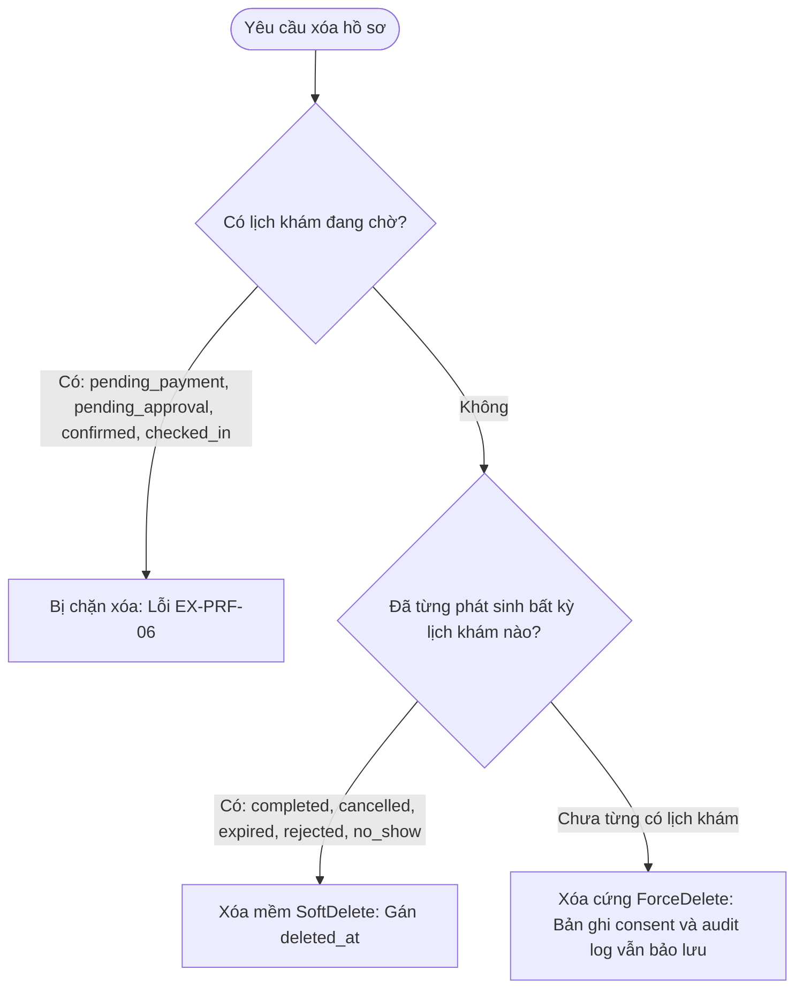

# Phân Hệ 03: Che Mờ Dữ Liệu, Snapshot & Chính Sách Xóa Hồ Sơ (Mã Task: S4-23, S4-24, S4-25)

> **Người thực hiện:** Hiệu  
> **Nhiệm vụ:** Bảo vệ dữ liệu nhạy cảm qua Data Masking, đóng băng thông tin bệnh nhân trong `patient_snapshot` khi đặt khám, và xây dựng chính sách xóa hồ sơ chuẩn nghiệp vụ MedSi.

---

## 1. Che Mờ Dữ Liệu Nhạy Cảm (Sensitive Data Masking — S4-23)

Để tuân thủ các quy định về an toàn thông tin y tế và quyền riêng tư cá nhân, toàn bộ API trả về cho client (web/mobile) **không được trả nguyên vẹn** số định danh cá nhân và số điện thoại, mà phải thực hiện che mờ (masking).

### 1.1. Quy tắc che mờ (Masking Rules)
* **Số CCCD / Định danh (`identity_card_number`):**
  * Giữ lại 6 ký tự đầu (mã tỉnh/giới tính/năm sinh) và 2 ký tự cuối; thay toàn bộ ký tự ở giữa bằng `****`.
  * Ví dụ: `001099123456` $\rightarrow$ `001099****56`.
  * Đối với CMND cũ 9 số: giữ 3 số đầu, 2 số cuối (ví dụ: `123****78`).
* **Số điện thoại (`phone`, `guardian_phone`):**
  * Giữ lại 3 số đầu (đầu số mạng viễn thông) và 2 số cuối; các số ở giữa thay bằng `*****`.
  * Ví dụ: `0901234589` $\rightarrow$ `090*****89`.

### 1.2. Triển khai API Resource (`app/Http/Resources/PatientProfileResource.php`)
```php
namespace App\Http\Resources;

use Illuminate\Http\Request;
use Illuminate\Http\Resources\Json\JsonResource;

class PatientProfileResource extends JsonResource
{
    public function toArray(Request $request): array
    {
        return [
            'id' => $this->id,
            'full_name' => $this->full_name,
            'dob' => $this->dob?->format('Y-m-d'),
            'gender' => $this->gender,
            'relationship' => $this->relationship,
            'phone' => $this->maskPhone($this->phone),
            'identity_card_number' => $this->maskIdentityCard($this->identity_card_number),
            'health_insurance_code' => $this->health_insurance_code,
            'guardian_name' => $this->guardian_name,
            'guardian_phone' => $this->maskPhone($this->guardian_phone),
            'guardian_relationship' => $this->guardian_relationship,
            'is_default' => (bool) $this->is_default,
            'created_at' => $this->created_at?->toIso8601String(),
        ];
    }

    /**
     * Hàm che mờ số điện thoại
     */
    protected function maskPhone(?string $phone): ?string
    {
        if (!$phone || strlen($phone) < 7) {
            return $phone;
        }
        return substr($phone, 0, 3) . '*****' . substr($phone, -2);
    }

    /**
     * Hàm che mờ số CCCD
     */
    protected function maskIdentityCard(?string $idCard): ?string
    {
        if (!$idCard) {
            return null;
        }
        $len = strlen($idCard);
        if ($len <= 5) {
            return $idCard;
        }
        $prefix = substr($idCard, 0, min(6, $len - 3));
        $suffix = substr($idCard, -2);
        return $prefix . '****' . $suffix;
    }
}
```

---

## 2. Masked Patient Snapshot khi Tạo Lịch Khám (S4-24)

Khi một lượt đặt khám (`bookings`) được tạo ra:
1. **Mục đích:** Thông tin bệnh nhân tại thời điểm đặt khám phải được lưu cố định (immutable). Nếu sau này người dùng có cập nhật hay xóa hồ sơ trong danh bạ thì hồ sơ lưu trữ gắn liền với lịch khám đã thanh toán vẫn không bị thay đổi.
2. **Cơ chế:** Dữ liệu được trích xuất từ `PatientProfile`, chạy qua bộ hàm che mờ (masking), rồi serialize thành JSON lưu vào cột `patient_snapshot` của bảng `bookings`.

```php
/**
 * Trích xuất bản chụp hồ sơ đã che mờ phục vụ Booking
 */
public function buildMaskedSnapshot(PatientProfile $profile): array
{
    return [
        'profile_id' => $profile->id,
        'full_name' => $profile->full_name,
        'dob' => $profile->dob->format('Y-m-d'),
        'gender' => $profile->gender,
        'phone_masked' => $this->maskPhone($profile->phone),
        'identity_card_masked' => $this->maskIdentityCard($profile->identity_card_number),
        'relationship' => $profile->relationship,
        'guardian_name' => $profile->guardian_name,
        'guardian_phone_masked' => $this->maskPhone($profile->guardian_phone),
        'guardian_relationship' => $profile->guardian_relationship,
        'captured_at' => now()->toIso8601String(),
    ];
}
```

---

## 3. Chính Sách Xóa Hồ Sơ (Deletion Policy — S4-25)

Theo quy định hợp nhất `DL-14` và mã ngoại lệ chuẩn `EX-PRF-06`, khi nhận được yêu cầu xóa một hồ sơ người khám, hệ thống thực hiện phân loại và xử lý theo đúng **3 trường hợp**:



### 3.1. Ba trường hợp xử lý chi tiết

| Trường hợp | Điều kiện kiểm tra lịch khám (`bookings`) | Hành động của hệ thống | Mã phản hồi / Kết quả |
|---|---|---|---|
| **1. Có lịch đang chờ** | Tồn tại lịch ở trạng thái: `pending_payment`, `pending_approval`, `confirmed`, `checked_in`. | **Chặn xóa ngay lập tức.** Bắn ra Exception nghiệp vụ với mã lỗi `EX-PRF-06`. | HTTP 400/422 kèm mã `EX-PRF-06`. |
| **2. Đã có lịch sử cũ** | Không có lịch chờ, nhưng từng có lịch ở quá khứ: `completed`, `cancelled`, `expired`, `rejected`, `no_show`. | **Xóa mềm (Soft Delete).** Gán timestamp vào cột `deleted_at`, hồ sơ bị ẩn khỏi danh sách của user nhưng vẫn giữ toàn vẹn quan hệ cơ sở dữ liệu. | `$profile->delete();` |
| **3. Chưa từng đặt lịch** | Tổng số lịch khám của hồ sơ = 0. | **Xóa cứng (Hard Delete).** Xóa vĩnh viễn dòng dữ liệu trong bảng `patient_profiles`. Bản ghi `patient_consents` và `audit_logs` **vẫn được giữ lại** nhờ thiết kế không FK cứng. | `$profile->forceDelete();` |

---

### 3.2. Triển khai Code Service Xóa Hồ Sơ
```php
namespace App\Services;

use App\Exceptions\ProfileDeletionBlockedException;
use App\Models\PatientProfile;
use Illuminate\Support\Facades\DB;

class PatientProfileDeletionService
{
    /**
     * Các trạng thái lịch khám đang hoạt động/chờ xử lý
     */
    protected const ACTIVE_BOOKING_STATUSES = [
        'pending_payment',
        'pending_approval',
        'confirmed',
        'checked_in',
    ];

    public function deleteProfile(PatientProfile $profile): array
    {
        return DB::transaction(function () use ($profile) {
            // 1. Kiểm tra lịch khám đang chờ xử lý
            $hasActiveBooking = $profile->bookings()
                ->whereIn('status', self::ACTIVE_BOOKING_STATUSES)
                ->exists();

            if ($hasActiveBooking) {
                // Chặn xóa và quăng lỗi mã EX-PRF-06
                throw new ProfileDeletionBlockedException(
                    'Hồ sơ đang có lịch khám chờ xử lý hoặc chưa hoàn tất, không thể xóa.',
                    'EX-PRF-06'
                );
            }

            // 2. Kiểm tra lịch sử đặt khám trước đó
            $hasAnyBookingHistory = $profile->bookings()->exists();

            if ($hasAnyBookingHistory) {
                // Xóa mềm: Gán giá trị deleted_at (Lưu trữ)
                $profile->delete();

                return [
                    'action' => 'soft_deleted',
                    'message' => 'Hồ sơ đã được lưu trữ (xóa mềm) do có lịch sử đặt khám.',
                ];
            }

            // 3. Chưa từng phát sinh lịch khám: Xóa cứng
            // Bằng chứng patient_consents và audit_logs vẫn bảo lưu nguyên vẹn
            $profile->forceDelete();

            return [
                'action' => 'hard_deleted',
                'message' => 'Hồ sơ đã được xóa hoàn toàn khỏi hệ thống.',
            ];
        });
    }
}
```

---

### 3.3. Định nghĩa Ngoại lệ `ProfileDeletionBlockedException.php`
```php
namespace App\Exceptions;

use Exception;
use Illuminate\Http\JsonResponse;

class ProfileDeletionBlockedException extends Exception
{
    protected string $errorCode;

    public function __construct(string $message = "", string $errorCode = "EX-PRF-06", int $code = 400)
    {
        parent::__construct($message, $code);
        $this->errorCode = $errorCode;
    }

    public function render($request): JsonResponse
    {
        return response()->json([
            'success' => false,
            'error_code' => $this->errorCode,
            'message' => $this->getMessage(),
        ], 400);
    }
}
```
