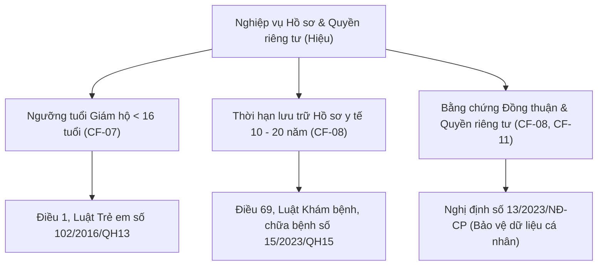

# HƯỚNG DẪN TRA CỨU ĐIỀU KHOẢN PHÁP LÝ GỐC TRÊN GOOGLE & KỸ THUẬT TÌM KIẾM CHUẨN SEO

> **Dành cho:** Thành viên **Lê Thành Hiệu (24520496)** — Dự án MedSi (IS207 - Sprint 4)  
> **Căn cứ phân công:** Mục 4.4 của `Sprint_4_requirement.pdf` (*"Dẫn số hiệu và điều khoản gốc cho ngưỡng tuổi giám hộ và thời hạn lưu trữ (CF-07, CF-08)"*).  
> **Mục tiêu:** Cung cấp phương pháp, cú pháp truy vấn nâng cao (Google Advanced Operators) và danh mục liên kết chính thống để tìm kiếm chính xác 100% văn bản quy phạm pháp luật gốc, phục vụ làm tài liệu `BR-PRF.docx`, `PRF_DD.docx` và thuyết trình đồ án.

---

## 1. TỔNG QUAN CÁC ĐIỀU KHOẢN PHÁP LÝ GỐC CẦN TRA CỨU

Trong Sprint 4, phân hệ **Hồ sơ bệnh nhân (`patient_profiles`)** và **Bằng chứng đồng thuận (`patient_consents`)** gắn liền trực tiếp với 3 văn bản luật quan trọng của Nước Cộng hòa Xã hội Chủ nghĩa Việt Nam:



| Quyết định CMN | Nghiệp vụ trong MedSi | Văn bản luật quy định | Điều khoản gốc cần trích dẫn |
|---|---|---|---|
| **CF-07 / DL-14** | Ngưỡng tuổi giám hộ: Dưới 16 tuổi bắt buộc thông tin & sự đồng thuận của cha mẹ/người giám hộ | **Luật Trẻ em 2016** (Số `102/2016/QH13`) | **Điều 1** (Định nghĩa trẻ em) & **Điều 21** (Quyền bí mật đời sống riêng tư) |
| **CF-08 / DL-14** | Thời hạn lưu trữ hồ sơ y tế: Bảng consent không dùng FK cứng, lưu trữ tối thiểu 10 - 20 năm | **Luật Khám bệnh, chữa bệnh 2023** (Số `15/2023/QH15`) | **Điều 69** (Hồ sơ bệnh án và thời hạn lưu trữ) |
| **CF-08, CF-11** | Bắt buộc ghi nhận bằng chứng đồng ý, IP, User Agent, quyền rút đồng thuận, Data Masking | **Nghị định 13/2023/NĐ-CP** về Bảo vệ dữ liệu cá nhân | **Điều 9** (Quyền của chủ thể dữ liệu), **Điều 11** (Sự đồng ý), **Điều 12** (Rút lại sự đồng ý) |

---

## 2. KỸ THUẬT TÌM KIẾM NÂNG CAO TRÊN GOOGLE (GOOGLE SEARCH OPERATORS ĐỈNH CAO)

Khi tra cứu văn bản pháp luật, nếu chỉ gõ từ khóa thông thường (ví dụ: *luat tre em*, *luat kham chua benh*), Google sẽ trả về hàng triệu bài viết SEO của các công ty luật, báo chí phân tích hoặc luật cũ đã hết hiệu lực.

Để lấy **chính xác văn bản gốc có dấu đỏ hoặc toàn văn luật chuẩn xác**, áp dụng các toán tử sau:

### 2.1. Toán tử `site:` (Thu hẹp tìm kiếm trong các cổng thông tin pháp luật chính thống)
* `site:thuvienphapluat.vn`: Thư viện Pháp luật — nguồn tra cứu nhanh, đầy đủ hiệu lực và các văn bản hướng dẫn thi hành.
* `site:vanban.chinhphu.vn`: Cổng Thông tin Điện tử Chính phủ — cơ sở dữ liệu văn bản chỉ đạo và luật gốc của Nhà nước.
* `site:vbpl.vn`: Cơ sở dữ liệu quốc gia về văn bản quy phạm pháp luật (Bộ Tư pháp).
* `site:moh.gov.vn`: Cổng thông tin điện tử Bộ Y tế.

### 2.2. Toán tử `"..."` (Khớp cụm từ chính xác - Exact Phrase Match)
* Bắt buộc Google phải tìm đúng từng từ ngữ xuất hiện liền nhau, không đảo trật tự từ.
* Ví dụ: `"Trẻ em là người dưới 16 tuổi"` hoặc `"102/2016/QH13"`.

### 2.3. Toán tử `filetype:pdf` hoặc `filetype:doc` (Tìm file văn bản gốc dấu đỏ)
* Giúp tải trực tiếp file PDF Công báo Nhà nước hoặc bản toàn văn để đính kèm minh chứng vào đồ án.
* Ví dụ: `"15/2023/QH15" filetype:pdf`.

### 2.4. Toán tử `-` (Loại trừ kết quả rác / quảng cáo)
* Loại bỏ các bài viết tư vấn quảng cáo dịch vụ luật không cần thiết.
* Ví dụ: `Luật trẻ em -"tư vấn ly hôn" -"bảng giá dịch vụ"`.

### 2.5. Toán tử `intitle:` / `allintitle:`
* Yêu cầu tiêu đề bài viết phải chứa đúng cụm từ khóa.
* Ví dụ: `allintitle: "102/2016/QH13" "Luật Trẻ em"`.

---

## 3. BỘ CÂU LỆNH MẪU (GOOGLE QUERIES) TRA CỨU TỪNG ĐIỀU KHOẢN

Dưới đây là các cú pháp truy vấn bạn chỉ cần copy và paste thẳng vào ô tìm kiếm của Google:

### 3.1. Tra cứu Ngưỡng tuổi Trẻ em & Giám hộ (CF-07)

#### Cú pháp tìm kiếm 1 (Tra cứu nhanh trên Thư Viện Pháp Luật):
```text
site:thuvienphapluat.vn "102/2016/QH13" "Điều 1" "Trẻ em là người"
```

#### Cú pháp tìm kiếm 2 (Tải file PDF văn bản gốc trên Cổng Chính phủ):
```text
site:vanban.chinhphu.vn "102/2016/QH13" filetype:pdf
```

#### Cú pháp tìm kiếm 3 (Tìm điều khoản về bảo vệ đời tư dữ liệu của trẻ em):
```text
site:thuvienphapluat.vn "102/2016/QH13" "Điều 21" "Bí mật đời sống riêng tư"
```

> **Nội dung điều khoản gốc cần trích xuất:**
> * **Điều 1, Luật Trẻ em 2016 (Luật số 102/2016/QH13 ngày 05/04/2016):**  
>   *"Trẻ em là người dưới 16 tuổi."*
> * **Khoản 1, Điều 21, Luật Trẻ em 2016:**  
>   *"Trẻ em có quyền bất khả xâm phạm về đời sống riêng tư, bí mật cá nhân và bí mật gia đình vì lợi ích tốt nhất của trẻ em."*

---

### 3.2. Tra cứu Thời hạn lưu trữ Hồ sơ y tế & Bệnh án (CF-08)

> [!WARNING]
> **Cảnh báo bẫy SEO:** Hiện nay nhiều trang web vẫn trích dẫn Luật Khám chữa bệnh cũ số **40/2009/QH12** (Điều 59). Luật này đã **hết hiệu lực** và được thay thế hoàn toàn bởi **Luật Khám bệnh, chữa bệnh số 15/2023/QH15** (có hiệu lực từ ngày 01/01/2024). Khi tra cứu bắt buộc phải dùng số hiệu `15/2023/QH15`.

#### Cú pháp tìm kiếm 1 (Tra cứu trực tiếp Điều 69 về Hồ sơ bệnh án):
```text
site:thuvienphapluat.vn "15/2023/QH15" "Điều 69" "Hồ sơ bệnh án"
```

#### Cú pháp tìm kiếm 2 (Tra cứu thời hạn lưu trữ ít nhất 10 năm - 20 năm):
```text
site:thuvienphapluat.vn "15/2023/QH15" "Lưu trữ hồ sơ bệnh án" "ít nhất 10 năm"
```

#### Cú pháp tìm kiếm 3 (Tải văn bản toàn văn PDF chính thức):
```text
site:vanban.chinhphu.vn "15/2023/QH15" filetype:pdf
```

> **Nội dung điều khoản gốc cần trích xuất:**
> * **Khoản 3, Điều 69, Luật Khám bệnh, chữa bệnh 2023 (Luật số 15/2023/QH15):**  
>   *"3. Thời hạn lưu trữ hồ sơ bệnh án được quy định như sau:*  
>   *a) Hồ sơ bệnh án nội trú, ngoại trú được lưu trữ ít nhất 10 năm kể từ ngày người bệnh kết thúc điều trị;*  
>   *b) Hồ sơ bệnh án tử vong được lưu trữ ít nhất 20 năm kể từ thời điểm người bệnh tử vong;*  
>   *c) Trường hợp hồ sơ bệnh án liên quan đến tai nạn lao động, bệnh nghề nghiệp được lưu trữ ít nhất 15 năm..."*  
> * **Ý nghĩa với MedSi:** Vì dữ liệu khám bệnh phải lưu trữ 10 - 20 năm, hệ thống MedSi không bao giờ được phép xóa cứng hồ sơ đã có lịch sử khám (xóa mềm `deleted_at`), và bảng `patient_consents` không dùng khóa ngoại CASCADE để đảm bảo bằng chứng pháp lý độc lập vĩnh viễn.

---

### 3.3. Tra cứu Nghị định 13/2023/NĐ-CP (Bảo vệ dữ liệu cá nhân & Đồng thuận - CF-08, CF-11)

#### Cú pháp tìm kiếm 1 (Tra cứu quy tắc rút đồng ý và lưu bằng chứng):
```text
site:thuvienphapluat.vn "13/2023/NĐ-CP" "Điều 12" "Rút lại sự đồng ý"
```

#### Cú pháp tìm kiếm 2 (Tra cứu định nghĩa dữ liệu cá nhân nhạy cảm y tế):
```text
site:thuvienphapluat.vn "13/2023/NĐ-CP" "dữ liệu cá nhân nhạy cảm" "tình trạng sức khỏe"
```

#### Cú pháp tìm kiếm 3 (Tra cứu quy định về xử lý dữ liệu trẻ em):
```text
site:thuvienphapluat.vn "13/2023/NĐ-CP" "Điều 20" "Xử lý dữ liệu cá nhân của trẻ em"
```

> **Nội dung điều khoản gốc cần trích xuất:**
> * **Điều 12 (Rút lại sự đồng ý):** Người dùng có quyền rút lại sự đồng ý bất kỳ lúc nào mà không làm ảnh hưởng đến tính hợp pháp của việc xử lý dữ liệu trước đó $\rightarrow$ Khớp với logic backend `revoked_at = now()` (không xóa bản ghi).
> * **Điều 20 (Dữ liệu trẻ em):** Xử lý dữ liệu trẻ em từ 7 tuổi trở lên phải có sự đồng ý của trẻ em và sự đồng ý của cha, mẹ hoặc người giám hộ $\rightarrow$ Khớp với logic form `guardian_name`, `guardian_phone`, `guardian_relationship`.

---

## 4. QUY TRÌNH DOUBLE-CHECK TÍNH CHUẨN XÁC CỦA VĂN BẢN (5 BƯỚC)

Khi mở một trang văn bản pháp luật trên Google, bạn hãy thực hiện kiểm tra theo checklist 5 bước sau:

1. **Bước 1: Kiểm tra Số hiệu văn bản:**
   * Luật Trẻ em: Phải có số `102/2016/QH13`.
   * Luật Khám bệnh, chữa bệnh: Phải có số `15/2023/QH15` (không lấy bản 2009).
   * Nghị định Dữ liệu cá nhân: Phải có số `13/2023/NĐ-CP` (ban hành ngày 17/04/2023).
2. **Bước 2: Kiểm tra Tình trạng hiệu lực:**
   * Xem nhãn màu xanh lá cây trên Thư Viện Pháp Luật ghi rõ: **"Đang có hiệu lực"**.
3. **Bước 3: Đối chiếu chính xác số hiệu Điều và Khoản:**
   * Không dẫn chung chung "theo luật", mà phải dẫn chi tiết: *"Căn cứ Khoản 3, Điều 69, Luật Khám bệnh, chữa bệnh số 15/2023/QH15..."*.
4. **Bước 4: Lưu trữ liên kết gốc và thời điểm truy cập:**
   * Ghi nhận URL chính thức và ngày giờ truy vấn (phục vụ danh mục tài liệu tham khảo theo chuẩn IEEE/APA).
5. **Bước 5: Chụp ảnh màn hình làm bằng chứng kiểm toán:**
   * Giữ 1 ảnh chụp màn hình chứa URL và nội dung điều khoản để nộp kèm hồ sơ nghiệm thu nếu giảng viên yêu cầu.

---

## 5. MẪU TRÍCH DẪN PHÁP LÝ CHUẨN ĐỂ COPY VÀO BÁO CÁO & SLIDE

### Mẫu 1: Dành cho mục Giám hộ trẻ em (`BR-PRF-04` trong tài liệu)
> *"Căn cứ **Điều 1 và Điều 21, Luật Trẻ em số 102/2016/QH13** được Quốc hội nước Cộng hòa Xã hội Chủ nghĩa Việt Nam thông qua ngày 05/04/2016, hệ thống MedSi thiết lập cấu hình `guardian_age_threshold = 16`. Mọi trường hợp bệnh nhân dưới 16 tuổi khi tạo hồ sơ bắt buộc phải khai báo đầy đủ thông tin người giám hộ (họ tên, số điện thoại, quan hệ) và có sự phê duyệt đồng thuận từ người giám hộ hợp pháp."*

### Mẫu 2: Dành cho mục Thời hạn lưu trữ và Xóa hồ sơ (`BR-PRF-05`, `BR-PRF-10`)
> *"Căn cứ **Khoản 3, Điều 69, Luật Khám bệnh, chữa bệnh số 15/2023/QH15** (quy định thời hạn lưu trữ hồ sơ bệnh án nội, ngoại trú ít nhất 10 năm) và **Nghị định số 13/2023/NĐ-CP** về Bảo vệ dữ liệu cá nhân, hệ thống áp dụng cơ chế lưu trữ mềm (`deleted_at`) đối với các hồ sơ đã có lịch sử khám bệnh. Đồng thời, bảng `patient_consents` và `audit_logs` được thiết kế bảo lưu độc lập, không dùng ràng buộc khóa ngoại cứng CASCADE để đảm bảo bằng chứng kiểm toán pháp lý không bao giờ bị tiêu hủy khi xóa hồ sơ."*

---

*Tài liệu này được lập và lưu trữ tại:* `d:\KnowledgeLibrary\web\project\sprint 4\Huong_Dan_Tra_Cuu_Dieu_Khoan_Goc_Google_SEO.md`.
