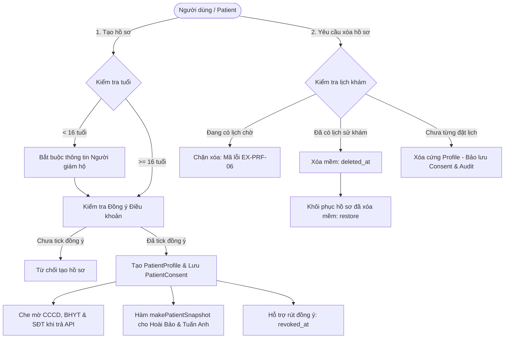

# Kế Hoạch & Chi Tiết Công Việc Sprint 4 — Thành Viên: Hiệu

> **Dự án:** MedSi — Nền tảng đặt lịch khám bệnh trực tuyến  
> **Căn cứ tài liệu:** `Sprint_4_requirement.pdf` (Mục 4.4) & `03._ERD_v1.1.pdf` (Mục 4.2, 4.3, 5, 6)  
> **Người phụ trách:** **Hiệu**  
> **Vai trò:** Backend Developer (Core Patient Profiles, Privacy, Factories & Acceptance Tests)  
> **Mã công việc:** `S4-03`, `S4-20`, `S4-21`, `S4-22`, `S4-23`, `S4-24`, `S4-25`  
> **Tiêu chí nghiệm thu E2E trực tiếp:** `E15`, `E17`

---

## 1. Tổng quan phân công Sprint 4 (Theo Mục 4.4 của Sprint 4 Requirement)

Hiệu chịu trách nhiệm toàn bộ phân hệ **Quản lý Hồ sơ người được khám (`patient_profiles`)**, **Bằng chứng đồng thuận điều khoản y tế (`patient_consents`)**, **Bảo vệ quyền riêng tư & che mờ dữ liệu nhạy cảm (Data Masking & Snapshot)**, **Hệ thống Model Factories cho 14 bảng CSDL**, và các kịch bản kiểm thử E2E liên quan (`E15`, `E17`).

---

## 2. Bảng phân rã công việc (Work Breakdown Structure)

| Mã Task | Hạng mục | Mô tả nội dung theo yêu cầu chính thức | Trạng thái Code / Tài liệu |
|---|---|---|---|
| **S4-03** | Eloquent Relationships, Soft Deletes & 14 Factories | (a) Khai báo Model, quan hệ Eloquent, SoftDeletes (`patient_profiles`, `doctors`, `hospitals`, `exam_types`) và Factory cho 14 bảng trong CSDL. | Đã hoàn thành & push GitHub |
| **S4-20** | Profile CRUD (`patient_profiles`) | (b) Tối đa 10 hồ sơ/tài khoản; bắt buộc họ tên, ngày sinh, giới tính, quan hệ (`Bản thân`, `Cha`, `Mẹ`, `Con`, `Vợ`, `Chồng`, `Khác`); SĐT và CCCD tuỳ chọn; không trùng CCCD trong tài khoản; đúng 1 hồ sơ mặc định. | Đã hoàn thành & push GitHub |
| **S4-21** | Guardian Validation | (d) Bắt buộc thông tin người giám hộ khi bệnh nhân dưới ngưỡng tuổi giám hộ (`config('medsi.guardian_age_threshold', 16)`). | Đã hoàn thành & push GitHub |
| **S4-22** | Consent Evidence & Revocation (`patient_consents`) | (c) Bắt buộc đồng ý dữ liệu trước khi lưu hồ sơ, ghi nhận phiên bản, IP, thiết bị; hỗ trợ rút đồng ý (`revoked_at`, không xóa bản ghi); không FK cứng. | Đã hoàn thành & push GitHub |
| **S4-23** | Sensitive Data Masking | (d) API Resource che mờ CCCD, BHYT, SĐT (trừ màn hình sửa của chủ sở hữu với `mode=edit`). | Đã hoàn thành & push GitHub |
| **S4-24** | Masked Patient Snapshot | (f) Hàm `makePatientSnapshot(profile)` trả JSON đã che mờ phục vụ luồng đặt khám của Hoài Bảo và Tuấn Anh. | Đã hoàn thành & push GitHub |
| **S4-25** | Deletion Policy & Restore | (e) Chặn khi còn lịch chờ (lỗi `EX-PRF-06`); xóa mềm (`deleted_at`) khi đã có lịch; xóa cứng khi chưa từng có lịch (giữ consent và audit logs); hỗ trợ khôi phục hồ sơ (`restore`). | Đã hoàn thành & push GitHub |

---

## 3. Căn cứ pháp lý & Chuẩn hóa quy định (Task tài liệu của Hiệu)

Theo mục 4.4 của `Sprint 4 requirement.pdf`, Hiệu phụ trách cập nhật các tài liệu đặc tả miền với các căn cứ pháp lý:

1. **Ngưỡng tuổi người giám hộ (`guardian_age_threshold = 16`):**
   * **Căn cứ pháp lý:** **Điều 1, Luật Trẻ em số 102/2016/QH13**: *"Trẻ em là người dưới 16 tuổi."*
   * Khi người được khám dưới 16 tuổi, bắt buộc phải có thông tin và sự đồng thuận của cha, mẹ hoặc người giám hộ hợp pháp.
2. **Thời hạn lưu trữ hồ sơ và bằng chứng đồng thuận:**
   * **Căn cứ pháp lý:** **Điều 69, Luật Khám bệnh, chữa bệnh số 15/2023/QH15** quy định hồ sơ bệnh án phải được lưu trữ ít nhất 10 năm đến 20 năm; **Nghị định 13/2023/NĐ-CP** về bảo vệ dữ liệu cá nhân.
   * Do đó, dù hồ sơ người dùng có bị xóa cứng (chưa từng đặt lịch) thì bảng `patient_consents` **không dùng khóa ngoại cứng** và bảng `audit_logs` là **Insert-only** để đảm bảo bằng chứng pháp lý và kiểm toán không bao giờ bị xóa mất.
3. **Các chuẩn hóa tài liệu miền đã chốt:**
   * Bỏ `district_id` theo CF-09.
   * Dùng `deleted_at` theo CF-06.
   * Xử lý mức độ nhạy cảm dữ liệu (Masking) theo CF-11.
   * Bỏ OTP khi tạo hồ sơ theo CF-51 (`BR-PRF-03`).
   * Sử dụng các trạng thái chuẩn: `pending_payment`, `pending_approval`, `confirmed` theo CF-47 (`BR-PRF-10`).

---

## 4. Mục tiêu nghiệm thu E2E (Acceptance Criteria)

* **`E15` (Hồ sơ trẻ em, Người giám hộ, Consent & Masking):**
  * Tạo hồ sơ trẻ em dưới 16 tuổi: thiếu thông tin giám hộ $\rightarrow$ Lỗi 422; thiếu consent $\rightarrow$ Lỗi 422.
  * Nhập đủ người giám hộ + đồng ý điều khoản $\rightarrow$ Thành công HTTP 201.
  * Đúng 1 bản ghi consent trong DB; Response trả về CCCD, BHYT, SĐT đều được che mờ.
  * Hàm `makePatientSnapshot(profile)` trả về JSON đã che mờ.
* **`E17` (Chính sách xóa 3 loại hồ sơ & Khôi phục):**
  * Hồ sơ có lịch chờ $\rightarrow$ Chặn với mã lỗi **`EX-PRF-06`**.
  * Hồ sơ có lịch sử cũ $\rightarrow$ Xóa mềm (`deleted_at`), hỗ trợ khôi phục qua API restore.
  * Hồ sơ chưa từng đặt lịch $\rightarrow$ Xóa cứng (`forceDelete`), bảo lưu bản ghi `patient_consents` và `audit_logs`.

---

## 5. Mục lục tài liệu chi tiết

1. [**`01_Model_Eloquent_Va_14_Factories.md`**](01_Model_Eloquent_Va_14_Factories.md): Chi tiết 14 Eloquent Models & 14 Factories.
2. [**`02_Quan_Ly_Ho_So_Va_Dong_Thuan.md`**](02_Quan_Ly_Ho_So_Va_Dong_Thuan.md): Nghiệp vụ CRUD, Enum quan hệ, Giám hộ <16 tuổi, Consent & Rút đồng ý.
3. [**`03_Masking_Snapshot_Va_Chinh_Sach_Xoa.md`**](03_Masking_Snapshot_Va_Chinh_Sach_Xoa.md): Che mờ CCCD/BHYT/SĐT, hàm `makePatientSnapshot`, chính sách xóa 3 trường hợp và khôi phục.
4. [**`04_Kich_Ban_Kiem_Thu_E2E_E15_E17.md`**](04_Kich_Ban_Kiem_Thu_E2E_E15_E17.md): Kịch bản và code PHPUnit E15 & E17.
5. [**`05_Bo_Test_Case_Va_Huong_Dan_Kiem_Thu_E15_E17.md`**](05_Bo_Test_Case_Va_Huong_Dan_Kiem_Thu_E15_E17.md): Bộ ma trận Test Case chi tiết, tài khoản test mẫu, kịch bản biên và hướng dẫn kiểm thử toàn diện.
6. [**`checklist.md`**](checklist.md): Bảng checklist tích hợp toàn diện (Dashboard, Profile, Backend, Pháp lý & Hồ sơ Sprint 4).
7. [**`Huong_Dan_Tra_Cuu_Dieu_Khoan_Goc_Google_SEO.md`**](Huong_Dan_Tra_Cuu_Dieu_Khoan_Goc_Google_SEO.md): Cẩm nang tra cứu điều khoản pháp lý gốc trên Google với kỹ thuật tìm kiếm chuẩn SEO (CF-07, CF-08).
