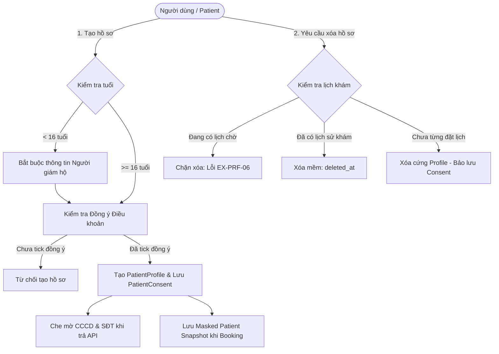

# Kế Hoạch & Chi Tiết Công Việc Sprint 4 — Thành Viên: Hiệu

> **Dự án:** MedSi — Nền tảng đặt lịch khám bệnh trực tuyến  
> **Phiên bản baseline:** v0.1 (Tài liệu thống nhất baseline Sprint 4)  
> **Người phụ trách:** **Hiệu**  
> **Vai trò:** Backend Developer (Core Patient Profiles, Privacy, Factories & Acceptance Tests)  
> **Mã công việc:** `S4-03`, `S4-20`, `S4-21`, `S4-22`, `S4-23`, `S4-24`, `S4-25`  
> **Tiêu chí nghiệm thu E2E trực tiếp:** `E15`, `E17`

---

## 1. Tổng quan phân công Sprint 4

Trong Sprint 4 của dự án MedSi, Hiệu chịu trách nhiệm toàn bộ phân hệ **Quản lý Hồ sơ người được khám (`patient_profiles`)**, **Bằng chứng đồng thuận điều khoản y tế (`patient_consents`)**, **Bảo vệ quyền riêng tư & che mờ dữ liệu nhạy cảm (Data Masking & Snapshot)**, **Hệ thống Model Factories cho 14 bảng CSDL**, và các kịch bản kiểm thử E2E liên quan (`E15`, `E17`).

---

## 2. Bảng phân rã công việc (Work Breakdown Structure)

| Mã Task | Tên hạng mục | Mô tả nội dung | Tài liệu chi tiết |
|---|---|---|---|
| **S4-03** | Eloquent Relationships, Soft Deletes & 14-Table Factories | Khai báo quan hệ Eloquent models, trait Soft Deletes và viết Model Factory cho toàn bộ 14 bảng CSDL để sinh dữ liệu test. | [01_Model_Eloquent_Va_14_Factories.md](01_Model_Eloquent_Va_14_Factories.md) |
| **S4-20** | Profile CRUD (`patient_profiles`) | Xây dựng API Thêm/Xem/Sửa/Xóa hồ sơ: tối đa 10 hồ sơ/user, 1 hồ sơ mặc định, unique `(user_id, identity_card_number)`. | [02_Quan_Ly_Ho_So_Va_Dong_Thuan.md](02_Quan_Ly_Ho_So_Va_Dong_Thuan.md) |
| **S4-21** | Guardian Validation | Xác thực người giám hộ: Bệnh nhân `< 16 tuổi` bắt buộc nhập `guardian_name`, `guardian_phone`, `guardian_relationship`. | [02_Quan_Ly_Ho_So_Va_Dong_Thuan.md](02_Quan_Ly_Ho_So_Va_Dong_Thuan.md) |
| **S4-22** | Consent Evidence (`patient_consents`) | Ghi nhận bằng chứng đồng ý điều khoản khi tạo hồ sơ. Thiết kế schema không khóa ngoại cứng để bảo lưu bằng chứng khi profile bị xóa. | [02_Quan_Ly_Ho_So_Va_Dong_Thuan.md](02_Quan_Ly_Ho_So_Va_Dong_Thuan.md) |
| **S4-23** | Sensitive Data Masking | Che giấu số CCCD và SĐT trên API response để bảo vệ quyền riêng tư cá nhân. | [03_Masking_Snapshot_Va_Chinh_Sach_Xoa.md](03_Masking_Snapshot_Va_Chinh_Sach_Xoa.md) |
| **S4-24** | Masked Patient Snapshot | Lưu snapshot thông tin bệnh nhân đã được che mờ vào cột JSON `patient_snapshot` của bảng `bookings`. | [03_Masking_Snapshot_Va_Chinh_Sach_Xoa.md](03_Masking_Snapshot_Va_Chinh_Sach_Xoa.md) |
| **S4-25** | Deletion Policy | Chính sách xóa hồ sơ theo 3 trường hợp: chặn xóa khi có lịch chờ (`EX-PRF-06`), xóa mềm khi có lịch sử, xóa cứng khi chưa từng đặt lịch. | [03_Masking_Snapshot_Va_Chinh_Sach_Xoa.md](03_Masking_Snapshot_Va_Chinh_Sach_Xoa.md) |

---

## 3. Mục tiêu nghiệm thu E2E (End-to-End Acceptance)

Hiệu chịu trách nhiệm trực tiếp viết và đảm bảo vượt qua (PASS) 2 kịch bản nghiệm thu kiểm thử tự động trong Sprint 4:

* **`E15` (Profile trẻ em, Xác thực người giám hộ, Đồng thuận điều khoản & Masking):**
  * Khởi tạo tài khoản bệnh nhân mới.
  * Tạo hồ sơ trẻ em dưới 16 tuổi (`guardian_age_threshold`).
  * Cố tình lưu khi chưa đồng thuận consent $\rightarrow$ Thất bại.
  * Cung cấp đủ thông tin người giám hộ + đồng ý điều khoản $\rightarrow$ Thành công.
  * Kiểm tra DB có đúng 1 bản ghi consent; response trả về CCCD và SĐT đã được che mờ (masked).
* **`E17` (Kiểm thử chính sách xóa 3 loại hồ sơ):**
  * Chuẩn bị 3 hồ sơ bệnh nhân:
    1. Đang có lịch khám chờ duyệt hoặc đang giữ chỗ.
    2. Đã từng có lịch sử khám trước đó.
    3. Chưa từng phát sinh bất kỳ lượt đặt lịch nào.
  * Yêu cầu xóa lần lượt:
    * Hồ sơ 1: Bị chặn xóa và quăng mã lỗi `EX-PRF-06`.
    * Hồ sơ 2: Được xóa mềm (`deleted_at` được gán timestamp).
    * Hồ sơ 3: Bị xóa cứng khỏi bảng `patient_profiles`, đồng thời bản ghi trong `patient_consents` và nhật ký audit vẫn được bảo lưu nguyên vẹn.

Chi tiết mã test tự động PHPUnit xem tại: [04_Kich_Ban_Kiem_Thu_E2E_E15_E17.md](04_Kich_Ban_Kiem_Thu_E2E_E15_E17.md).

---

## 4. Mục lục tài liệu phân công

1. **[01_Model_Eloquent_Va_14_Factories.md](01_Model_Eloquent_Va_14_Factories.md)**: Chi tiết cấu trúc Model, Soft Deletes và 14 file Model Factories.
2. **[02_Quan_Ly_Ho_So_Va_Dong_Thuan.md](02_Quan_Ly_Ho_So_Va_Dong_Thuan.md)**: Nghiệp vụ CRUD hồ sơ, giới hạn số lượng, xác thực người giám hộ và lưu bằng chứng consent.
3. **[03_Masking_Snapshot_Va_Chinh_Sach_Xoa.md](03_Masking_Snapshot_Va_Chinh_Sach_Xoa.md)**: Cơ chế che mờ dữ liệu (Data Masking), lưu `patient_snapshot` và xử lý 3 kịch bản xóa hồ sơ.
4. **[04_Kich_Ban_Kiem_Thu_E2E_E15_E17.md](04_Kich_Ban_Kiem_Thu_E2E_E15_E17.md)**: Kịch bản và code kiểm thử E2E tự động cho E15 và E17.
