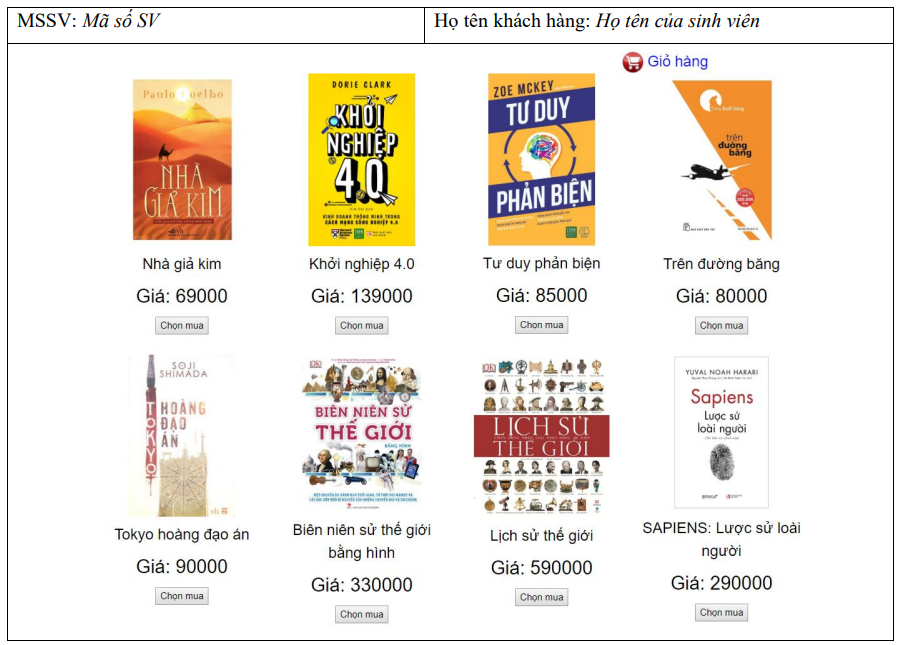
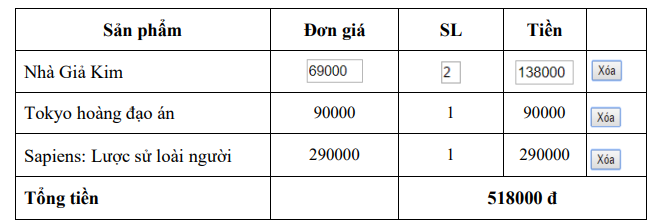
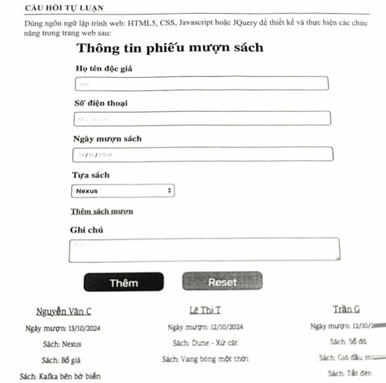
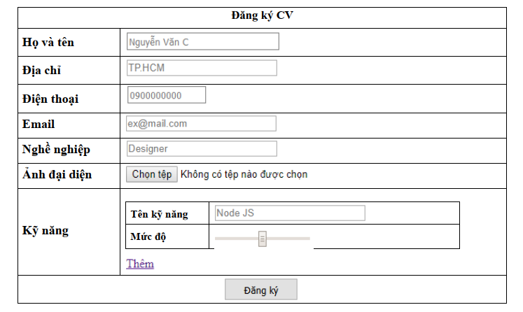
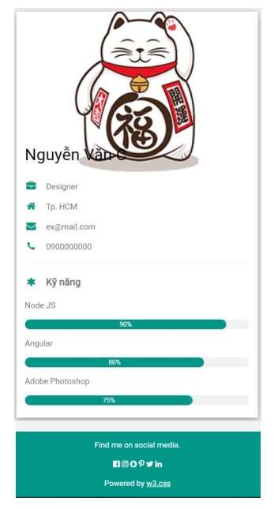
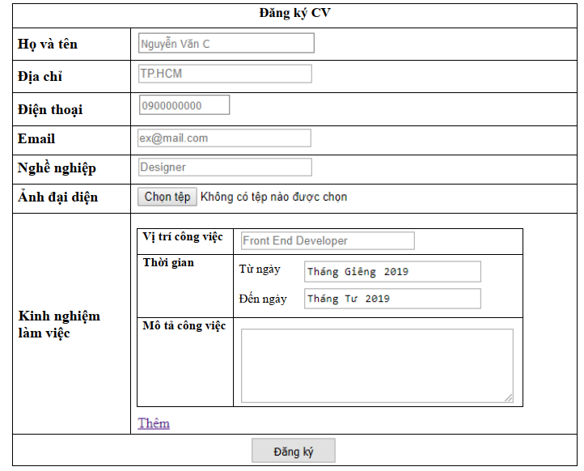
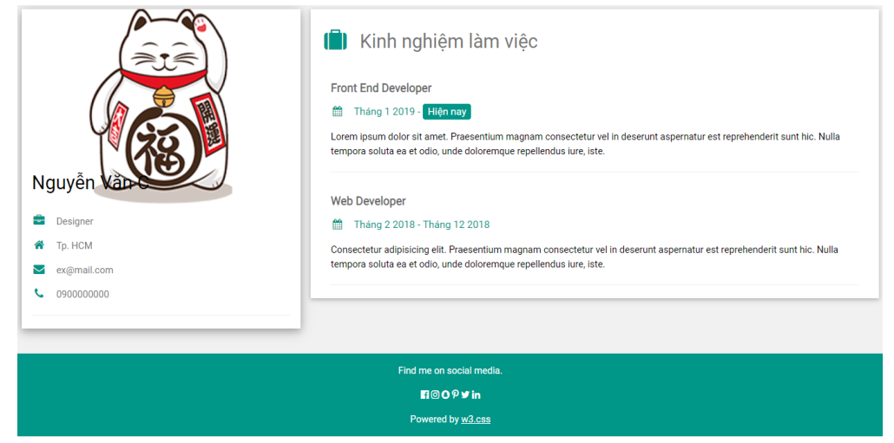

# 📘 GIẢI CHI TIẾT 4 ĐỀ THI GIỮA KỲ MÔN WEB (IS207 - UIT)
### ĐỀ HK1 (2019-2020) • ĐỀ HK1 (2024-2025) • 2 ĐỀ HK2 (2018-2019) • HTML5 + CSS3 + VANILLA JS

> **Nội dung:** Phân tích yêu cầu và lời giải hoàn chỉnh bằng **100% HTML5, CSS3 và Vanilla JavaScript (không dùng jQuery)** cho 4 đề thi giữa kỳ thực tế của Khoa Hệ thống Thông tin - UIT.

---

## 🔑 KIẾN THỨC CỐT LÕI XUYÊN SUỐT CẢ 4 ĐỀ THI: TRUYỀN DỮ LIỆU QUA TRANG MỚI

Cả 4 đề thi đều có cấu trúc gồm 2 câu:
- **Câu 1 (5.0 - 6.0 điểm):** Thiết kế giao diện trang chính (bảng/form), bắt sự kiện thêm phần tử động và lưu trữ dữ liệu.
- **Câu 2 (4.0 - 5.0 điểm):** Khi nhấn vào liên kết hoặc nút Submit (`"Giỏ hàng"`, `"Tên độc giả"`, `"Đăng ký"`), hiển thị chi tiết dữ liệu đã nhập ở Câu 1 theo bố cục giao diện mới.

### Công thức truyền dữ liệu giữa 2 trang HTML bằng `localStorage`:
```javascript
// 1. Ở TRANG 1 (Lưu mảng/đối tượng vào localStorage trước khi chuyển trang):
localStorage.setItem("ten_khoa", JSON.stringify(duLieu));

// 2. Ở TRANG 2 (Đọc lại dữ liệu từ localStorage khi mở trang mới):
const duLieu = JSON.parse(localStorage.getItem("ten_khoa")) || [];
```

---

# 🏛️ PHẦN 1: GIẢI ĐỀ THI GIỮA KỲ HK1 (2019 - 2020)
**Chủ đề:** Website Bán Sách & Quản Lý Giỏ Hàng

## 1.1. Tóm tắt yêu cầu đề bài
- **Câu 1 (5.0 điểm) - Trang danh mục sách (`index.html`):**
  - Phần đầu hiển thị `"MSSV: ..."` và `"Họ tên khách hàng: ..."` có **font chữ 14 (`14px`), màu Xanh dương (`blue`)**.
  - Góc trên bên phải của khung sản phẩm có liên kết **`Giỏ hàng`** dẫn sang trang giỏ hàng.
  - Danh sách 8 quyển sách chia làm 2 hàng $\times$ 4 cột, mỗi quyển gồm: **Hình ảnh, Tên sách, Giá sách** và nút **`Chọn mua`**.
  - Mỗi lần nhấn nút **`Chọn mua`**, lưu tạm sản phẩm (Tên sản phẩm, Đơn giá, Số lượng) vào bộ nhớ.
- **Câu 2 (5.0 điểm) - Trang giỏ hàng (`giohang.html`):**
  - Khi click vào **`Giỏ hàng`**, mở trang mới hiển thị bảng danh sách các sách đã chọn mua.
  - Bảng gồm các cột: `Sản phẩm` | `Đơn giá` | `SL` | `Tiền` | (Nút `Xóa`).
  - **Yêu cầu đặc biệt:** Các cột **`Đơn giá`**, **`SL`** và **`Tiền`** phải là các **textbox (`<input type="text">` / `<input type="number">`)**.
  - Khi thay đổi số lượng (`SL`) của một quyển sách thì ô `Tiền` của dòng đó và `Tổng tiền` ở cuối bảng tự động cập nhật.
  - Khi nhấn nút **`Xóa`**, xóa sản phẩm đó khỏi bảng và cập nhật lại `Tổng tiền`.

---

## 1.2. Bài giải Câu 1: Trang Danh Mục Sách (`index.html`)



```html
<!DOCTYPE html>
<html lang="vi">
<head>
  <meta charset="UTF-8">
  <meta name="viewport" content="width=device-width, initial-scale=1.0">
  <title>Website Bán Sách - IS207</title>
  <style>
    * { box-sizing: border-box; font-family: Arial, sans-serif; }
    .main-table {
      width: 850px;
      margin: 20px auto;
      border-collapse: collapse;
      border: 1px solid #333;
    }
    .main-table td {
      border: 1px solid #333;
      padding: 8px 12px;
    }
    /* Yêu cầu đề: MSSV và Họ tên khách hàng font chữ 14, màu Xanh dương */
    .student-info {
      font-size: 14px;
      color: blue;
      width: 50%;
    }
    .cart-header {
      text-align: right;
      margin-bottom: 10px;
      padding-right: 20px;
    }
    .cart-header a {
      text-decoration: none;
      color: #003399;
      font-weight: bold;
      font-size: 15px;
    }
    /* Lưới 4 cột hiển thị sách */
    .book-grid {
      display: grid;
      grid-template-columns: repeat(4, 1fr);
      gap: 20px;
      padding: 10px;
      text-align: center;
    }
    .book-item img {
      width: 110px;
      height: 155px;
      object-fit: cover;
      border: 1px solid #ddd;
    }
    .book-title {
      font-size: 14px;
      margin: 8px 0 4px 0;
      min-height: 34px;
    }
    .book-price {
      font-size: 16px;
      margin-bottom: 8px;
    }
    .btn-buy {
      padding: 4px 12px;
      cursor: pointer;
      border: 1px solid #888;
      background-color: #f0f0f0;
    }
    .btn-buy:hover {
      background-color: #ddd;
    }
  </style>
</head>
<body>

  <table class="main-table">
    <!-- Hàng thông tin sinh viên -->
    <tr>
      <td class="student-info">MSSV: <i>24520001</i></td>
      <td class="student-info">Họ tên khách hàng: <i>Nguyễn Văn A</i></td>
    </tr>

    <!-- Hàng hiển thị danh sách sản phẩm -->
    <tr>
      <td colspan="2">
        <div class="cart-header">
          🛒 <a href="giohang.html" target="_blank">Giỏ hàng</a>
        </div>

        <div class="book-grid">
          <!-- Sản phẩm 1 -->
          <div class="book-item">
            
            <div class="book-title">Nhà giả kim</div>
            <div class="book-price">Giá: 69000</div>
            <button type="button" class="btn-buy" data-name="Nhà Giả Kim" data-price="69000">Chọn mua</button>
          </div>

          <!-- Sản phẩm 2 -->
          <div class="book-item">
            
            <div class="book-title">Khởi nghiệp 4.0</div>
            <div class="book-price">Giá: 139000</div>
            <button type="button" class="btn-buy" data-name="Khởi nghiệp 4.0" data-price="139000">Chọn mua</button>
          </div>

          <!-- Sản phẩm 3 -->
          <div class="book-item">
            
            <div class="book-title">Tư duy phản biện</div>
            <div class="book-price">Giá: 85000</div>
            <button type="button" class="btn-buy" data-name="Tư duy phản biện" data-price="85000">Chọn mua</button>
          </div>

          <!-- Sản phẩm 4 -->
          <div class="book-item">
            
            <div class="book-title">Trên đường băng</div>
            <div class="book-price">Giá: 80000</div>
            <button type="button" class="btn-buy" data-name="Trên đường băng" data-price="80000">Chọn mua</button>
          </div>

          <!-- Sản phẩm 5 -->
          <div class="book-item">
            
            <div class="book-title">Tokyo hoàng đạo án</div>
            <div class="book-price">Giá: 90000</div>
            <button type="button" class="btn-buy" data-name="Tokyo hoàng đạo án" data-price="90000">Chọn mua</button>
          </div>

          <!-- Sản phẩm 6 -->
          <div class="book-item">
            
            <div class="book-title">Biên niên sử thế giới bằng hình</div>
            <div class="book-price">Giá: 330000</div>
            <button type="button" class="btn-buy" data-name="Biên niên sử thế giới bằng hình" data-price="330000">Chọn mua</button>
          </div>

          <!-- Sản phẩm 7 -->
          <div class="book-item">
            
            <div class="book-title">Lịch sử thế giới</div>
            <div class="book-price">Giá: 590000</div>
            <button type="button" class="btn-buy" data-name="Lịch sử thế giới" data-price="590000">Chọn mua</button>
          </div>

          <!-- Sản phẩm 8 -->
          <div class="book-item">
            
            <div class="book-title">SAPIENS: Lược sử loài người</div>
            <div class="book-price">Giá: 290000</div>
            <button type="button" class="btn-buy" data-name="Sapiens: Lược sử loài người" data-price="290000">Chọn mua</button>
          </div>
        </div>
      </td>
    </tr>
  </table>

  <script>
    // Lắng nghe sự kiện click trên tất cả các nút "Chọn mua"
    const buyButtons = document.querySelectorAll(".btn-buy");

    buyButtons.forEach(function(btn) {
      btn.addEventListener("click", function() {
        const name  = this.dataset.name;
        const price = parseFloat(this.dataset.price);

        // Đọc giỏ hàng hiện tại từ localStorage (nếu chưa có thì tạo mảng rỗng)
        let cart = JSON.parse(localStorage.getItem("bookCart")) || [];

        // Kiểm tra xem sách đã có trong giỏ hàng chưa
        const existingItem = cart.find(item => item.name === name);
        if (existingItem) {
          existingItem.qty += 1; // Nếu có rồi thì cộng dồn số lượng thêm 1
        } else {
          cart.push({ name: name, price: price, qty: 1 });
        }

        // Lưu lại vào localStorage
        localStorage.setItem("bookCart", JSON.stringify(cart));
        alert("Đã thêm '" + name + "' vào giỏ hàng!");
      });
    });
  </script>

</body>
</html>
```

---

## 1.3. Bài giải Câu 2: Trang Giỏ Hàng (`giohang.html`)



```html
<!DOCTYPE html>
<html lang="vi">
<head>
  <meta charset="UTF-8">
  <meta name="viewport" content="width=device-width, initial-scale=1.0">
  <title>Giỏ Hàng</title>
  <style>
    * { box-sizing: border-box; font-family: "Times New Roman", serif; font-size: 16px; }
    table {
      width: 650px;
      margin: 30px auto;
      border-collapse: collapse;
      border: 1px solid #333;
    }
    th, td {
      border: 1px solid #333;
      padding: 8px 10px;
    }
    th {
      font-weight: bold;
      text-align: center;
    }
    .text-center { text-align: center; }
    /* Định dạng các textbox Đơn giá, SL, Tiền */
    .txt-price, .txt-total {
      width: 90px;
      padding: 3px 5px;
    }
    .txt-qty {
      width: 45px;
      padding: 3px 5px;
      text-align: center;
    }
    .btn-del {
      padding: 3px 8px;
      cursor: pointer;
    }
  </style>
</head>
<body>

  <table id="cartTable">
    <thead>
      <tr>
        <th>Sản phẩm</th>
        <th>Đơn giá</th>
        <th>SL</th>
        <th>Tiền</th>
        <th></th>
      </tr>
    </thead>
    <tbody id="cartBody">
      <!-- Dữ liệu từ localStorage sẽ được chèn vào đây -->
    </tbody>
    <tfoot>
      <tr>
        <td><b>Tổng tiền</b></td>
        <td></td>
        <td colspan="3" class="text-center"><b id="grandTotal">0 đ</b></td>
      </tr>
    </tfoot>
  </table>

  <script>
    const cartBody = document.getElementById("cartBody");
    const grandTotalEl = document.getElementById("grandTotal");

    // Đọc danh sách sản phẩm đã chọn từ localStorage
    let cart = JSON.parse(localStorage.getItem("bookCart")) || [];

    // Hàm hiển thị giỏ hàng ra bảng
    function renderCart() {
      cartBody.innerHTML = "";
      let sum = 0;

      cart.forEach(function(item, index) {
        const lineTotal = item.price * item.qty;
        sum += lineTotal;

        // Đề yêu cầu: Các cột Đơn giá, SL và Tiền là các textbox (<input>)
        cartBody.insertAdjacentHTML("beforeend", `
          <tr data-index="${index}">
            <td>${item.name}</td>
            <td class="text-center">
              <input type="text" class="txt-price" value="${item.price}" readonly>
            </td>
            <td class="text-center">
              <input type="number" class="txt-qty" value="${item.qty}" min="1">
            </td>
            <td class="text-center">
              <input type="text" class="txt-total" value="${lineTotal}" readonly>
            </td>
            <td class="text-center">
              <button type="button" class="btn-del">Xóa</button>
            </td>
          </tr>
        `);
      });

      grandTotalEl.textContent = sum + " đ";
    }

    // Lắng nghe sự kiện thay đổi số lượng (SL)
    cartBody.addEventListener("input", function(e) {
      if (e.target.classList.contains("txt-qty")) {
        const row = e.target.closest("tr");
        const index = parseInt(row.dataset.index);
        let newQty = parseInt(e.target.value) || 1;
        if (newQty < 1) {
          newQty = 1;
          e.target.value = 1;
        }

        // Cập nhật số lượng và tính lại ô Tiền của dòng hiện tại
        cart[index].qty = newQty;
        const lineTotal = cart[index].price * newQty;
        row.querySelector(".txt-total").value = lineTotal;

        // Cập nhật localStorage và Tổng tiền toàn bảng
        localStorage.setItem("bookCart", JSON.stringify(cart));
        const total = cart.reduce((acc, item) => acc + item.price * item.qty, 0);
        grandTotalEl.textContent = total + " đ";
      }
    });

    // Lắng nghe sự kiện nhấn nút "Xóa"
    cartBody.addEventListener("click", function(e) {
      if (e.target.classList.contains("btn-del")) {
        const row = e.target.closest("tr");
        const index = parseInt(row.dataset.index);

        // Xóa phần tử khỏi mảng, lưu lại và vẽ lại bảng
        cart.splice(index, 1);
        localStorage.setItem("bookCart", JSON.stringify(cart));
        renderCart();
      }
    });

    // Khởi chạy lần đầu khi mở trang
    renderCart();
  </script>

</body>
</html>
```

---
---

# 🏛️ PHẦN 2: GIẢI ĐỀ THI GIỮA KỲ HK1 (2024 - 2025)
**Chủ đề:** Quản Lý Thông Tin Phiếu Mượn Sách Thư Viện (`IS207.P11`)

## 2.1. Tóm tắt yêu cầu đề bài
- **Câu 1 (6.0 điểm) - Trang tạo phiếu mượn sách (`phieumuon.html`):**
  - Form nhập thông tin gồm: **Họ tên độc giả**, **Số điện thoại**, **Ngày mượn sách**, **Tựa sách** (combobox `<select>`), liên kết/nút **`Thêm sách mượn`**, **Ghi chú** (`<textarea>`), nút **`Thêm`** và nút **`Reset`**.
  - **Ràng buộc "Thêm sách mượn":** Mỗi lần nhấn vào `"Thêm sách mượn"` sẽ sinh thêm 1 combobox chọn tựa sách. **Mỗi phiếu mượn chỉ được mượn tối đa 03 quyển sách**.
  - Mỗi tựa sách trong combobox có kèm **thời hạn mượn** của sách đó (VD: `7 ngày`, `14 ngày`).
  - Mỗi lần nhấn nút **`Thêm`**, thông tin phiếu mượn lấy từ form sẽ được thêm và hiển thị phía dưới trang web (gồm: **Tên độc giả dạng link**, **Ngày mượn**, và **danh sách các tựa sách đã mượn**).
- **Câu 2 (4.0 điểm) - Trang chi tiết phiếu mượn (`chitiet.html`):**
  - Khi click vào link **`Tên độc giả`** nào ở phía dưới, hiện ra thông tin chi tiết phiếu mượn của độc giả đó trong một trang mới gồm:
    - `Tên độc giả`, `Số điện thoại`
    - Bảng 2 cột `Sách mượn` và `Hạn mượn` (VD: `Nexus` - `7 ngày`, `Bố già` - `7 ngày`, `Kafka bên bờ biển` - `14 ngày`)
    - `Ghi chú`

---

## 2.2. Bài giải Câu 1: Trang Tạo Phiếu Mượn Sách (`phieumuon.html`)



```html
<!DOCTYPE html>
<html lang="vi">
<head>
  <meta charset="UTF-8">
  <meta name="viewport" content="width=device-width, initial-scale=1.0">
  <title>Thông tin phiếu mượn sách</title>
  <style>
    * { box-sizing: border-box; font-family: Arial, sans-serif; }
    .container {
      width: 560px;
      margin: 20px auto;
      padding: 15px;
    }
    h2 {
      text-align: center;
      margin-bottom: 20px;
    }
    .form-group {
      margin-bottom: 14px;
    }
    label {
      display: block;
      font-weight: bold;
      margin-bottom: 5px;
      font-size: 14px;
    }
    input[type="text"], input[type="date"], textarea {
      width: 100%;
      padding: 8px;
      border: 1px solid #888;
      border-radius: 4px;
    }
    select.book-select {
      width: 220px;
      padding: 6px;
      border: 1px solid #888;
      border-radius: 4px;
      display: block;
      margin-bottom: 8px;
    }
    .add-book-link {
      display: inline-block;
      font-weight: bold;
      font-size: 13px;
      color: #000;
      cursor: pointer;
      text-decoration: underline;
      margin-bottom: 12px;
    }
    .btn-group {
      text-align: center;
      margin-top: 15px;
    }
    .btn {
      width: 140px;
      padding: 8px 16px;
      border: none;
      border-radius: 6px;
      font-size: 15px;
      font-weight: bold;
      color: white;
      cursor: pointer;
      margin: 0 10px;
    }
    .btn-submit { background-color: #111; }
    .btn-reset  { background-color: #777; }

    /* Khu vực hiển thị danh sách phiếu mượn phía dưới (chia 3 cột như đề) */
    .loan-list {
      width: 750px;
      margin: 30px auto;
      display: grid;
      grid-template-columns: repeat(3, 1fr);
      gap: 25px;
      text-align: center;
    }
    .loan-card a.reader-link {
      font-weight: bold;
      color: #000;
      text-decoration: underline;
      font-size: 16px;
      cursor: pointer;
    }
    .loan-card p {
      margin: 6px 0;
      font-size: 14px;
    }
  </style>
</head>
<body>

  <div class="container">
    <h2>Thông tin phiếu mượn sách</h2>

    <form id="loanForm">
      <div class="form-group">
        <label for="readerName">Họ tên độc giả</label>
        <input type="text" id="readerName" placeholder="Nhập họ tên độc giả" required>
      </div>

      <div class="form-group">
        <label for="phone">Số điện thoại</label>
        <input type="text" id="phone" placeholder="09xxxxxxxx" required>
      </div>

      <div class="form-group">
        <label for="borrowDate">Ngày mượn sách</label>
        <input type="text" id="borrowDate" placeholder="13/10/2024" required>
      </div>

      <div class="form-group">
        <label>Tựa sách</label>
        <div id="bookSelectContainer">
          <!-- Combobox mặc định đầu tiên -->
          <select class="book-select">
            <option value="Nexus" data-duration="7 ngày">Nexus</option>
            <option value="Bố già" data-duration="7 ngày">Bố già</option>
            <option value="Kafka bên bờ biển" data-duration="14 ngày">Kafka bên bờ biển</option>
            <option value="Dune - Xứ cát" data-duration="14 ngày">Dune - Xứ cát</option>
            <option value="Vang bóng một thời" data-duration="7 ngày">Vang bóng một thời</option>
            <option value="Số đỏ" data-duration="7 ngày">Số đỏ</option>
            <option value="Gió đầu mùa" data-duration="7 ngày">Gió đầu mùa</option>
            <option value="Tắt đèn" data-duration="14 ngày">Tắt đèn</option>
          </select>
        </div>

        <!-- Nút/chữ Thêm sách mượn (Tối đa 3 quyển) -->
        <span id="btnAddBookSelect" class="add-book-link">Thêm sách mượn</span>
      </div>

      <div class="form-group">
        <label for="note">Ghi chú</label>
        <textarea id="note" rows="3" placeholder="Nhập ghi chú..."></textarea>
      </div>

      <div class="btn-group">
        <button type="submit" class="btn btn-submit">Thêm</button>
        <button type="reset" id="btnReset" class="btn btn-reset">Reset</button>
      </div>
    </form>
  </div>

  <!-- Danh sách các phiếu mượn hiển thị bên dưới -->
  <div id="loanList" class="loan-list"></div>

  <script>
    const bookSelectContainer = document.getElementById("bookSelectContainer");
    const btnAddBookSelect = document.getElementById("btnAddBookSelect");
    const loanForm = document.getElementById("loanForm");
    const loanList = document.getElementById("loanList");

    // 1. Chức năng "Thêm sách mượn" (Tối đa 03 quyển sách)
    btnAddBookSelect.addEventListener("click", function() {
      const currentSelects = bookSelectContainer.querySelectorAll(".book-select");
      if (currentSelects.length >= 3) {
        alert("Lưu ý: Mỗi phiếu mượn chỉ được mượn tối đa 03 quyển sách!");
        return;
      }

      // Nhân bản (clone) combobox đầu tiên để giữ nguyên danh sách sách & thời hạn
      const newSelect = currentSelects[0].cloneNode(true);
      bookSelectContainer.appendChild(newSelect);
    });

    // Khi bấm nút Reset, xóa bớt các combobox thêm vào, chỉ giữ lại 1 combobox gốc
    document.getElementById("btnReset").addEventListener("click", function() {
      const allSelects = bookSelectContainer.querySelectorAll(".book-select");
      allSelects.forEach((sel, idx) => {
        if (idx > 0) sel.remove();
      });
    });

    // Đọc danh sách phiếu mượn từ localStorage
    let loans = JSON.parse(localStorage.getItem("libraryLoans")) || [];

    // 2. Hàm hiển thị các phiếu mượn bên dưới trang web
    function renderLoans() {
      loanList.innerHTML = "";
      loans.forEach(function(loan, index) {
        const booksHtml = loan.books.map(b => `<p>Sách: ${b.title}</p>`).join("");

        loanList.insertAdjacentHTML("beforeend", `
          <div class="loan-card">
            <a href="chitiet.html" target="_blank" class="reader-link" data-index="${index}">
              ${loan.readerName}
            </a>
            <p>Ngày mượn: ${loan.borrowDate}</p>
            ${booksHtml}
          </div>
        `);
      });
    }

    // 3. Sự kiện nhấn nút "Thêm" phiếu mượn
    loanForm.addEventListener("submit", function(e) {
      e.preventDefault();

      const readerName = document.getElementById("readerName").value.trim();
      const phone      = document.getElementById("phone").value.trim();
      const borrowDate = document.getElementById("borrowDate").value.trim();
      const note       = document.getElementById("note").value.trim();

      // Lấy danh sách các sách được chọn kèm hạn mượn
      const books = [];
      bookSelectContainer.querySelectorAll(".book-select").forEach(function(sel) {
        const opt = sel.options[sel.selectedIndex];
        books.push({
          title: opt.value,
          duration: opt.dataset.duration
        });
      });

      // Tạo đối tượng phiếu mượn mới và lưu vào localStorage
      loans.push({
        readerName: readerName,
        phone: phone,
        borrowDate: borrowDate,
        books: books,
        note: note
      });
      localStorage.setItem("libraryLoans", JSON.stringify(loans));

      // Vẽ lại danh sách phía dưới và reset form về 1 combobox
      renderLoans();
      loanForm.reset();
      document.getElementById("btnReset").click();
    });

    // 4. Khi click vào link "Tên độc giả", lưu phiếu được chọn vào localStorage để trang chitiet.html đọc
    loanList.addEventListener("click", function(e) {
      if (e.target.classList.contains("reader-link")) {
        const index = parseInt(e.target.dataset.index);
        localStorage.setItem("selectedLoan", JSON.stringify(loans[index]));
      }
    });

    renderLoans();
  </script>

</body>
</html>
```

---

## 2.3. Bài giải Câu 2: Trang Chi Tiết Phiếu Mượn (`chitiet.html`)


```html
<!DOCTYPE html>
<html lang="vi">
<head>
  <meta charset="UTF-8">
  <meta name="viewport" content="width=device-width, initial-scale=1.0">
  <title>Chi tiết phiếu mượn</title>
  <style>
    * { box-sizing: border-box; font-family: "Times New Roman", serif; font-size: 16px; }
    .detail-box {
      width: 450px;
      margin: 30px auto;
      border: 1px solid #888;
      padding: 15px 20px;
    }
    h3 {
      text-align: center;
      margin-top: 0;
      margin-bottom: 12px;
      font-size: 18px;
    }
    table {
      width: 100%;
      border-collapse: collapse;
    }
    td {
      padding: 5px 0;
      vertical-align: top;
    }
    .col-left {
      width: 45%;
    }
    .bold {
      font-weight: bold;
    }
  </style>
</head>
<body>

  <div class="detail-box">
    <h3>Thông tin phiếu mượn</h3>
    <table id="detailTable">
      <!-- Nội dung chi tiết sẽ được render bằng JS -->
    </table>
  </div>

  <script>
    const detailTable = document.getElementById("detailTable");
    const loan = JSON.parse(localStorage.getItem("selectedLoan"));

    if (loan) {
      // Tạo các dòng hiển thị từng quyển sách và hạn mượn
      const bookRows = loan.books.map(b => `
        <tr>
          <td>${b.title}</td>
          <td>${b.duration}</td>
        </tr>
      `).join("");

      detailTable.innerHTML = `
        <tr>
          <td class="col-left bold">Tên độc giả</td>
          <td>${loan.readerName}</td>
        </tr>
        <tr>
          <td class="col-left bold">Số điện thoại</td>
          <td>${loan.phone}</td>
        </tr>
        <tr>
          <td class="col-left bold">Sách mượn</td>
          <td class="bold">Hạn mượn</td>
        </tr>
        ${bookRows}
        <tr>
          <td class="col-left bold">Ghi chú</td>
          <td>${loan.note || ""}</td>
        </tr>
      `;
    } else {
      detailTable.innerHTML = `<tr><td colspan="2">Chưa có thông tin phiếu mượn được chọn.</td></tr>`;
    }
  </script>

</body>
</html>
```

---
---

# 🏛️ PHẦN 3: GIẢI ĐỀ THI GIỮA KỲ HK2 (2018 - 2019) – ĐỀ 1 (`IS207.J21`)
**Chủ đề:** Đăng Ký Thông Tin CV & Thanh Mức Độ Kỹ Năng (`<input type="range">`)

## 3.1. Tóm tắt yêu cầu đề bài
- **Câu 1 (5.0 điểm) - Thiết kế form Đăng ký CV (`dangky_cv_1.html`):**
  - Bảng form gồm: **Họ và tên**, **Địa chỉ**, **Điện thoại**, **Email**, **Nghề nghiệp**, **Ảnh đại diện** (`<input type="file">`) và **Kỹ năng**.
  - Phần **Kỹ năng** chứa bảng con gồm 2 dòng:
    - **Tên kỹ năng**: `<input type="text" placeholder="Node JS">`
    - **Mức độ**: Thanh trượt `<input type="range" min="0" max="100" step="10">` (*"hiển thị từ 0 đến 100, mỗi lần dịch chuyển là 10. Số này sẽ được dùng để hiển thị trong câu 2"*).
  - Khi nhấn vào link **`Thêm`**, thêm một bảng nhập kỹ năng mới bên dưới.
  - Khi nhấn vào button **`Đăng ký`**, hiển thị trang web CV theo mẫu Câu 2.
- **Câu 2 (5.0 điểm) - Hiển thị trang CV (`hienthi_cv_1.html`):**
  - Dựa vào thông tin lấy được ở form Câu 1, hiển thị thẻ CV gồm:
    - Ảnh đại diện ở trên cùng, **Họ và tên** nằm đè lên góc dưới bên trái của ảnh (`position: absolute`).
    - Danh sách thông tin cá nhân kèm biểu tượng: Nghề nghiệp, Địa chỉ, Email, Điện thoại.
    - Phần **Kỹ năng**: Hiển thị từng kỹ năng kèm thanh tiến trình (progress bar) màu xanh (`#009688`) có độ rộng bằng đúng số `%` đã kéo ở Câu 1 và hiển thị con số `XX%` ở giữa thanh.
    - *Lưu ý:* Phần footer không cần làm.

---

## 3.2. Bài giải Câu 1: Trang Form Đăng Ký CV & Kỹ Năng (`dangky_cv_1.html`)



```html
<!DOCTYPE html>
<html lang="vi">
<head>
  <meta charset="UTF-8">
  <meta name="viewport" content="width=device-width, initial-scale=1.0">
  <title>Đăng ký CV - Kỹ năng</title>
  <style>
    * { box-sizing: border-box; font-family: "Times New Roman", serif; font-size: 16px; }
    .cv-table {
      width: 650px;
      margin: 25px auto;
      border-collapse: collapse;
      border: 1px solid #000;
    }
    .cv-table > tbody > tr > th,
    .cv-table > tbody > tr > td {
      border: 1px solid #000;
      padding: 8px 10px;
      vertical-align: middle;
    }
    .col-label {
      width: 150px;
      font-weight: bold;
    }
    input[type="text"], input[type="email"] {
      width: 240px;
      padding: 4px 6px;
      border: 1px solid #999;
      font-family: Arial, sans-serif;
      font-size: 14px;
    }
    #phone { width: 130px; }

    /* Bảng con nhập Kỹ năng */
    .skill-table {
      width: 100%;
      border-collapse: collapse;
      border: 1px solid #000;
      margin-bottom: 10px;
    }
    .skill-table td {
      border: 1px solid #000;
      padding: 6px 8px;
    }
    .skill-table .sub-label {
      width: 115px;
      font-weight: bold;
    }
    input[type="range"] {
      width: 160px;
      cursor: pointer;
    }
    .add-link {
      color: #551a8b;
      text-decoration: underline;
      cursor: pointer;
      display: inline-block;
      margin-top: 2px;
    }
    .btn-submit {
      padding: 6px 24px;
      background-color: #e0e0e0;
      border: 1px solid #999;
      cursor: pointer;
      font-family: Arial, sans-serif;
      font-size: 14px;
    }
  </style>
</head>
<body>

  <form id="cvForm">
    <table class="cv-table">
      <tbody>
        <tr>
          <th colspan="2" style="text-align: center;">Đăng ký CV</th>
        </tr>
        <tr>
          <td class="col-label">Họ và tên</td>
          <td><input type="text" id="fullName" placeholder="Nguyễn Văn C" required></td>
        </tr>
        <tr>
          <td class="col-label">Địa chỉ</td>
          <td><input type="text" id="address" placeholder="TP.HCM" required></td>
        </tr>
        <tr>
          <td class="col-label">Điện thoại</td>
          <td><input type="text" id="phone" placeholder="0900000000" required></td>
        </tr>
        <tr>
          <td class="col-label">Email</td>
          <td><input type="email" id="email" placeholder="ex@mail.com" required></td>
        </tr>
        <tr>
          <td class="col-label">Nghề nghiệp</td>
          <td><input type="text" id="job" placeholder="Designer" required></td>
        </tr>
        <tr>
          <td class="col-label">Ảnh đại diện</td>
          <td><input type="file" id="avatar" accept="image/*"></td>
        </tr>
        <tr>
          <td class="col-label">Kỹ năng</td>
          <td>
            <div id="skillList">
              <!-- Khối kỹ năng mặc định đầu tiên -->
              <table class="skill-table">
                <tr>
                  <td class="sub-label">Tên kỹ năng</td>
                  <td><input type="text" class="skill-name" placeholder="Node JS" required></td>
                </tr>
                <tr>
                  <td class="sub-label">Mức độ</td>
                  <td>
                    <!-- Thanh mức độ từ 0 đến 100, bước nhảy 10 -->
                    <input type="range" class="skill-level" min="0" max="100" step="10" value="90">
                  </td>
                </tr>
              </table>
            </div>
            <span id="btnAddSkill" class="add-link">Thêm</span>
          </td>
        </tr>
        <tr>
          <td colspan="2" style="text-align: center;">
            <button type="submit" class="btn-submit">Đăng ký</button>
          </td>
        </tr>
      </tbody>
    </table>
  </form>

  <script>
    const skillList = document.getElementById("skillList");
    const btnAddSkill = document.getElementById("btnAddSkill");
    const cvForm = document.getElementById("cvForm");
    let avatarDataUrl = "avatar_default.png"; // Ảnh mặc định nếu không chọn file

    // Đọc file ảnh đại diện sang chuỗi Base64 để truyền qua localStorage
    document.getElementById("avatar").addEventListener("change", function(e) {
      const file = e.target.files[0];
      if (file) {
        const reader = new FileReader();
        reader.onload = function(evt) {
          avatarDataUrl = evt.target.result;
        };
        reader.readAsDataURL(file);
      }
    });

    // 1. Khi nhấn vào "Thêm" -> Thêm một bảng nhập kỹ năng mới
    btnAddSkill.addEventListener("click", function() {
      const firstTable = skillList.querySelector(".skill-table");
      const newTable = firstTable.cloneNode(true);
      newTable.querySelector(".skill-name").value = "";
      newTable.querySelector(".skill-level").value = 50;
      skillList.appendChild(newTable);
    });

    // 2. Khi nhấn vào nút "Đăng ký" -> Lưu thông tin và chuyển sang trang Câu 2
    cvForm.addEventListener("submit", function(e) {
      e.preventDefault();

      const skills = [];
      skillList.querySelectorAll(".skill-table").forEach(function(tbl) {
        const name  = tbl.querySelector(".skill-name").value.trim();
        const level = parseInt(tbl.querySelector(".skill-level").value) || 0;
        if (name !== "") {
          skills.push({ name: name, level: level });
        }
      });

      const cvData = {
        fullName: document.getElementById("fullName").value.trim(),
        address:  document.getElementById("address").value.trim(),
        phone:    document.getElementById("phone").value.trim(),
        email:    document.getElementById("email").value.trim(),
        job:      document.getElementById("job").value.trim(),
        avatar:   avatarDataUrl,
        skills:   skills
      };

      localStorage.setItem("cvDataSkills", JSON.stringify(cvData));
      window.location.href = "hienthi_cv_1.html";
    });
  </script>

</body>
</html>
```

---

## 3.3. Bài giải Câu 2: Trang Hiển Thị CV & Thanh Kỹ Năng (`hienthi_cv_1.html`)



```html
<!DOCTYPE html>
<html lang="vi">
<head>
  <meta charset="UTF-8">
  <meta name="viewport" content="width=device-width, initial-scale=1.0">
  <title>Thông tin CV</title>
  <style>
    * { box-sizing: border-box; font-family: Arial, sans-serif; }
    body { background-color: #f1f1f1; padding: 20px; }
    .cv-card {
      width: 360px;
      margin: 0 auto;
      background-color: #fff;
      box-shadow: 0 2px 8px rgba(0,0,0,0.2);
      border: 1px solid #ddd;
    }
    /* Khung ảnh đại diện + Tên ứng viên đè lên góc dưới ảnh */
    .avatar-box {
      position: relative;
      width: 100%;
      text-align: center;
    }
    .avatar-box img {
      width: 100%;
      max-height: 300px;
      object-fit: contain;
      display: block;
    }
    .avatar-box .candidate-name {
      position: absolute;
      bottom: 12px;
      left: 16px;
      font-size: 24px;
      color: #000;
    }
    .card-body {
      padding: 16px;
      color: #666;
      font-size: 14px;
    }
    .info-row {
      margin-bottom: 12px;
      display: flex;
      align-items: center;
      gap: 12px;
    }
    .icon {
      color: #009688;
      font-weight: bold;
      font-size: 16px;
      width: 20px;
      text-align: center;
    }
    hr {
      border: none;
      border-top: 1px solid #eee;
      margin: 16px 0;
    }
    .section-title {
      font-size: 18px;
      font-weight: bold;
      color: #666;
      margin-bottom: 14px;
      display: flex;
      align-items: center;
      gap: 10px;
    }
    /* Thanh tiến trình kỹ năng (Progress Bar) */
    .skill-item {
      margin-bottom: 14px;
    }
    .skill-label {
      margin-bottom: 6px;
      color: #666;
    }
    .progress-bg {
      width: 100%;
      background-color: #f1f1f1;
      border-radius: 12px;
      overflow: hidden;
    }
    .progress-bar {
      background-color: #009688;
      color: white;
      font-size: 12px;
      text-align: center;
      padding: 2px 0;
      border-radius: 12px;
    }
  </style>
</head>
<body>

  <div class="cv-card" id="cvCard"></div>

  <script>
    const cvCard = document.getElementById("cvCard");
    const data = JSON.parse(localStorage.getItem("cvDataSkills"));

    if (data) {
      const skillsHtml = data.skills.map(s => `
        <div class="skill-item">
          <div class="skill-label">${s.name}</div>
          <div class="progress-bg">
            <div class="progress-bar" style="width: ${s.level}%;">${s.level}%</div>
          </div>
        </div>
      `).join("");

      cvCard.innerHTML = `
        <div class="avatar-box">
          
          <div class="candidate-name">${data.fullName}</div>
        </div>
        <div class="card-body">
          <div class="info-row"><span class="icon">💼</span> <span>${data.job}</span></div>
          <div class="info-row"><span class="icon">🏠</span> <span>${data.address}</span></div>
          <div class="info-row"><span class="icon">✉️</span> <span>${data.email}</span></div>
          <div class="info-row"><span class="icon">📞</span> <span>${data.phone}</span></div>
          <hr>
          <div class="section-title"><span class="icon">✳</span> Kỹ năng</div>
          ${skillsHtml}
        </div>
      `;
    }
  </script>

</body>
</html>
```

---
---

# 🏛️ PHẦN 4: GIẢI ĐỀ THI GIỮA KỲ HK2 (2018 - 2019) – ĐỀ 2 (`IS207.J21.HTCL`)
**Chủ đề:** Đăng Ký Thông Tin CV & Kinh Nghiệm Làm Việc (Bố Cục 2 Cột)

## 4.1. Tóm tắt yêu cầu đề bài
- **Câu 1 (5.0 điểm) - Thiết kế form Đăng ký CV & Kinh nghiệm làm việc (`dangky_cv_2.html`):**
  - Bảng form gồm: **Họ và tên**, **Địa chỉ**, **Điện thoại**, **Email**, **Nghề nghiệp**, **Ảnh đại diện** và **Kinh nghiệm làm việc**.
  - Phần **Kinh nghiệm làm việc** chứa bảng con gồm 3 dòng:
    - **Vị trí công việc**: `<input type="text" placeholder="Front End Developer">`
    - **Thời gian**: Gồm 2 ô `Từ ngày` và `Đến ngày` (`<input type="text">` hoặc `<input type="month">`).
    - **Mô tả công việc**: `<textarea rows="4"></textarea>`.
  - Khi nhấn vào link **`Thêm`**, thêm một bảng nhập kinh nghiệm làm việc mới.
  - Khi nhấn vào button **`Đăng ký`**, hiển thị trang web CV theo mẫu Câu 2.
- **Câu 2 (5.0 điểm) - Hiển thị trang CV 2 cột (`hienthi_cv_2.html`):**
  - Dựa vào thông tin lấy được ở form Câu 1, hiển thị giao diện 2 cột:
    - **Cột trái:** Ảnh đại diện + Họ và tên đè lên góc dưới ảnh + Nghề nghiệp, Địa chỉ, Email, Điện thoại.
    - **Cột phải:** Khung `🧳 Kinh nghiệm làm việc` liệt kê các công việc đã nhập (Vị trí công việc, Thời gian từ ngày - đến ngày màu xanh `#009688`, và đoạn Mô tả công việc).
    - *Lưu ý:* Phần footer không cần làm.

---

## 4.2. Bài giải Câu 1: Trang Form Đăng Ký CV & Kinh Nghiệm (`dangky_cv_2.html`)



```html
<!DOCTYPE html>
<html lang="vi">
<head>
  <meta charset="UTF-8">
  <meta name="viewport" content="width=device-width, initial-scale=1.0">
  <title>Đăng ký CV - Kinh nghiệm làm việc</title>
  <style>
    * { box-sizing: border-box; font-family: "Times New Roman", serif; font-size: 16px; }
    .cv-table {
      width: 680px;
      margin: 25px auto;
      border-collapse: collapse;
      border: 1px solid #000;
    }
    .cv-table > tbody > tr > th,
    .cv-table > tbody > tr > td {
      border: 1px solid #000;
      padding: 8px 10px;
      vertical-align: middle;
    }
    .col-label {
      width: 150px;
      font-weight: bold;
    }
    input[type="text"], input[type="email"] {
      width: 240px;
      padding: 4px 6px;
      border: 1px solid #999;
      font-family: Arial, sans-serif;
      font-size: 14px;
    }
    #phone { width: 130px; }

    /* Bảng con nhập Kinh nghiệm làm việc */
    .exp-table {
      width: 100%;
      border-collapse: collapse;
      border: 1px solid #000;
      margin-bottom: 12px;
    }
    .exp-table td {
      border: 1px solid #000;
      padding: 6px 8px;
      vertical-align: top;
    }
    .exp-table .sub-label {
      width: 130px;
      font-weight: bold;
    }
    .time-row {
      margin-bottom: 6px;
    }
    .time-row span {
      display: inline-block;
      width: 70px;
    }
    .exp-desc {
      width: 100%;
      height: 85px;
      padding: 5px;
      border: 1px solid #999;
    }
    .add-link {
      color: #551a8b;
      text-decoration: underline;
      cursor: pointer;
      display: inline-block;
      margin-top: 2px;
    }
    .btn-submit {
      padding: 6px 24px;
      background-color: #e0e0e0;
      border: 1px solid #999;
      cursor: pointer;
      font-family: Arial, sans-serif;
      font-size: 14px;
    }
  </style>
</head>
<body>

  <form id="cvExpForm">
    <table class="cv-table">
      <tbody>
        <tr>
          <th colspan="2" style="text-align: center;">Đăng ký CV</th>
        </tr>
        <tr>
          <td class="col-label">Họ và tên</td>
          <td><input type="text" id="fullName" placeholder="Nguyễn Văn C" required></td>
        </tr>
        <tr>
          <td class="col-label">Địa chỉ</td>
          <td><input type="text" id="address" placeholder="TP.HCM" required></td>
        </tr>
        <tr>
          <td class="col-label">Điện thoại</td>
          <td><input type="text" id="phone" placeholder="0900000000" required></td>
        </tr>
        <tr>
          <td class="col-label">Email</td>
          <td><input type="email" id="email" placeholder="ex@mail.com" required></td>
        </tr>
        <tr>
          <td class="col-label">Nghề nghiệp</td>
          <td><input type="text" id="job" placeholder="Designer" required></td>
        </tr>
        <tr>
          <td class="col-label">Ảnh đại diện</td>
          <td><input type="file" id="avatar" accept="image/*"></td>
        </tr>
        <tr>
          <td class="col-label">Kinh nghiệm<br>làm việc</td>
          <td>
            <div id="expList">
              <!-- Khối kinh nghiệm làm việc mặc định đầu tiên -->
              <table class="exp-table">
                <tr>
                  <td class="sub-label">Vị trí công việc</td>
                  <td><input type="text" class="exp-position" placeholder="Front End Developer" required></td>
                </tr>
                <tr>
                  <td class="sub-label">Thời gian</td>
                  <td>
                    <div class="time-row">
                      <span>Từ ngày</span>
                      <input type="text" class="exp-from" placeholder="Tháng Giêng 2019" required>
                    </div>
                    <div class="time-row">
                      <span>Đến ngày</span>
                      <input type="text" class="exp-to" placeholder="Tháng Tư 2019" required>
                    </div>
                  </td>
                </tr>
                <tr>
                  <td class="sub-label">Mô tả công việc</td>
                  <td><textarea class="exp-desc" placeholder="Nhập mô tả công việc..."></textarea></td>
                </tr>
              </table>
            </div>
            <span id="btnAddExp" class="add-link">Thêm</span>
          </td>
        </tr>
        <tr>
          <td colspan="2" style="text-align: center;">
            <button type="submit" class="btn-submit">Đăng ký</button>
          </td>
        </tr>
      </tbody>
    </table>
  </form>

  <script>
    const expList = document.getElementById("expList");
    const btnAddExp = document.getElementById("btnAddExp");
    const cvExpForm = document.getElementById("cvExpForm");
    let avatarDataUrl = "avatar_default.png";

    // Đọc file ảnh đại diện sang Base64
    document.getElementById("avatar").addEventListener("change", function(e) {
      const file = e.target.files[0];
      if (file) {
        const reader = new FileReader();
        reader.onload = function(evt) {
          avatarDataUrl = evt.target.result;
        };
        reader.readAsDataURL(file);
      }
    });

    // 1. Khi nhấn vào "Thêm" -> Nhân bản bảng nhập kinh nghiệm làm việc
    btnAddExp.addEventListener("click", function() {
      const firstExp = expList.querySelector(".exp-table");
      const newExp = firstExp.cloneNode(true);
      newExp.querySelector(".exp-position").value = "";
      newExp.querySelector(".exp-from").value = "";
      newExp.querySelector(".exp-to").value = "";
      newExp.querySelector(".exp-desc").value = "";
      expList.appendChild(newExp);
    });

    // 2. Khi nhấn vào button "Đăng ký" -> Lưu dữ liệu và chuyển sang trang Câu 2
    cvExpForm.addEventListener("submit", function(e) {
      e.preventDefault();

      const experiences = [];
      expList.querySelectorAll(".exp-table").forEach(function(tbl) {
        const position = tbl.querySelector(".exp-position").value.trim();
        const fromDate = tbl.querySelector(".exp-from").value.trim();
        const toDate   = tbl.querySelector(".exp-to").value.trim();
        const desc     = tbl.querySelector(".exp-desc").value.trim();

        if (position !== "") {
          experiences.push({
            position: position,
            fromDate: fromDate,
            toDate: toDate,
            desc: desc
          });
        }
      });

      const cvData = {
        fullName:    document.getElementById("fullName").value.trim(),
        address:     document.getElementById("address").value.trim(),
        phone:       document.getElementById("phone").value.trim(),
        email:       document.getElementById("email").value.trim(),
        job:         document.getElementById("job").value.trim(),
        avatar:      avatarDataUrl,
        experiences: experiences
      };

      localStorage.setItem("cvDataExp", JSON.stringify(cvData));
      window.location.href = "hienthi_cv_2.html";
    });
  </script>

</body>
</html>
```

---

## 4.3. Bài giải Câu 2: Trang Hiển Thị CV 2 Cột (`hienthi_cv_2.html`)



```html
<!DOCTYPE html>
<html lang="vi">
<head>
  <meta charset="UTF-8">
  <meta name="viewport" content="width=device-width, initial-scale=1.0">
  <title>Hồ sơ CV - Kinh nghiệm làm việc</title>
  <style>
    * { box-sizing: border-box; font-family: Arial, sans-serif; }
    body { background-color: #f1f1f1; padding: 20px; }

    /* Bố cục 2 cột bằng Flexbox */
    .cv-layout {
      max-width: 980px;
      margin: 0 auto;
      display: flex;
      gap: 16px;
      align-items: flex-start;
    }
    .col-left {
      width: 320px;
      background: #fff;
      box-shadow: 0 2px 6px rgba(0,0,0,0.18);
    }
    .col-right {
      flex: 1;
      background: #fff;
      padding: 20px 24px;
      box-shadow: 0 2px 6px rgba(0,0,0,0.18);
    }

    /* Cột trái: Ảnh đại diện & Thông tin liên hệ */
    .avatar-box {
      position: relative;
      width: 100%;
    }
    .avatar-box img {
      width: 100%;
      max-height: 280px;
      object-fit: contain;
      display: block;
    }
    .avatar-box .candidate-name {
      position: absolute;
      bottom: 12px;
      left: 16px;
      font-size: 22px;
      color: #000;
    }
    .contact-list {
      padding: 16px;
      color: #666;
      font-size: 14px;
    }
    .info-row {
      margin-bottom: 12px;
      display: flex;
      align-items: center;
      gap: 10px;
    }
    .icon {
      color: #009688;
      width: 20px;
      text-align: center;
    }

    /* Cột phải: Kinh nghiệm làm việc */
    .right-header {
      font-size: 24px;
      color: #666;
      margin-bottom: 20px;
      display: flex;
      align-items: center;
      gap: 12px;
    }
    .exp-item {
      margin-bottom: 18px;
    }
    .exp-title {
      font-size: 16px;
      font-weight: bold;
      color: #555;
      margin-bottom: 8px;
    }
    .exp-time {
      font-size: 14px;
      color: #009688;
      margin-bottom: 10px;
    }
    .exp-desc-text {
      font-size: 14px;
      color: #333;
      line-height: 1.5;
    }
    hr {
      border: none;
      border-top: 1px solid #eee;
      margin: 16px 0;
    }
  </style>
</head>
<body>

  <div class="cv-layout" id="cvContainer"></div>

  <script>
    const cvContainer = document.getElementById("cvContainer");
    const data = JSON.parse(localStorage.getItem("cvDataExp"));

    if (data) {
      const expHtml = data.experiences.map((exp, idx) => `
        <div class="exp-item">
          <div class="exp-title">${exp.position}</div>
          <div class="exp-time">📅 ${exp.fromDate} - ${exp.toDate}</div>
          <div class="exp-desc-text">${exp.desc}</div>
        </div>
        ${idx < data.experiences.length - 1 ? "<hr>" : ""}
      `).join("");

      cvContainer.innerHTML = `
        <!-- Cột trái -->
        <div class="col-left">
          <div class="avatar-box">
            
            <div class="candidate-name">${data.fullName}</div>
          </div>
          <div class="contact-list">
            <div class="info-row"><span class="icon">💼</span> <span>${data.job}</span></div>
            <div class="info-row"><span class="icon">🏠</span> <span>${data.address}</span></div>
            <div class="info-row"><span class="icon">✉️</span> <span>${data.email}</span></div>
            <div class="info-row"><span class="icon">📞</span> <span>${data.phone}</span></div>
          </div>
        </div>

        <!-- Cột phải -->
        <div class="col-right">
          <div class="right-header">
            <span class="icon" style="font-size: 26px;">🧳</span> Kinh nghiệm làm việc
          </div>
          ${expHtml}
        </div>
      `;
    }
  </script>

</body>
</html>
```

---

## 💡 MẸO XỬ LÝ NHANH CÁC KỸ THUẬT TRONG 4 ĐỀ THI TRÊN

1. **Nhân bản một khối `<select>` hoặc `<table>` có sẵn khi bấm nút "Thêm"**:
   - Dùng **`cloneNode(true)`** để sao chép toàn bộ cấu trúc thẻ con bên trong, sau đó xóa trắng các ô `.value = ""` trước khi `appendChild`:
     ```javascript
     const firstBlock = container.querySelector(".exp-table");
     const newBlock = firstBlock.cloneNode(true);
     newBlock.querySelectorAll("input, textarea").forEach(el => el.value = "");
     container.appendChild(newBlock);
     ```
2. **Thanh trượt mức độ (`<input type="range">`) & Thanh tiến trình (Progress Bar)**:
   - Câu 1 dùng `<input type="range" min="0" max="100" step="10" value="80">`.
   - Câu 2 hiển thị thanh màu xanh bằng 2 thẻ `div` lồng nhau: thẻ ngoài `width: 100%; background: #f1f1f1;`, thẻ trong `style="width: ${level}%; background: #009688;"`.
3. **Đặt chữ đè lên góc dưới ảnh đại diện**:
   - Khung bao ngoài ảnh đặt `position: relative;`, thẻ tên ứng viên đặt `position: absolute; bottom: 12px; left: 16px;`.
4. **Đọc ảnh từ `<input type="file">` để hiển thị sang trang Câu 2**:
   - Sử dụng `FileReader` (`reader.readAsDataURL(file)`) để chuyển ảnh thành chuỗi Base64 và lưu vào `localStorage`.
