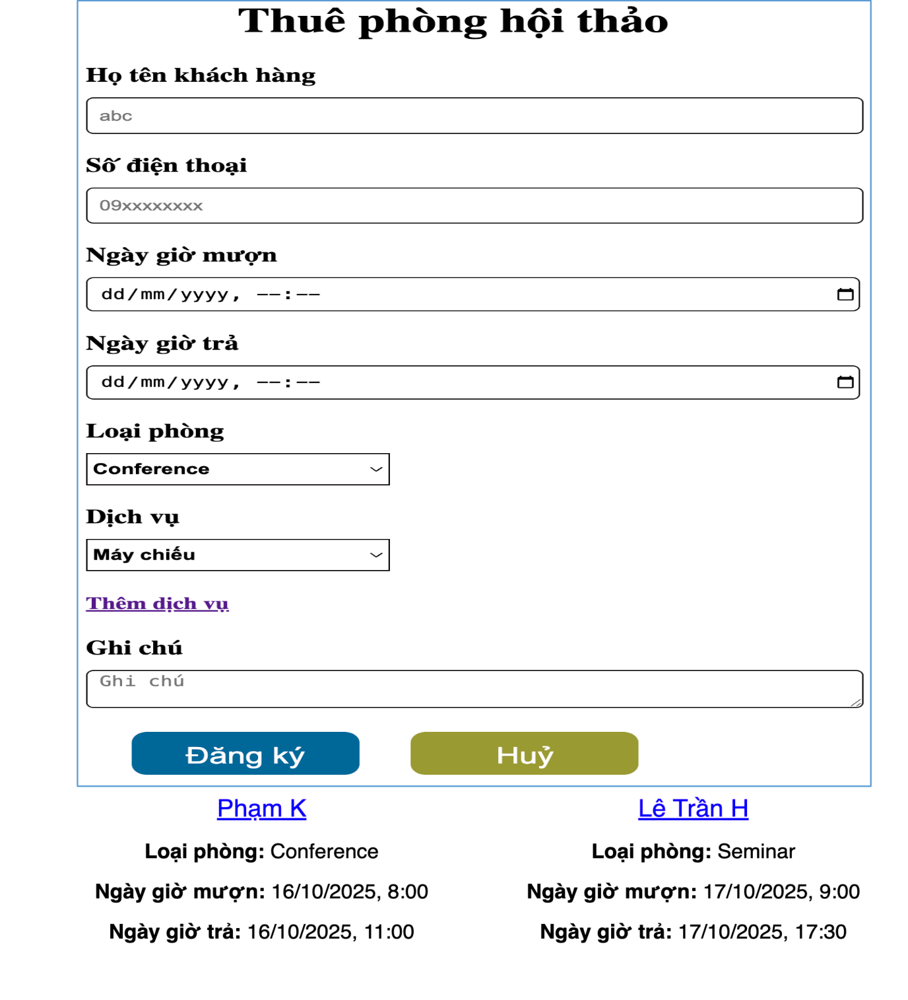
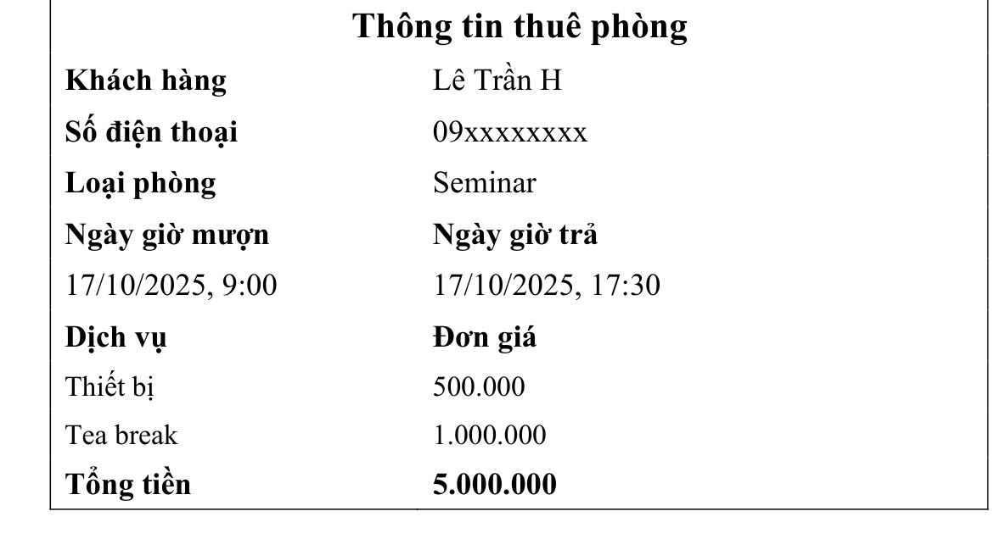
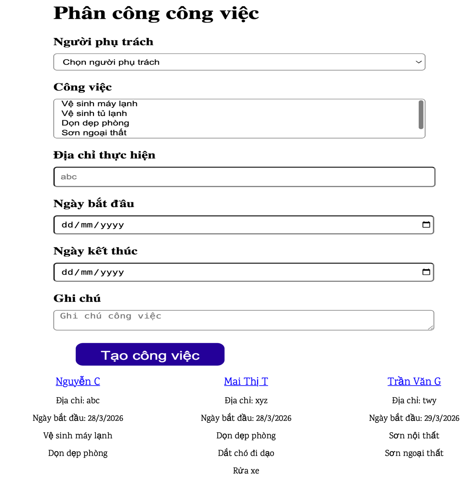
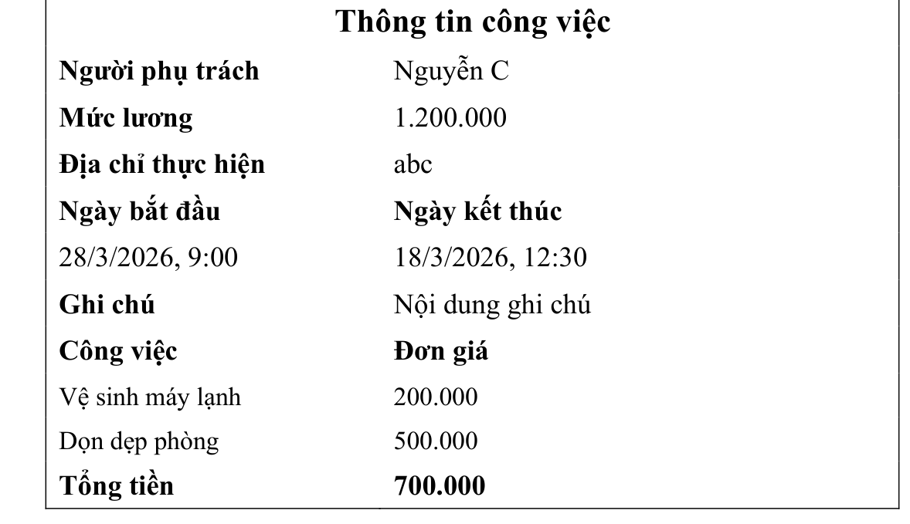

# 📘 GIẢI CHI TIẾT 2 ĐỀ THI GIỮA KỲ MÔN WEB (IS207 - UIT NĂM HỌC 2025-2026)
### ĐỀ HK1 (2025-2026) LỚP IS207.Q11 • ĐỀ HK2 (2025-2026) LỚP IS207.Q22 • HTML5 + CSS3 + VANILLA JS

> **Nội dung:** Tài liệu phân tích từng chức năng, giải thích chi tiết từng câu lệnh và cung cấp bài giải chuẩn **100% HTML5, CSS3 và Vanilla JavaScript (không dùng thư viện ngoài)** cho 2 đề thi giữa kỳ năm học 2025-2026 của Khoa Hệ thống Thông tin - UIT.

---

## 🔑 NGUYÊN LÝ CỐT LÕI: CƠ CHẾ LIÊN KẾT & TRUYỀN DỮ LIỆU TỪ CÂU 1 SANG CÂU 2

Cả 2 đề thi đều được thiết kế gồm **2 trang web liên kết mật thiết với nhau**:
- **Trang 1 (`index.html` - Câu 1):** Người dùng nhập form $\rightarrow$ bấm nút Đăng ký/Tạo công việc $\rightarrow$ dữ liệu được lưu vào bộ nhớ trình duyệt `localStorage` $\rightarrow$ hiển thị thẻ tóm tắt có **tên người (dạng link `<a>`)** ở phía dưới form.
- **Cơ chế chuyển giao giữa 2 trang:** Khi người dùng click vào một link `<a>` tên người bất kỳ ở Trang 1, JavaScript bắt sự kiện click, lưu chỉ số `index` (hoặc `id`) của người đó vào `localStorage`, rồi trình duyệt mở trang mới `chitiet.html`.
- **Trang 2 (`chitiet.html` - Câu 2):** Khi vừa mở lên, JavaScript tự động đọc lại danh sách từ `localStorage`, lấy đúng dữ liệu chi tiết của người vừa được click ở Trang 1, lặp qua danh sách các dịch vụ/công việc mà người đó đã chọn để vẽ thành bảng và tính ra `Tổng tiền`.

```
[Trang 1: index.html]                          [Trang 2: chitiet.html]
1. Nhập Form & chọn DV/Công việc               1. Đọc lại 'dsPhieu' & 'selectedIndex'
2. Bấm nút -> Lưu mảng vào localStorage        2. Lấy đúng dữ liệu của khách đó
3. Render tên người thành <a href="chitiet.html" data-index="...">
4. Click vào tên -> Lưu 'selectedIndex' -------> 3. Đổ vào Bảng & Tính Tổng tiền
```

---

# 🏛️ ĐỀ SỐ 1: ĐỀ THI GIỮA KỲ HK1 (2025 - 2026) - LỚP IS207.Q11
**Chủ đề:** Quản Lý Thuê Phòng Hội Thảo (`index.html` & `chitiet.html`)

## 1.1. Tóm tắt yêu cầu đề bài & Hình ảnh giao diện gốc

### A. Giao diện và yêu cầu Câu 1 (6.0 điểm) - Trang Tạo Phiếu Thuê Phòng (`index.html`)


- **Các thành phần nhập thông tin trên Form:**
  - `Họ tên khách hàng` (`<input type="text">`), `Số điện thoại` (`<input type="text">`).
  - `Ngày giờ mượn` và `Ngày giờ trả` (`<input type="datetime-local">`).
  - `Loại phòng` (`<select>`): Mỗi loại phòng hội thảo có một đơn giá thuê riêng (VD: `Conference` giá `2.000.000`, `Seminar` giá `3.500.000`, `Meeting` giá `1.500.000`).
  - `Dịch vụ` (`<select>`): Mỗi dịch vụ đi kèm có đơn giá riêng (VD: `Máy chiếu` giá `500.000`, `Thiết bị` giá `500.000`, `Tea break` giá `1.000.000`, `Âm thanh - Ánh sáng` giá `1.500.000`).
  - Liên kết **`Thêm dịch vụ`**: Mỗi lần nhấn vào `"Thêm dịch vụ"`, chương trình tự động nhân bản/thêm một combobox (`<select>`) chọn dịch vụ mới ngay bên dưới để khách đăng ký nhiều dịch vụ.
  - `Ghi chú` (`<textarea>`), nút **`Đăng ký`** và nút **`Huỷ`**.
- **Hiển thị danh sách phía dưới Form:**
  - Mỗi lần nhấn nút **`Đăng ký`**, thông tin phiếu thuê (lấy từ trên form) được thêm vào danh sách hiển thị phía dưới form (xếp dạng các cột ngang như hình).
  - Thông tin hiển thị ở mỗi mục gồm: **Tên khách hàng thuê (dạng link `<a>`)**, **Loại phòng**, **Ngày giờ mượn** và **Ngày giờ trả**.

### B. Giao diện và yêu cầu Câu 2 (4.0 điểm) - Trang Chi Tiết Thuê Phòng (`chitiet.html`)


- Khi người dùng nhấn vào link **`Tên khách hàng thuê`** nào ở phía dưới form, mở ra một trang mới (`chitiet.html`) hiển thị bảng **`Thông tin thuê phòng`** của đúng khách hàng đó:
  - Hiển thị: `Khách hàng`, `Số điện thoại`, `Loại phòng`, `Ngày giờ mượn`, `Ngày giờ trả`.
  - Liệt kê toàn bộ các **`Dịch vụ`** đã đăng ký kèm **`Đơn giá`** tương ứng của từng dịch vụ.
  - Tính và hiển thị **`Tổng tiền`** = **Tiền thuê phòng hội thảo** + **Tổng tiền các dịch vụ đã đăng ký** (VD trong đề: Phòng `Seminar` giá `3.500.000` + `Thiết bị` `500.000` + `Tea break` `1.000.000` = **`5.000.000`**).

---

## 1.2. Tổng quan các chức năng cần lập trình trong Đề 1 (IS207.Q11)

| STT | Tên chức năng | Mô tả kỹ thuật xử lý chính |
| :--- | :--- | :--- |
| **Chức năng 1** | **Thiết kế Form Thuê Phòng Hội Thảo (`index.html`)** | Tạo khung viền xanh nhạt chứa các ô input, `<input type="datetime-local">`, `<select>` Loại phòng và `<select>` Dịch vụ có gắn thuộc tính `data-price` để lưu giá tiền. |
| **Chức năng 2** | **Nhấn link `"Thêm dịch vụ"` để sinh thêm combobox `<select>`** | Lắng nghe sự kiện `"click"` trên thẻ `<a id="btnThemDichVu">`, dùng `.cloneNode(true)` nhân bản thẻ `<select class="cbo-dichvu">` đầu tiên và chèn thêm vào khung `#danhSachDichVu`. |
| **Chức năng 3** | **Định dạng ngày giờ từ `datetime-local` sang `dd/mm/yyyy, hh:mm`** | Chuyển chuỗi mặc định của HTML5 (`"2025-10-17T09:00"`) thành đúng định dạng hiển thị trên đề thi (`"17/10/2025, 9:00"`). |
| **Chức năng 4** | **Nhấn nút `"Đăng ký"` để lưu dữ liệu & Hiển thị thẻ khách hàng bên dưới** | Đọc toàn bộ thông tin trên Form + duyệt qua tất cả các combobox `.cbo-dichvu` để gom mảng dịch vụ, lưu vào `localStorage` và vẽ danh sách các khách hàng (`Phạm K`, `Lê Trần H`...) bên dưới form. |
| **Chức năng 5** | **Nhấn vào link `"Tên khách hàng"` để chuyển sang trang `chitiet.html`** | Lưu chỉ số (`index`) của khách hàng vừa được click vào `localStorage.setItem("selectedBookingIndex", idx)` rồi mở trang `chitiet.html`. |
| **Chức năng 6** | **Hiển thị bảng `"Thông tin thuê phòng"` & Tính tổng tiền ở `chitiet.html`** | Đọc thông tin khách hàng từ `localStorage`, đổ vào bảng chi tiết, lặp qua mảng `dichVuList` để tạo các dòng dịch vụ và tính `Tổng tiền = Giá phòng + Tổng giá dịch vụ`. |

---

## 1.3. Chi tiết từng chức năng & Code giải Đề 1 (IS207.Q11)

### 🔹 CHỨC NĂNG 1: Thiết Kế Giao Diện & Form Thuê Phòng Hội Thảo (`index.html`)

#### 1. Đoạn code CSS & HTML của Form:
```html
<!DOCTYPE html>
<html lang="vi">
<head>
  <meta charset="UTF-8">
  <meta name="viewport" content="width=device-width, initial-scale=1.0">
  <title>Thuê phòng hội thảo - IS207.Q11</title>
  <style>
    * { box-sizing: border-box; font-family: Arial, sans-serif; }
    body { background-color: #ffffff; padding: 20px; }

    /* Khung Form có viền xanh nhạt như hình đề thi */
    .form-container {
      width: 560px;
      margin: 0 auto;
      border: 1px solid #7ab3ef;
      padding: 18px 24px;
    }
    .form-title {
      text-align: center;
      font-family: "Times New Roman", serif;
      font-size: 28px;
      font-weight: bold;
      margin: 0 0 16px 0;
    }
    .form-group {
      margin-bottom: 14px;
    }
    .form-group label {
      display: block;
      font-family: "Times New Roman", serif;
      font-size: 18px;
      font-weight: bold;
      margin-bottom: 6px;
    }
    .form-control {
      width: 100%;
      padding: 7px 10px;
      border: 1px solid #333;
      border-radius: 5px;
      font-size: 14px;
    }
    .select-short {
      width: 220px;
      padding: 6px 8px;
      border: 1px solid #333;
      font-size: 14px;
      font-weight: bold;
      display: block;
      margin-bottom: 8px;
    }
    .add-service-link {
      display: inline-block;
      font-family: "Times New Roman", serif;
      color: #4b0082;
      font-weight: bold;
      text-decoration: underline;
      cursor: pointer;
      margin-bottom: 12px;
    }
    .btn-group {
      display: flex;
      justify-content: center;
      gap: 40px;
      margin-top: 12px;
    }
    .btn-submit {
      background-color: #006699;
      color: #fff;
      border: none;
      border-radius: 8px;
      padding: 8px 36px;
      font-size: 16px;
      font-weight: bold;
      cursor: pointer;
    }
    .btn-reset {
      background-color: #999933;
      color: #fff;
      border: none;
      border-radius: 8px;
      padding: 8px 46px;
      font-size: 16px;
      font-weight: bold;
      cursor: pointer;
    }

    /* Khu vực hiển thị danh sách khách thuê bên dưới Form */
    .booking-list {
      width: 560px;
      margin: 20px auto 0;
      display: grid;
      grid-template-columns: repeat(2, 1fr);
      gap: 20px;
      text-align: center;
    }
    .booking-item a {
      font-size: 17px;
      color: blue;
      text-decoration: underline;
      cursor: pointer;
    }
    .booking-item p {
      margin: 6px 0;
      font-size: 14px;
    }
  </style>
</head>
<body>

  <div class="form-container">
    <h1 class="form-title">Thuê phòng hội thảo</h1>

    <form id="frmThuePhong">
      <div class="form-group">
        <label>Họ tên khách hàng</label>
        <input type="text" id="txtHoTen" class="form-control" placeholder="abc" required>
      </div>

      <div class="form-group">
        <label>Số điện thoại</label>
        <input type="text" id="txtSDT" class="form-control" placeholder="09xxxxxxxx" required>
      </div>

      <div class="form-group">
        <label>Ngày giờ mượn</label>
        <input type="datetime-local" id="dtMuon" class="form-control" required>
      </div>

      <div class="form-group">
        <label>Ngày giờ trả</label>
        <input type="datetime-local" id="dtTra" class="form-control" required>
      </div>

      <div class="form-group">
        <label>Loại phòng</label>
        <!-- Lưu đơn giá thuê của từng loại phòng vào data-price -->
        <select id="cboLoaiPhong" class="select-short">
          <option value="Conference" data-price="2000000">Conference</option>
          <option value="Seminar" data-price="3500000">Seminar</option>
          <option value="Meeting" data-price="1500000">Meeting</option>
        </select>
      </div>

      <div class="form-group">
        <label>Dịch vụ</label>
        <!-- Khung chứa các combobox dịch vụ (bấm Thêm dịch vụ sẽ chèn thêm vào đây) -->
        <div id="danhSachDichVu">
          <select class="select-short cbo-dichvu">
            <option value="Máy chiếu" data-price="500000">Máy chiếu</option>
            <option value="Thiết bị" data-price="500000">Thiết bị</option>
            <option value="Tea break" data-price="1000000">Tea break</option>
            <option value="Âm thanh" data-price="1500000">Âm thanh</option>
          </select>
        </div>
        <a id="btnThemDichVu" class="add-service-link">Thêm dịch vụ</a>
      </div>

      <div class="form-group">
        <label>Ghi chú</label>
        <textarea id="txtGhiChu" class="form-control" rows="2" placeholder="Ghi chú"></textarea>
      </div>

      <div class="btn-group">
        <button type="submit" class="btn-submit">Đăng ký</button>
        <button type="reset" id="btnHuy" class="btn-reset">Huỷ</button>
      </div>
    </form>
  </div>

  <!-- Danh sách các phiếu thuê phòng hiển thị bên dưới Form -->
  <div id="khuVucHienThi" class="booking-list"></div>
```

#### 2. Bảng giải thích các thuộc tính quan trọng ở Chức năng 1:
| Thuộc tính / Cú pháp Code | Giải thích chi tiết ý nghĩa & Tác dụng |
| :--- | :--- |
| `<input type="datetime-local">` | Tạo ô chọn **cả Ngày tháng năm lẫn Giờ phút** (`dd/mm/yyyy, --:--`) có biểu tượng lịch ở góc phải giống hệt hình đề bài. |
| `<option value="Seminar" data-price="3500000">` | Dùng `value` để lưu tên loại phòng (`"Seminar"`) và dùng `data-price="3500000"` để lưu giá thuê phòng (`3.500.000`), giúp ở Câu 2 khi cộng thêm `Thiết bị (500.000)` + `Tea break (1.000.000)` sẽ ra đúng `Tổng tiền = 5.000.000` như hình mẫu của đề! |
| `<div id="danhSachDichVu">` | Thẻ `<div>` bao bọc quanh thẻ `<select class="cbo-dichvu">` đầu tiên. Khi người dùng nhấn vào `"Thêm dịch vụ"`, các thẻ `<select>` mới sẽ được gắn nối tiếp vào bên trong `<div>` này. |
| `.booking-list { display: grid; grid-template-columns: repeat(2, 1fr); }` | Chia danh sách khách hàng bên dưới Form thành **2 cột ngang đều nhau** (cột trái hiển thị `Phạm K`, cột phải hiển thị `Lê Trần H` đúng như đề bài). |

---

### 🔹 CHỨC NĂNG 2 & 3: Nhân Bản Combobox Khi Bấm `"Thêm dịch vụ"` & Định Dạng Ngày Giờ

#### 1. Đoạn code JavaScript xử lý Thêm dịch vụ, Huỷ form và Định dạng ngày giờ:
```javascript
// 1. Khi nhấn vào link "Thêm dịch vụ" -> Thêm 1 combobox <select> dịch vụ mới
const btnThemDichVu = document.getElementById("btnThemDichVu");
const danhSachDichVu = document.getElementById("danhSachDichVu");

btnThemDichVu.addEventListener("click", function(e) {
  e.preventDefault();
  // Nhân bản thẻ <select class="cbo-dichvu"> đầu tiên (gồm toàn bộ các thẻ <option> bên trong)
  const firstSelect = danhSachDichVu.querySelector(".cbo-dichvu");
  const newSelect = firstSelect.cloneNode(true);
  danhSachDichVu.appendChild(newSelect);
});

// 2. Khi nhấn nút "Huỷ" -> Xóa bớt các combobox dịch vụ đã thêm, chỉ giữ lại 1 combobox đầu tiên
document.getElementById("btnHuy").addEventListener("click", function() {
  const allSelects = danhSachDichVu.querySelectorAll(".cbo-dichvu");
  allSelects.forEach((sel, index) => {
    if (index > 0) sel.remove();
  });
});

// 3. Hàm đổi chuỗi "2025-10-17T09:00" sang "17/10/2025, 9:00" giống hệt đề bài
function formatDateTimeVN(isoStr) {
  if (!isoStr) return "";
  const d = new Date(isoStr);
  const ngay  = d.getDate();
  const thang = d.getMonth() + 1; // Nhớ +1 vì tháng trong JS chạy từ 0 -> 11
  const nam   = d.getFullYear();
  const gio   = d.getHours();
  const phut  = String(d.getMinutes()).padStart(2, "0");
  return `${ngay}/${thang}/${nam}, ${gio}:${phut}`;
}
```

#### 2. Bảng giải thích chi tiết:
| Câu lệnh JavaScript | Giải thích chi tiết cơ chế hoạt động |
| :--- | :--- |
| `firstSelect.cloneNode(true)` | Sao chép nguyên vẹn thẻ `<select class="cbo-dichvu">` đầu tiên cùng toàn bộ các `<option>` bên trong nó (nhờ tham số `true`). |
| `danhSachDichVu.appendChild(newSelect)` | Đưa combobox dịch vụ mới vừa nhân bản xuống ngay bên dưới combobox cũ. |
| `if (index > 0) sel.remove();` | Khi bấm nút `"Huỷ"`, giữ lại combobox đầu tiên (`index === 0`) và xóa hết các combobox dịch vụ phát sinh thêm (`index > 0`). |
| `String(d.getMinutes()).padStart(2, "0")` | Đảm bảo số phút luôn có 2 chữ số (ví dụ `0` phút sẽ thành `"00"` để hiển thị `"9:00"` thay vì `"9:0"`). |

---

### 🔹 CHỨC NĂNG 4 & 5: Nhấn `"Đăng ký"` Lưu Phiếu Thuê, Hiển Thị Bên Dưới Form & Chuyển Trang

#### 1. Đoạn code JavaScript xử lý Đăng ký, Hiển thị danh sách và Click vào tên khách hàng:
```javascript
// Đọc danh sách phiếu thuê từ localStorage (nếu chưa có thì khởi tạo mảng rỗng)
let dsPhieuThue = JSON.parse(localStorage.getItem("dsPhieuThue")) || [];

// Hàm vẽ danh sách các khách hàng đã đăng ký ở phía dưới Form
function renderDanhSachPhieu() {
  const khuVucHienThi = document.getElementById("khuVucHienThi");
  khuVucHienThi.innerHTML = dsPhieuThue.map((item, index) => `
    <div class="booking-item">
      <a href="chitiet.html" class="link-khach" data-index="${index}">${item.hoTen}</a>
      <p><strong>Loại phòng:</strong> ${item.loaiPhong}</p>
      <p><strong>Ngày giờ mượn:</strong> ${item.ngayMuon}</p>
      <p><strong>Ngày giờ trả:</strong> ${item.ngayTra}</p>
    </div>
  `).join("");
}

// Bắt sự kiện Submit khi nhấn nút "Đăng ký"
document.getElementById("frmThuePhong").addEventListener("submit", function(e) {
  e.preventDefault(); // Ngăn form tự tải lại trang

  // 1. Lấy thông tin cơ bản và giá loại phòng
  const hoTen = document.getElementById("txtHoTen").value.trim();
  const sdt   = document.getElementById("txtSDT").value.trim();
  const ngayMuon = formatDateTimeVN(document.getElementById("dtMuon").value);
  const ngayTra  = formatDateTimeVN(document.getElementById("dtTra").value);
  const ghiChu   = document.getElementById("txtGhiChu").value.trim();

  const cboPhong = document.getElementById("cboLoaiPhong");
  const optPhong = cboPhong.options[cboPhong.selectedIndex];
  const loaiPhong = optPhong.value;
  const giaPhong  = parseFloat(optPhong.dataset.price) || 0;

  // 2. Duyệt qua TẤT CẢ các combobox dịch vụ (.cbo-dichvu) đang có trên Form
  const dichVuList = [];
  document.querySelectorAll(".cbo-dichvu").forEach(selectEl => {
    const optDV = selectEl.options[selectEl.selectedIndex];
    dichVuList.push({
      tenDV: optDV.value,
      giaDV: parseFloat(optDV.dataset.price) || 0
    });
  });

  // 3. Đóng gói thành 1 đối tượng phiếu thuê và thêm vào mảng
  const phieuMoi = {
    hoTen,
    sdt,
    loaiPhong,
    giaPhong,
    ngayMuon,
    ngayTra,
    ghiChu,
    dichVuList
  };

  dsPhieuThue.push(phieuMoi);
  localStorage.setItem("dsPhieuThue", JSON.stringify(dsPhieuThue));

  // 4. Cập nhật lại giao diện bên dưới Form và reset Form
  renderDanhSachPhieu();
  this.reset();
  document.getElementById("btnHuy").click(); // Thu gọn lại còn 1 combobox dịch vụ
});

// Bắt sự kiện khi nhấn vào link "Tên khách hàng thuê" -> Lưu vị trí khách đó để trang 2 đọc
document.getElementById("khuVucHienThi").addEventListener("click", function(e) {
  if (e.target.classList.contains("link-khach")) {
    const idx = e.target.dataset.index;
    localStorage.setItem("selectedBookingIndex", idx);
  }
});

// Hiển thị danh sách ngay khi mở trang
renderDanhSachPhieu();
```

#### 2. Bảng giải thích chi tiết:
| Câu lệnh JavaScript | Giải thích chi tiết cơ chế hoạt động |
| :--- | :--- |
| `document.querySelectorAll(".cbo-dichvu").forEach(...)` | Quét tất cả các combobox dịch vụ mà khách đã thêm trên Form, lấy tên dịch vụ (`optDV.value`) và đơn giá (`optDV.dataset.price`) đẩy vào mảng `dichVuList`. |
| `<a href="chitiet.html" class="link-khach" data-index="${index}">` | Mỗi tên khách hàng là một thẻ `<a>` dẫn tới `chitiet.html`, đồng thời gắn kèm `data-index="${index}"` để biết người dùng vừa bấm vào khách hàng thứ mấy trong mảng. |
| `localStorage.setItem("selectedBookingIndex", idx)` | Ngay khoảnh khắc người dùng click vào tên khách hàng (ví dụ `Lê Trần H`), lưu vị trí `idx` của khách đó vào `localStorage` trước khi trình duyệt chuyển sang trang `chitiet.html`. |

---

### 🔹 CHỨC NĂNG 5 & 6: Cơ Chế Chuyển Dữ Liệu Sang Câu 2 & Trang Chi Tiết Thuê Phòng (`chitiet.html`)

> **Điểm mấu chốt nối giữa Câu 1 và Câu 2:**
> 1. Ở Trang 1, mỗi tên khách hàng là một thẻ liên kết: `<a href="chitiet.html" class="link-khach" data-index="${index}">${item.hoTen}</a>`.
> 2. Khi người dùng click vào tên khách hàng nào (ví dụ click vào `Lê Trần H`), hàm sau sẽ chặn lại 1 khoảnh khắc để ghi vị trí `index` của khách đó vào `localStorage`:
> ```javascript
> document.getElementById("khuVucHienThi").addEventListener("click", function(e) {
>   if (e.target.classList.contains("link-khach")) {
>     const idx = e.target.dataset.index; // Lấy vị trí của khách vừa bấm
>     localStorage.setItem("selectedBookingIndex", idx); // Lưu vào bộ nhớ
>   }
> });
> ```
> 3. Trình duyệt chuyển sang `chitiet.html` (Câu 2). Tại đây, JavaScript đọc `selectedBookingIndex`, lấy đúng thông tin của `Lê Trần H` (gồm loại phòng Seminar 3.500.000, dịch vụ Thiết bị 500.000 và Tea break 1.000.000) để đổ vào bảng và tính ra `Tổng tiền = 5.000.000`.

#### 1. Đoạn code hoàn chỉnh của trang `chitiet.html` (Câu 2):
```html
<!DOCTYPE html>
<html lang="vi">
<head>
  <meta charset="UTF-8">
  <meta name="viewport" content="width=device-width, initial-scale=1.0">
  <title>Thông tin thuê phòng - IS207.Q11</title>
  <style>
    body {
      font-family: "Times New Roman", serif;
      padding: 30px;
    }
    .detail-box {
      width: 520px;
      margin: 0 auto;
      border: 1px solid #333;
      padding: 16px 24px;
    }
    .detail-title {
      text-align: center;
      font-size: 24px;
      font-weight: bold;
      margin: 0 0 14px 0;
    }
    .detail-table {
      width: 100%;
      border-collapse: collapse;
      font-size: 19px;
    }
    .detail-table td {
      padding: 5px 4px;
      width: 50%;
    }
    .label-bold {
      font-weight: bold;
    }
  </style>
</head>
<body>

  <div class="detail-box">
    <h2 class="detail-title">Thông tin thuê phòng</h2>
    <table class="detail-table">
      <tbody id="bangChiTiet">
        <!-- Dữ liệu chi tiết sẽ được JavaScript đổ vào đây -->
      </tbody>
    </table>
  </div>

  <script>
    // Hàm định dạng số có dấu chấm ngăn cách hàng nghìn (VD: 5000000 -> "5.000.000")
    function formatTien(num) {
      return (Number(num) || 0).toLocaleString("vi-VN");
    }

    // 1. Đọc danh sách phiếu thuê và vị trí khách hàng vừa được chọn từ localStorage
    const dsPhieuThue = JSON.parse(localStorage.getItem("dsPhieuThue")) || [];
    const idx = parseInt(localStorage.getItem("selectedBookingIndex")) || 0;
    const phieu = dsPhieuThue[idx];

    const bangChiTiet = document.getElementById("bangChiTiet");

    if (phieu) {
      // 2. Tính tổng tiền = Tiền phòng hội thảo + Tổng tiền các dịch vụ đã đăng ký
      let tongTien = phieu.giaPhong || 0;
      let htmlDichVu = "";

      phieu.dichVuList.forEach(dv => {
        tongTien += dv.giaDV;
        htmlDichVu += `
          <tr>
            <td>${dv.tenDV}</td>
            <td>${formatTien(dv.giaDV)}</td>
          </tr>
        `;
      });

      // 3. Render toàn bộ bảng chi tiết đúng theo bố cục hình mẫu Câu 2
      bangChiTiet.innerHTML = `
        <tr>
          <td class="label-bold">Khách hàng</td>
          <td>${phieu.hoTen}</td>
        </tr>
        <tr>
          <td class="label-bold">Số điện thoại</td>
          <td>${phieu.sdt}</td>
        </tr>
        <tr>
          <td class="label-bold">Loại phòng</td>
          <td>${phieu.loaiPhong}</td>
        </tr>
        <tr>
          <td class="label-bold">Ngày giờ mượn</td>
          <td class="label-bold">Ngày giờ trả</td>
        </tr>
        <tr>
          <td>${phieu.ngayMuon}</td>
          <td>${phieu.ngayTra}</td>
        </tr>
        <tr>
          <td class="label-bold">Dịch vụ</td>
          <td class="label-bold">Đơn giá</td>
        </tr>
        ${htmlDichVu}
        <tr>
          <td class="label-bold">Tổng tiền</td>
          <td class="label-bold">${formatTien(tongTien)}</td>
        </tr>
      `;
    }
  </script>
</body>
</html>
```

#### 2. Bảng giải thích chi tiết:
| Câu lệnh JavaScript | Giải thích chi tiết cơ chế hoạt động |
| :--- | :--- |
| `const phieu = dsPhieuThue[idx];` | Lấy ra đúng đối tượng phiếu thuê của khách hàng mà người dùng vừa bấm vào ở Trang 1. |
| `let tongTien = phieu.giaPhong \|\| 0;` | Khởi tạo biến `tongTien` bắt đầu bằng **tiền thuê phòng hội thảo** (`phieu.giaPhong`). |
| `phieu.dichVuList.forEach(dv => { tongTien += dv.giaDV; ... })` | Duyệt qua từng dịch vụ mà khách đã chọn, vừa cộng dồn `dv.giaDV` vào `tongTien`, vừa nối chuỗi tạo ra các dòng `<tr><td>Tên dịch vụ</td><td>Đơn giá</td></tr>`. |
| `(Number(num) \|\| 0).toLocaleString("vi-VN")` | Định dạng số tiền có dấu chấm ngăn cách hàng nghìn đúng chuẩn đề bài (`500.000`, `1.000.000`, `5.000.000`). |

---
---

# 🏛️ ĐỀ SỐ 2: ĐỀ THI GIỮA KỲ HK2 (2025 - 2026) - LỚP IS207.Q22
**Chủ đề:** Quản Lý Phân Công Công Việc (`index.html` & `chitiet.html`)

## 2.1. Tóm tắt yêu cầu đề bài & Hình ảnh giao diện gốc

### A. Giao diện và yêu cầu Câu 1 (6.0 điểm) - Trang Tạo Phiếu Phân Công Công Việc (`index.html`)


- **Các thành phần nhập thông tin trên Form:**
  - `Người phụ trách` (`<select>`): Mỗi người phụ trách có một **mức lương riêng** (VD: `Nguyễn C` mức lương `1.200.000`, `Mai Thị T` mức lương `1.500.000`, `Trần Văn G` mức lương `1.000.000`).
  - `Công việc` (`<select multiple size="4">`): Hộp danh sách cho phép **chọn nhiều công việc cùng lúc** (giữ phím `Ctrl` hoặc `Shift` khi click). Mỗi công việc có một **đơn giá thực hiện riêng** (VD: `Vệ sinh máy lạnh` giá `200.000`, `Dọn dẹp phòng` giá `500.000`, `Sơn ngoại thất` giá `1.000.000`...).
  - `Địa chỉ thực hiện` (`<input type="text">`).
  - `Ngày bắt đầu` và `Ngày kết thúc` (`<input type="date">` hoặc `<input type="datetime-local">`).
  - `Ghi chú` (`<textarea>`), nút **`Tạo công việc`**.
- **Hiển thị danh sách phân công phía dưới Form:**
  - Mỗi lần nhấn nút **`Tạo công việc`**, thông tin phân công được thêm và hiển thị phía dưới form (xếp thành 3 cột ngang như hình).
  - Thông tin hiển thị gồm: **Người phụ trách (dạng link `<a>`)**, **Địa chỉ thực hiện**, **Ngày bắt đầu**, và **danh sách tên các công việc đã chọn**.

### B. Giao diện và yêu cầu Câu 2 (4.0 điểm) - Trang Chi Tiết Công Việc (`chitiet.html`)


- Khi nhấn vào link **`Tên người phụ trách`** nào ở phía dưới form, mở ra một trang mới (`chitiet.html`) hiển thị bảng **`Thông tin công việc`** đã giao cho người đó:
  - Hiển thị: `Người phụ trách`, `Mức lương`, `Địa chỉ thực hiện`, `Ngày bắt đầu`, `Ngày kết thúc`, `Ghi chú`.
  - Liệt kê các **`Công việc`** đã giao kèm **`Đơn giá`** riêng của từng công việc.
  - Tính và hiển thị **`Tổng tiền`** của các công việc đã chọn (Lưu ý quan trọng từ hình mẫu Câu 2: `Vệ sinh máy lạnh: 200.000` + `Dọn dẹp phòng: 500.000` $\rightarrow$ **`Tổng tiền: 700.000`**, tức là tổng tiền bằng tổng đơn giá của các công việc được giao!).

---

## 2.2. Tổng quan các chức năng cần lập trình trong Đề 2 (IS207.Q22)

| STT | Tên chức năng | Mô tả kỹ thuật xử lý chính |
| :--- | :--- | :--- |
| **Chức năng 1** | **Thiết kế Form Phân Công Công Việc với `<select multiple>`** | Tạo `<select id="cboNguoi">` (gắn `data-salary` lưu mức lương) và `<select id="lstCongViec" multiple size="4">` (cho phép chọn nhiều dòng cùng lúc, mỗi `<option>` gắn `data-price` lưu đơn giá công việc). |
| **Chức năng 2** | **Đọc toàn bộ các dòng được chọn trong `<select multiple>` (`selectedOptions`)** | Sử dụng `Array.from(lstCongViec.selectedOptions)` hoặc `querySelectorAll("#lstCongViec option:checked")` để lấy ra danh sách tất cả các công việc mà người dùng đã bôi đen chọn. |
| **Chức năng 3** | **Nhấn `"Tạo công việc"` để lưu vào `localStorage` & Hiển thị 3 cột bên dưới** | Đóng gói đối tượng phân công (gồm người phụ trách, mức lương, địa chỉ, ngày bắt đầu, ngày kết thúc, ghi chú, mảng các công việc đã chọn) và render thành lưới 3 cột phía dưới form. |
| **Chức năng 4** | **Nhấn vào link `"Tên người phụ trách"` để mở trang `chitiet.html`** | Lưu chỉ số `data-index` của phiếu phân công vừa bấm vào `localStorage` rồi chuyển sang `chitiet.html`. |
| **Chức năng 5** | **Hiển thị bảng `"Thông tin công việc"` & Tính tổng tiền công việc ở `chitiet.html`** | Đọc dữ liệu từ `localStorage`, hiển thị thông tin người phụ trách, mức lương, địa chỉ, ngày bắt đầu/kết thúc, ghi chú và duyệt mảng công việc để cộng dồn `Tổng tiền`. |

---

## 2.3. Chi tiết từng chức năng & Code giải Đề 2 (IS207.Q22)

### 🔹 CHỨC NĂNG 1: Thiết Kế Giao Diện & Hộp Chọn Nhiều Công Việc `<select multiple>` (`index.html`)

#### 1. Đoạn code CSS & HTML của Form Phân công công việc:
```html
<!DOCTYPE html>
<html lang="vi">
<head>
  <meta charset="UTF-8">
  <meta name="viewport" content="width=device-width, initial-scale=1.0">
  <title>Phân công công việc - IS207.Q22</title>
  <style>
    * { box-sizing: border-box; font-family: Arial, sans-serif; }
    body { background-color: #ffffff; padding: 20px; }

    .form-wrapper {
      width: 580px;
      margin: 0 auto;
    }
    .form-title {
      font-family: "Times New Roman", serif;
      font-size: 32px;
      font-weight: bold;
      margin: 0 0 18px 0;
    }
    .form-group {
      margin-bottom: 14px;
    }
    .form-group label {
      display: block;
      font-family: "Times New Roman", serif;
      font-size: 20px;
      font-weight: bold;
      margin-bottom: 6px;
    }
    .form-control {
      width: 100%;
      padding: 8px 10px;
      border: 1.5px solid #333;
      border-radius: 6px;
      font-size: 14px;
    }
    .btn-create {
      background-color: #1a0dab;
      color: #ffffff;
      border: none;
      border-radius: 8px;
      padding: 10px 42px;
      font-size: 18px;
      cursor: pointer;
      margin-left: 30px;
      margin-top: 6px;
    }

    /* Lưới 3 cột hiển thị danh sách phân công bên dưới Form */
    .task-list {
      width: 680px;
      margin: 24px auto 0;
      display: grid;
      grid-template-columns: repeat(3, 1fr);
      gap: 20px;
      text-align: center;
      font-family: "Times New Roman", serif;
    }
    .task-item a {
      font-size: 18px;
      color: blue;
      text-decoration: underline;
      cursor: pointer;
    }
    .task-item p {
      margin: 6px 0;
      font-size: 15px;
    }
  </style>
</head>
<body>

  <div class="form-wrapper">
    <h1 class="form-title">Phân công công việc</h1>

    <form id="frmPhanCong">
      <div class="form-group">
        <label>Người phụ trách</label>
        <!-- Lưu mức lương riêng của từng người vào thuộc tính data-salary -->
        <select id="cboNguoiPhuTrach" class="form-control" required>
          <option value="">Chọn người phụ trách</option>
          <option value="Nguyễn C" data-salary="1200000">Nguyễn C</option>
          <option value="Mai Thị T" data-salary="1500000">Mai Thị T</option>
          <option value="Trần Văn G" data-salary="1000000">Trần Văn G</option>
        </select>
      </div>

      <div class="form-group">
        <label>Công việc</label>
        <!-- Thuộc tính multiple và size="4" tạo khung cuộn chọn nhiều công việc như hình đề bài -->
        <select id="lstCongViec" class="form-control" multiple size="4" required>
          <option value="Vệ sinh máy lạnh" data-price="200000">Vệ sinh máy lạnh</option>
          <option value="Vệ sinh tủ lạnh" data-price="300000">Vệ sinh tủ lạnh</option>
          <option value="Dọn dẹp phòng" data-price="500000">Dọn dẹp phòng</option>
          <option value="Sơn ngoại thất" data-price="1000000">Sơn ngoại thất</option>
          <option value="Sơn nội thất" data-price="800000">Sơn nội thất</option>
          <option value="Dắt chó đi dạo" data-price="150000">Dắt chó đi dạo</option>
          <option value="Rửa xe" data-price="100000">Rửa xe</option>
        </select>
      </div>

      <div class="form-group">
        <label>Địa chỉ thực hiện</label>
        <input type="text" id="txtDiaChi" class="form-control" placeholder="abc" required>
      </div>

      <div class="form-group">
        <label>Ngày bắt đầu</label>
        <input type="datetime-local" id="dtBatDau" class="form-control" required>
      </div>

      <div class="form-group">
        <label>Ngày kết thúc</label>
        <input type="datetime-local" id="dtKetThuc" class="form-control" required>
      </div>

      <div class="form-group">
        <label>Ghi chú</label>
        <textarea id="txtGhiChu" class="form-control" rows="2" placeholder="Ghi chú công việc"></textarea>
      </div>

      <button type="submit" class="btn-create">Tạo công việc</button>
    </form>
  </div>

  <!-- Khu vực hiển thị danh sách công việc đã giao bên dưới Form -->
  <div id="khuVucPhanCong" class="task-list"></div>
```

#### 2. Bảng giải thích các thuộc tính quan trọng ở Chức năng 1:
| Thuộc tính / Cú pháp Code | Giải thích chi tiết ý nghĩa & Tác dụng |
| :--- | :--- |
| `<select id="lstCongViec" multiple size="4">` | • `multiple`: Cho phép người dùng giữ phím `Ctrl` (hoặc kéo chuột) để **chọn nhiều công việc cùng lúc**.<br>• `size="4"`: Hiển thị cố định **4 dòng nhìn thấy trước** kèm thanh cuộn dọc bên phải, giống hệt hộp `Công việc` trong hình đề thi! |
| `data-salary="1200000"` | Lưu ngầm **Mức lương** của người phụ trách ngay trên thẻ `<option>` (ví dụ `Nguyễn C` có mức lương `1.200.000` khớp với hình Câu 2). |
| `data-price="200000"` | Lưu ngầm **Đơn giá thực hiện** của từng công việc trên thẻ `<option>` (ví dụ `Vệ sinh máy lạnh` giá `200.000`, `Dọn dẹp phòng` giá `500.000`). |
| `.task-list { display: grid; grid-template-columns: repeat(3, 1fr); }` | Chia khu vực danh sách bên dưới Form thành **3 cột ngang đều nhau** (`Nguyễn C` - `Mai Thị T` - `Trần Văn G`). |

---

### 🔹 CHỨC NĂNG 2, 3 & 4: Đọc `<select multiple>`, Lưu Phân Công & Hiển Thị Danh Sách Bên Dưới

#### 1. Đoạn code JavaScript xử lý ở Trang 1 (`index.html`):
```javascript
let dsPhanCong = JSON.parse(localStorage.getItem("dsPhanCong")) || [];

// Hàm đổi định dạng ngày để hiển thị ngắn gọn (dd/m/yyyy) ở Trang 1 và đầy đủ (dd/m/yyyy, h:mm) ở Trang 2
function formatDateShort(isoStr) {
  if (!isoStr) return "";
  const d = new Date(isoStr);
  return `${d.getDate()}/${d.getMonth() + 1}/${d.getFullYear()}`;
}

function formatDateTimeFull(isoStr) {
  if (!isoStr) return "";
  const d = new Date(isoStr);
  const phut = String(d.getMinutes()).padStart(2, "0");
  return `${d.getDate()}/${d.getMonth() + 1}/${d.getFullYear()}, ${d.getHours()}:${phut}`;
}

// Hàm vẽ danh sách các công việc đã tạo phía dưới Form
function renderDanhSachPhanCong() {
  const khuVuc = document.getElementById("khuVucPhanCong");
  khuVuc.innerHTML = dsPhanCong.map((item, index) => {
    // Nối danh sách tên các công việc đã chọn thành từng dòng <p>
    const htmlTenCongViec = item.congViecList.map(cv => `<p>${cv.tenCV}</p>`).join("");

    return `
      <div class="task-item">
        <a href="chitiet.html" class="link-nguoi" data-index="${index}">${item.nguoiPhuTrach}</a>
        <p>Địa chỉ: ${item.diaChi}</p>
        <p>Ngày bắt đầu: ${item.ngayBatDauShort}</p>
        ${htmlTenCongViec}
      </div>
    `;
  }).join("");
}

// Bắt sự kiện khi nhấn nút "Tạo công việc"
document.getElementById("frmPhanCong").addEventListener("submit", function(e) {
  e.preventDefault();

  // 1. Lấy người phụ trách và mức lương tương ứng
  const cboNguoi = document.getElementById("cboNguoiPhuTrach");
  const optNguoi = cboNguoi.options[cboNguoi.selectedIndex];
  const nguoiPhuTrach = optNguoi.value;
  const mucLuong = parseFloat(optNguoi.dataset.salary) || 0;

  // 2. Lấy TẤT CẢ các công việc được chọn trong <select multiple>
  const lstCongViec = document.getElementById("lstCongViec");
  const congViecList = Array.from(lstCongViec.selectedOptions).map(opt => ({
    tenCV: opt.value,
    donGia: parseFloat(opt.dataset.price) || 0
  }));

  // 3. Lấy địa chỉ, ngày bắt đầu, ngày kết thúc và ghi chú
  const diaChi = document.getElementById("txtDiaChi").value.trim();
  const rawBatDau  = document.getElementById("dtBatDau").value;
  const rawKetThuc = document.getElementById("dtKetThuc").value;
  const ghiChu = document.getElementById("txtGhiChu").value.trim();

  // 4. Đóng gói và lưu vào localStorage
  dsPhanCong.push({
    nguoiPhuTrach,
    mucLuong,
    diaChi,
    ngayBatDauShort: formatDateShort(rawBatDau),
    ngayBatDauFull:  formatDateTimeFull(rawBatDau),
    ngayKetThucFull: formatDateTimeFull(rawKetThuc),
    ghiChu,
    congViecList
  });

  localStorage.setItem("dsPhanCong", JSON.stringify(dsPhanCong));

  // 5. Vẽ lại danh sách phía dưới và xóa trắng Form
  renderDanhSachPhanCong();
  this.reset();
});

// Khi click vào link "Tên người phụ trách" -> Lưu chỉ số vào localStorage trước khi mở trang mới
document.getElementById("khuVucPhanCong").addEventListener("click", function(e) {
  if (e.target.classList.contains("link-nguoi")) {
    localStorage.setItem("selectedTaskIndex", e.target.dataset.index);
  }
});

renderDanhSachPhanCong();
```

#### 2. Bảng giải thích chi tiết:
| Câu lệnh JavaScript | Giải thích chi tiết cơ chế hoạt động |
| :--- | :--- |
| `lstCongViec.selectedOptions` | Thuộc tính đặc biệt của thẻ `<select multiple>`: trả về danh sách **tất cả các thẻ `<option>` đang được người dùng bôi đen chọn**. |
| `Array.from(lstCongViec.selectedOptions).map(...)` | Chuyển `selectedOptions` thành mảng JavaScript để dùng `.map()` trích xuất `tenCV` (`opt.value`) và `donGia` (`opt.dataset.price`) của từng công việc đã chọn. |
| `item.congViecList.map(cv => '<p>' + cv.tenCV + '</p>').join("")` | In lần lượt từng công việc đã giao thành các dòng `<p>` nằm bên dưới dòng `Ngày bắt đầu` giống hệt giao diện Câu 1. |

---

### 🔹 CHỨC NĂNG 4 & 5: Cơ Chế Chuyển Dữ Liệu Sang Câu 2 & Trang Chi Tiết Công Việc (`chitiet.html`)

> **Điểm mấu chốt nối giữa Câu 1 và Câu 2:**
> 1. Ở Trang 1, mỗi người phụ trách là một thẻ liên kết: `<a href="chitiet.html" class="link-nguoi" data-index="${index}">${item.nguoiPhuTrach}</a>`.
> 2. Khi người dùng click vào tên người nào (ví dụ click vào `Nguyễn C`), sự kiện sau sẽ ghi `index` của người đó vào `localStorage`:
> ```javascript
> document.getElementById("khuVucPhanCong").addEventListener("click", function(e) {
>   if (e.target.classList.contains("link-nguoi")) {
>     localStorage.setItem("selectedTaskIndex", e.target.dataset.index);
>   }
> });
> ```
> 3. Trình duyệt chuyển sang `chitiet.html` (Câu 2). Tại đây, JavaScript đọc `selectedTaskIndex`, lấy đúng thông tin đã lưu của `Nguyễn C` (Mức lương 1.200.000, Địa chỉ abc, Ngày bắt đầu/kết thúc, Ghi chú, và danh sách các việc đã chọn: Vệ sinh máy lạnh 200.000 + Dọn dẹp phòng 500.000) để vẽ bảng và tính ra `Tổng tiền = 700.000`.

#### 1. Đoạn code hoàn chỉnh của trang `chitiet.html` (Câu 2):
```html
<!DOCTYPE html>
<html lang="vi">
<head>
  <meta charset="UTF-8">
  <meta name="viewport" content="width=device-width, initial-scale=1.0">
  <title>Thông tin công việc - IS207.Q22</title>
  <style>
    body {
      font-family: "Times New Roman", serif;
      padding: 30px;
    }
    .detail-box {
      width: 520px;
      margin: 0 auto;
      border: 1px solid #333;
      padding: 16px 24px;
    }
    .detail-title {
      text-align: center;
      font-size: 24px;
      font-weight: bold;
      margin: 0 0 14px 0;
    }
    .detail-table {
      width: 100%;
      border-collapse: collapse;
      font-size: 19px;
    }
    .detail-table td {
      padding: 5px 4px;
      width: 50%;
    }
    .label-bold {
      font-weight: bold;
    }
  </style>
</head>
<body>

  <div class="detail-box">
    <h2 class="detail-title">Thông tin công việc</h2>
    <table class="detail-table">
      <tbody id="bangChiTietCV">
        <!-- Dữ liệu chi tiết sẽ được JavaScript đổ vào đây -->
      </tbody>
    </table>
  </div>

  <script>
    function formatTien(num) {
      return (Number(num) || 0).toLocaleString("vi-VN");
    }

    // 1. Đọc dữ liệu phân công và vị trí người phụ trách vừa chọn từ localStorage
    const dsPhanCong = JSON.parse(localStorage.getItem("dsPhanCong")) || [];
    const idx = parseInt(localStorage.getItem("selectedTaskIndex")) || 0;
    const pc = dsPhanCong[idx];

    const bangChiTietCV = document.getElementById("bangChiTietCV");

    if (pc) {
      // 2. Duyệt danh sách các công việc đã giao và cộng dồn Tổng tiền
      let tongTien = 0;
      let htmlCongViec = "";

      pc.congViecList.forEach(cv => {
        tongTien += cv.donGia;
        htmlCongViec += `
          <tr>
            <td>${cv.tenCV}</td>
            <td>${formatTien(cv.donGia)}</td>
          </tr>
        `;
      });

      // 3. Hiển thị toàn bộ bảng chi tiết đúng theo mẫu Câu 2
      bangChiTietCV.innerHTML = `
        <tr>
          <td class="label-bold">Người phụ trách</td>
          <td>${pc.nguoiPhuTrach}</td>
        </tr>
        <tr>
          <td class="label-bold">Mức lương</td>
          <td>${formatTien(pc.mucLuong)}</td>
        </tr>
        <tr>
          <td class="label-bold">Địa chỉ thực hiện</td>
          <td>${pc.diaChi}</td>
        </tr>
        <tr>
          <td class="label-bold">Ngày bắt đầu</td>
          <td class="label-bold">Ngày kết thúc</td>
        </tr>
        <tr>
          <td>${pc.ngayBatDauFull}</td>
          <td>${pc.ngayKetThucFull}</td>
        </tr>
        <tr>
          <td class="label-bold">Ghi chú</td>
          <td>${pc.ghiChu || "Nội dung ghi chú"}</td>
        </tr>
        <tr>
          <td class="label-bold">Công việc</td>
          <td class="label-bold">Đơn giá</td>
        </tr>
        ${htmlCongViec}
        <tr>
          <td class="label-bold">Tổng tiền</td>
          <td class="label-bold">${formatTien(tongTien)}</td>
        </tr>
      `;
    }
  </script>
</body>
</html>
```

#### 2. Bảng giải thích chi tiết:
| Câu lệnh JavaScript | Giải thích chi tiết cơ chế hoạt động |
| :--- | :--- |
| `const pc = dsPhanCong[idx];` | Lấy ra đúng đối tượng phân công công việc của người phụ trách vừa được click ở Trang 1. |
| `pc.congViecList.forEach(cv => { tongTien += cv.donGia; ... })` | Duyệt qua danh sách công việc đã giao cho người đó, cộng dồn đơn giá từng việc (`200.000 + 500.000 = 700.000`) và tạo các dòng `<tr>` hiển thị tên công việc kèm đơn giá. |
| `${pc.ghiChu \|\| "Nội dung ghi chú"}` | Hiển thị nội dung ghi chú đã nhập ở Trang 1 (nếu để trống thì hiển thị chuỗi mặc định `"Nội dung ghi chú"`). |
