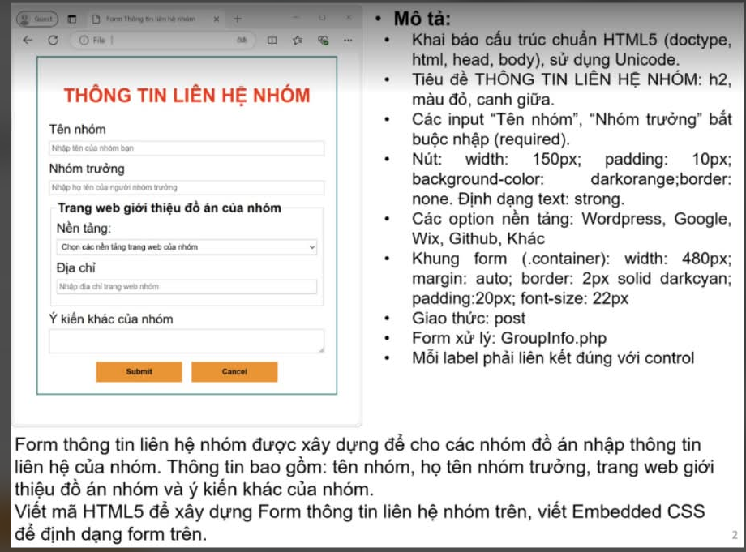

# 📌 TỔNG HỢP KIẾN THỨC MÔN WEB (IS207 - UIT)
### TÀI LIỆU TRA CỨU: HTML5 • CSS3 • BOOTSTRAP 5 • JAVASCRIPT THUẦN (VANILLA JS)

> **Nội dung:** Hệ thống hóa cú pháp, kiến thức trọng tâm và các mẫu bài tập thực hành kết hợp **HTML5 + CSS3 + JavaScript thuần**.

---

## ⚡ 0. TEMPLATE CẤU TRÚC TRANG WEB CƠ BẢN (TỐI GIẢN PHÒNG THI)

> 💡 **Lưu ý phòng thi quan trọng:**
> - Trong đề thi thực tế, giảng viên **KHÔNG** bắt buộc bạn phải viết các CSS trang trí rườm rà (như `box-shadow`, `border-radius`, hover nút, màu nền...).
> - **Nếu đề có chấm CSS:** Đề sẽ ghi rõ từng thông số cụ thể (VD: *khung rộng 480px, viền 2px solid darkcyan...*), đề bảo viết gì thì viết nấy.
> - **Nếu đề chú trọng JavaScript/PHP:** Bạn chỉ cần dùng bộ CSS **tối giản (4-5 dòng cốt lõi)** bên dưới để giao diện ngay ngắn, không vỡ layout và tiết kiệm tối đa thời gian làm bài.

```html
<!DOCTYPE html>
<html lang="vi">
<head>
  <meta charset="UTF-8">
  <meta name="viewport" content="width=device-width, initial-scale=1.0">
  <title>Ứng Dụng Web IS207</title>
  <style>
    /* 1. Tránh vỡ layout khi dùng width 100% kèm padding */
    * { box-sizing: border-box; }

    /* 2. Khung chứa căn giữa cơ bản */
    .container { max-width: 800px; margin: 20px auto; font-family: Arial, sans-serif; }

    /* 3. Kẻ bảng nét đơn chuẩn phòng thi */
    table { width: 100%; border-collapse: collapse; margin-top: 15px; }
    th, td { border: 1px solid #333; padding: 8px; }
    th { background: #eee; }

    /* 4. Căn lề số lượng / đơn giá / nút bấm */
    .text-right { text-align: right; }
    .text-center { text-align: center; }

    /* 5. Khoảng cách form & thông báo lỗi màu đỏ */
    .form-group { margin-bottom: 12px; }
    .error { color: red; font-size: 13px; font-style: italic; }
  </style>
</head>
<body>
  <div class="container">
    <!-- NỘI DUNG GIAO DIỆN ĐẶT TẠI ĐÂY -->
  </div>

  <script>
    document.addEventListener("DOMContentLoaded", function() {
      // CODE JAVASCRIPT THUẦN TẠI ĐÂY
    });
  </script>
</body>
</html>
```

---

## 🧱 1. HTML & HTML5 TỐC KÝ

### 1.1. Bảng biểu (`<table>`) & Gộp ô (`colspan`, `rowspan`)
- `colspan="N"`: Gộp **N cột ngang** trên cùng 1 hàng (hàng đó sẽ giảm đi $N-1$ thẻ `<td>`).
- `rowspan="M"`: Gộp **M hàng dọc** trên cùng 1 cột (các hàng bên dưới sẽ giảm đi 1 thẻ `<td>` ở vị trí cột đó).

```html
<table border="1" cellspacing="0" cellpadding="8">
  <thead>
    <tr>
      <th rowspan="2">STT</th>
      <th colspan="2">Thông tin sinh viên</th>
    </tr>
    <tr>
      <th>MSSV</th>
      <th>Họ tên</th>
    </tr>
  </thead>
  <tbody>
    <tr>
      <td>1</td>
      <td>24520001</td>
      <td>Nguyễn Văn A</td>
    </tr>
  </tbody>
</table>
```

### 1.2. Form & Các thẻ nhập liệu (`<form>`)
- Thuộc tính thẻ `<form>`:
  - `action="url"`: Địa chỉ nhận dữ liệu.
  - `method="GET"` (dữ liệu nối lên URL, giới hạn độ dài) hoặc `method="POST"` (dữ liệu ẩn trong body, bảo mật, gửi file lớn).
  - `enctype="multipart/form-data"`: **Bắt buộc** khi form có `<input type="file">`.

| Loại Control | Cú pháp chuẩn | Cách đọc giá trị bằng JS thuần |
| :--- | :--- | :--- |
| **Ô nhập chữ** | `<input type="text" id="txtName" placeholder="..." required>` | `document.getElementById("txtName").value.trim()` |
| **Ô nhập số** | `<input type="number" id="qty" value="1" min="1" max="99" step="1">` | `parseInt(document.getElementById("qty").value) \|\| 0` |
| **Radio (Chọn 1)** | `<input type="radio" name="time" value="day" checked>` | `document.querySelector("input[name='time']:checked").value` |
| **Checkbox (Chọn nhiều)** | `<input type="checkbox" name="food" value="20000" data-name="Phở">` | `document.querySelectorAll("input[name='food']:checked")` |
| **Dropdown (`select`)** | `<select id="cboTable"><option value="1">Bàn 1</option></select>` | Giá trị: `cbo.value` \| Text: `cbo.options[cbo.selectedIndex].text` |
| **Nút bấm** | `<button type="button" id="btn">Tính</button>` | Dùng `type="button"` nếu không muốn form tự reload! |

### 1.3. Lý thuyết HTML5 hay hỏi trắc nghiệm
- **Thẻ ngữ nghĩa (Semantic Tags):**
  - `<header>`: Đầu trang/đầu khối.
  - `<nav>`: Thanh điều hướng chính.
  - `<main>`: Nội dung chính duy nhất của trang.
  - `<article>`: Nội dung **độc lập, trọn vẹn**, có thể tách rời/phân phối lại (bài báo, bài blog, comment).
  - `<section>`: Phân nhóm nội dung theo chủ đề (thường có heading).
  - `<aside>`: Nội dung phụ trợ, sidebar, quảng cáo.
  - `<footer>`: Chân trang.
- **Canvas vs SVG:**
  - **Canvas (`<canvas>`)**: Đồ họa **Raster/Bitmap (pixel)**, vẽ hoàn toàn bằng JavaScript, phóng to bị vỡ hạt, không tạo node DOM cho từng hình vẽ (phù hợp làm game 2D).
  - **SVG (`<svg>`)**: Đồ họa **Vector (XML)**, phóng to **không vỡ hạt**, mỗi hình vẽ là 1 phần tử DOM riêng biệt, gắn được sự kiện `click`/`hover` và style bằng CSS.
- **Web Storage (`localStorage` vs `sessionStorage`):**
  - Dung lượng ~5MB, lưu trữ dạng cặp `key - value` kiểu **String** (muốn lưu Object/Array phải dùng `JSON.stringify()` và đọc ra bằng `JSON.parse()`), **không** tự động gửi lên server.
  - `localStorage`: Lưu **vĩnh viễn** cho đến khi xóa thủ công (`localStorage.setItem('k', 'v')`, `getItem('k')`, `removeItem('k')`, `clear()`).
  - `sessionStorage`: Tự động **mất sạch khi đóng tab/cửa sổ trình duyệt**.

---

## 🎨 2. CSS, CSS3 & BOOTSTRAP 5 TỐC KÝ

### 2.1. Hệ thống Bộ chọn CSS (Selectors) & Độ ưu tiên (Specificity)

#### A. Bảng các bộ chọn CSS quan trọng cần nhớ
| Loại bộ chọn | Cú pháp | Ý nghĩa & Ứng dụng thực tế |
| :--- | :--- | :--- |
| **Con hậu duệ (Descendant)** | `A B` (VD: `.card p`) | Chọn **mọi** thẻ `B` nằm bên trong `A` (ở bất kỳ cấp nào) |
| **Con trực tiếp (Child)** | `A > B` (VD: `.cv-table > tbody > tr > td`) | Chỉ chọn `B` là **con ruột cấp 1** của `A` (tránh làm hỏng bảng con bên trong) |
| **Anh em kế tiếp sát nhau** | `A + B` (VD: `label + input`) | Chọn thẻ `B` đứng **ngay sát sau** thẻ `A` (cùng cha) |
| **Tất cả anh em phía sau** | `A ~ B` | Chọn tất cả thẻ `B` đứng sau `A` (cùng cha) |
| **Theo thuộc tính** | `input[type="text"]`, `[data-id]` | Chọn chính xác loại ô input để định dạng mà không ảnh hưởng radio/checkbox |
| **Trạng thái tương tác** | `:hover`, `:focus`, `:checked`, `:disabled` | Đổi màu khi rê chuột (`:hover`), khi đang gõ chữ (`:focus`), khi được tích (`:checked`) |
| **Vị trí con trong danh sách** | `:first-child`, `:last-child`, `:nth-child(even/odd)` | Tô màu xen kẽ các dòng chẵn (`even`) / lẻ (`odd`) trong bảng `<table>` |

#### B. Độ ưu tiên CSS (Specificity) - Từ cao xuống thấp
1. `!important` (Thắng tuyệt đối)
2. **Inline style** (`style="..."` trong thẻ HTML): **1000 điểm**
3. **ID Selector** (`#id`): **100 điểm**
4. **Class / Attribute / Pseudo-class** (`.class`, `[type="text"]`, `:hover`): **10 điểm**
5. **Element / Pseudo-element** (`div`, `p`, `::before`): **1 điểm**
6. **Universal** (`*`): **0 điểm**
> *Lưu ý:* Nếu bằng điểm nhau $\rightarrow$ Quy tắc nào viết **sau cùng** sẽ được áp dụng.

### 2.2. Thuộc tính `display`, CSS Box Model & `box-sizing`
- **Phân biệt nhanh các giá trị `display`:**
  - `block`: Chiếm trọn 1 hàng ngang, đặt được `width`, `height`, `margin`, `padding` (`div`, `p`, `h1`-`h6`, `form`, `table`).
  - `inline`: Nằm trên cùng 1 dòng, **không** đặt được `width`, `height`, `margin-top/bottom` (`span`, `a`, `b`, `i`, `strong`).
  - `inline-block`: Nằm trên cùng 1 dòng như `inline` nhưng **đặt được `width`, `height`, `padding`, `margin`** (rất hay dùng cho nút bấm, nhãn thời gian).
  - `none`: Ẩn hoàn toàn phần tử khỏi trang (không chiếm chỗ). Khác với `visibility: hidden` (ẩn nhưng vẫn giữ nguyên khoảng trống).
- **`box-sizing: content-box` (Mặc định):**
  - $\text{Chiều rộng thực tế} = \text{width} + 2 \times \text{padding} + 2 \times \text{border}$
  - *Ví dụ:* `width: 300px; padding: 20px; border: 5px solid;` $\Rightarrow 300 + 40 + 10 = 350\text{px}$.
- **`box-sizing: border-box` (Khuyên dùng cho mọi bài):**
  - $\text{Chiều rộng thực tế} = \text{width}$ (đã bao gồm cả `padding` và `border` bên trong, giúp `width: 100%` không bao giờ bị tràn khung).
- **Căn giữa một khối block theo chiều ngang:** `width: 800px; margin: 0 auto;`

### 2.3. Định vị (`position`) & Mẫu chữ/nhãn đè lên ảnh
- `static`: Mặc định (không dùng được `top`, `bottom`, `left`, `right`, `z-index`).
- `relative`: Dịch chuyển so với **vị trí ban đầu của chính nó**, vẫn giữ nguyên khoảng trống cũ. Thường dùng làm mốc tọa độ cho thẻ con `absolute`.
- `absolute`: Tách khỏi luồng trang, định vị theo **phần tử cha/tổ tiên gần nhất có `position` khác `static`**. Nếu không có cha nào thỏa mãn, nó neo theo `<html>`.
- `fixed`: Neo cố định theo **khung nhìn trình duyệt (viewport)**, cuộn trang không bị trôi (nút Back-to-top, menu nổi, popup modal).
- `sticky`: Lai giữa `relative` và `fixed` (cuộn chạm mốc `top: 0` sẽ dính lại).

```css
/* MẪU KINH ĐIỂN: Đặt Tên ứng viên hoặc Nhãn giảm giá (-20%) đè lên góc ảnh */
.image-wrapper {
  position: relative; /* Bắt buộc đặt trên thẻ cha bao quanh ảnh */
  width: 300px;
}
.image-wrapper img {
  width: 100%;
  display: block;
}
.overlay-text {
  position: absolute; /* Định vị con theo .image-wrapper */
  bottom: 12px;       /* Cách đáy ảnh 12px (nếu muốn góc trên phải thì dùng top: 10px; right: 10px;) */
  left: 16px;
  color: #000;
  font-size: 22px;
  font-weight: bold;
}
```

### 2.4. Toàn bộ các mẫu Bố cục (Layout) bằng Flexbox & CSS Grid
```css
/* 1. BỐ CỤC 2 CỘT (Cột trái cố định + Cột phải tự co giãn - Đề CV / Tin tức) */
.layout-2col {
  display: flex;
  gap: 20px;
  align-items: flex-start;
}
.sidebar { width: 300px; }
.content { flex: 1; } /* Chiếm toàn bộ phần rộng còn lại */

/* 2. BỐ CỤC LƯỚI N CỘT ĐỀU NHAU (Đề Bán sách 4 cột / Đề Mượn sách 3 cột) */
.grid-products {
  display: grid;
  grid-template-columns: repeat(4, 1fr); /* Đổi số 4 thành 2, 3, 5 tùy số cột đề vẽ */
  gap: 20px;
  text-align: center;
}

/* 3. BỐ CỤC DÒNG FORM NGANG (Label bên trái, Input bên phải trên cùng 1 hàng) */
.form-row {
  display: flex;
  align-items: center;
  margin-bottom: 12px;
}
.form-row label {
  width: 140px;       /* Cố định độ rộng cột nhãn */
  font-weight: bold;
}
.form-row input, .form-row select, .form-row textarea {
  flex: 1;            /* Ô nhập tự giãn hết phần còn lại */
  padding: 6px 8px;
}

/* 4. THANH TIẾN TRÌNH (PROGRESS BAR - Đề Kỹ năng CV) */
.progress-bg {
  width: 100%;
  background-color: #f1f1f1;
  border-radius: 12px;
  overflow: hidden;
}
.progress-fill {
  background-color: #009688;
  color: #fff;
  font-size: 12px;
  text-align: center;
  padding: 2px 0;
  border-radius: 12px;
  /* Độ rộng gán động qua style="width: 80%;" */
}
```

### 2.5. Định dạng Bảng biểu (`<table>`), Hình ảnh (``), CSS3 & Bootstrap 5
- **Bảng biểu có đường viền đơn sắc nét:**
  - `table { width: 100%; border-collapse: collapse; }` (Gộp viền đôi thành viền đơn).
  - `th, td { border: 1px solid #333; padding: 8px; vertical-align: middle; }`
- **Giữ tỷ lệ hình ảnh đồng đều không bị méo:**
  - `img.thumb { width: 120px; height: 160px; object-fit: cover; }` (`cover`: lấp đầy khung; `contain`: thấy trọn vẹn ảnh).
- **Thứ tự thẻ `<a>` bắt buộc (LVHA):** `:link` $\rightarrow$ `:visited` $\rightarrow$ `:hover` $\rightarrow$ `:active`.
- **Hiệu ứng CSS3 thông dụng:**
  - Bo góc: `border-radius: 8px;` (hình tròn: `50%`).
  - Đổ bóng hộp: `box-shadow: 0 4px 10px rgba(0,0,0,0.15);`
  - Chuyển cảnh mượt: `transition: all 0.3s ease;`
  - Biến đổi: `transform: scale(1.05) translateY(-3px) rotate(5deg);`
- **Bootstrap 5 (So với Bootstrap 4):**
  - Bỏ phụ thuộc thư viện ngoài, dùng Vanilla JS thuần.
  - Đổi `ml-*` / `mr-*` $\rightarrow$ `ms-*` (margin-start) / `me-*` (margin-end); `pl-*` / `pr-*` $\rightarrow$ `ps-*` / `pe-*`.
  - Bỏ `.form-group` (dùng `.mb-3` thay thế), thêm breakpoint `xxl` ($\ge 1400\text{px}$).
  - Hệ thống lưới **12 cột**: `.container` > `.row` > `.col-12 .col-md-8` + `.col-12 .col-md-4` (Con trực tiếp của `.row` bắt buộc là `.col-*`).

---

## ⚡ 3. JAVASCRIPT (ES6+) & DOM TỐC KÝ

### 3.1. Biến, Kiểu dữ liệu & Các "Bẫy" Toán tử
| Đặc điểm | `var` | `let` | `const` |
| :--- | :--- | :--- | :--- |
| **Scope (Phạm vi)** | Function / Global | Block `{}` | Block `{}` |
| **Hoisting** | Có (`undefined`) | Bị khóa vùng TDZ (Lỗi) | Bị khóa vùng TDZ (Lỗi) |
| **Khai báo lại / Gán lại** | Có / Có | Không / Có | Không / **Không** |

- **Bẫy `typeof` và so sánh:**
  - `typeof null === "object"` | `typeof undefined === "undefined"` | `typeof NaN === "number"`.
  - `null == undefined` (`true`) nhưng `null === undefined` (`false`).
  - `NaN === NaN` luôn là **`false`** $\rightarrow$ Phải dùng `isNaN(x)` hoặc `Number.isNaN(x)`.
- **Bẫy cộng chuỗi vs trừ số:**
  - `"10" + 2` $\rightarrow$ `"102"` (Toán tử `+` ưu tiên nối chuỗi nếu có 1 vế là chuỗi).
  - `"10" - 2` $\rightarrow$ `8` (Toán tử `-`, `*`, `/` ép chuỗi sang số).
  - `"10" - 2 + "5"` $\rightarrow$ `8 + "5"` $\rightarrow$ `"85"`.
- **Toán tử `||` vs `??` (Nullish Coalescing):**
  - `a || b`: Trả về `b` nếu `a` là **Falsy** (`false`, `0`, `""`, `null`, `undefined`, `NaN`).
  - `a ?? b`: Chỉ trả về `b` nếu `a` là **`null` hoặc `undefined`** (Số `0` và chuỗi rỗng `""` vẫn được giữ nguyên!).
  - *Ví dụ:* `0 || 100` $\rightarrow$ `100`, nhưng `0 ?? 100` $\rightarrow$ `0`.

### 3.2. Ép kiểu & Định dạng tiền tệ Việt Nam
```javascript
// 1. Ép kiểu từ ô input (luôn kèm || 0 để chống NaN khi ô trống)
let qty   = parseInt(document.getElementById("qty").value) || 0;
let price = parseFloat(document.getElementById("price").value) || 0;

// 2. Định dạng tiền có dấu chấm phân cách hàng nghìn (VD: 120000 -> "120.000 đ")
let formatted = total.toLocaleString("vi-VN") + " đ";

// 3. Ngược lại: Xóa dấu chấm/chữ để lấy lại số từ chuỗi "120.000 đ" -> 120000
let rawNumber = parseFloat(str.replace(/\./g, "").replace(/[^\d]/g, "")) || 0;
```

### 3.3. Đối tượng `Date` (Lấy Ngày Giờ Hệ Thống & Tính Số Ngày Thuê/Mượn)
> **Bẫy chết người:** `now.getMonth()` trả về từ **0 đến 11** $\rightarrow$ Bắt buộc phải **`+ 1`**! `now.getDay()` trả về từ **0 (Chủ Nhật) đến 6 (Thứ Bảy)**.

```javascript
// 1. Lấy Thứ, Ngày, Tháng, Năm, Giờ hiện tại
function getVietnameseDateTime() {
  const days = ["Chủ Nhật", "Thứ 2", "Thứ 3", "Thứ 4", "Thứ 5", "Thứ 6", "Thứ 7"];
  const now = new Date();
  const thu   = days[now.getDay()];
  const ngay  = String(now.getDate()).padStart(2, "0");
  const thang = String(now.getMonth() + 1).padStart(2, "0"); // NHỚ +1
  const nam   = now.getFullYear();
  const gio   = String(now.getHours()).padStart(2, "0");
  const phut  = String(now.getMinutes()).padStart(2, "0");
  const giay  = String(now.getSeconds()).padStart(2, "0");
  return `${thu}, ${ngay}/${thang}/${nam} - ${gio}:${phut}:${giay}`;
}

// 2. Tính số ngày chênh lệch giữa 2 ô <input type="date"> (Đặt phòng khách sạn / Thuê xe / Mượn sách)
const d1 = new Date(document.getElementById("ngayNhan").value);
const d2 = new Date(document.getElementById("ngayTra").value);
const soNgay = Math.ceil((d2 - d1) / (1000 * 60 * 60 * 24));
if (soNgay <= 0) {
  alert("Ngày trả phải lớn hơn ngày nhận!");
}
```

### 3.4. Bảng Tổng Hợp Các Hàm Xử Lý Mảng (Array) & Chuỗi (String) Cốt Lõi
```javascript
// --- 1. CÁC HÀM MẢNG (ARRAY) DÙNG CHO GIỎ HÀNG / DANH SÁCH ---
let list = JSON.parse(localStorage.getItem("data")) || [];

// Thêm phần tử vào cuối mảng:
list.push({ id: "SP1", name: "Áo", price: 120000, qty: 1 });

// Tìm 1 phần tử (để kiểm tra trùng lặp -> cộng dồn số lượng):
let found = list.find(item => item.id === "SP1");
if (found) found.qty += 1;

// Xóa 1 phần tử tại vị trí index:
list.splice(index, 1);

// Lọc danh sách (Tìm kiếm theo tên hoặc lọc theo loại):
let ketQuaLoc = list.filter(item => item.name.toLowerCase().includes(tuKhoa.toLowerCase()));

// Sắp xếp mảng (Tăng dần theo giá / theo tên tiếng Việt):
list.sort((a, b) => a.price - b.price);                 // Giảm dần: b.price - a.price
list.sort((a, b) => a.name.localeCompare(b.name, "vi"));

// Tính tổng tiền toàn bộ mảng bằng reduce:
let tongTien = list.reduce((sum, item) => sum + item.price * item.qty, 0);

// Biến mảng thành chuỗi HTML để chèn vào bảng:
tbody.innerHTML = list.map((item, idx) => `
  <tr data-index="${idx}">
    <td>${item.name}</td>
    <td>${item.price.toLocaleString("vi-VN")} đ</td>
  </tr>
`).join("");
```

### 3.5. Bảng Tra Cứu Biểu Thức Chính Quy (Regex) Thông Dụng
Cú pháp kiểm tra: `let isHopLe = regex.test(chuoiCanKiemTra);` (Trả về `true` / `false`).

| Yêu cầu kiểm tra | Biểu thức Regex chuẩn | Giải thích nhanh |
| :--- | :--- | :--- |
| **MSSV UIT** (8 chữ số, bắt đầu bằng số 2) | `/^2\d{7}$/` | `^2` (đầu là 2) + `\d{7}` (7 số tiếp theo) |
| **Mã khách hàng** (Ví dụ: `KH` + 4 chữ số) | `/^KH\d{4}$/` | Bắt đầu bằng `KH`, theo sau đúng 4 chữ số |
| **SĐT Việt Nam** (10 số, đầu 03, 05, 07, 08, 09) | `/^0[35789]\d{8}$/` | Số `0` + 1 số thuộc `[35789]` + 8 chữ số |
| **Email chuẩn** | `/^[^\s@]+@[^\s@]+\.[^\s@]+$/` | Có chữ trước `@`, tên miền và dấu `.` |
| **Chỉ chứa chữ cái & khoảng trắng** (Họ tên) | `/^[a-zA-ZÀ-ỹ\s]+$/` | Hỗ trợ cả tiếng Việt có dấu |
| **Mật khẩu mạnh** ($\ge 8$ ký tự, 1 hoa, 1 thường, 1 số) | `/^(?=.*[a-z])(?=.*[A-Z])(?=.*\d).{8,}$/` | Dùng positive lookahead `(?=...)` |
| **Số nguyên dương** ($> 0$) | `/^[1-9]\d*$/` | Chữ số đầu từ 1-9, theo sau là các chữ số |

---

## 🛠️ 4. THAO TÁC DOM, SỰ KIỆN & 5 KỸ THUẬT XỬ LÝ ĐỀ MỚI (VANILLA JS)

> **So sánh `DOMContentLoaded` vs `window.onload`:**
> - `document.addEventListener("DOMContentLoaded", fn)`: Chạy ngay khi **cây DOM vừa dựng xong** (không cần đợi ảnh/video tải xong) $\rightarrow$ Nhanh hơn.
> - `window.onload = fn`: Phải đợi **toàn bộ tài nguyên (ảnh, CSS, iframe)** tải xong 100%.

### 4.1. Bảng Tra Cứu Nhanh Các Hàm DOM Thuần Thay Cho Mọi Thao Tác
| Thao tác cần làm | Cú pháp JavaScript thuần (Vanilla JS) |
| :--- | :--- |
| **Tìm 1 phần tử theo ID** | `const el = document.getElementById("myId");` |
| **Tìm 1 phần tử theo CSS Selector** | `const el = document.querySelector("#tbl tbody");` |
| **Tìm tất cả phần tử khớp Selector** | `const list = document.querySelectorAll("input[name='mon']:checked");` |
| **Duyệt qua danh sách phần tử** | `list.forEach(item => { ... });` |
| **Tìm phần tử con bên trong 1 dòng `tr`** | `const qtyInput = row.querySelector(".qty");` |
| **Tìm thẻ cha `<tr>` gần nhất (để xóa dòng)** | `const row = btn.closest("tr"); row.remove();` |
| **Đọc / Ghi giá trị ô input, select** | `let v = el.value.trim();` / `el.value = "Mới";` |
| **Kiểm tra 1 ô checkbox có được tích không** | `let isChecked = document.getElementById("chk").checked;` (`true`/`false`) |
| **Đọc / Ghi nội dung chữ thuần** | `let t = el.textContent;` / `el.textContent = "120.000 đ";` |
| **Đọc / Ghi mã HTML bên trong** | `el.innerHTML = "<tr><td>...</td></tr>";` (Xóa rỗng: `el.innerHTML = "";`) |
| **Đọc / Ghi thuộc tính `data-*`** | `<td data-price="20000">` $\rightarrow$ `el.dataset.price` |
| **Ẩn / Hiện phần tử** | `el.style.display = "none";` / `el.style.display = "block";` (hoặc `"table"`) |
| **Thêm / Xóa / Đảo class CSS** | `el.classList.add("active");` / `.remove("active");` / `.toggle("active");` |
| **Bật / Tắt khóa ô nhập hoặc nút bấm** | `el.disabled = true;` / `el.disabled = false;` |

### 4.2. Hai cách thêm dòng mới vào bảng `<table>`
**Cách 1: Dùng `insertAdjacentHTML("beforeend", ...)` (Ngắn gọn & trực quan)**
```javascript
const tbody = document.querySelector("#myTable tbody");
tbody.insertAdjacentHTML("beforeend", `
  <tr>
    <td>Áo thun</td>
    <td class="text-right">120.000 đ</td>
    <td class="text-center"><button type="button" class="btn-del">Xóa</button></td>
  </tr>
`);
```

**Cách 2: Dùng API bảng `insertRow()` và `insertCell()`**
```javascript
const tbody = document.querySelector("#myTable tbody");
const row = tbody.insertRow(); // Tạo <tr> ở cuối tbody
row.insertCell(0).textContent = "Áo thun";
row.insertCell(1).textContent = "120.000 đ";
row.insertCell(2).innerHTML = `<button type="button" class="btn-del">Xóa</button>`;
```

### 4.3. Năm mẫu kỹ thuật "Mảnh ghép" giải quyết các dạng đề biến tấu mới

#### Mẫu A: Nhân bản khối nhập liệu khi bấm nút "Thêm..." (Thêm sách, Thêm kỹ năng, Thêm thành viên)
```javascript
document.getElementById("btnAddBlock").addEventListener("click", function() {
  const container = document.getElementById("blockContainer");
  const blocks = container.querySelectorAll(".item-block");

  // Nếu đề giới hạn số lượng tối đa (VD: tối đa 3 quyển sách)
  if (blocks.length >= 3) {
    alert("Chỉ được thêm tối đa 3 mục!");
    return;
  }

  // Nhân bản khối đầu tiên và xóa trắng dữ liệu bên trong
  const newBlock = blocks[0].cloneNode(true);
  newBlock.querySelectorAll("input, textarea").forEach(el => el.value = "");
  container.appendChild(newBlock);
});
```

#### Mẫu B: Chọn Dropdown `<select>` tự động nhảy Đơn giá & Hình ảnh tương ứng
```javascript
// HTML: <select id="cboSP"><option value="150000" data-img="ao.jpg">Áo sơ mi</option></select>
document.getElementById("cboSP").addEventListener("change", function() {
  const opt = this.options[this.selectedIndex];
  document.getElementById("txtDonGia").value = opt.value;
  document.getElementById("imgPreview").src  = opt.dataset.img;
});
```

#### Mẫu C: Đọc và hiển thị ảnh từ `<input type="file">` (Vừa xem trước vừa lưu vào `localStorage`)
```javascript
let avatarBase64 = "default.png";
document.getElementById("fileInput").addEventListener("change", function(e) {
  const file = e.target.files[0];
  if (file) {
    const reader = new FileReader();
    reader.onload = function(evt) {
      avatarBase64 = evt.target.result; // Chuỗi Base64 lưu được vào localStorage
      document.getElementById("imgPreview").src = avatarBase64;
    };
    reader.readAsDataURL(file);
  }
});
```

#### Mẫu D: Tìm kiếm / Lọc các dòng trong bảng theo từ khóa gõ vào (`input` event)
```javascript
document.getElementById("txtSearch").addEventListener("input", function() {
  const keyword = this.value.trim().toLowerCase();
  document.querySelectorAll("#myTable tbody tr").forEach(function(row) {
    const text = row.textContent.toLowerCase();
    row.style.display = text.includes(keyword) ? "" : "none";
  });
});
```

#### Mẫu E: Truyền dữ liệu từ Trang 1 sang Trang 2 bằng `localStorage`
```javascript
// Ở Trang 1 (Trước khi mở hoặc chuyển sang Trang 2):
localStorage.setItem("savedData", JSON.stringify(myObjectOrArray));
window.location.href = "trang2.html"; // Hoặc dùng thẻ <a href="trang2.html" target="_blank">

// Ở Trang 2 (Khi vừa mở trang):
const data = JSON.parse(localStorage.getItem("savedData")) || [];
```

### 4.4. Ủy quyền sự kiện (Event Delegation) trong JS thuần & Event Loop
- **Ủy quyền sự kiện cho các nút "Xóa" hoặc ô số lượng mới sinh ra:**
```javascript
document.getElementById("myTable").addEventListener("click", function(e) {
  if (e.target.classList.contains("btn-del")) {
    e.target.closest("tr").remove(); // Xóa dòng chứa nút vừa bấm
    capNhatTongTien();
  }
});
```
- **Event Bubbling (Nổi bọt - Mặc định):** Click vào thẻ con $\rightarrow$ chạy sự kiện thẻ con trước $\rightarrow$ nổi bọt lên thẻ cha $\rightarrow$ `body` $\rightarrow$ `html` $\rightarrow$ `document` $\rightarrow$ `window`.
  - Chặn nổi bọt lên thẻ cha: `e.stopPropagation()`.
  - Chặn hành vi mặc định của trình duyệt (chặn reload khi submit form): `e.preventDefault()`.
- **Thứ tự ưu tiên Event Loop:**
  1. **Synchronous (Đồng bộ)** trong Call Stack chạy trước tiên.
  2. **Microtasks** (`Promise.then`, `catch`, `finally`, `async/await`) chạy ngay sau khi Call Stack rỗng.
  3. **Macrotasks** (`setTimeout`, `setInterval`) chạy cuối cùng.

---

## 🏆 5. CÁC MẪU BÀI TẬP THỰC HÀNH TRỌNG TÂM (VANILLA JS)

### 📌 DẠNG 1: FORM VALIDATION VỚI REGEX + THÊM VÀO BẢNG
```html
<form id="frmDangKy">
  <div class="form-group">
    <label>MSSV (8 số, bắt đầu bằng 2):</label>
    <input type="text" id="mssv">
    <div id="errMssv" class="error"></div>
  </div>
  <div class="form-group">
    <label>Họ và tên:</label>
    <input type="text" id="hoten">
    <div id="errHoten" class="error"></div>
  </div>
  <div class="form-group">
    <label>Số điện thoại (10 số VN):</label>
    <input type="text" id="sdt">
    <div id="errSdt" class="error"></div>
  </div>
  <div class="form-group">
    <label>Email:</label>
    <input type="text" id="email">
    <div id="errEmail" class="error"></div>
  </div>
  <button type="submit" class="btn">Đăng Ký</button>
</form>

<table id="tblDanhSach">
  <thead>
    <tr><th>MSSV</th><th>Họ tên</th><th>SĐT</th><th>Email</th><th>Xóa</th></tr>
  </thead>
  <tbody id="tbodyDanhSach"></tbody>
</table>

<script>
  const frm = document.getElementById("frmDangKy");
  const tbody = document.getElementById("tbodyDanhSach");

  frm.addEventListener("submit", function(e) {
    e.preventDefault(); // 1. Chặn reload trang

    // 2. Xóa toàn bộ thông báo lỗi cũ
    document.querySelectorAll(".error").forEach(el => el.textContent = "");
    let valid = true;

    const mssv  = document.getElementById("mssv").value.trim();
    const hoten = document.getElementById("hoten").value.trim();
    const sdt   = document.getElementById("sdt").value.trim();
    const email = document.getElementById("email").value.trim();

    if (!/^2\d{7}$/.test(mssv)) {
      document.getElementById("errMssv").textContent = "MSSV phải gồm 8 chữ số và bắt đầu bằng số 2!";
      valid = false;
    }
    if (hoten === "") {
      document.getElementById("errHoten").textContent = "Họ tên không được để trống!";
      valid = false;
    }
    if (!/^0[35789]\d{8}$/.test(sdt)) {
      document.getElementById("errSdt").textContent = "SĐT không hợp lệ (10 số, đầu 03/05/07/08/09)!";
      valid = false;
    }
    if (!/^[^\s@]+@[^\s@]+\.[^\s@]+$/.test(email)) {
      document.getElementById("errEmail").textContent = "Email không đúng định dạng!";
      valid = false;
    }

    if (valid) {
      tbody.insertAdjacentHTML("beforeend", `
        <tr>
          <td>${mssv}</td>
          <td>${hoten}</td>
          <td>${sdt}</td>
          <td>${email}</td>
          <td class="text-center"><button type="button" class="btn-del">Xóa</button></td>
        </tr>
      `);
      frm.reset(); // Xóa trắng form sau khi thêm
    }
  });

  // Ủy quyền sự kiện xóa dòng
  tbody.addEventListener("click", function(e) {
    if (e.target.classList.contains("btn-del")) {
      e.target.closest("tr").remove();
    }
  });
</script>
```

---

### 📌 DẠNG 2: THỰC ĐƠN CHỌN MÓN (CHECKBOX + RADIO NGÀY/ĐÊM PHỤ THU 10%)
```html
<form id="frmMenu">
  <div class="form-group">
    <label>Chọn món ăn:</label><br>
    <label><input type="checkbox" name="mon" value="20000" data-ten="Bún bò"> Bún bò (20.000đ)</label><br>
    <label><input type="checkbox" name="mon" value="18000" data-ten="Hủ tiếu"> Hủ tiếu (18.000đ)</label><br>
    <label><input type="checkbox" name="mon" value="15000" data-ten="Bánh canh"> Bánh canh (15.000đ)</label>
  </div>
  <div class="form-group">
    <label>Thời điểm:</label><br>
    <label><input type="radio" name="buoi" value="ngay" checked> Ban ngày (Giá gốc)</label>
    <label><input type="radio" name="buoi" value="dem"> Ban đêm (Phụ thu +10%)</label>
  </div>
  <button type="button" id="btnTinhTien" class="btn">Tính Tiền</button>
</form>

<table id="tblHoaDon" style="display:none;">
  <thead>
    <tr><th>Món đã chọn</th><th class="text-right">Thành tiền</th></tr>
  </thead>
  <tbody id="tbodyHoaDon"></tbody>
  <tfoot>
    <tr>
      <th>Tổng thanh toán:</th>
      <th id="lblTongTien" class="text-right" style="color:red;">0 đ</th>
    </tr>
  </tfoot>
</table>

<script>
  document.getElementById("btnTinhTien").addEventListener("click", function() {
    const dsChon = document.querySelectorAll("input[name='mon']:checked");
    const tblHoaDon = document.getElementById("tblHoaDon");
    const tbody = document.getElementById("tbodyHoaDon");

    if (dsChon.length === 0) {
      alert("Vui lòng chọn ít nhất 1 món!");
      tblHoaDon.style.display = "none";
      return;
    }

    tbody.innerHTML = ""; // Xóa dữ liệu hóa đơn cũ
    let tong = 0;

    dsChon.forEach(function(item) {
      const ten = item.dataset.ten;
      const gia = parseFloat(item.value);
      tong += gia;
      tbody.insertAdjacentHTML("beforeend", `
        <tr>
          <td>${ten}</td>
          <td class="text-right">${gia.toLocaleString("vi-VN")} đ</td>
        </tr>
      `);
    });

    // Kiểm tra phụ thu ban đêm 10%
    const buoi = document.querySelector("input[name='buoi']:checked").value;
    if (buoi === "dem") {
      const phuThu = tong * 0.1;
      tong += phuThu;
      tbody.insertAdjacentHTML("beforeend", `
        <tr>
          <td><i>Phụ thu ban đêm (10%)</i></td>
          <td class="text-right">${phuThu.toLocaleString("vi-VN")} đ</td>
        </tr>
      `);
    }

    document.getElementById("lblTongTien").textContent = tong.toLocaleString("vi-VN") + " đ";
    tblHoaDon.style.display = "table";
  });
</script>
```

---

### 📌 DẠNG 3: BẢNG GIỎ HÀNG ĐỘNG (ĐỔI SỐ LƯỢNG TỰ TÍNH TIỀN & XÓA DÒNG)
```html
<table id="tblGioHang">
  <thead>
    <tr>
      <th>Sản phẩm</th>
      <th>Số lượng</th>
      <th class="text-right">Đơn giá</th>
      <th class="text-right">Thành tiền</th>
      <th>Xóa</th>
    </tr>
  </thead>
  <tbody id="tbodyGioHang">
    <tr>
      <td>Áo thun UIT</td>
      <td><input type="number" class="qty" value="2" min="1"></td>
      <td class="text-right price" data-price="120000">120.000 đ</td>
      <td class="text-right subtotal">240.000 đ</td>
      <td class="text-center"><button type="button" class="btn-del">Xóa</button></td>
    </tr>
    <tr>
      <td>Balo Laptop</td>
      <td><input type="number" class="qty" value="1" min="1"></td>
      <td class="text-right price" data-price="350000">350.000 đ</td>
      <td class="text-right subtotal">350.000 đ</td>
      <td class="text-center"><button type="button" class="btn-del">Xóa</button></td>
    </tr>
  </tbody>
  <tfoot>
    <tr>
      <th colspan="3" class="text-right">Tổng cộng:</th>
      <th id="grandTotal" class="text-right" style="color:red;">590.000 đ</th>
      <th></th>
    </tr>
  </tfoot>
</table>

<script>
  const tbodyGioHang = document.getElementById("tbodyGioHang");

  function tinhLaiGioHang() {
    let tongCong = 0;
    const rows = tbodyGioHang.querySelectorAll("tr");

    rows.forEach(function(row) {
      const qtyInput = row.querySelector(".qty");
      let sl = parseInt(qtyInput.value) || 0;
      if (sl < 1) { sl = 1; qtyInput.value = 1; }

      const gia = parseFloat(row.querySelector(".price").dataset.price) || 0;
      const thanhTien = sl * gia;

      row.querySelector(".subtotal").textContent = thanhTien.toLocaleString("vi-VN") + " đ";
      tongCong += thanhTien;
    });

    document.getElementById("grandTotal").textContent = tongCong.toLocaleString("vi-VN") + " đ";
  }

  // Lắng nghe khi gõ hoặc đổi số lượng
  tbodyGioHang.addEventListener("input", function(e) {
    if (e.target.classList.contains("qty")) {
      tinhLaiGioHang();
    }
  });

  // Lắng nghe khi bấm nút Xóa dòng
  tbodyGioHang.addEventListener("click", function(e) {
    if (e.target.classList.contains("btn-del")) {
      e.target.closest("tr").remove();
      tinhLaiGioHang();
    }
  });
</script>
```

---

### 📌 DẠNG 4: CHỌN MÓN VÀO BÀN (CỘNG DỒN NẾU TRÙNG MÓN + ĐỒNG HỒ HỆ THỐNG)
```html
<div>Thời gian hệ thống: <b id="dongHo"></b></div>

<div class="form-group" style="margin-top:10px;">
  <label>Chọn món:</label>
  <select id="cboMon">
    <option value="20000" data-id="M1">Bún bò (20.000đ)</option>
    <option value="18000" data-id="M2">Hủ tiếu (18.000đ)</option>
    <option value="15000" data-id="M3">Cà phê sữa (15.000đ)</option>
  </select>
  <button type="button" id="btnThemMon" class="btn" style="margin-top:8px;">Thêm vào bàn</button>
</div>

<table id="tblBanAn">
  <thead>
    <tr><th>Tên món</th><th>Số lượng</th><th class="text-right">Đơn giá</th><th class="text-right">Thành tiền</th><th>Xóa</th></tr>
  </thead>
  <tbody id="tbodyBanAn"></tbody>
  <tfoot>
    <tr>
      <th colspan="3" class="text-right">Tổng tiền bàn:</th>
      <th id="tongBan" class="text-right" style="color:red;">0 đ</th>
      <th></th>
    </tr>
  </tfoot>
</table>

<script>
  // 1. Hiển thị đồng hồ ngày giờ hệ thống
  function capNhatDongHo() {
    const thuArr = ["Chủ Nhật", "Thứ 2", "Thứ 3", "Thứ 4", "Thứ 5", "Thứ 6", "Thứ 7"];
    const d = new Date();
    const str = `${thuArr[d.getDay()]}, ${String(d.getDate()).padStart(2,"0")}/${String(d.getMonth()+1).padStart(2,"0")}/${d.getFullYear()} ${String(d.getHours()).padStart(2,"0")}:${String(d.getMinutes()).padStart(2,"0")}`;
    document.getElementById("dongHo").textContent = str;
  }
  capNhatDongHo();

  const tbodyBanAn = document.getElementById("tbodyBanAn");

  // 2. Hàm cập nhật tổng tiền bàn
  function tinhTongBan() {
    let tong = 0;
    tbodyBanAn.querySelectorAll("tr").forEach(function(row) {
      const sl  = parseInt(row.querySelector(".sl").textContent) || 0;
      const gia = parseFloat(row.dataset.gia) || 0;
      const tt  = sl * gia;
      row.querySelector(".tt").textContent = tt.toLocaleString("vi-VN") + " đ";
      tong += tt;
    });
    document.getElementById("tongBan").textContent = tong.toLocaleString("vi-VN") + " đ";
  }

  // 3. Thêm món (Nếu món đã có trong bảng thì cộng dồn số lượng +1)
  document.getElementById("btnThemMon").addEventListener("click", function() {
    const cbo   = document.getElementById("cboMon");
    const opt   = cbo.options[cbo.selectedIndex];
    const idMon = opt.dataset.id;
    const ten   = opt.text.split("(")[0].trim();
    const gia   = parseFloat(opt.value);

    // Kiểm tra xem dòng có data-id này đã tồn tại trong bảng chưa
    const dongCu = tbodyBanAn.querySelector(`tr[data-id='${idMon}']`);
    if (dongCu) {
      const cellSl = dongCu.querySelector(".sl");
      cellSl.textContent = parseInt(cellSl.textContent) + 1;
    } else {
      tbodyBanAn.insertAdjacentHTML("beforeend", `
        <tr data-id="${idMon}" data-gia="${gia}">
          <td>${ten}</td>
          <td class="text-center sl">1</td>
          <td class="text-right">${gia.toLocaleString("vi-VN")} đ</td>
          <td class="text-right tt">${gia.toLocaleString("vi-VN")} đ</td>
          <td class="text-center"><button type="button" class="btn-del">Xóa</button></td>
        </tr>
      `);
    }
    tinhTongBan();
  });

  // 4. Xóa món khỏi bàn
  tbodyBanAn.addEventListener("click", function(e) {
    if (e.target.classList.contains("btn-del")) {
      e.target.closest("tr").remove();
      tinhTongBan();
    }
  });
</script>
```

---

## 📝 6. BÀI TẬP THỰC HÀNH: FORM THÔNG TIN LIÊN HỆ NHÓM

### 6.1. Yêu cầu thiết kế "Form Thông tin liên hệ nhóm" (HTML5 + Embedded CSS)


**Mô tả yêu cầu:**
- Khai báo cấu trúc chuẩn HTML5 (`<!DOCTYPE html>`, `<html>`, `<head>`, `<body>`), sử dụng bảng mã Unicode (`<meta charset="utf-8">`), tiêu đề trang trên tab trình duyệt: `<title>Form Thông tin liên hệ nhóm</title>`.
- Sử dụng **Internal/Embedded CSS** (thẻ `<style>` đặt trong `<head>`).
- Khung chứa form (`.container`): `width: 480px; margin: auto; border: 2px solid darkcyan; padding: 20px; font-size: 22px;`.
- Tiêu đề `THÔNG TIN LIÊN HỆ NHÓM`: dùng thẻ `<h2>`, chữ màu đỏ (`color: red`), canh giữa (`text-align: center`).
- Thẻ `<form>` gửi bằng giao thức `post` (`method="post"`), trang xử lý là `GroupInfo.php` (`action="GroupInfo.php"`).
- **Mỗi `<label>` bắt buộc phải liên kết đúng với control qua cặp thuộc tính `for="..."` và `id="..."`**.
- Các control trong form:
  1. **Tên nhóm**: `<input type="text" id="groupName" name="groupName">`, placeholder `"Nhập tên của nhóm bạn"`, bắt buộc nhập (`required`).
  2. **Nhóm trưởng**: `<input type="text" id="groupLeader" name="groupLeader">`, placeholder `"Nhập họ tên của người nhóm trưởng"`, bắt buộc nhập (`required`).
  3. Khung nhóm **`<fieldset>`** có tiêu đề **`<legend>Trang web giới thiệu đồ án của nhóm</legend>`**, bên trong gồm:
     - **Nền tảng:**: `<select id="platform" name="platform">` có 1 option mặc định `"Chọn các nền tảng trang web của nhóm"` và **5 `<option>` có `value` khác nhau**: `Wordpress`, `Google`, `Wix`, `Github`, `Khác`.
     - **Địa chỉ**: `<input type="url" id="websiteUrl" name="websiteUrl">`, placeholder `"Nhập địa chỉ trang web nhóm"`, bắt buộc nhập (`required`).
  4. **Ý kiến khác của nhóm**: `<textarea id="otherComments" name="otherComments"></textarea>`.
  5. **Hai nút bấm canh giữa**:
     - Nút **Submit** (`<button type="submit">`) và nút **Cancel** (`<button type="reset">`).
     - Định dạng nút: `width: 150px; padding: 10px; background-color: darkorange; border: none;`, chữ in đậm (`<strong>` hoặc `font-weight: bold`).

---

### 6.2. Các tiêu chí đánh giá kỹ thuật cần lưu ý
1. **Khai báo chung (2.0 điểm):**
   - Thiếu `<!DOCTYPE html>`: `-0.25đ`
   - Thiếu hoặc đặt sai chỗ `html`, `head`, `body`: `-0.25đ` đến `-0.5đ`
   - Thiếu `<meta charset="utf-8">`: `-0.25đ`
   - Thiếu `<title>Form Thông tin liên hệ nhóm</title>` (nhìn kỹ thanh tab trên hình đề thi!): `-0.25đ`
   - Không viết `<style>` (Internal CSS) trong `<head>`: `-0.5đ`
   - Thiếu `<form action="GroupInfo.php" method="post">`: `-0.25đ`
2. **HTML (5.0 điểm):**
   - Thiếu `<h2>`: `-0.25đ` | Thiếu `<div class="container">`: `-0.5đ`
   - Thiếu các thẻ `<label>` hoặc **không có `for` khớp với `id` của input/select/textarea**: `-0.25đ` đến `-1.75đ`
   - Đặt tên/kiểu input chuẩn: `type="text"` cho `groupName`, `groupLeader` (`-0.5đ`); **`type="url"`** cho `websiteUrl` (`-0.25đ`)
   - Thiếu `placeholder` hoặc `required` tại Tên nhóm, Nhóm trưởng, Địa chỉ: `-0.25đ` đến `-0.75đ`
   - Không dùng `<fieldset>` và `<legend>` cho khung "Trang web giới thiệu đồ án của nhóm": `-0.5đ`
   - Không tạo đủ 5 `<option>` với các `value` khác nhau (kèm 1 option hướng dẫn đầu tiên): `-0.25đ` đến `-0.5đ`
   - Thiếu `<textarea>`: `-0.5đ`
   - Hai nút bấm phải dùng đúng `type="submit"` (Submit) và `type="reset"` (Cancel): `-0.25đ` đến `-0.5đ`
3. **CSS (3.0 điểm):**
   - Định dạng `.container` đúng thông số đề bài: `0.75đ`
   - Định dạng `h2` màu đỏ, canh giữa: `0.25đ`
   - Định dạng chung `input[type="text"], input[type="url"], select, textarea` (`width: 100%; box-sizing: border-box;`): `0.75đ`
   - Định dạng `button` đúng thông số và canh giữa 2 nút: `0.75đ`
   - *(Lưu ý: Nhớ ghi tên nhóm/thông tin sinh viên đúng vị trí yêu cầu của đề, quên trừ 1.0đ!)*

---

### 6.3. Mã nguồn hoàn chỉnh (HTML5 + Internal CSS)

```html
<!DOCTYPE html>
<html lang="vi">
<head>
  <meta charset="utf-8">
  <meta name="viewport" content="width=device-width, initial-scale=1.0">
  <title>Form Thông tin liên hệ nhóm</title>
  <style>
    /* 1. Định dạng khung chứa .container theo đúng đề bài */
    .container {
      width: 480px;
      margin: auto;
      border: 2px solid darkcyan;
      padding: 20px;
      font-size: 22px;
      font-family: Arial, sans-serif;
      box-sizing: border-box;
    }

    /* 2. Định dạng tiêu đề h2 màu đỏ, canh giữa */
    h2 {
      color: red;
      text-align: center;
      margin-top: 10px;
      margin-bottom: 20px;
      font-size: 26px;
    }

    /* 3. Định dạng label và các ô nhập liệu */
    label {
      display: block;
      margin-bottom: 6px;
    }

    input[type="text"],
    input[type="url"],
    select,
    textarea {
      width: 100%;
      padding: 8px;
      margin-bottom: 14px;
      border: 1px solid #ccc;
      box-sizing: border-box;
      font-size: 15px;
      font-family: inherit;
    }

    /* 4. Định dạng khung Fieldset & Legend */
    fieldset {
      border: 1px solid #ddd;
      padding: 12px 15px 4px 15px;
      margin-bottom: 14px;
    }

    legend {
      font-weight: bold;
      padding: 0 5px;
    }

    /* 5. Định dạng và canh giữa 2 nút bấm */
    .button-group {
      text-align: center;
      margin-top: 10px;
    }

    button {
      width: 150px;
      padding: 10px;
      background-color: darkorange;
      border: none;
      font-weight: bold;
      cursor: pointer;
      margin: 0 8px;
    }
  </style>
</head>
<body>

  <div class="container">
    <h2>THÔNG TIN LIÊN HỆ NHÓM</h2>

    <form action="GroupInfo.php" method="post">
      <!-- 1. Tên nhóm -->
      <label for="groupName">Tên nhóm</label>
      <input type="text" id="groupName" name="groupName" placeholder="Nhập tên của nhóm bạn" required>

      <!-- 2. Nhóm trưởng -->
      <label for="groupLeader">Nhóm trưởng</label>
      <input type="text" id="groupLeader" name="groupLeader" placeholder="Nhập họ tên của người nhóm trưởng" required>

      <!-- 3. Khung Fieldset: Trang web giới thiệu đồ án của nhóm -->
      <fieldset>
        <legend><strong>Trang web giới thiệu đồ án của nhóm</strong></legend>

        <label for="platform">Nền tảng:</label>
        <select id="platform" name="platform">
          <option value="">Chọn các nền tảng trang web của nhóm</option>
          <option value="wordpress">Wordpress</option>
          <option value="google">Google</option>
          <option value="wix">Wix</option>
          <option value="github">Github</option>
          <option value="other">Khác</option>
        </select>

        <label for="websiteUrl">Địa chỉ</label>
        <input type="url" id="websiteUrl" name="websiteUrl" placeholder="Nhập địa chỉ trang web nhóm" required>
      </fieldset>

      <!-- 4. Ý kiến khác của nhóm -->
      <label for="otherComments">Ý kiến khác của nhóm</label>
      <textarea id="otherComments" name="otherComments" rows="3"></textarea>

      <!-- 5. Nút Submit & Cancel (reset) canh giữa -->
      <div class="button-group">
        <button type="submit"><strong>Submit</strong></button>
        <button type="reset"><strong>Cancel</strong></button>
      </div>
    </form>
  </div>

</body>
</html>
```

---

## 🚨 7. CHECKLIST KIỂM TRA KỸ THUẬT

1. **Tiêu đề trang `<title>`**: Khai báo đúng nội dung tiêu đề hiển thị trên thanh tab trình duyệt.
2. **Liên kết `<label for="id_cua_o">`**: Phải khớp chính xác với thuộc tính `id="id_cua_o"` của thẻ `input` / `select` / `textarea`.
3. **Nhóm các trường liên quan**: Sử dụng `<fieldset>` kết hợp với `<legend>` cho khung viền có tiêu đề nằm trên cạnh trên.
4. **Kiểu `type` cho `<input>` và `<button>`**: Địa chỉ web dùng `type="url"`, email dùng `type="email"`, nút làm mới form (Cancel/Nhập lại) dùng `<button type="reset">`.
5. **Chặn tải lại trang với `e.preventDefault()`**: Đặt ở đầu hàm xử lý sự kiện `submit` bằng JS (hoặc dùng nút `type="button"`).
6. **Ép kiểu số học**: Bọc `parseInt()` / `parseFloat()` khi lấy `.value` từ input để tính toán (tránh lỗi nối chuỗi `"10000" + "20000"`).
7. **Tháng trong đối tượng `Date`**: Giá trị `new Date().getMonth()` tính từ `0` đến `11` nên cần cộng thêm `1`.
8. **Ủy quyền sự kiện (Event Delegation)**: Với các dòng bảng được thêm động, lắng nghe sự kiện trên `tbody` (`tbody.addEventListener("click", ...)`) và xóa dòng bằng `e.target.closest("tr").remove()`.
